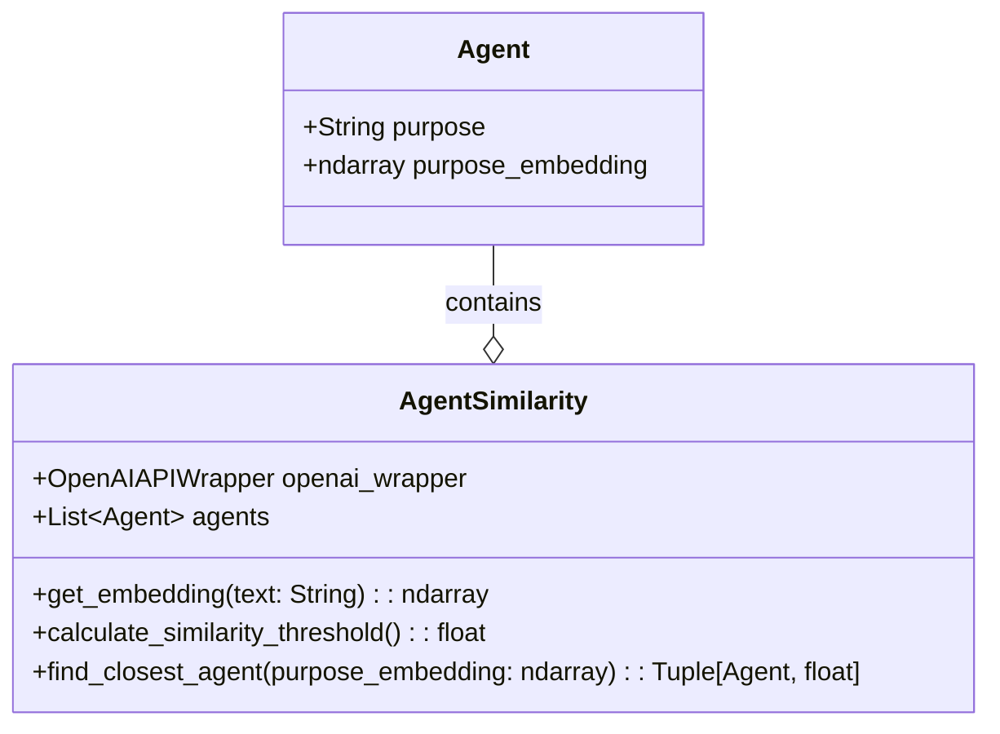
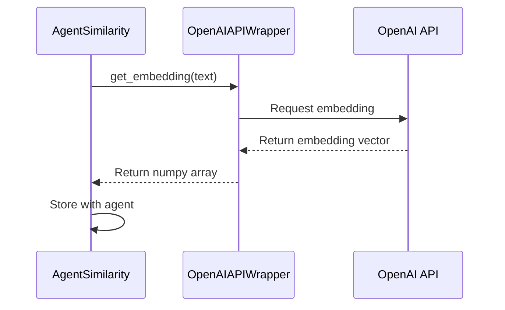
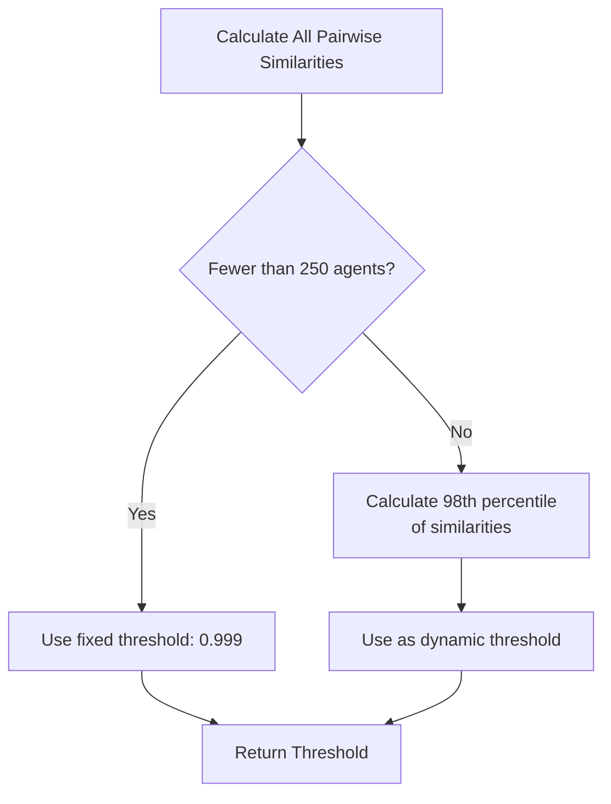
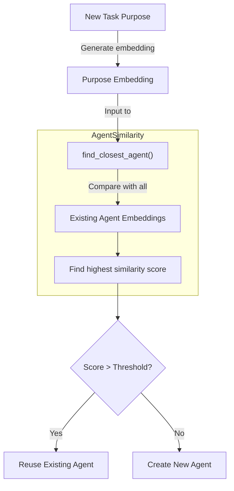
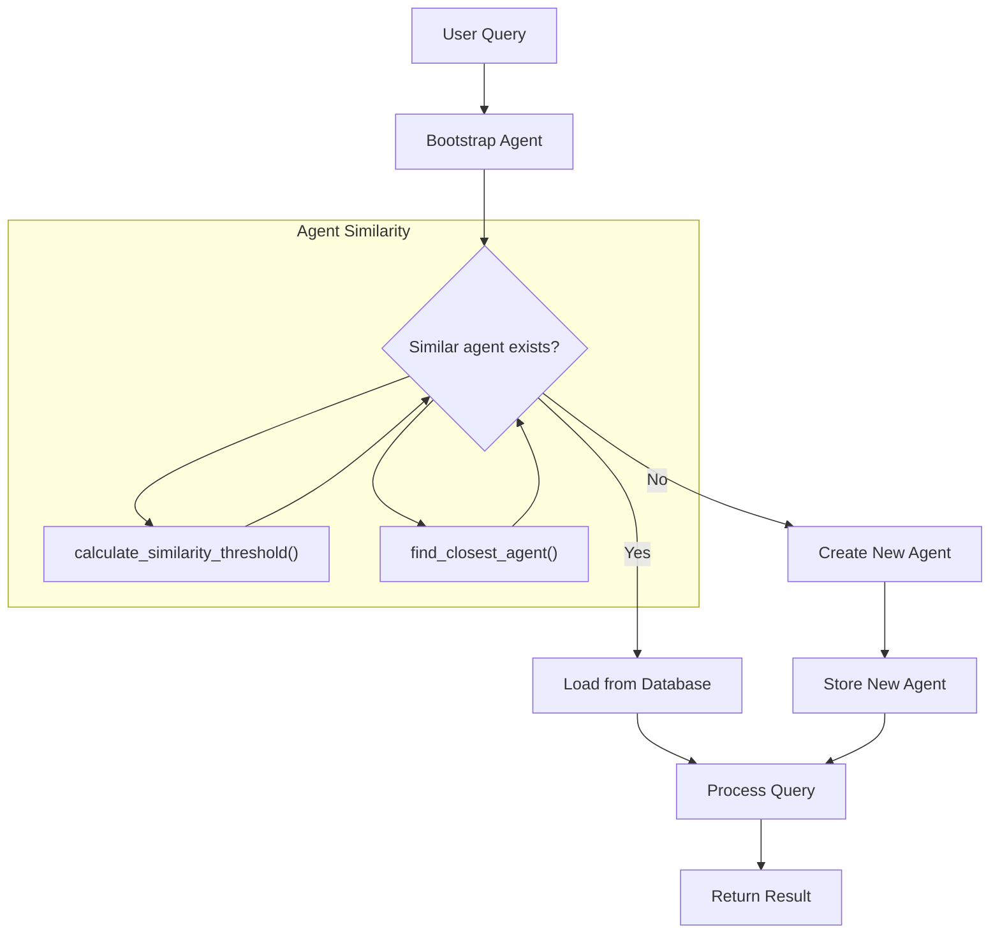

<!-- source: DeepWiki mcp.deepwiki.com · repo aymenfurter/microagents · page 3.2 Agent Similarity and Selection · fetched 2026-10-27 -->

# Agent Similarity and Selection

Relevant source files

The following files were used as context for generating this wiki page:

- [agents/agent_similarity.py](agents/agent_similarity.py)

## Purpose and Scope

This document describes the agent similarity and selection mechanisms in the Microagents system. It covers how agent purposes are converted to embeddings, how similarity between agents is calculated, and how the system decides whether to reuse existing agents or create new ones based on semantic similarity. For information about the overall agent lifecycle, see [Agent Lifecycle](#2.2), and for details on agent evaluation and evolution, see [Agent Evaluation and Evolution](#3.3).

## Agent Similarity System Overview

The Microagents system uses semantic similarity to determine when an existing agent can be reused for a new task. This approach avoids creating redundant agents and leverages previously successful agents for similar tasks.

Sources: [agents/agent_similarity.py:15-93]()

### Key Components

The agent similarity system consists of two primary classes:

1. `Agent` - A simple class representing an agent with:
   - `purpose`: A string describing the agent's purpose
   - `purpose_embedding`: A vector representation of the purpose

2. `AgentSimilarity` - A class that handles similarity calculations between agents:
   - Generates embeddings for agent purposes
   - Calculates similarity thresholds
   - Finds the most similar agent for a given purpose

Sources: [agents/agent_similarity.py:10-14](), [agents/agent_similarity.py:15-25]()

## Embedding Generation

The similarity calculation begins with converting agent purposes (text descriptions) into numeric vector representations (embeddings) using the OpenAI embedding API.

### Embedding Process

1. The system sends the agent's purpose text to the OpenAI API
2. The API returns a high-dimensional vector representing the semantic meaning of the text
3. These embeddings are stored with the agent for future comparisons

Sources: [agents/agent_similarity.py:26-42]()

## Similarity Calculation

The system calculates similarity between agent purposes using cosine similarity between their embedding vectors.

### Cosine Similarity

Cosine similarity measures the cosine of the angle between two vectors, providing a value between -1 and 1, where:
- 1 means exactly the same direction (identical meaning)
- 0 means orthogonal (unrelated meaning)
- -1 means opposite direction (opposite meaning)

In practice, embeddings for natural language usually produce similarity scores between 0 and 1.

### Similarity Threshold

The system dynamically calculates a similarity threshold to determine when purposes are similar enough to reuse an agent:

1. If fewer than 250 agents exist, a fixed threshold of 0.999 is used (requiring near-perfect similarity)
2. Otherwise, the threshold is calculated as the 98th percentile of all pairwise similarities between existing agents

This approach automatically adjusts the threshold based on the diversity of agents in the system.

Sources: [agents/agent_similarity.py:45-66]()

## Agent Selection Process

When the system needs an agent for a task, it follows this process:

1. Generate an embedding for the new purpose
2. Compare it with all existing agent purpose embeddings
3. Find the agent with the highest similarity score
4. Compare this score against the similarity threshold
5. If above threshold, reuse the existing agent; otherwise, create a new one

Sources: [agents/agent_similarity.py:69-93]()

## Finding the Closest Agent

The `find_closest_agent` method determines which existing agent is most similar to a given purpose:

1. It iterates through all existing agents
2. For each agent, it ensures a purpose embedding exists or generates one
3. It calculates the cosine similarity between the new purpose embedding and each agent's embedding
4. It tracks the agent with the highest similarity score
5. It returns both the closest agent and the similarity score

This function is the core of the agent selection process, enabling intelligent reuse of agents.

| Method | Purpose | Return Value |
|--------|---------|--------------|
| `get_embedding` | Converts text to vector representation | NumPy array with embedding values |
| `calculate_similarity_threshold` | Determines when agents are similar enough | Float value representing similarity threshold |
| `find_closest_agent` | Finds most similar existing agent | Tuple of (Agent, similarity_score) |

Sources: [agents/agent_similarity.py:69-93]()

## Integration with Agent Lifecycle

Agent similarity and selection is a crucial part of the overall agent lifecycle:

When the system reuses an agent based on similarity:

1. It avoids the cost of creating and training a new agent
2. It leverages prior knowledge and capabilities of the existing agent
3. It maintains a more focused agent population rather than creating highly similar agents

Over time, this results in a diverse but efficient collection of specialized agents.

Sources: [agents/agent_similarity.py:15-93]()

## Conclusion

The Agent Similarity and Selection system enables intelligent reuse of existing agents by:

1. Converting agent purposes to embeddings for semantic comparison
2. Calculating similarity between agent purposes using cosine similarity
3. Determining appropriate similarity thresholds dynamically
4. Making decisions about agent reuse based on similarity scores

This approach balances the benefits of specialization with efficient resource use, allowing the Microagents system to build a library of reusable, specialized agents over time.

---

