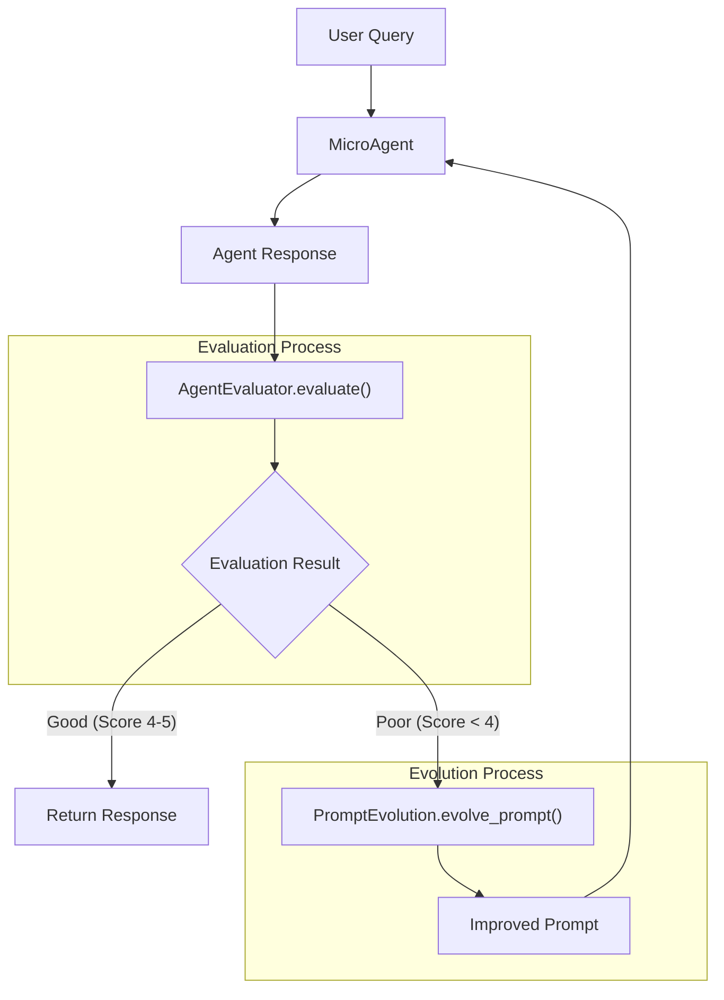
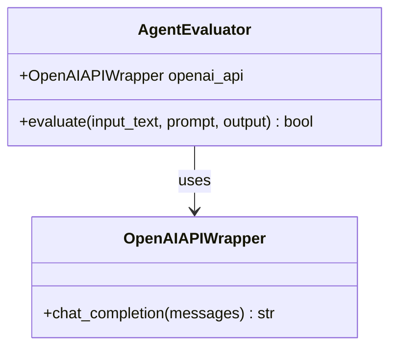
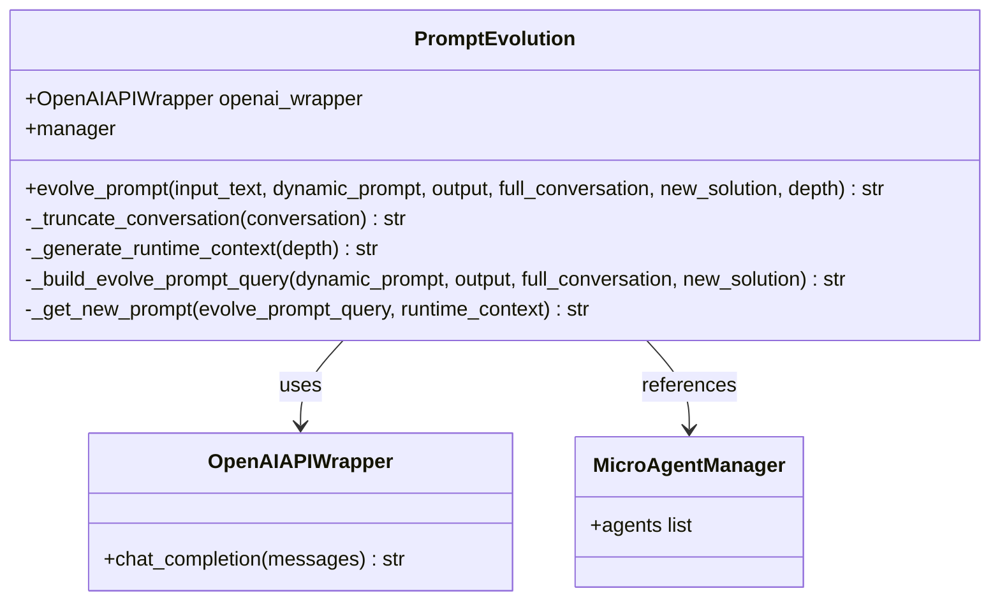
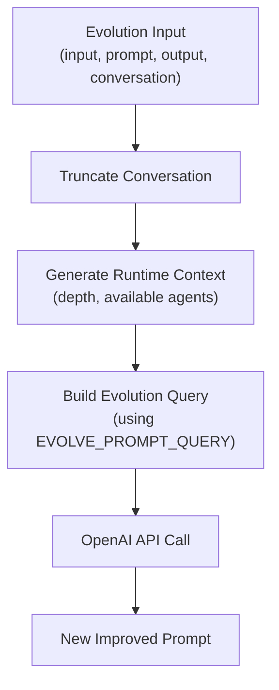
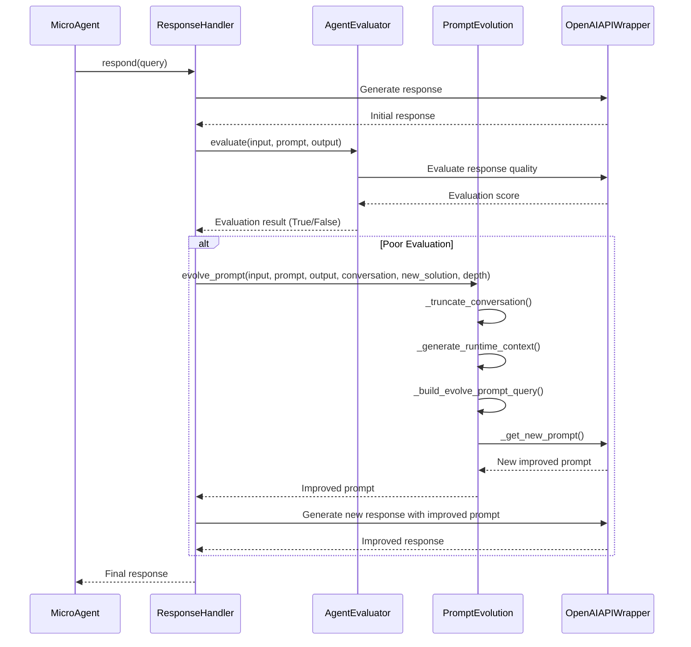

<!-- source: DeepWiki mcp.deepwiki.com · repo aymenfurter/microagents · page 3.3 Agent Evaluation and Evolution · fetched 2026-10-27 -->

# Agent Evaluation and Evolution

<details>
<summary>Relevant source files</summary>

The following files were used as context for generating this wiki page:

- [agents/agent_evaluation.py](agents/agent_evaluation.py)
- [prompt_management/prompt_evolution.py](prompt_management/prompt_evolution.py)

</details>


## Purpose and Scope

This document details the agent evaluation and evolution mechanisms within the microagents system. It explains how agent responses are evaluated for quality and how prompts evolve over time to improve agent performance. This represents a critical self-improvement capability of the system, allowing agents to adapt and enhance their effectiveness based on feedback.

For information about how agents are initially selected based on similarity measures, see [Agent Similarity and Selection](#3.2).

## Overview of the Evaluation and Evolution Process

The microagents system implements a feedback loop where agent responses are evaluated for quality, and when responses don't meet expectations, the system automatically improves the prompts used to generate them.



Sources: [agents/agent_evaluation.py:7-30](), [prompt_management/prompt_evolution.py:7-62]()

## Agent Evaluation System

The evaluation system assesses the quality of agent responses using OpenAI's language models in a scoring capacity.

### AgentEvaluator Component

The `AgentEvaluator` class is responsible for determining the quality of an agent's response by using another LLM call to judge the output.



Sources: [agents/agent_evaluation.py:7-30]()

### Evaluation Process

The evaluation process takes three key inputs:
- The original user input
- The prompt used to generate the response
- The agent's output response

Using these inputs, the evaluator formulates a meta-prompt (defined in `AGENT_EVALUATION_PROMPT`) that instructs another instance of the language model to score the response on a scale of 1-5. Responses receiving a score of 4 or 5 are considered successful (returning `True`), while lower scores indicate the need for improvement (returning `False`).

The evaluation meta-prompt instructs the model to consider factors such as:
- Accuracy and correctness
- Completeness in addressing the request
- Clarity and coherence
- Relevance to the original query

```
Input → AgentEvaluator.evaluate() → Meta-Prompt with AGENT_EVALUATION_PROMPT → OpenAI API → Score → True/False
```

Sources: [agents/agent_evaluation.py:15-30]()

## Prompt Evolution System

When agent responses are deemed inadequate by the evaluation system, the prompt evolution system generates improved prompts to produce better responses.

### PromptEvolution Component

The `PromptEvolution` class implements mechanisms to refine prompts based on the results of previous interactions.



Sources: [prompt_management/prompt_evolution.py:7-62]()

### Evolution Process

The prompt evolution process follows these key steps:

1. **Input Processing**: The system takes the original input, current prompt, output, and conversation history.

2. **Conversation Truncation**: Long conversations are truncated to manage token limits.
   ```python
   # If conversation > 1000 chars, keep first 200 chars and last 1000 chars
   return conversation[:200] + "..." + conversation[-1000:]
   ```

3. **Runtime Context Generation**: The system creates context information about available agents and their depths.

4. **Evolution Query Building**: A meta-prompt is constructed using the `EVOLVE_PROMPT_QUERY` template.

5. **New Prompt Generation**: The OpenAI API is called to generate an improved prompt.

The evolution process is designed to analyze failures and adjust the prompt to address the specific issues that led to poor performance.



Sources: [prompt_management/prompt_evolution.py:13-62]()

## Integration of Evaluation and Evolution

The evaluation and evolution components work together in a feedback loop that enables continuous improvement of agent responses.

### Feedback Loop Architecture



Sources: [agents/agent_evaluation.py:7-30](), [prompt_management/prompt_evolution.py:7-62]()

### Evolution Context Generation

An important aspect of prompt evolution is gathering runtime context about the agent environment. The `_generate_runtime_context` method collects information about:

1. The current depth of the agent in the hierarchy
2. Other available agents in the system and their respective depths

This context allows the evolution system to create prompts that are aware of the full ecosystem of agents, enabling more effective delegation and collaboration patterns.

```python
# Generate context showing current depth and available agents
available_agents = [agent for agent in self.manager.agents if agent.purpose != "General"]
agents_info = ', '.join([f"{agent.purpose} (depth={agent.depth})" for agent in available_agents])
return f"Current Agent Depth: {depth}. Available agents: {agents_info}."
```

Sources: [prompt_management/prompt_evolution.py:46-50]()

## Key Implementation Details

### Evaluation Criteria

The `AgentEvaluator` uses a simple threshold mechanism for determining response quality:

```python
# Return True for high scores (4-5), False otherwise
if "5" in response or "4" in response:
    return True
else:
    return False
```

This binary evaluation model allows the system to make clear decisions about whether prompt evolution is necessary.

Sources: [agents/agent_evaluation.py:24-27]()

### Error Handling

Both the evaluation and evolution systems include error handling to ensure system stability:

1. **Evaluation Errors**: Exceptions are logged and re-raised to allow higher-level components to handle them.
2. **Evolution Errors**: If prompt evolution fails, the system falls back to using the original prompt.

```python
try:
    new_prompt = self._get_new_prompt(evolve_prompt_query, runtime_context)
except Exception as e:
    logger.error(f"Error evolving prompt: {e}")
    new_prompt = dynamic_prompt
```

This ensures that temporary failures in the evolution system don't block the overall agent operation.

Sources: [prompt_management/prompt_evolution.py:32-36]()

## Summary

The Agent Evaluation and Evolution subsystem provides the microagents system with a self-improvement capability. By continuously evaluating agent responses and evolving prompts based on performance feedback, the system can adapt to challenges and improve over time.

This feedback loop architecture is a key differentiator, allowing the system to incrementally refine its problem-solving approaches through an AI-driven meta-optimization process.

---

