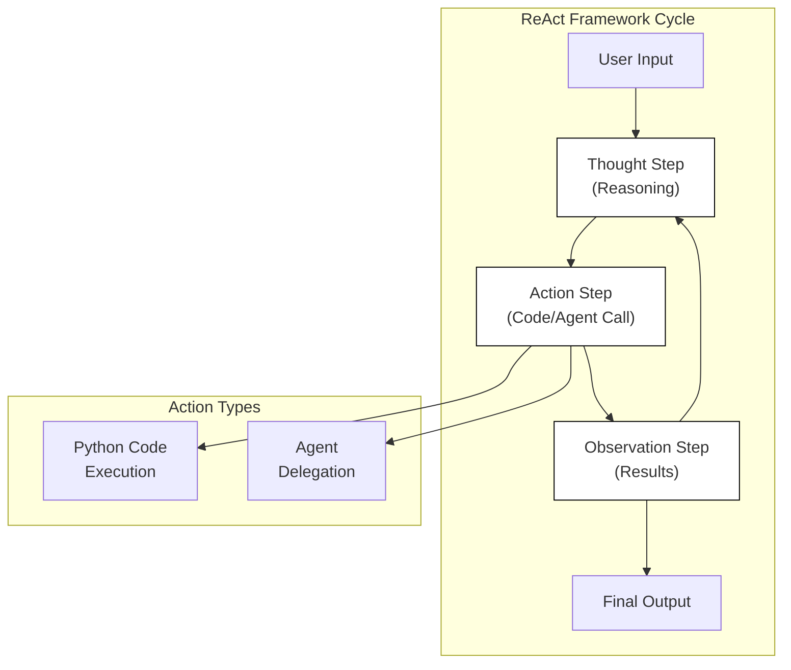
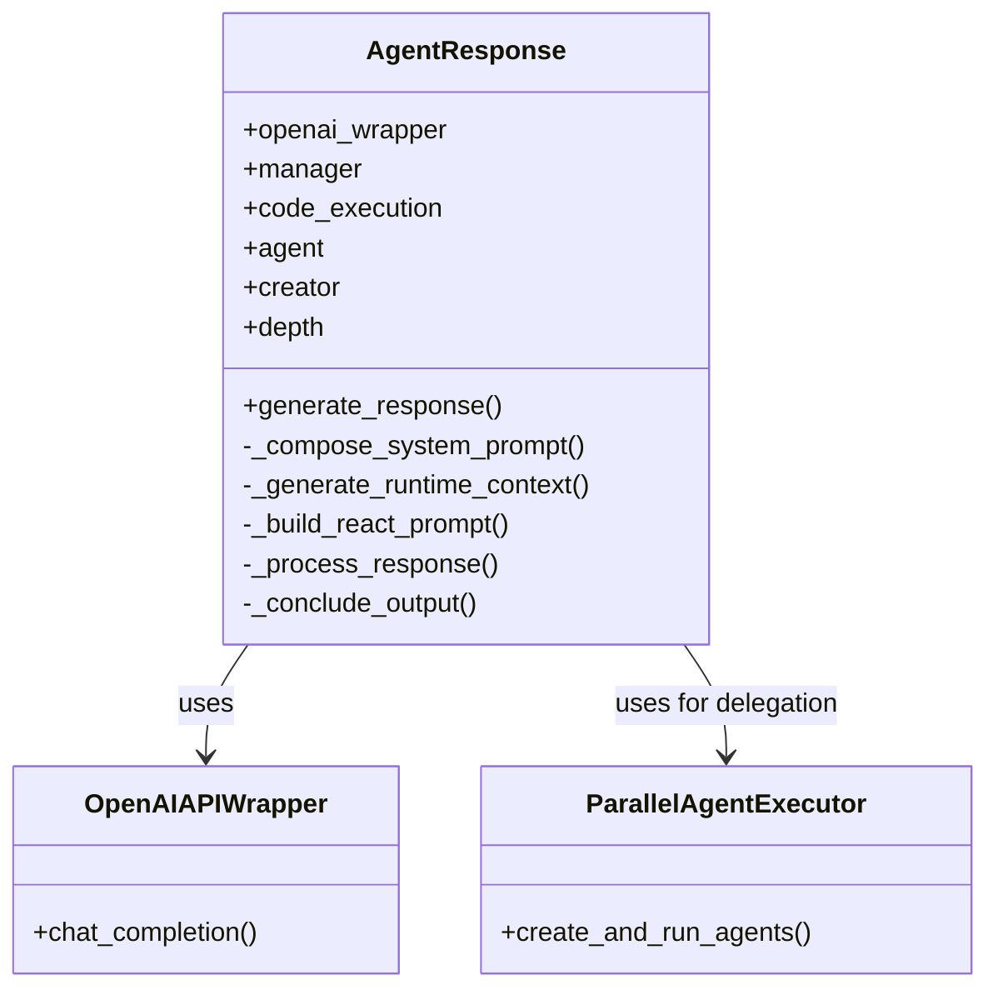
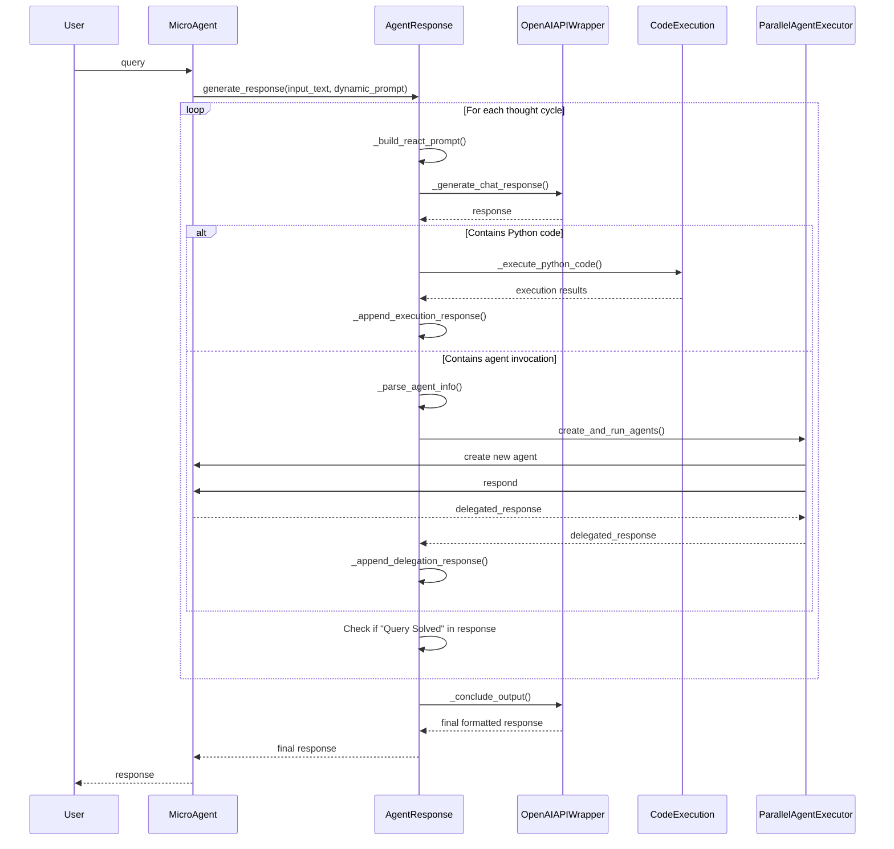
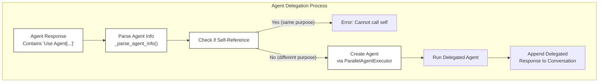
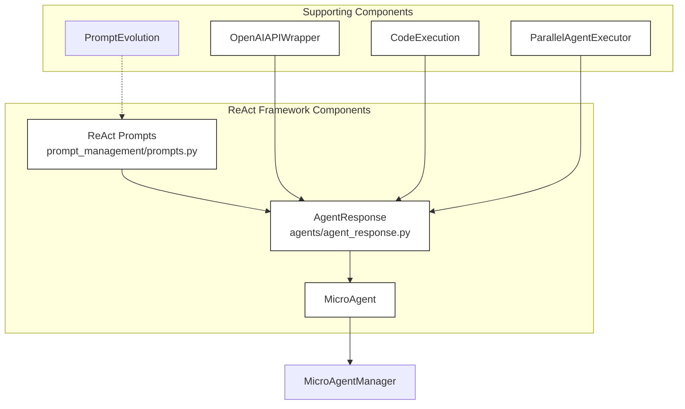

<!-- source: DeepWiki mcp.deepwiki.com · repo aymenfurter/microagents · page 4.2 ReAct Framework Integration · fetched 2026-10-27 -->

# ReAct Framework Integration

<details>
<summary>Relevant source files</summary>

The following files were used as context for generating this wiki page:

- [agents/agent_response.py](agents/agent_response.py)
- [prompt_management/prompts.py](prompt_management/prompts.py)
- [tests/test_agent_similarity.py](tests/test_agent_similarity.py)

</details>


This document details how the Microagents system integrates the ReAct (Reasoning and Acting) framework to enable structured, effective problem-solving by AI agents. ReAct is a prompting framework that guides language models through interleaved reasoning and action steps to decompose complex tasks into manageable subtasks.

For information about the broader prompt management system, see [Prompt Management System](#4) and [Prompt Templates](#4.1).

## Overview of ReAct in Microagents

The ReAct framework structures agent interactions through a formal sequence of thought, action, and observation steps. This allows agents to:

1. **Decompose tasks** into smaller, manageable pieces
2. **Reason explicitly** about how to approach problems
3. **Execute actions** including code execution and agent delegation
4. **Observe results** and incorporate them into subsequent reasoning



Sources: [prompt_management/prompts.py:41-47](), [agents/agent_response.py:26-46]()

## ReAct Prompt Templates

The Microagents system implements ReAct through carefully designed prompt templates that guide agent behavior:

| Template | Purpose | Used By |
|----------|---------|---------|
| `REACT_STEP_PROMPT` | Guides thinking for regular agents, emphasizing task decomposition | Regular agents |
| `REACT_STEP_PROMPT_PRIME` | Similar to above but for the Bootstrap Agent | Prime/Bootstrap agent |
| `REACT_STEP_POST` | Format for specifying actions after reasoning | Regular agents |
| `REACT_STEP_POST_PRIME` | Action format specifically for Bootstrap Agent | Prime/Bootstrap agent |
| `REACT_PLAN_PROMPT` | Encourages planning before action | All agents |
| `REACT_SYSTEM_PROMPT` | Extracts final concise answer from the conversation | Final output processing |

These templates work together to create a structured reasoning and action flow that agents follow when responding to user queries.

Sources: [prompt_management/prompts.py:41-47]()

## Implementation Architecture

The ReAct framework is primarily implemented in the `AgentResponse` class, which handles the generation of responses using the ReAct pattern:



Sources: [agents/agent_response.py:10-141]()

## ReAct Processing Flow

The following sequence diagram illustrates how the ReAct framework processes a user query through multiple thought-action-observation cycles:



Sources: [agents/agent_response.py:26-46](), [agents/agent_response.py:76-127]()

## Response Generation Process

The heart of the ReAct implementation is the `generate_response` method in the `AgentResponse` class, which follows these steps:

1. **Setup**: 
   - Generate runtime context including available agents
   - Compose the system prompt 
   - Initialize counters and accumulators

2. **Iterative ReAct Cycle**:
   - Build a ReAct prompt with thought and action templates
   - Generate a response from the LLM
   - Process the response:
     - If it contains Python code, execute it
     - If it contains agent invocation, delegate to another agent
   - Append results to the conversation
   - Continue until "Query Solved" is found or max iterations reached

3. **Conclusion**:
   - Format the final output using the `REACT_SYSTEM_PROMPT`

Sources: [agents/agent_response.py:26-46]()

## Delegation and Agent Invocation

A key feature of the ReAct implementation is the ability to delegate tasks to other agents using a structured syntax:

```
Use Agent[Purpose:Parameter]
```

When the system detects this pattern in an agent's response, it:

1. Parses the agent name/purpose and input parameters
2. Creates a new agent (or uses an existing one) for the specified purpose
3. Delegates the task to that agent
4. Incorporates the delegated agent's response into the original conversation

This enables complex, multi-step problem solving through agent composition.



Sources: [agents/agent_response.py:106-127](), [prompt_management/prompts.py:62-83]()

## Code Execution in ReAct

The ReAct framework also handles code execution when agents generate Python code enclosed in triple backticks. The process works as follows:

1. System detects Python code blocks in agent responses
2. Code is extracted and executed in a sandboxed environment
3. Execution results are captured and appended to the conversation
4. Subsequent reasoning takes execution results into account

This allows agents to perform computations, API calls, data processing, and other programmatic tasks as part of their reasoning process.

Sources: [agents/agent_response.py:95-104]()

## Prime Agent vs. Regular Agents

The ReAct framework implementation differentiates between the prime/bootstrap agent and regular agents:

| Aspect | Prime Agent | Regular Agents |
|--------|------------|----------------|
| System Prompt | `STATIC_PRE_PROMPT_PRIME` | `STATIC_PRE_PROMPT` |
| Step Prompt | `REACT_STEP_PROMPT_PRIME` | `REACT_STEP_PROMPT` |
| Action Format | `REACT_STEP_POST_PRIME` | `REACT_STEP_POST` |
| Capabilities | Can only delegate to other agents | Can execute code and delegate to agents |
| Purpose | Task decomposition and orchestration | Specialized task execution |

This distinction ensures that the prime agent focuses on high-level task orchestration while delegating specific tasks to specialized agents.

Sources: [agents/agent_response.py:48-66](), [prompt_management/prompts.py:38-47]()

## Final Output Generation

After the ReAct cycles are complete, the system generates a final, formatted response using the `_conclude_output` method, which:

1. Takes the full conversation history
2. Prepends it with agent information and the original query
3. Sends it to the LLM with the `REACT_SYSTEM_PROMPT`
4. Returns a concise, formatted answer that captures the key results

This ensures that users receive a clean, summarized response rather than the full thought process.

Sources: [agents/agent_response.py:129-141]()

## Integration with Other System Components

The ReAct framework integrates with several other components of the Microagents system:



Sources: [agents/agent_response.py:1-18](), [prompt_management/prompts.py:3-6]()

## Conclusion

The ReAct framework integration provides the Microagents system with a structured approach to complex problem solving. By formalizing the thought-action-observation cycle and enabling task decomposition through agent delegation, the system can tackle complex, multi-step tasks that would be difficult for a single monolithic agent.

---

