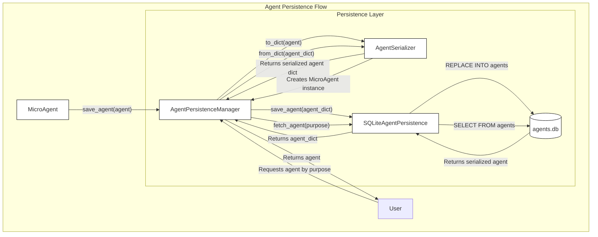
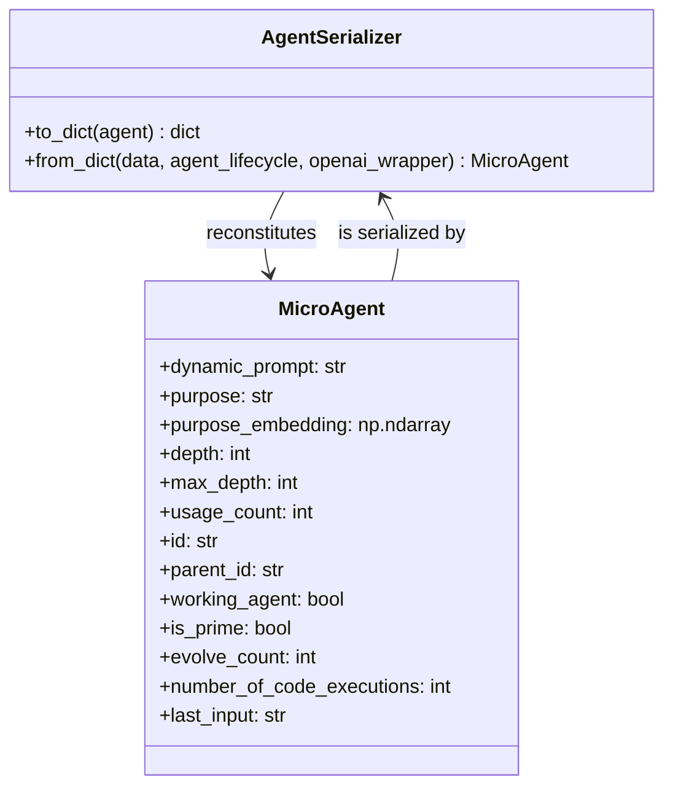
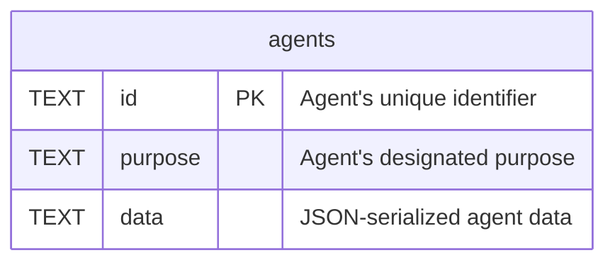
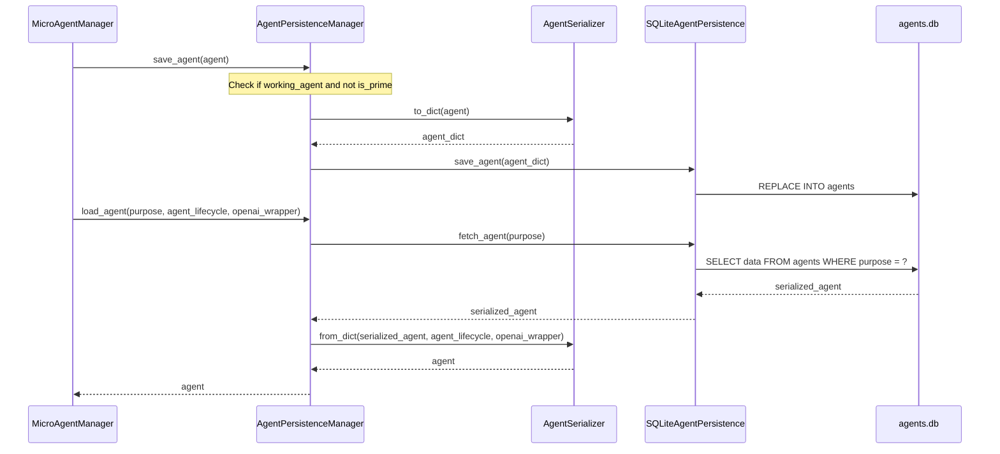
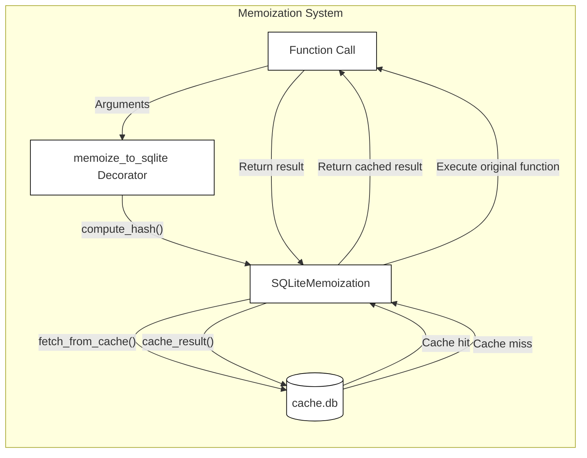

<!-- source: DeepWiki mcp.deepwiki.com · repo aymenfurter/microagents · page 5 Data Persistence · fetched 2026-10-27 -->

# Data Persistence

<details>
<summary>Relevant source files</summary>

The following files were used as context for generating this wiki page:

- [.github/workflows/python-ci.yml](.github/workflows/python-ci.yml)
- [.vscode/launch.json](.vscode/launch.json)
- [agents/agent_persistence_manager.py](agents/agent_persistence_manager.py)
- [agents/agent_serializer.py](agents/agent_serializer.py)
- [integrations/agent_persistence.py](integrations/agent_persistence.py)
- [integrations/memoize.py](integrations/memoize.py)
- [integrations/sqlite_agent_persistence.py](integrations/sqlite_agent_persistence.py)
- [tests/test_agent_serializer.py](tests/test_agent_serializer.py)
- [tests/test_sqlite_agent_persistance.py](tests/test_sqlite_agent_persistance.py)
- [tests/test_sqlite_memoization.py](tests/test_sqlite_memoization.py)

</details>


This document describes how the microagents system persistently stores and retrieves agent data. It covers the core persistence architecture, serialization mechanisms, SQLite storage implementation, and related caching systems. For information about OpenAI/Azure integration, see [OpenAI/Azure Integration](#5.1).

## Persistence Architecture Overview

The microagents system uses a SQLite-based persistence layer to store agent data between sessions. This enables agents to be reused across system restarts and allows successful agents to be preserved for future tasks.



Sources:
- [agents/agent_persistence_manager.py:6-44]()
- [integrations/sqlite_agent_persistence.py:5-57]()
- [agents/agent_serializer.py:5-58]()

The persistence architecture consists of three main components:

1. **AgentPersistenceManager**: The high-level manager that coordinates persistence operations.
2. **AgentSerializer**: Converts MicroAgent objects to/from serializable dictionaries.
3. **SQLiteAgentPersistence**: Implements the database operations using SQLite.

This layered approach separates concerns between serialization logic and storage mechanisms, allowing for potential alternative storage backends in the future.

## Agent Serialization and Deserialization

Agent serialization is the process of converting MicroAgent objects into data structures that can be persisted to storage. The `AgentSerializer` class handles this conversion.



Sources:
- [agents/agent_serializer.py:5-58]()
- [tests/test_agent_serializer.py:1-66]()

### Serialized Agent Fields

The following fields are serialized for each agent:

| Field | Type | Description |
|-------|------|-------------|
| dynamic_prompt | string | The agent's current prompt template |
| purpose | string | The agent's designated purpose |
| purpose_embedding | array | Vector embedding of the agent's purpose |
| depth | integer | The agent's depth in the agent hierarchy |
| max_depth | integer | Maximum allowed depth for child agents |
| usage_count | integer | Number of times the agent has been used |
| id | string | Unique identifier for the agent |
| parent_id | string | ID of the parent agent |
| working_agent | boolean | Flag indicating if agent is operational |
| is_prime | boolean | Flag indicating if agent is a primary agent |
| evolve_count | integer | Number of prompt evolution iterations |
| number_of_code_executions | integer | Count of code executions performed |
| last_input | string | Most recent input provided to the agent |

### Serialization Process

During serialization:
1. The `to_dict()` method extracts all relevant fields from a MicroAgent
2. NumPy arrays (e.g., purpose_embedding) are converted to Python lists
3. The resulting dictionary can be stored in JSON format

During deserialization:
1. The `from_dict()` method constructs a new MicroAgent instance
2. Python lists are converted back to NumPy arrays where needed
3. Additional fields are set through direct attribute assignment

## SQLite Storage Implementation

The system uses SQLite for persistent storage of agent data. This provides a lightweight, file-based database that requires no separate server process.



Sources:
- [integrations/sqlite_agent_persistence.py:5-57]()
- [tests/test_sqlite_agent_persistance.py:1-62]()

### Database Schema

The SQLite database (`agents.db`) contains a single table called `agents` with the following schema:

```
CREATE TABLE IF NOT EXISTS agents (
    id TEXT PRIMARY KEY,
    purpose TEXT,
    data TEXT
)
```

Where:
- `id`: The unique identifier for the agent (primary key)
- `purpose`: The agent's purpose, used for retrieval
- `data`: JSON string containing all serialized agent data

### Key Database Operations

The `SQLiteAgentPersistence` class provides the following key operations:

- **Save Agent**: Stores a serialized agent in the database, replacing any existing entry with the same ID.
- **Fetch Agent**: Retrieves an agent by its purpose, deserializing the stored JSON data.
- **Load All Purposes**: Returns a list of all agent purposes stored in the database.
- **Remove Agent**: Deletes an agent from the database by its ID.

### Persistence Manager

The `AgentPersistenceManager` class serves as a facade for the persistence system, coordinating between the serialization and storage components:



Sources:
- [agents/agent_persistence_manager.py:6-44]()

The persistence manager only saves agents that meet certain criteria:
- The agent must be a working agent (working_agent = True)
- The agent must not be a prime agent (is_prime = False)

This ensures that only useful, successful agents are persisted for future reuse.

## Memoization System

In addition to agent persistence, the system includes a memoization feature that caches function call results in a SQLite database. This is primarily used to improve performance by avoiding redundant API calls or expensive computations.



Sources:
- [integrations/memoize.py:1-73]()
- [tests/test_sqlite_memoization.py:1-56]()

### Memoization Components

The memoization system consists of:

1. **memoize_to_sqlite decorator**: A function decorator that wraps any function to cache its results.
2. **SQLiteMemoization class**: Handles the cache operations including storage and retrieval.
3. **Cache database**: A SQLite database (typically `cache.db`) that stores the cached results.

### Cache Database Schema

The memoization cache uses a simple schema:

```
CREATE TABLE IF NOT EXISTS cache (
    hash TEXT PRIMARY KEY,
    result TEXT
)
```

Where:
- `hash`: A SHA-256 hash of the function name and arguments
- `result`: The JSON-serialized function result

### Memoization Process

1. When a memoized function is called, the system computes a hash of the function name and its arguments.
2. The system checks if this hash exists in the cache.
3. If found (cache hit), the stored result is deserialized and returned.
4. If not found (cache miss), the original function is executed, and its result is stored in the cache before being returned.

This memoization can significantly improve performance for deterministic functions, especially expensive API calls with identical parameters.

## Usage Patterns

### Saving and Loading Agents

The typical pattern for agent persistence is:

1. Create and use agents through the MicroAgentManager
2. Successful agents are automatically saved (if they meet criteria)
3. When requesting an agent with the same purpose, the system checks for a persisted version first

```
# Simplified pseudocode for agent persistence workflow:
agent = manager.get_or_create_agent(purpose)
response = agent.respond(query)
# Agent is automatically saved after successful response
```

### Using Memoization

The memoization system can be used to cache any function:

```python
# Example of using the memoization decorator
@memoize_to_sqlite('function_name', 'cache.db')
def expensive_function(arg1, arg2):
    # Function implementation
    return result
```

This is particularly useful for caching API calls to external services like OpenAI, reducing costs and improving response times.

Sources:
- [integrations/memoize.py:8-19]()

---

