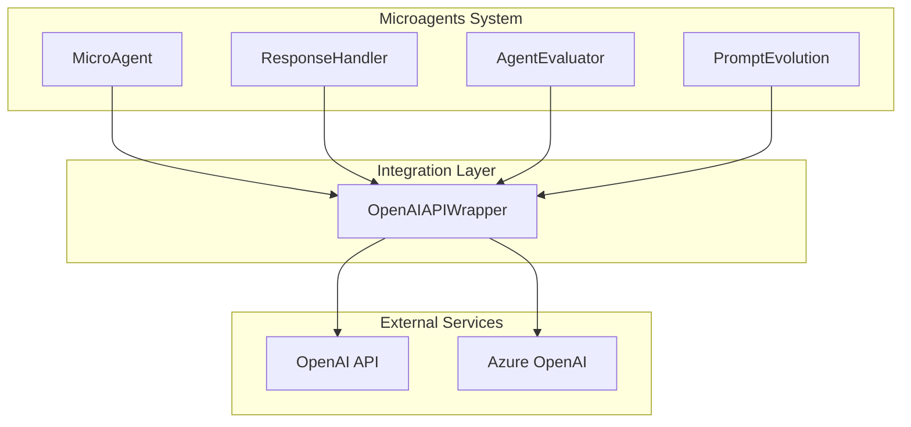
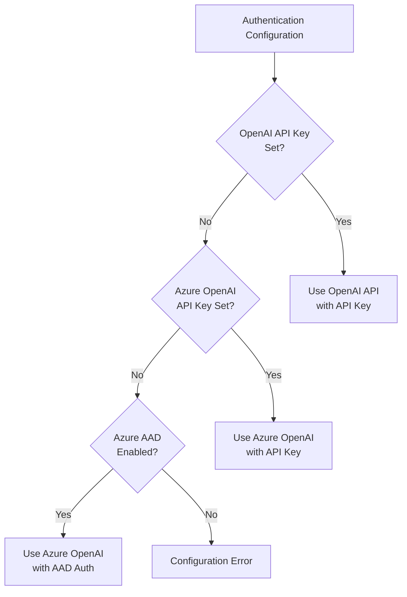
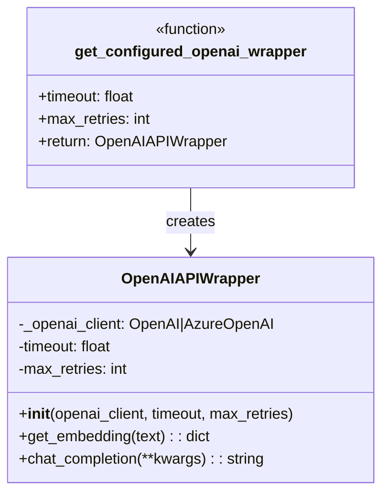
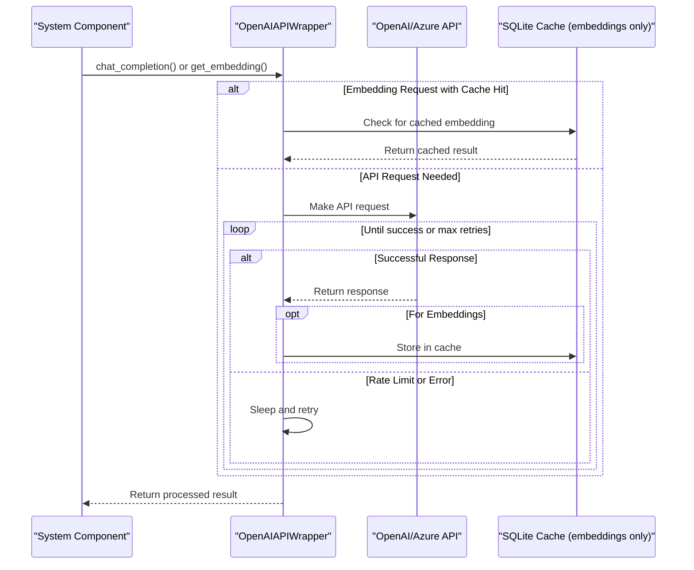
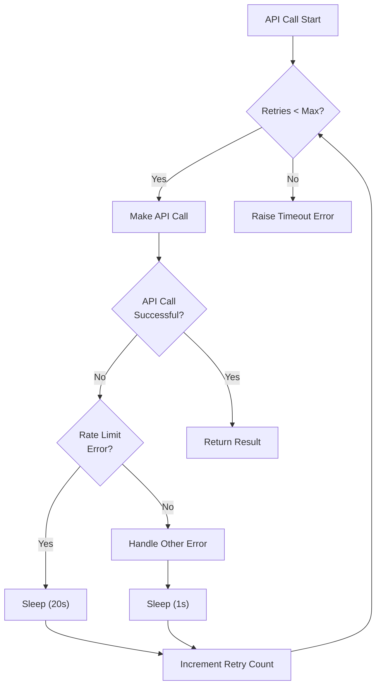

<!-- source: DeepWiki mcp.deepwiki.com · repo aymenfurter/microagents · page 5.1 OpenAI/Azure Integration · fetched 2026-10-27 -->

# OpenAI/Azure Integration

Relevant source files

The following files were used as context for generating this wiki page:

- [README.md](README.md)
- [integrations/openaiwrapper.py](integrations/openaiwrapper.py)

This page details the integration of the Microagents system with OpenAI and Azure OpenAI services. It covers the configuration options, authentication methods, and the wrapper implementation that provides a unified interface for accessing AI capabilities.

## Overview

The Microagents framework integrates with OpenAI's API services through a dedicated wrapper that supports both direct OpenAI API access and Azure OpenAI Services. This integration enables all AI capabilities within the system, including agent response generation, prompt evolution, and similarity comparisons.

Sources: [integrations/openaiwrapper.py:1-198](), [README.md:25-71]()

## Configuration

The integration can be configured through environment variables, allowing users to choose between direct OpenAI API access or Azure OpenAI Services.

### OpenAI Configuration

For direct OpenAI API access, the following environment variables are supported:

| Environment Variable | Description | Default |
|----------------------|-------------|---------|
| OPENAI_KEY | API key for OpenAI | Required |
| OPENAI_BASE_URL | Custom base URL for OpenAI API | Optional |
| OPENAI_API_BASE | Legacy variable for base URL | Optional |
| OPENAI_ORG_ID | Organization ID for OpenAI | Optional |
| OPENAI_MODEL | Model to use for completions | gpt-4-1106-preview |
| OPENAI_EMBEDDING | Model to use for embeddings | text-embedding-ada-002 |

### Azure OpenAI Configuration

For Azure OpenAI Services, the following environment variables are supported:

| Environment Variable | Description | Default |
|----------------------|-------------|---------|
| AZURE_OPENAI_API_KEY | API key for Azure OpenAI | Required (unless using AAD) |
| AZURE_OPENAI_ENDPOINT | Endpoint URL for Azure OpenAI | Required |
| AZURE_OPENAI_API_VERSION | API version for Azure OpenAI | 2024-03-01-preview |
| AZURE_OPENAI_USE_AAD | Enable Azure Active Directory auth | false |
| AZURE_OPENAI_AD_TOKEN | Explicit AAD token | Optional |
| AZURE_CLIENT_ID | Client ID for managed identity | Optional |
| OPENAI_MODEL | Deployment name for completions | gpt-4-1106-preview |
| OPENAI_EMBEDDING | Deployment name for embeddings | text-embedding-ada-002 |

Sources: [integrations/openaiwrapper.py:13-14](), [integrations/openaiwrapper.py:23-34](), [README.md:52-71]()

## Authentication Flow

The system supports three authentication methods:

1. OpenAI API Key authentication
2. Azure OpenAI API Key authentication
3. Azure OpenAI with Azure Active Directory (AAD/Entra ID)

Sources: [integrations/openaiwrapper.py:48-96](), [README.md:52-71]()

## OpenAIWrapper Architecture

The `OpenAIAPIWrapper` class provides a unified interface to OpenAI APIs, abstracting away the differences between OpenAI and Azure OpenAI services. It's instantiated via the `get_configured_openai_wrapper` factory function, which handles the authentication logic.

Sources: [integrations/openaiwrapper.py:16-96](), [integrations/openaiwrapper.py:99-123]()

## API Functions

The `OpenAIAPIWrapper` provides two main API functions:

### Embedding Generation

The `get_embedding` method retrieves embeddings for text using OpenAI's embedding models:

- Uses the configured embedding model (defaults to `text-embedding-ada-002`)
- Results are memoized to SQLite for improved performance
- Implements retry logic and timeout handling
- Returns a structured response with embedding data and token usage

### Chat Completion

The `chat_completion` method generates text completions using OpenAI's chat models:

- Uses the configured model (defaults to `gpt-4-1106-preview`)
- Accepts all standard parameters for OpenAI's chat completions API
- Implements retry logic and timeout handling
- Returns the text content from the response, with whitespace trimmed

Sources: [integrations/openaiwrapper.py:124-198]()

## Error Handling and Resilience

The OpenAI integration includes several resilience features:

1. **Configurable Timeouts**: Each API call has a configurable timeout (default: 10 seconds)
2. **Automatic Retries**: Failed API calls are retried automatically (default: up to 5 times)
3. **Rate Limit Handling**: The system detects rate limit errors and implements a backoff strategy
4. **Memoization**: Embedding results are cached to avoid redundant API calls

These features help ensure the system remains operational even when facing transient API issues.

Sources: [integrations/openaiwrapper.py:125-198]()

## Integration Usage in Microagents

The OpenAI integration is used extensively throughout the Microagents system:

1. **Agent Response Generation**: Agents use chat completion to generate responses to user queries
2. **Embedding Computation**: Used for calculating agent similarity for retrieval and reuse
3. **Prompt Evolution**: Used to improve prompts when agent responses are inadequate
4. **Agent Evaluation**: Used to evaluate agent responses for quality

The integration serves as the foundation for all AI capabilities in the system.

Sources: [integrations/openaiwrapper.py:1-198](), [README.md:28-32]()

---

