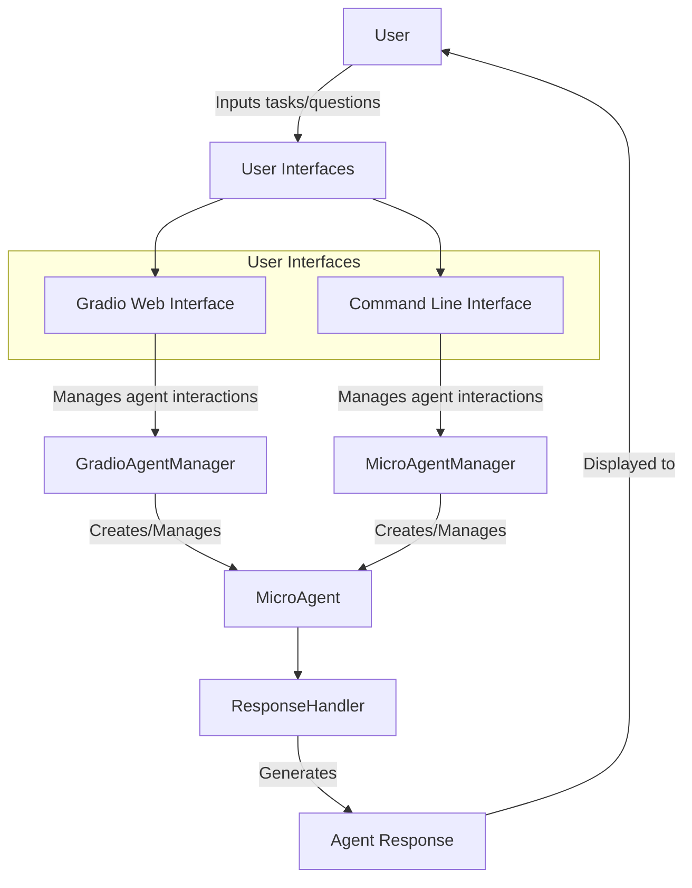
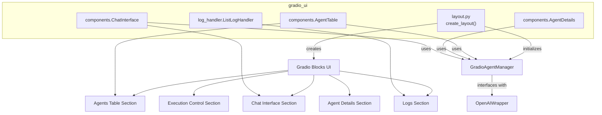
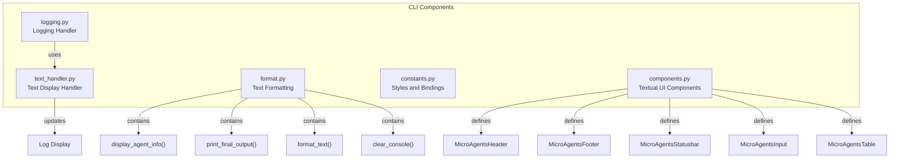
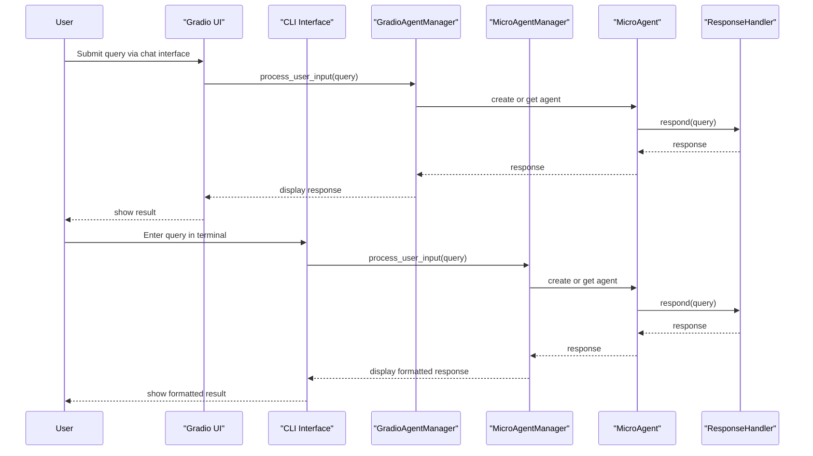

<!-- source: DeepWiki mcp.deepwiki.com · repo aymenfurter/microagents · page 6 User Interfaces · fetched 2026-10-27 -->

# User Interfaces

<details>
<summary>Relevant source files</summary>

The following files were used as context for generating this wiki page:

- [.devcontainer/devcontainer.json](.devcontainer/devcontainer.json)
- [agents/response_handler.py](agents/response_handler.py)
- [gradio_ui/layout.py](gradio_ui/layout.py)
- [tests/test_agent_lifecycle.py](tests/test_agent_lifecycle.py)
- [ui/components.py](ui/components.py)
- [ui/constants.py](ui/constants.py)
- [ui/format.py](ui/format.py)
- [ui/logging.py](ui/logging.py)
- [ui/text_handler.py](ui/text_handler.py)

</details>


This page documents the user interfaces available in the Microagents system. The system provides two distinct interfaces for interacting with the microagents: a web-based interface built with Gradio and a command-line interface (CLI). For information about the underlying agent system these interfaces connect to, see [System Architecture](#2).

## Interface Architecture Overview

The Microagents system provides two user interface options that serve as the entry point for user interaction with the underlying agent system:



Sources: [gradio_ui/layout.py:9-74](), [ui/format.py:11-94]()

## Gradio Web Interface

The Gradio web interface provides a browser-based UI for interacting with the microagents system. It is implemented using the Gradio library, which enables the creation of web interfaces for machine learning models and AI systems.

### Components and Structure

The Gradio interface consists of several key components:



Sources: [gradio_ui/layout.py:9-24](), [gradio_ui/layout.py:40-74]()

### Layout and Interface Elements

The Gradio interface is organized into several sections:

1. **Header Section**: Contains the title "Microagents"
2. **Agent Table**: Displays information about all available agents
3. **Chat Interface**: Allows users to interact with the agents by submitting queries
4. **Logs Section**: Shows system logs in real-time
5. **Execution Control**: Provides a button to cancel ongoing agent executions
6. **Agent Details**: Shows detailed information about a selected agent

The layout is created by the `create_layout()` function in `layout.py`, which initializes all components and arranges them in a structured layout using Gradio's `Blocks` API.

Sources: [gradio_ui/layout.py:40-74]()

### Key Functions

| Function | Purpose |
|----------|---------|
| `create_layout()` | Creates and returns the complete Gradio interface layout |
| `refresh_agent_list()` | Updates the agent dropdown with the current list of agents |
| `cancel_execution()` | Stops all running agents when the cancel button is pressed |
| `fetch_logs()` | Retrieves current logs for display in the UI |

Sources: [gradio_ui/layout.py:9-35]()

## Command Line Interface (CLI)

The CLI provides a text-based interface for interacting with the microagents system in terminal environments. It uses the Textual library for creating rich terminal user interfaces along with colorama for colored text output.

### Components and Structure



Sources: [ui/components.py:1-33](), [ui/format.py:7-94](), [ui/constants.py:1-32](), [ui/logging.py:1-14](), [ui/text_handler.py:1-14]()

### Display Functions

The CLI interface provides several functions for displaying information about agents and formatting text output:

1. **Agent Information Display**: The `display_agent_info()` function continuously displays comprehensive information about the agents in a tabular format, including their status, statistics, and current operations.

2. **Final Output Display**: The `print_final_output()` function displays the final results and agent statistics once processing is complete.

3. **Agent Statistics**: The `print_agent_statistics()` function prints detailed statistics for a specific agent, including counts of evolutions, code executions, and information about the agent's status and prompt.

4. **Text Formatting**: The `format_text()` function applies color and styling to user questions and agent responses to improve readability.

Sources: [ui/format.py:11-94]()

### UI Component Classes

The CLI interface uses several custom UI component classes built on the Textual library:

| Component | Purpose |
|-----------|---------|
| `MicroAgentsHeader` | Custom header for the application |
| `MicroAgentsFooter` | Custom footer with key bindings |
| `MicroAgentsStatusbar` | Status bar for displaying system messages |
| `MicroAgentsInput` | Input field for user queries |
| `MicroAgentsTable` | Table for displaying agent information |

Sources: [ui/components.py:1-33]()

### Styling and Key Bindings

The CLI interface uses CSS-like styling defined in `constants.py` to control the appearance of UI components. It also defines key bindings for common actions:

```
Key Bindings:
- q: Quit the application
- d: Toggle dark mode
```

Sources: [ui/constants.py:5-32]()

## Interface Integration with Backend

Both interfaces integrate with the microagents backend system through manager classes that handle the communication with the agent infrastructure:



Sources: [gradio_ui/layout.py:9-16](), [ui/format.py:11-94](), [agents/response_handler.py:18-54]()

### Response Flow

When a user submits a query through either interface:

1. The query is passed to the appropriate manager class (`GradioAgentManager` or `MicroAgentManager`)
2. The manager creates or retrieves the appropriate agent for handling the query
3. The query is passed to the agent's `respond()` method
4. The `ResponseHandler` processes the query and generates a response
5. The response is returned through the manager to the UI
6. The UI formats and displays the response to the user

The managers also handle additional functions like agent statistics tracking, state management, and agent lifecycle operations.

Sources: [agents/response_handler.py:18-54](), [gradio_ui/layout.py:9-16]()

## Usage Statistics and Monitoring

Both interfaces provide capabilities to monitor agent activities and system status:

1. **Gradio UI**: Displays a real-time agent table with status information and detailed views of individual agents. It also provides a logs section that updates continuously.

2. **CLI**: Displays comprehensive agent information in a continuously updating table with various statistics and status indicators. It uses Unicode symbols and colored text to improve readability.

Sources: [gradio_ui/layout.py:40-74](), [ui/format.py:11-54]()

---

