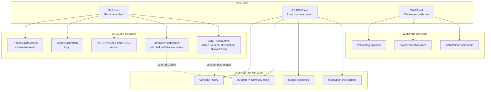
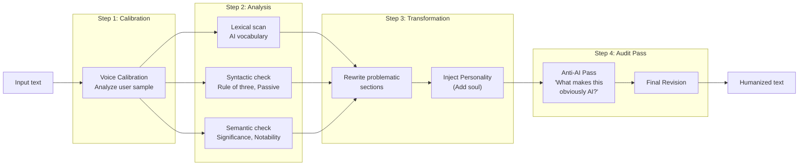

<!-- source: DeepWiki mcp.deepwiki.com · repo blader/humanizer · page 1 Overview · fetched 2026-10-27 -->

# Overview

Relevant source files

The following files were used as context for generating this wiki page:

- [README.md](README.md)
- [SKILL.md](SKILL.md)

## Purpose and Scope

This document provides a high-level overview of the Humanizer system: a Claude Code and OpenCode skill that detects and removes patterns characteristic of AI-generated text. It covers the system's architecture, the problem it solves, the pattern taxonomy it implements, and how the components interact.

The Humanizer is designed to bridge the gap between sterile, statistically-likely LLM output and natural, "soulful" human writing. It uses a library of 29 empirically-derived patterns to identify and remediate common "AI-isms."

Sources: [SKILL.md:1-10](), [README.md:1-4](), [WARP.md:5-9]()

---

## What is Humanizer

Humanizer is a file-based skill that transforms AI-generated text to sound more natural. It operates as a runtime artifact (`SKILL.md`) containing YAML metadata and pattern-matching instructions that compatible agents load and execute.

The system is based on Wikipedia's "Signs of AI writing" article, maintained by WikiProject AI Cleanup. This foundation provides empirical grounding: the patterns cataloged in `SKILL.md` derive from analysis of thousands of AI-generated text instances observed on Wikipedia.

**Key characteristics:**
- **Zero-compilation deployment**: Markdown files only, no binary dependencies.
- **File-based plugin architecture**: Installed in `~/.claude/skills/humanizer/` or `~/.config/opencode/skills/humanizer/`.
- **29 documented patterns**: Organized across 5 categories (Content, Language, Style, Communication, Filler).
- **Dual-purpose processing**: Pattern removal combined with personality injection.
- **YAML-driven configuration**: Explicit tool permissions (`Read`, `Write`, `Edit`, `Grep`, `Glob`, `AskUserQuestion`).

Sources: [README.md:5-40](), [SKILL.md:1-20](), [SKILL.md:24-25](), [WARP.md:5-9]()

---

## The Problem: Statistical Text Generation

AI language models generate text by predicting statistically likely next tokens. As noted in the system's key insights: "LLMs use statistical algorithms to guess what should come next. The result tends toward the most statistically likely result that applies to the widest variety of cases."

This produces characteristic failure modes:
- **Significance inflation**: Arbitrary aspects described as "pivotal moments" or "evolving landscapes."
- **Copula avoidance**: Overusing "serves as" or "boasts" instead of "is" or "has."
- **Promotional language**: Adjective-heavy descriptions like "nestled within the breathtaking region."
- **Vague attributions**: "Experts believe" or "observers have noted" without specific citations.
- **Formulaic structure**: Patterns like "Despite challenges... continues to thrive."

The system addresses not just mechanical patterns but also "soulless writing" that lacks human voice—monotonous rhythm, neutrality where opinion is warranted, and a lack of first-person perspective.

Sources: [SKILL.md:59-84](), [SKILL.md:94-105](), [README.md:87-90]()

---

## System Architecture: Three-File Design

**Diagram 1: Three-File Architecture and Internal Structure**

The system consists of three Markdown files with distinct purposes:

| File | Purpose | Audience | Key Content |
|------|---------|----------|-------------|
| `SKILL.md` | Runtime artifact (source of truth) | Claude Code / OpenCode | YAML frontmatter, 29 patterns, `Voice Calibration`, `PERSONALITY AND SOUL` |
| `README.md` | User documentation | End users | Installation commands, usage examples, 29-pattern summary table, version history |
| `WARP.md` | Meta-documentation | Developers | Synchronization rules, versioning protocol, maintenance workflow |

The hierarchy is strict: `SKILL.md` defines behavior, `README.md` documents it, `WARP.md` governs maintenance. Version numbers in the YAML frontmatter ([SKILL.md:3]()) must match the version history in [README.md:154-162]().

Sources: [SKILL.md:1-20](), [README.md:1-162](), [WARP.md:1-52]()

---

## Pattern Taxonomy: 29 Patterns in 5 Categories

```mermaid
graph TB
    subgraph "Pattern Categories"
        CONTENT["CONTENT PATTERNS<br/>Patterns #1-6"]
        LANGUAGE["LANGUAGE AND GRAMMAR<br/>Patterns #7-13"]
        STYLE["STYLE PATTERNS<br/>Patterns #14-19, 26-29"]
        COMM["COMMUNICATION PATTERNS<br/>Patterns #20-22"]
        FILLER["FILLER AND HEDGING<br/>Patterns #23-25"]
    end
    
    subgraph "Content Examples"
        P1["#1: Significance inflation<br/>'pivotal moment'"]
        P3["#3: Superficial -ing<br/>'symbolizing... reflecting'"]
    end
    
    subgraph "Language Examples"
        P7["#7: AI vocabulary<br/>'additionally, testament'"]
        P8["#8: Copula avoidance<br/>'serves as' vs 'is'"]
        P13["#13: Passive voice<br/>Subjectless fragments"]
    end
    
    subgraph "Style Examples"
        P14["#14: Em dash overuse"]
        P26["#26: Hyphenated pairs<br/>'data-driven'"]
        P28["#28: Signposting<br/>'Let's dive in'"]
    end
    
    subgraph "Communication Examples"
        P20["#20: Chatbot artifacts<br/>'I hope this helps!'"]
        P22["#22: Sycophantic tone"]
    end
    
    CONTENT --> P1
    CONTENT --> P3
    LANGUAGE --> P7
    LANGUAGE --> P8
    LANGUAGE --> P13
    STYLE --> P14
    STYLE --> P26
    STYLE --> P28
    COMM --> P20
    COMM --> P22
```

**Diagram 2: Pattern Taxonomy with Code Entity References**

The 29 patterns are organized into 5 categories, each implemented as a section in `SKILL.md`:

| Category | Patterns | Section in SKILL.md |
|----------|----------|---------------------|
| Content Patterns | #1-6 | `## CONTENT PATTERNS` [SKILL.md:92-154]() |
| Language and Grammar | #7-13 | `## LANGUAGE AND GRAMMAR PATTERNS` [SKILL.md:156-241]() |
| Style Patterns | #14-19, 26-29 | `## STYLE PATTERNS` [SKILL.md:243-346]() |
| Communication Patterns | #20-22 | `## COMMUNICATION PATTERNS` [SKILL.md:348-388]() |
| Filler and Hedging | #23-25 | `## FILLER AND HEDGING` [SKILL.md:390-426]() |

Each pattern definition includes a "Words to watch" list (lexical triggers), a problem description, and a before/after example to guide the model's transformation logic.

Sources: [SKILL.md:92-426](), [README.md:91-145]()

---

## Processing Model: Detection and Remediation

**Diagram 3: Processing Pipeline with Logic Flows**

The processing pipeline operates through distinct phases defined in the `## Your Task` section [SKILL.md:26-36]():

1.  **Voice Calibration (Optional)**: If a user provides a sample, the system analyzes sentence length patterns, word choice level, and punctuation habits to match the user's specific voice [SKILL.md:38-57]().
2.  **Pattern Identification**: Scanning for the 29 documented AI patterns [SKILL.md:30]().
3.  **Remediation and Personality Injection**: Replacing AI-isms with natural alternatives while adding "soul"—opinions, varied rhythm, and specific feelings [SKILL.md:31-34]().
4.  **Anti-AI Audit Pass**: A critical final step where the system asks itself "What makes the below so obviously AI generated?" and performs a final revision based on the remaining tells [SKILL.md:35]().

Sources: [SKILL.md:26-57](), [SKILL.md:433-461]()

---

## Runtime Integration: Skill Architecture

The system utilizes a standard skill directory structure for Claude Code and OpenCode. The `SKILL.md` file serves as the manifest and instruction set.

| Field | Value | Purpose |
|-------|-------|---------|
| `name` | `humanizer` | The command name used for invocation (`/humanizer`) [SKILL.md:2]() |
| `version` | `2.5.1` | Current release version [SKILL.md:3]() |
| `allowed-tools` | `Read, Write, Edit, Grep, Glob, AskUserQuestion` | Permissions granted to the skill to interact with files [SKILL.md:13-19]() |

**Installation paths:**
- Claude Code: `~/.claude/skills/humanizer/SKILL.md` [README.md:12-13]()
- OpenCode: `~/.config/opencode/skills/humanizer/SKILL.md` [README.md:28-29]()

Sources: [SKILL.md:1-20](), [README.md:5-40]()

---

## Synchronization Protocol

The `WARP.md` file defines the maintenance protocol to ensure the three files remain in sync:

- **Source of Truth**: `SKILL.md` is the primary file. Any logic or pattern changes must start here [WARP.md:21-22]().
- **Documentation Sync**: When patterns are added or removed in `SKILL.md`, the summary table in `README.md` must be updated to match [WARP.md:37-40]().
- **Versioning**: The version number in `SKILL.md` YAML must match the top of `README.md` and the `Version History` section [WARP.md:30-35]().

Sources: [WARP.md:21-52](), [README.md:154-162]()

---

