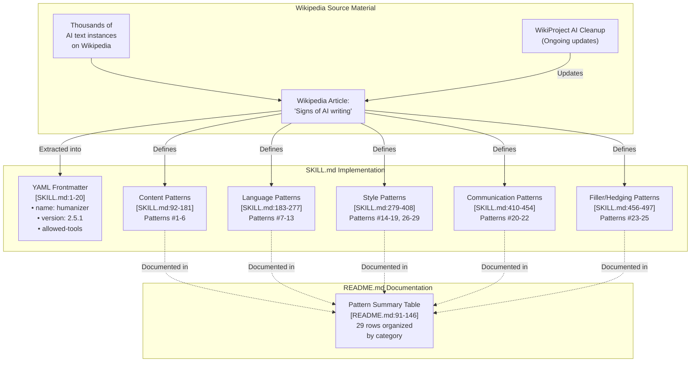
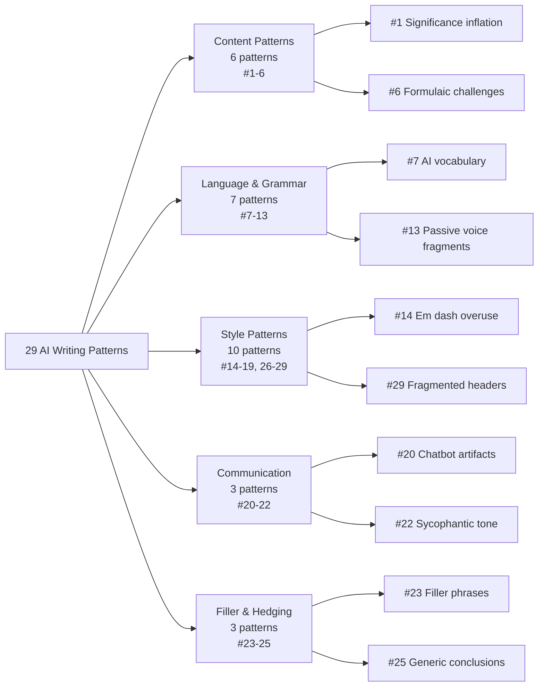
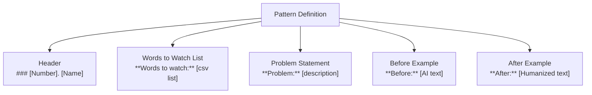

<!-- source: DeepWiki mcp.deepwiki.com · repo blader/humanizer · page 3 AI Writing Patterns · fetched 2026-10-27 -->

# AI Writing Patterns

Relevant source files

The following files were used as context for generating this wiki page:

- [README.md](README.md)
- [SKILL.md](SKILL.md)

## Purpose and Scope

This page documents the 29 AI writing patterns that the Humanizer skill detects and corrects. These patterns represent empirically observed characteristics of AI-generated text, derived from Wikipedia's "Signs of AI writing" guide maintained by WikiProject AI Cleanup. The patterns are organized into five categories and serve as the core knowledge base that drives the Humanizer's transformation engine.

The current version of the system (v2.5.1) has expanded the pattern library from the original 24 to 29 distinct markers. For implementation details on how these patterns are detected and remediated, see [Pattern Detection and Remediation](#4.4). For detailed examples and usage of each pattern category, see the child pages: [Content Patterns](#3.2), [Language and Grammar Patterns](#3.3), [Style Patterns](#3.4), [Communication Patterns](#3.5), and [Filler and Hedging Patterns](#3.6).

Sources: [SKILL.md:3-10](), [README.md:91-146]()

---

## Wikipedia Foundation

The Humanizer's pattern catalog is based on [Wikipedia:Signs of AI writing](https://en.wikipedia.org/wiki/Wikipedia:Signs_of_AI_writing), a comprehensive guide maintained by WikiProject AI Cleanup. This guide emerged from analysis of thousands of instances of AI-generated text submitted to Wikipedia.

### Empirical Basis

The patterns documented in `SKILL.md` are not theoretical constructs but empirical observations of how large language models actually write. As noted in the system's core logic:

> "LLMs use statistical algorithms to guess what should come next. The result tends toward the most statistically likely result that applies to the widest variety of cases." [SKILL.md:543-545]()

This statistical optimization toward "safest" outputs produces characteristic patterns:
- Inflated significance statements that apply broadly.
- Promotional language that avoids negative claims.
- Avoidance of simple constructions like "is" or "has" (Copula avoidance).
- Overuse of present participles ("-ing") to add apparent depth.
- Mechanical formatting patterns (em dashes, boldface, emojis).

### WikiProject AI Cleanup

WikiProject AI Cleanup continuously maintains and updates the source material as new AI writing patterns emerge. The Humanizer skill imports these patterns into executable transformation rules. Recent updates (v2.3.0 through v2.5.1) have added five new patterns—including hyphenated word pairs, persuasive authority tropes, and passive voice fragments—to keep pace with evolving LLM behaviors.

**Pattern Knowledge Flow:**

Sources: [SKILL.md:24-25](), [SKILL.md:543-545](), [README.md:81-90](), [README.md:179-183]()

---

## Pattern Taxonomy

The 29 patterns are organized into five functional categories. This categorization reflects different analytical layers: semantic (content), syntactic (grammar), stylistic (formatting), conversational (artifacts), and rhetorical (filler).

### Complete Pattern Catalog

| # | Pattern Name | Category | SKILL.md Reference |
|---|--------------|----------|-------------------|
| 1-6 | Content Patterns | Content | [SKILL.md:94-181]() |
| 7-13 | Language & Grammar | Language | [SKILL.md:185-277]() |
| 14-19, 26-29 | Style Patterns | Style | [SKILL.md:281-408]() |
| 20-22 | Communication | Communication | [SKILL.md:412-454]() |
| 23-25 | Filler & Hedging | Filler | [SKILL.md:458-497]() |

Sources: [SKILL.md:92-497](), [README.md:91-146]()

### Category Distribution

Sources: [SKILL.md:92-497](), [README.md:93-145]()

---

## Pattern Structure

Each pattern definition in `SKILL.md` follows a consistent structure optimized for the LLM editor.

### Pattern Definition Components

**Pattern Template Structure:**

Sources: [SKILL.md:94-105]()

### Words-to-Watch Lists

Many patterns include curated keyword lists that serve as lexical detection triggers:

| Pattern | Words-to-Watch Example | Line Reference |
|---------|------------------------|----------------|
| #1 Significance inflation | `pivotal, testament, landscape, underscores` | [SKILL.md:96]() |
| #7 AI vocabulary | `Additionally, delve, crucial, showcase` | [SKILL.md:187]() |
| #8 Copula avoidance | `serves as, stands as, boasts, features` | [SKILL.md:201]() |
| #26 Hyphenated pairs | `cross-functional, data-driven, client-facing` | [SKILL.md:363]() |

Sources: [SKILL.md:96](), [SKILL.md:187](), [SKILL.md:201](), [SKILL.md:363]()

---

## Category Overview

### Content Patterns (Patterns #1-6)
Address meaning-level issues where AI inflates significance or uses vague attributions.
- **Key Patterns:** Significance inflation, Notability name-dropping, Superficial -ing analyses.
- For details, see [Content Patterns](#3.2).

### Language and Grammar Patterns (Patterns #7-13)
Address syntactic layer issues including word choice and sentence structure.
- **Key Patterns:** AI vocabulary, Copula avoidance, Rule of three, Passive voice (added in v2.5.1).
- For details, see [Language and Grammar Patterns](#3.3).

### Style Patterns (Patterns #14-19, 26-29)
Address formatting and typographic choices. This category saw the most expansion in recent versions.
- **Key Patterns:** Em dash overuse, Title Case headings, Hyphenated word pairs, Signposting announcements.
- For details, see [Style Patterns](#3.4).

### Communication Patterns (Patterns #20-22)
Remnants of chatbot dialogue and system limitations.
- **Key Patterns:** Chatbot artifacts ("I hope this helps"), Cutoff disclaimers, Sycophantic tone.
- For details, see [Communication Patterns](#3.5).

### Filler and Hedging Patterns (Patterns #23-25)
Address wordiness and over-qualification that dilutes the message.
- **Key Patterns:** Filler phrases ("in order to"), Excessive hedging, Generic conclusions.
- For details, see [Filler and Hedging Patterns](#3.6).

Sources: [SKILL.md:92-497](), [README.md:93-145]()

---

## Pattern Co-occurrence

AI-generated text typically exhibits multiple patterns simultaneously. The system's full example demonstrates how a single passage can contain over 20 patterns, from "significance inflation" to "sycophantic tone" and "em dash overuse".

**Full Example Analysis:** [SKILL.md:499-538]()

Sources: [SKILL.md:499-538]()

---

