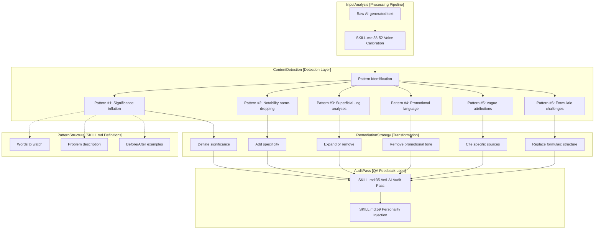
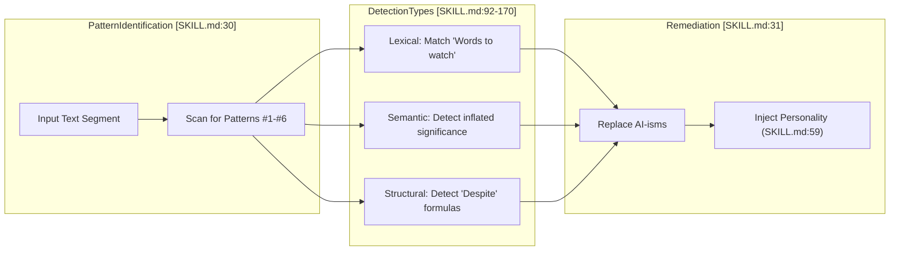

<!-- source: DeepWiki mcp.deepwiki.com · repo blader/humanizer · page 3.2 Content Patterns · fetched 2026-10-27 -->

# Content Patterns

Relevant source files

The following files were used as context for generating this wiki page:

- [README.md](README.md)
- [SKILL.md](SKILL.md)

## Purpose and Scope

This page documents the six **Content Patterns** that the Humanizer skill detects and remediates. Content patterns address *what is said* rather than how it is said—they focus on semantic issues such as inflated significance, promotional language, superficial analysis, vague sourcing, and formulaic structural elements. These patterns represent the first tier of the 29 AI writing patterns identified by the system.

Sources: [SKILL.md:5-10](), [SKILL.md:92-154](), [README.md:93-102]()

---

## Pattern Category Overview

Content patterns represent semantic-level pathologies in AI-generated text. Unlike language patterns (which detect grammatical constructions) or style patterns (which detect formatting choices), content patterns identify issues with the *substance* of claims: exaggerated importance, unsupported assertions, superficial analysis masquerading as depth, and formulaic structure.

These patterns derive from Wikipedia's observation that "LLMs use statistical algorithms to guess what should come next. The result tends toward the most statistically likely result that applies to the widest variety of cases." This leads to text that is technically grammatical and stylistically polished, but semantically hollow—claiming significance without evidence, citing sources without context, and analyzing topics without substance.

Sources: [SKILL.md:22-24](), [README.md:81-91]()

---

## Content Pattern Architecture

**Figure 1: Content Pattern Detection and Remediation Pipeline**

This diagram shows how content patterns operate within the detection pipeline. The identification phase dispatches to individual pattern detectors defined in `SKILL.md`. Each pattern (#1-#6) is defined by three components: a keyword list ("words to watch"), a problem description, and before/after examples. Pattern matches trigger specialized remediation strategies that transform the text semantically. The process concludes with an "Anti-AI Pass" to catch remaining tells.

Sources: [SKILL.md:26-35](), [SKILL.md:92-154](), [README.md:85]()

---

## Pattern Structure in SKILL.md

Each content pattern follows a consistent structure in the `SKILL.md` file to ensure the LLM understands the detection logic and the desired output state.

| Component | Purpose | Location Example |
|-----------|---------|-----------------|
| Pattern number and title | Identifies the pattern | `### 1. Undue Emphasis on Significance...` [SKILL.md:94]() |
| **Words to watch** | Lexical triggers for pattern detection | `**Words to watch:** stands/serves as, testament...` [SKILL.md:96]() |
| **Problem** | Explains why LLMs generate this pattern | `**Problem:** LLM writing puffs up importance...` [SKILL.md:98]() |
| **Before** | Example of AI-generated text with pattern | `> The Statistical Institute... marking a pivotal moment...` [SKILL.md:100]() |
| **After** | Humanized version with pattern removed | `> The Statistical Institute was established in 1989...` [SKILL.md:103]() |

Sources: [SKILL.md:94-105]()

---

## Pattern #1: Significance Inflation

**Pattern ID**: 1  
**Category**: Content  

### Definition
This pattern detects text that artificially inflates the importance of ordinary events by claiming they "mark pivotal moments" or "serve as testaments" without providing evidence.

### Detection Keywords
The following phrases trigger detection (stored in [SKILL.md:96]()):
`stands/serves as`, `is a testament/reminder`, `a vital/significant/crucial/pivotal/key role/moment`, `underscores/highlights its importance/significance`, `reflects broader`, `symbolizing its ongoing/enduring/lasting`, `key turning point`, `evolving landscape`, `focal point`, `indelible mark`.

### Remediation Strategy
**Before** ([SKILL.md:100-101]()): "The Statistical Institute of Catalonia was officially established in 1989, marking a pivotal moment in the evolution of regional statistics in Spain."  
**After** ([SKILL.md:103-104]()): "The Statistical Institute of Catalonia was established in 1989 to collect and publish regional statistics independently from Spain's national statistics office."

Sources: [SKILL.md:94-105]()

---

## Pattern #2: Notability Name-Dropping

**Pattern ID**: 2  
**Category**: Content  

### Definition
Detects attempts to establish notability by listing media outlets or follower counts without providing context about the actual contribution or claims.

### Detection Keywords
Keywords from [SKILL.md:109]():
`independent coverage`, `local/regional/national media outlets`, `written by a leading expert`, `active social media presence`.

### Remediation Strategy
**Before** ([SKILL.md:113-114]()): "Her views have been cited in The New York Times, BBC, Financial Times, and The Hindu. She maintains an active social media presence with over 500,000 followers."  
**After** ([SKILL.md:116-117]()): "In a 2024 New York Times interview, she argued that AI regulation should focus on outcomes rather than methods."

Sources: [SKILL.md:107-118]()

---

## Pattern #3: Superficial -ing Analyses

**Pattern ID**: 3  
**Category**: Content  

### Definition
Detects present participle phrases ("-ing" endings) appended to sentences to create the appearance of depth without adding substantive content.

### Detection Keywords
From [SKILL.md:122]():
`highlighting/underscoring/emphasizing...`, `ensuring...`, `reflecting/symbolizing...`, `contributing to...`, `cultivating/fostering...`, `showcasing...`.

### Remediation Strategy
**Before** ([SKILL.md:126-127]()): "...symbolizing Texas bluebonnets, the Gulf of Mexico, and the diverse Texan landscapes, reflecting the community's deep connection to the land."  
**After** ([SKILL.md:129-130]()): "The temple uses blue, green, and gold colors. The architect said these were chosen to reference local bluebonnets and the Gulf coast."

Sources: [SKILL.md:120-131]()

---

## Pattern #4: Promotional Language

**Pattern ID**: 4  
**Category**: Content  

### Definition
Detects language that reads like advertising or tourism promotion (non-neutral tone) rather than factual description.

### Detection Keywords
From [SKILL.md:135]():
`boasts a`, `vibrant`, `rich (figurative)`, `profound`, `nestled`, `in the heart of`, `groundbreaking`, `breathtaking`, `stunning`.

### Remediation Strategy
**Before** ([SKILL.md:139-140]()): "Nestled within the breathtaking region of Gonder in Ethiopia, Alamata Raya Kobo stands as a vibrant town..."  
**After** ([SKILL.md:142-143]()): "Alamata Raya Kobo is a town in the Gonder region of Ethiopia, known for its weekly market and 18th-century church."

Sources: [SKILL.md:133-144]()

---

## Pattern #5: Vague Attributions

**Pattern ID**: 5  
**Category**: Content  

### Definition
Detects claims attributed to vague, unverifiable authorities like "experts," "observers," or "industry reports."

### Detection Keywords
From [SKILL.md:148]():
`Industry reports`, `Observers have cited`, `Experts argue`, `Some critics argue`.

### Remediation Strategy
**Before** ([SKILL.md:152-153]()): "Experts believe it plays a crucial role in the regional ecosystem."  
**After** ([SKILL.md:155-156]()): "The Haolai River supports several endemic fish species, according to a 2019 survey by the Chinese Academy of Sciences."

Sources: [SKILL.md:146-157]()

---

## Pattern #6: Formulaic Challenges Sections

**Pattern ID**: 6  
**Category**: Content  

### Definition
Detects sections that follow a predictable "Despite challenges, it continues to thrive" template without providing specific facts.

### Detection Keywords
From [SKILL.md:161]():
`Despite its... faces several challenges...`, `Despite these challenges`, `Challenges and Legacy`.

### Remediation Strategy
**Before** ([SKILL.md:165-166]()): "Despite its industrial prosperity, Korattur faces challenges typical of urban areas... Despite these challenges... Korattur continues to thrive..."  
**After** ([SKILL.md:168-169]()): "Traffic congestion increased after 2015 when three new IT parks opened. The municipal corporation began a stormwater drainage project in 2022..."

Sources: [SKILL.md:159-170]()

---

## Pattern Detection Logic

**Figure 2: Content Pattern Logic Flow**

This diagram illustrates how the `humanizer` skill identifies content patterns using three distinct methodologies: lexical matching of prohibited phrases, semantic analysis of claim weight, and structural analysis of formulaic sections. The result is a rewrite that replaces these patterns with natural alternatives and "personality" as defined in the `PERSONALITY AND SOUL` section of `SKILL.md`.

Sources: [SKILL.md:26-35](), [SKILL.md:59-91](), [SKILL.md:92-170]()

---

