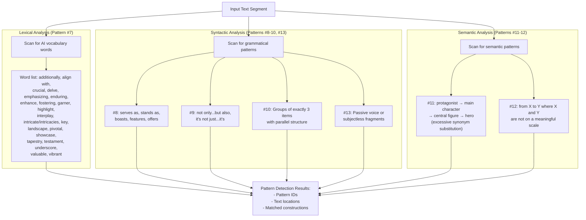
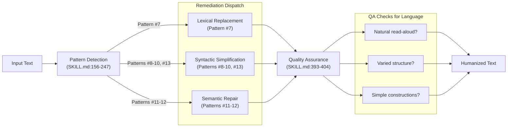

<!-- source: DeepWiki mcp.deepwiki.com · repo blader/humanizer · page 3.3 Language and Grammar Patterns · fetched 2026-10-27 -->

# Language and Grammar Patterns

<details>
<summary>Relevant source files</summary>

The following files were used as context for generating this wiki page:

- [README.md](README.md)
- [SKILL.md](SKILL.md)

</details>


## Purpose and Scope

This page documents the seven **Language and Grammar Patterns** (patterns #7-13) that the Humanizer skill detects and corrects. These patterns operate at the syntactic and lexical level, identifying how AI models structure sentences and choose vocabulary. Unlike content patterns (see [Content Patterns](#3.2)) which focus on semantic meaning, or style patterns (see [Style Patterns](#3.4)) which address formatting, language patterns target grammatical constructions and word choice that characterize statistical language models.

All patterns derive from [Wikipedia:Signs of AI writing](https://en.wikipedia.org/wiki/Wikipedia:Signs_of_AI_writing), maintained by WikiProject AI Cleanup. The patterns are implemented in [SKILL.md:156-247]() and documented in [README.md:104-115]().

**Sources:** [SKILL.md:1-469](), [README.md:1-143]()

---

## Pattern Catalog Structure

The seven language and grammar patterns are organized by detection complexity and remediation strategy. Pattern #13 was added in version 2.5.1 [SKILL.md:3]().

| Pattern # | Pattern Name | Detection Type | Remediation Strategy | Lines in SKILL.md |
|-----------|-------------|----------------|---------------------|-------------------|
| 7 | AI Vocabulary | Lexical (word list) | Replace | [158-169]() |
| 8 | Copula Avoidance | Syntactic (construction) | Simplify | [171-183]() |
| 9 | Negative Parallelisms | Syntactic (construction) | Simplify | [185-195]() |
| 10 | Rule of Three | Syntactic (grouping) | Simplify | [197-207]() |
| 11 | Elegant Variation | Semantic (synonym tracking) | Replace | [209-219]() |
| 12 | False Ranges | Semantic (logical validation) | Reformat | [221-231]() |
| 13 | Passive Voice / Fragments | Syntactic (voice) | Activate / Name Actor | [233-247]() |

**Sources:** [SKILL.md:156-247](), [README.md:104-115]()

---

## Pattern Detection Flow



**Diagram: Language Pattern Detection Pipeline**

This diagram shows the detection architecture for language patterns. Lexical analysis (Pattern #7) performs string matching. Syntactic analysis (Patterns #8-10, #13) identifies grammatical constructions like copula substitutions, parallel structures, and passive voice. Semantic analysis (Patterns #11-12) requires understanding meaning to detect logical flaws in synonym usage and range constructions.

**Sources:** [SKILL.md:156-247]()

---

## Pattern #7: Overused AI Vocabulary

**Detection Mechanism:** Lexical scanning for high-frequency AI words.

**Words to Watch:** [SKILL.md:160]() defines the canonical list:
- `additionally`, `align with`, `crucial`, `delve`, `emphasizing`, `enduring`, `enhance`, `fostering`, `garner`, `highlight` (verb), `interplay`, `intricate`/`intricacies`, `key` (adjective), `landscape` (abstract noun), `pivotal`, `showcase`, `tapestry` (abstract noun), `testament`, `underscore` (verb), `valuable`, `vibrant`.

**Problem Statement:** [SKILL.md:162]() notes these words "appear far more frequently in post-2023 text. They often co-occur."

**Before/After Examples:**

```markdown
Before (SKILL.md:164-166):
> Additionally, a distinctive feature of Somali cuisine is the incorporation 
> of camel meat. An enduring testament to Italian colonial influence is the 
> widespread adoption of pasta in the local culinary landscape, showcasing 
> how these dishes have integrated into the traditional diet.

After (SKILL.md:167-169):
> Somali cuisine also includes camel meat, which is considered a delicacy. 
> Pasta dishes, introduced during Italian colonization, remain common, 
> especially in the south.
```

**Sources:** [SKILL.md:158-169](), [README.md:108]()

---

## Pattern #8: Copula Avoidance

**Detection Mechanism:** Syntactic pattern matching for `is`/`are` substitutions.

**Construction Patterns:** [SKILL.md:174]() lists:
- `serves as [noun]` / `stands as [noun]` / `marks [noun]` / `represents [noun]`
- `boasts [noun]` / `features [noun]` / `offers [noun]`

**Problem Statement:** [SKILL.md:176]() - "LLMs substitute elaborate constructions for simple copulas."

**Before/After Examples:**

```markdown
Before (SKILL.md:178-179):
> Gallery 825 serves as LAAA's exhibition space for contemporary art. 
> The gallery features four separate spaces and boasts over 3,000 square feet.

After (SKILL.md:180-182):
> Gallery 825 is LAAA's exhibition space for contemporary art. 
> The gallery has four rooms totaling 3,000 square feet.
```

**Sources:** [SKILL.md:171-183](), [README.md:109]()

---

## Pattern #9: Negative Parallelisms / Tailing Negations

**Detection Mechanism:** Syntactic pattern matching for parallel negative constructions or trailing clarifying negatives.

**Construction Patterns:** [SKILL.md:187]()
- `Not only X, but [also] Y`
- `It's not just [about] X; it's Y`
- `..., no guessing` / `..., no code required`

**Problem Statement:** [SKILL.md:188]() - "Constructions like 'Not only...but...' or 'It's not just about..., it's...' are overused. Tailing negations ('no configuration needed') are common in technical AI text."

**Before/After Examples:**

```markdown
Before (SKILL.md:190-191):
> It's not just about the beat riding under the vocals; it's part of the 
> aggression and atmosphere. It's not merely a song, it's a statement.

After (SKILL.md:192-194):
> The heavy beat adds to the aggressive tone.
```

**Sources:** [SKILL.md:185-195](), [README.md:110]()

---

## Pattern #10: Rule of Three Overuse

**Detection Mechanism:** Syntactic pattern matching for groups of exactly three parallel items.

**Problem Statement:** [SKILL.md:200]() - "LLMs force ideas into groups of three to appear comprehensive."

**Before/After Examples:**

```markdown
Before (SKILL.md:202-203):
> The event features keynote sessions, panel discussions, and networking 
> opportunities. Attendees can expect innovation, inspiration, and industry 
> insights.

After (SKILL.md:204-206):
> The event includes talks and panels. There's also time for informal 
> networking between sessions.
```

**Sources:** [SKILL.md:197-207](), [README.md:111]()

---

## Pattern #11: Elegant Variation (Synonym Cycling)

**Detection Mechanism:** Semantic tracking of synonyms for the same referent.

**Problem Statement:** [SKILL.md:212]() - "AI has repetition-penalty code causing excessive synonym substitution."

**Before/After Examples:**

```markdown
Before (SKILL.md:214-215):
> The protagonist faces many challenges. The main character must overcome 
> obstacles. The central figure eventually triumphs. The hero returns home.

After (SKILL.md:216-218):
> The protagonist faces many challenges but eventually triumphs and 
> returns home.
```

**Sources:** [SKILL.md:209-219](), [README.md:112]()

---

## Pattern #12: False Ranges

**Detection Mechanism:** Semantic validation of `from X to Y` constructions.

**Problem Statement:** [SKILL.md:224]() - "LLMs use 'from X to Y' constructions where X and Y aren't on a meaningful scale."

**Before/After Examples:**

```markdown
Before (SKILL.md:226-227):
> Our journey through the universe has taken us from the singularity of 
> the Big Bang to the grand cosmic web, from the birth and death of stars 
> to the enigmatic dance of dark matter.

After (SKILL.md:228-230):
> The book covers the Big Bang, star formation, and current theories 
> about dark matter.
```

**Sources:** [SKILL.md:221-231](), [README.md:113]()

---

## Pattern #13: Passive Voice and Subjectless Fragments

**Detection Mechanism:** Syntactic analysis for passive verb forms and sentences lacking a grammatical subject.

**Problem Statement:** [SKILL.md:236]() - "AI often uses passive voice to sound 'objective' or uses subjectless fragments in technical contexts ('No configuration file needed')."

**Before/After Examples:**

```markdown
Before (SKILL.md:238-241):
> The results were analyzed by the team. No configuration file needed. 
> Deployment can be achieved with a single command.

After (SKILL.md:242-246):
> The team analyzed the results. You don't need a configuration file. 
> Deploy the app with one command.
```

**Remediation Strategy:** Convert passive voice to active voice. For subjectless fragments, identify the actor (e.g., "You") and restructure into a complete sentence.

**Sources:** [SKILL.md:233-247](), [README.md:114]()

---

## Integration with Processing Pipeline



**Diagram: Language Pattern Remediation Flow**

This diagram shows how language patterns integrate into the overall processing pipeline. Pattern detection occurs at [SKILL.md:156-247](). Remediation dispatches based on pattern type. Quality assurance at [SKILL.md:393-404]() ensures the output avoids AI vocabulary and uses simple, varied constructions.

**Sources:** [SKILL.md:156-247](), [SKILL.md:393-404]()

---

## Full Example Analysis

The comprehensive example at [SKILL.md:413-461]() demonstrates multiple language patterns in context:

```markdown
Before (SKILL.md:416-430, language patterns highlighted):
> AI-assisted coding [#8: serves as] an [#7: enduring testament] to the 
> transformative potential of large language models, marking a [#7: pivotal] 
> moment in the evolution of software development. In today's rapidly 
> [#7: evolving] technological [#7: landscape], these groundbreaking 
> tools—nestled at the intersection of research and practice—are reshaping 
> how engineers ideate, iterate, and deliver, [#7: underscoring] their 
> [#7: vital] role in modern workflows.
>
> At its core, the value proposition is clear: [#10: streamlining processes, 
> enhancing collaboration, and fostering alignment]. [#9: It's not just about 
> autocomplete; it's about] unlocking creativity at scale, ensuring that 
> organizations can remain agile while delivering seamless, intuitive, and 
> powerful experiences to users. The tool [#8: serves as] a catalyst. The 
> assistant [#8: functions as] a partner. The system [#8: stands as] a 
> foundation for innovation.
```

**Language Patterns Removed (from SKILL.md:443-461):**
- **Pattern #7:** `testament`, `pivotal`, `evolving`, `landscape`, `underscoring`, `vital`.
- **Pattern #8:** `serves as`, `functions as`, `stands as` → replaced with direct verbs.
- **Pattern #9:** `It's not just X; it's Y` → simplified to direct statement.
- **Pattern #10:** The forced triad of `streamlining... enhancing... fostering` is removed.

**Sources:** [SKILL.md:413-461](), [SKILL.md:443-461]()

---

