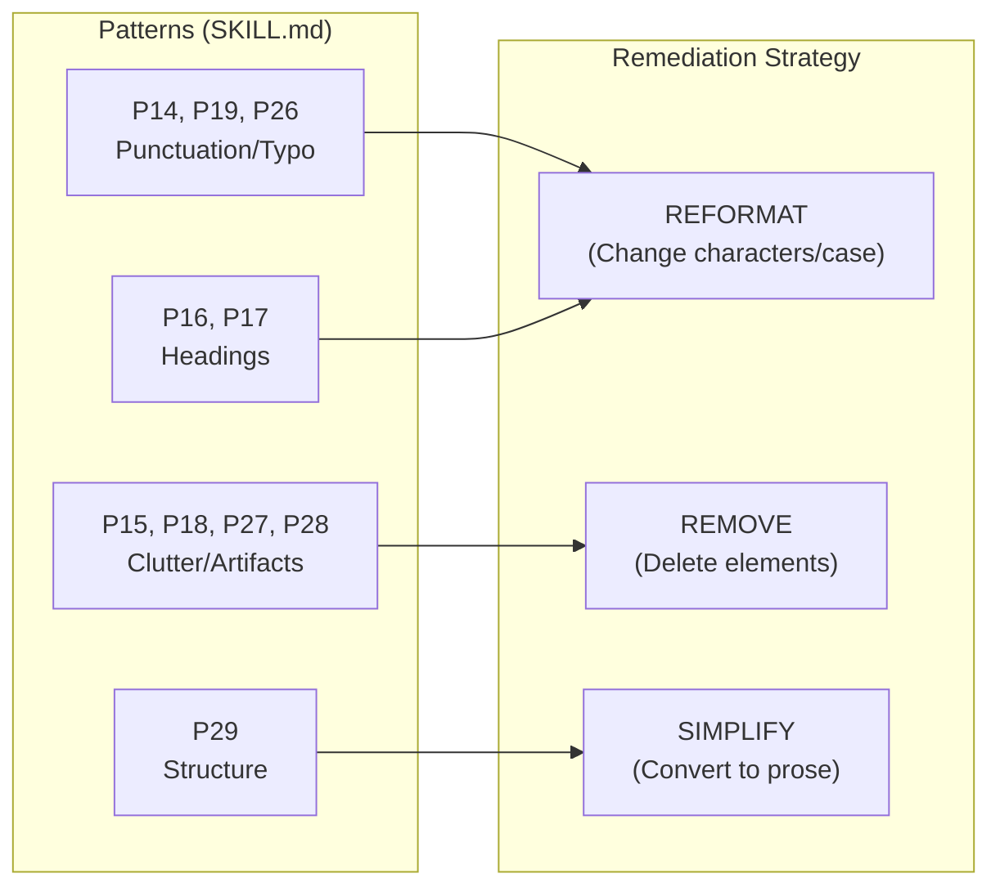

<!-- source: DeepWiki mcp.deepwiki.com · repo blader/humanizer · page 3.4 Style Patterns · fetched 2026-10-27 -->

# Style Patterns

<details>
<summary>Relevant source files</summary>

The following files were used as context for generating this wiki page:

- [README.md](README.md)
- [SKILL.md](SKILL.md)

</details>


## Purpose and Scope

This page documents the 10 style patterns detected by the Humanizer skill. Style patterns are formatting and presentation choices that betray AI authorship—visual artifacts like excessive punctuation marks, typographic conventions, and structural layouts that appear more frequently in LLM-generated text than in human writing.

As of version 2.5.1, the pattern library has expanded from the original 6 to include 4 new patterns (26–29) addressing hyphenation, persuasive tropes, signposting, and header fragmentation.

**Sources:** [SKILL.md:3-10](), [README.md:116-130]()

## What Are Style Patterns?

Style patterns operate at the presentation layer—they concern how text *looks* rather than what it *says*. These are formatting choices, punctuation habits, and visual layouts that AI models statistically favor but that human writers use more sparingly or avoid entirely.

The 10 style patterns in the catalog are:

| Pattern # | Name | Signal |
|-----------|------|--------|
| 14 | Em dash overuse | Excessive use of `—` for parenthetical remarks |
| 15 | Boldface overuse | Mechanical bolding of acronyms and key phrases |
| 16 | Inline-header lists | Bullet points starting with `**Header:**` pattern |
| 17 | Title Case headings | Capitalizing All Main Words In Headings |
| 18 | Emojis | Decorative emojis (`🚀`, `💡`) in technical text |
| 19 | Curly quotes | Using `“curly”` instead of `"straight"` quotation marks |
| 26 | Hyphenated word pairs | Over-hyphenating common pairs like "data-driven" |
| 27 | Persuasive authority tropes | Phrases like "At its core" or "What matters is" |
| 28 | Signposting announcements | "Let's dive in" or "Here is what you need to know" |
| 29 | Fragmented headers | Short, vague headers followed by single sentences |

**Sources:** [SKILL.md:234-367](), [README.md:116-130]()

## Pattern Detection Flow

Style patterns are detected through Layer 4 (Stylistic Analysis) of the multi-layer detection system. Unlike semantic or syntactic analysis, stylistic analysis operates on formatting metadata and character-level features.

### Diagram: Style Pattern Identification Pipeline

```mermaid
graph TB
    Input["Input Text"]
    
    subgraph "Layer 4: Stylistic Analysis"
        ScanPunct["Punctuation Scanner<br/>Count em dashes (—)<br/>Identify quote types (“ vs \")"]
        ScanFormat["Formatting Scanner<br/>Detect **bold** patterns<br/>Detect emoji Unicode ranges"]
        ScanStructure["Structure Scanner<br/>Analyze heading capitalization<br/>Detect list item patterns"]
    end
    
    subgraph "Pattern Library (SKILL.md)"
        P14["Pattern #14<br/>Em Dash Overuse"]
        P15["Pattern #15<br/>Boldface Overuse"]
        P16["Pattern #16<br/>Inline-Header Lists"]
        P17["Pattern #17<br/>Title Case"]
        P18["Pattern #18<br/>Emojis"]
        P19["Pattern #19<br/>Curly Quotes"]
        P26["Pattern #26<br/>Hyphenated Pairs"]
        P27["Pattern #27<br/>Authority Tropes"]
        P28["Pattern #28<br/>Signposting"]
        P29["Pattern #29<br/>Fragmented Headers"]
    end
    
    Results["Style Pattern Detections<br/>Sent to Rewrite Module"]
    
    Input --> ScanPunct
    Input --> ScanFormat
    Input --> ScanStructure
    
    ScanPunct --> P14
    ScanPunct --> P19
    ScanFormat --> P15
    ScanFormat --> P18
    ScanStructure --> P16
    ScanStructure --> P17
    ScanStructure --> P26
    ScanStructure --> P27
    ScanStructure --> P28
    ScanStructure --> P29
    
    P14 --> Results
    P29 --> Results
```

**Sources:** [SKILL.md:234-367]()

## Pattern Catalog

### Pattern #14: Em Dash Overuse
**Problem:** LLMs use em dashes to mimic "punchy" sales writing. Humans use commas or periods more frequently.
- **Before:** "institutions—not the people—yet this continues—"
- **After:** Prefer commas or periods.
- **Remediation:** `REFORMAT`

### Pattern #15: Boldface Overuse
**Problem:** Mechanical bolding of acronyms or key phrases creates visual clutter.
- **Before:** "**OKRs**, **KPIs**, **BMC**"
- **After:** "OKRs, KPIs, BMC"
- **Remediation:** `REMOVE` (formatting only)

### Pattern #16: Inline-Header Lists
**Problem:** Bullet points starting with `**Header:**` that often repeat the description's first word.
- **Before:** "**Performance:** Performance improved"
- **After:** Convert to prose.
- **Remediation:** `SIMPLIFY`

### Pattern #17: Title Case Headings
**Problem:** AI defaults to capitalizing every word in a header.
- **Before:** "Strategic Negotiations And Partnerships"
- **After:** "Strategic negotiations and partnerships"
- **Remediation:** `REFORMAT`

### Pattern #18: Emojis
**Problem:** Decorative emojis (`🚀`, `💡`) in technical text are a major AI "tell."
- **Before:** "🚀 Launch Phase: 💡 Key Insight:"
- **After:** Remove emojis.
- **Remediation:** `REMOVE`

### Pattern #19: Curly Quotes
**Problem:** LLMs default to typographically correct curly quotes (`“ ”`), which can break code or search.
- **Before:** `said “the project”`
- **After:** `said "the project"`
- **Remediation:** `REFORMAT`

### Pattern #26: Hyphenated Word Pairs
**Problem:** AI over-hyphenates compound modifiers that humans leave separate.
- **Before:** "cross-functional, data-driven, client-facing"
- **After:** Drop hyphens on common word pairs.
- **Remediation:** `REFORMAT`

### Pattern #27: Persuasive Authority Tropes
**Problem:** Prefacing statements with "At its core" or "Ultimately" to sound profound.
- **Before:** "At its core, what matters is..."
- **After:** State the point directly.
- **Remediation:** `REMOVE` (phrase level)

### Pattern #28: Signposting Announcements
**Problem:** Chatbots announce what they are about to do.
- **Before:** "Let's dive in", "Here's what you need to know"
- **After:** Start with the content.
- **Remediation:** `REMOVE`

### Pattern #29: Fragmented Headers
**Problem:** Using a heading followed by a single, short sentence.
- **Before:** "## Performance" + "Speed matters."
- **After:** Let the heading do the work or merge into a larger section.
- **Remediation:** `EXPAND` or `SIMPLIFY`

**Sources:** [SKILL.md:234-367](), [README.md:116-130]()

## Implementation and Data Flow

The following diagram maps the style patterns to the remediation strategies used in the `humanizer` skill.

### Diagram: Remediation Strategy Mapping



**Sources:** [SKILL.md:234-367](), [SKILL.md:392-410]()

## Full Style Transformation Example

This example demonstrates the simultaneous removal of multiple style patterns (15, 17, 18, 28, 29).

**Before (AI-Generated):**
> ### 🚀 Key Performance Metrics
> Let's dive into the metrics.
> 
> - **Speed:** Speed is a testament to our progress.
> - **Efficiency:** Efficiency has been optimized.

**After (Humanized):**
> ### Performance metrics
> 
> We measured a 20% increase in processing speed and reduced memory overhead by 15% across all nodes.

**Transformations Applied:**
1. **P17:** "Key Performance Metrics" -> "Performance metrics" (Sentence case).
2. **P18:** Removed 🚀 emoji.
3. **P28:** Removed "Let's dive into the metrics."
4. **P15:** Converted the list into a specific, factual sentence.
5. **P29:** Replaced the fragmented single-sentence structure with actual data.

**Sources:** [SKILL.md:413-461](), [README.md:147-165]()

## Style vs. Content Patterns

Style patterns are distinguished from other categories by operating on presentation rather than semantic meaning:

| Aspect | Style Patterns | Content Patterns |
|--------|----------------|------------------|
| **Analysis Layer** | Stylistic (formatting) | Semantic (meaning) |
| **Detection** | Character/Format scanning | Phrase matching/Context |
| **Primary Goal** | Clean visual "tells" | Remove inflated claims |
| **Example** | Em dashes, Emojis | "Pivotal moment", "Testament" |

**Sources:** [SKILL.md:92-367]()

---

