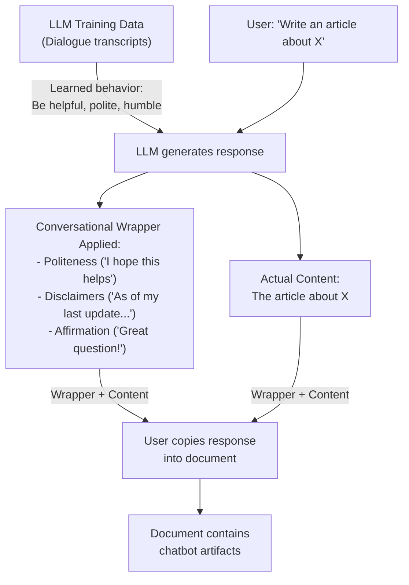
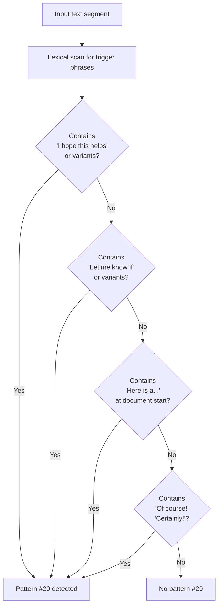
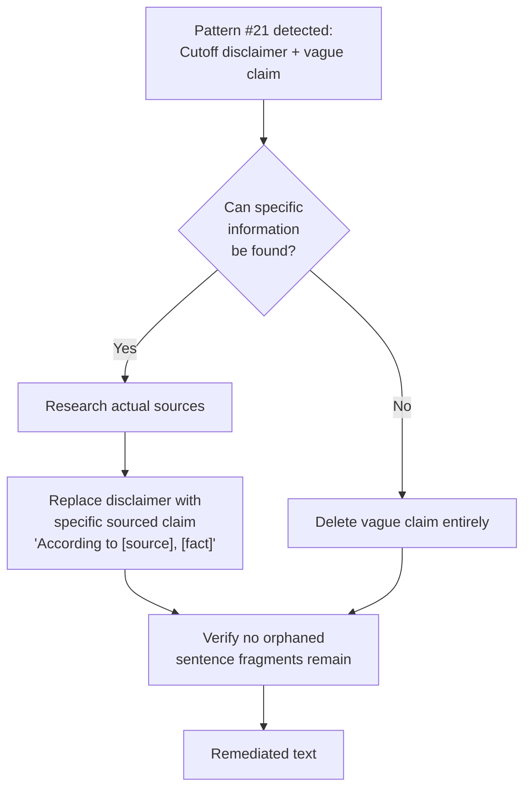
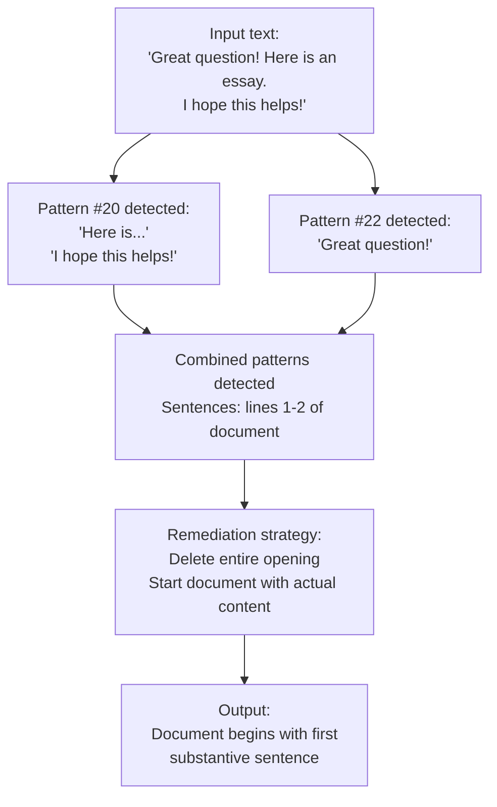

<!-- source: DeepWiki mcp.deepwiki.com · repo blader/humanizer · page 3.5 Communication Patterns · fetched 2026-10-27 -->

# Communication Patterns

<details>
<summary>Relevant source files</summary>

The following files were used as context for generating this wiki page:

- [README.md](README.md)
- [SKILL.md](SKILL.md)

</details>


## Purpose and Scope

This page documents the three **Communication Patterns** (patterns #20-#22) detected and removed by the `humanizer` skill. These patterns are artifacts of conversational AI interaction that reveal text originated from chatbot dialogue rather than authored content.

Communication patterns differ from other AI writing signs in that they explicitly expose the chatbot medium itself—phrases like "I hope this helps!" or "Great question!" make it obvious that a human asked an AI to write something, and the AI's response was copied verbatim without removing the conversational wrapper.

For other pattern categories, see: [Content Patterns](#3.2), [Language and Grammar Patterns](#3.3), [Style Patterns](#3.4), and [Filler and Hedging Patterns](#3.6).

Sources: [SKILL.md:312-352](), [README.md:131-138]()

---

## Pattern Taxonomy

Communication patterns fall into three distinct subcategories based on their conversational function:

| Pattern # | Name | Function | Detection Basis |
|-----------|------|----------|-----------------|
| 20 | Chatbot Artifacts | Chatbot politeness/helpfulness signals | Lexical (specific phrases) |
| 21 | Knowledge-Cutoff Disclaimers | Training data limitation hedging | Lexical + semantic (temporal references) |
| 22 | Sycophantic Tone | People-pleasing affirmations | Lexical + pragmatic (excessive positivity) |

Sources: [SKILL.md:312-352](), [README.md:131-138]()

---

## Why Communication Patterns Occur



**Diagram: Origin of Communication Patterns**

Communication patterns emerge because LLMs are trained on conversational data where being helpful, humble, and polite is rewarded. When users paste chatbot responses directly into documents, these conversational wrappers come along for the ride.

Sources: [SKILL.md:312-352](), [SKILL.md:464-468]()

---

## Pattern #20: Chatbot Artifacts

### Definition

Phrases that signal the text is a chatbot response to a user query, not standalone authored content. These are conversational politeness markers and meta-commentary about the response itself.

Sources: [SKILL.md:314-325]()

### Detection Triggers

The following lexical patterns trigger detection:

**Primary indicators:**
- `I hope this helps`
- `Let me know if...`
- `Would you like...`
- `Here is a...` (at start of response)
- `Of course!`
- `Certainly!`

**Meta-commentary:**
- `let me expand on`
- `if you'd like me to elaborate`
- `feel free to ask`

Sources: [SKILL.md:316-317]()

### Detection Flow



**Diagram: Pattern #20 Detection Logic**

Sources: [SKILL.md:316-325]()

### Examples

**Before (contains artifacts):**
```
Here is an overview of the French Revolution. I hope this helps! 
Let me know if you'd like me to expand on any section.
```

**After (artifacts removed):**
```
The French Revolution began in 1789 when financial crisis and food 
shortages led to widespread unrest.
```

Sources: [SKILL.md:320-324](), [README.md:135]()

### Remediation Strategy

**Complete deletion.** Chatbot artifacts add no semantic value to the content itself. The remediation is straightforward:

1. Identify sentence(s) containing trigger phrases.
2. Remove entire sentence(s).
3. Ensure remaining content has proper opening (no "Additionally..." starting orphaned).

Sources: [SKILL.md:320-325]()

---

## Pattern #21: Knowledge-Cutoff Disclaimers

### Definition

Phrases that reveal the AI's training data limitations or temporal knowledge boundaries. These disclaimers acknowledge incomplete information based on the model's training cutoff date or corpus limitations.

Sources: [SKILL.md:327-340]()

### Detection Triggers

**Temporal disclaimers:**
- `as of [date]`
- `Up to my last training update`
- `as of my knowledge cutoff`

**Availability disclaimers:**
- `While specific details are limited/scarce...`
- `based on available information...`
- `not extensively documented in readily available sources`
- `details are not well documented`

Sources: [SKILL.md:330]()

### Examples

**Before (contains disclaimer):**
```
While specific details about the company's founding are not extensively 
documented in readily available sources, it appears to have been established 
sometime in the 1990s.
```

**After (replaced with specific information):**
```
The company was founded in 1994, according to its registration documents.
```

Sources: [SKILL.md:334-338](), [README.md:136]()

### Remediation Strategy



**Diagram: Pattern #21 Remediation Flow**

Sources: [SKILL.md:334-340]()

---

## Pattern #22: Sycophantic Tone

### Definition

Overly positive, people-pleasing language that flatters the reader or affirms their input. This tone is characteristic of AI assistants trained to be maximally agreeable and encouraging.

Sources: [SKILL.md:342-351]()

### Detection Triggers

**Affirmation phrases:**
- `Great question!`
- `You're absolutely right!`
- `That's an excellent point!`
- `You've hit on something important`

**Excessive positivity:**
- `Great observation about...`
- `You're correct that...`
- `Absolutely!` (as response opener)

Sources: [SKILL.md:344]()

### Examples

**Before (sycophantic tone):**
```
Great question! You're absolutely right that this is a complex topic. 
That's an excellent point about the economic factors.
```

**After (direct response):**
```
The economic factors you mentioned are relevant here.
```

Sources: [SKILL.md:346-350](), [README.md:137]()

---

## Multi-Pattern Detection and Remediation

Communication patterns frequently co-occur. The full example in `SKILL.md` demonstrates patterns appearing together:



**Diagram: Multi-Pattern Detection Example**

When multiple communication patterns appear in the same segment, remediation involves deleting the entire conversational wrapper as a unit.

Sources: [SKILL.md:415-461](), [SKILL.md:443-459]()

---

## Summary Table: Communication Patterns

| Aspect | Pattern #20 | Pattern #21 | Pattern #22 |
|--------|-------------|-------------|-------------|
| **Name** | Chatbot Artifacts | Knowledge-Cutoff Disclaimers | Sycophantic Tone |
| **Detection** | Lexical (specific phrases) | Lexical + semantic | Lexical + pragmatic |
| **Primary Triggers** | "I hope this helps", "Let me know if" | "as of [date]", "details are limited" | "Great question!", "You're right!" |
| **Remediation** | Delete entirely | Research and replace OR delete | Delete affirmations, state directly |

Sources: [SKILL.md:312-352](), [README.md:131-138]()

---

