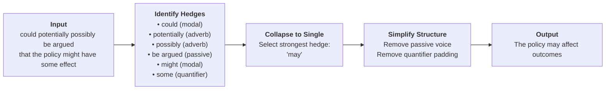
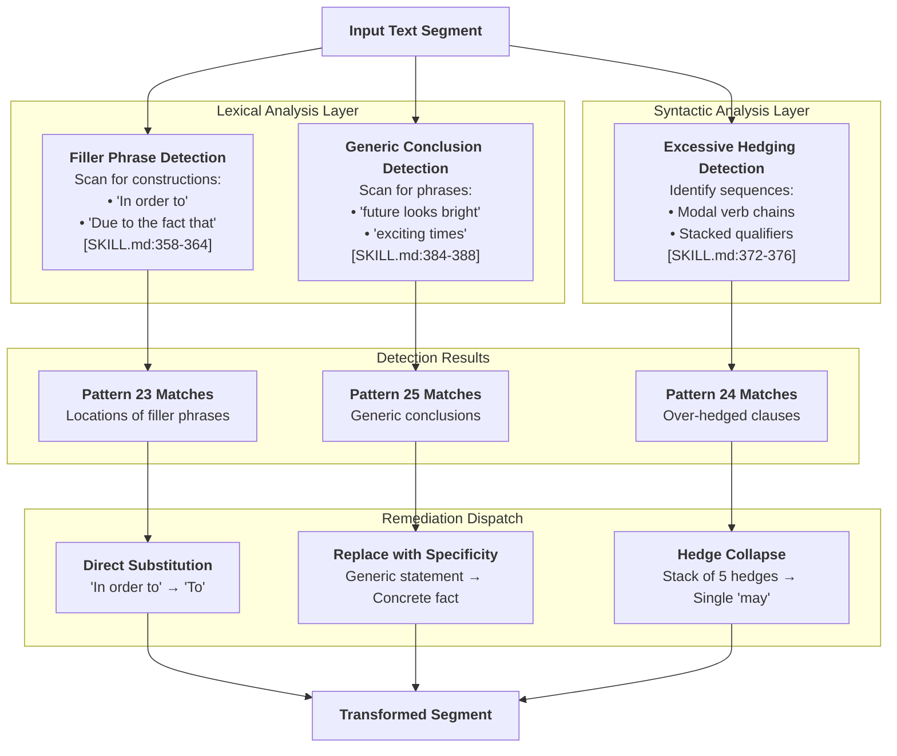
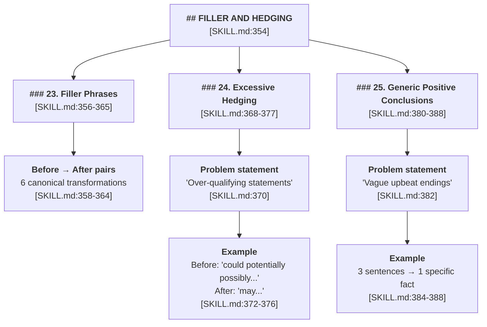

<!-- source: DeepWiki mcp.deepwiki.com · repo blader/humanizer · page 3.6 Filler and Hedging Patterns · fetched 2026-10-27 -->

# Filler and Hedging Patterns

<details>
<summary>Relevant source files</summary>

The following files were used as context for generating this wiki page:

- [README.md](README.md)
- [SKILL.md](SKILL.md)

</details>


## Purpose and Scope

This page documents the three Filler and Hedging patterns (patterns 23-25) detected and corrected by the Humanizer skill. These patterns represent unnecessary wordiness and over-qualification that LLMs use to pad text and avoid appearing definitive. Unlike content-level issues or structural problems, filler and hedging patterns target rhetorical bloat: words that consume space without adding meaning.

The three patterns in this category are:
- **Pattern 23**: Filler Phrases - verbose constructions replaceable by shorter equivalents.
- **Pattern 24**: Excessive Hedging - over-qualification through stacked modal verbs.
- **Pattern 25**: Generic Conclusions - vague positive endings that add no information.

These patterns are defined in [SKILL.md:354-390]() and summarized in [README.md:141-145]().

**Sources**: [SKILL.md:354-390](), [README.md:141-145]()

---

## Pattern Category Overview

Filler and hedging patterns arise from two distinct LLM behaviors:

1. **Statistical padding**: LLMs extend sentences to match the statistically expected length for formal writing, inserting prepositional phrases and conjunctive constructions.
2. **Confidence suppression**: Training on human feedback that penalizes overconfidence causes LLMs to stack qualifiers ("could potentially possibly") to avoid making definitive claims.

The remediation strategy for this category is **direct simplification**: remove filler, collapse hedges to single qualifiers, and replace generic statements with specific facts.

**Sources**: [SKILL.md:354-390]()

---

## Pattern 23: Filler Phrases

### Description

Filler phrases are multi-word constructions that can be replaced by shorter equivalents without loss of meaning. These phrases appear in AI text because LLMs generate token sequences that match the statistical distribution of formal writing, where verbose constructions are common.

The pattern definition in [SKILL.md:356-365]() provides six before/after pairs as canonical examples. The underlying issue is that LLMs lack the editorial judgment to prefer brevity over "formal-sounding" complexity.

**Sources**: [SKILL.md:356-365](), [README.md:143]()

### Detection Criteria

Detection operates at the lexical level through pattern matching. The system scans for known filler constructions:

| Filler Construction | Trigger Phrase | Replacement |
|---------------------|----------------|-------------|
| Purpose inflation | "In order to" | "To" |
| Causality padding | "Due to the fact that" | "Because" |
| Temporal bloat | "At this point in time" | "Now" |
| Conditional expansion | "In the event that" | "If" |
| Capability wrapper | "has the ability to" | "can" |
| Emphasis filler | "It is important to note that" | (remove entirely) |

The detection logic is implicit in the before/after examples rather than encoded as explicit regex patterns. The AI processor learns from the examples in [SKILL.md:358-364]().

**Sources**: [SKILL.md:356-365]()

### Examples from Pattern Definition

```
Before: "In order to achieve this goal"
After:  "To achieve this"

Before: "Due to the fact that it was raining"
After:  "Because it was raining"

Before: "The system has the ability to process"
After:  "The system can process"
```

**Sources**: [SKILL.md:358-364]()

---

## Pattern 24: Excessive Hedging

### Description

Excessive hedging stacks modal verbs and qualifiers beyond what is needed to express uncertainty. The pattern manifests as chains like "could potentially possibly be argued that... might have some effect."

The root cause is that LLMs trained with RLHF learn that unqualified statements get negative feedback, so they over-apply hedging to avoid confident claims. The statistical model does not distinguish between appropriate caution and rhetorical paralysis.

**Sources**: [SKILL.md:368-377](), [README.md:144]()

### Detection Criteria

Detection targets sequences containing multiple hedging elements:
- **Modal verbs**: could, might, may, would, should
- **Adverbial qualifiers**: potentially, possibly, arguably, perhaps
- **Passive constructions**: "it could be argued that"
- **Epistemic markers**: "some", "certain"

The canonical example in [SKILL.md:372-373]() shows the extreme case: "could potentially possibly be argued that the policy might have some effect" — five hedging elements in one clause.

**Sources**: [SKILL.md:368-377]()

### Transformation Example



**Sources**: [SKILL.md:372-376]()

### Remediation Strategy

The remediation strategy is **hedge collapse**: identify all hedging elements in a clause, select a single appropriate qualifier (typically "may" or "might"), and restructure the sentence to use active voice if necessary.

The pattern definition in [SKILL.md:372-376]() shows the transformation from five hedges to one. The resulting statement "The policy may affect outcomes" retains appropriate uncertainty without rhetorical excess.

**Sources**: [SKILL.md:372-377]()

---

## Pattern 25: Generic Conclusions

### Description

Generic conclusions are vague, upbeat statements that convey optimism without specific information. These conclusions appear because LLMs pattern-match on the expected structure of articles (introduction → body → conclusion) and generate statistically likely ending phrases.

**Sources**: [SKILL.md:380-388](), [README.md:145]()

### Detection Criteria

Detection identifies sentences containing:
- **Future-tense optimism**: "looks bright", "lie ahead", "promising future"
- **Journey metaphors**: "continue the journey", "path forward", "next chapter"
- **Vague positivity**: "exciting times", "great potential", "step in the right direction"

The canonical example in [SKILL.md:384-388]() demonstrates the pattern: three sentences that sound conclusive but provide zero factual information about actual plans.

**Sources**: [SKILL.md:380-388]()

### Before/After Comparison

```
Before:
"The future looks bright for the company. Exciting times 
lie ahead as they continue their journey toward excellence. 
This represents a major step in the right direction."

After:
"The company plans to open two more locations next year."
```

**Sources**: [SKILL.md:384-388]()

---

## Detection and Remediation Pipeline

The following diagram shows how filler and hedging patterns integrate into the multi-layer detection architecture described in [SKILL.md:22-35]() and the pattern library in [SKILL.md:354-390]().



**Sources**: [SKILL.md:354-390](), [SKILL.md:26-35]()

---

## Pattern Definition Structure in SKILL.md

The filler and hedging patterns follow the standard pattern documentation structure used throughout the `SKILL.md` file.



**Sources**: [SKILL.md:354-390]()

---

## Relationship to Other Pattern Categories

Filler and hedging patterns differ from other categories in their remediation approach:

| Category | Primary Strategy | Example |
|----------|------------------|---------|
| Content Patterns | Replace vague with specific | "Experts say" → "2019 survey by..." |
| Language Patterns | Simplify constructions | "serves as" → "is" |
| Style Patterns | Reformat or remove | Em dash → comma |
| Communication Patterns | Delete artifacts | "I hope this helps!" → (delete) |
| **Filler/Hedging** | **Condense or delete** | "In order to" → "To" |

The key distinction is that filler and hedging patterns target **redundancy** rather than **incorrectness**. The before versions are grammatically valid and semantically meaningful — they are just unnecessarily verbose.

**Sources**: [SKILL.md:92-390](), [README.md:93-145]()

---

## Synchronization Requirements

Changes to filler and hedging patterns must be synchronized between `SKILL.md` and `README.md` following the protocol defined in `WARP.md`.

- **Pattern Numbers**: Must match exactly (currently 23, 24, 25).
- **Examples**: Before/After examples in `README.md` must be derived from the canonical examples in `SKILL.md`.
- **Version History**: Any changes to these patterns must be documented in the version history section of `README.md`.

**Sources**: [README.md:141-145](), [README.md:175-200](), [WARP.md:15-45]()

---

