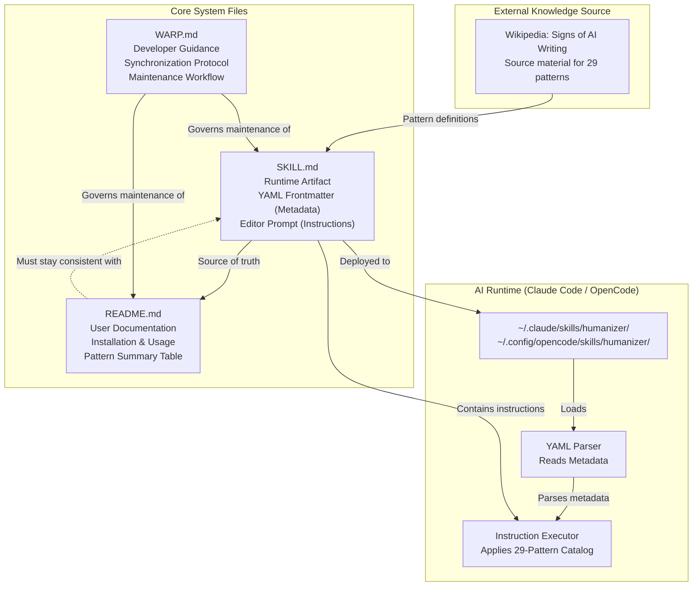
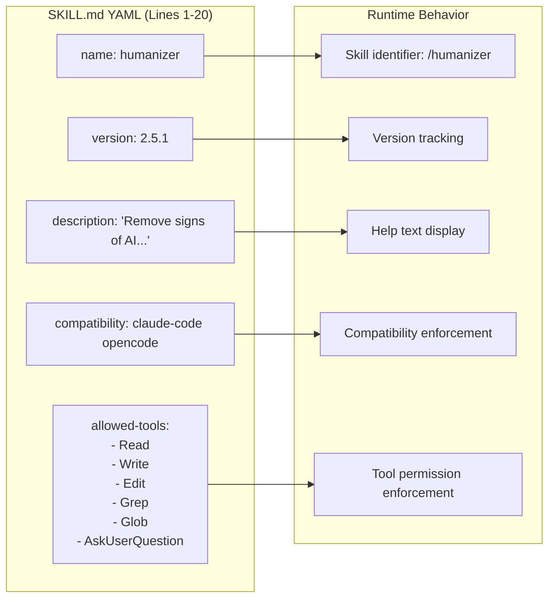
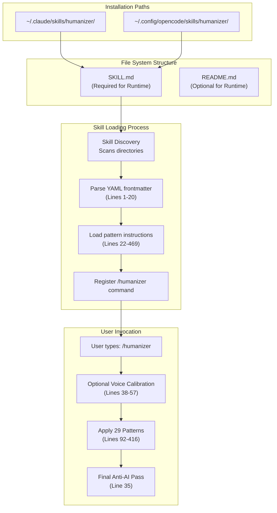
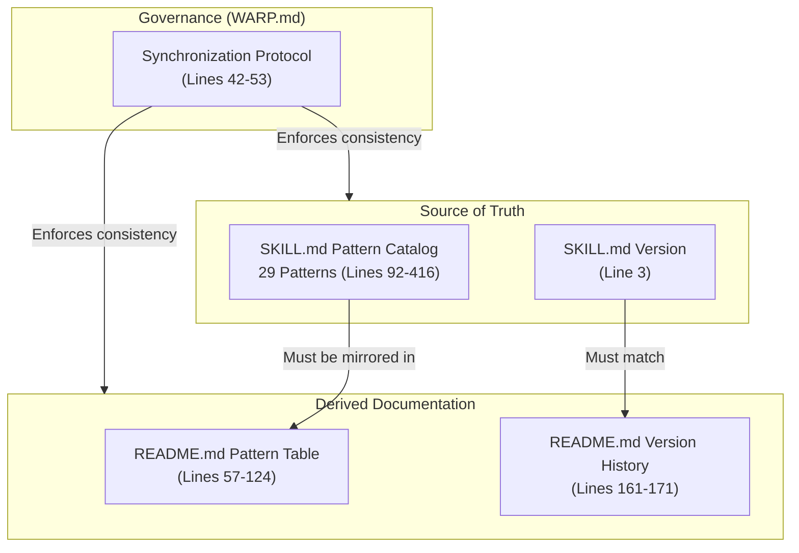

<!-- source: DeepWiki mcp.deepwiki.com · repo blader/humanizer · page 4.1 System Architecture · fetched 2026-10-27 -->

# System Architecture

Relevant source files

The following files were used as context for generating this wiki page:

- [SKILL.md](SKILL.md)
- [WARP.md](WARP.md)

## Purpose and Scope

This document describes the high-level architecture of the Humanizer system, including the three-file structure, the Claude Code and OpenCode plugin mechanisms, and the source-of-truth hierarchy that governs file relationships. This architecture supports a text transformation pipeline that removes AI writing patterns and injects personality.

## Architectural Overview

The Humanizer system is implemented as a **file-based skill** consisting of three Markdown files. Unlike traditional software systems that require compilation or runtime dependencies, the entire system is deployed by placing a single Markdown file (`SKILL.md`) in a specific directory location. The architecture prioritizes simplicity, maintainability, and zero-dependency deployment.

The system follows a strict source-of-truth hierarchy:
1. Wikipedia article "Signs of AI writing" provides the foundational pattern taxonomy [SKILL.md:24-24]().
2. `SKILL.md` implements these patterns as executable AI instructions and contains the runtime YAML frontmatter [SKILL.md:1-20]().
3. `README.md` documents the patterns for human users [README.md:1-171]().
4. `WARP.md` provides meta-guidance for maintaining the first two files [WARP.md:1-53]().

**Sources:** [SKILL.md:1-469](), [README.md:1-171](), [WARP.md:1-53]()

## Three-File Architecture

The system's modularity is defined by the interaction between three primary files, each serving a distinct role in the development and execution lifecycle.

**Figure 1: Three-File Architecture and Relationships**

| File | Purpose | Primary Audience | Key Components |
|------|---------|------------------|--------------|
| `SKILL.md` | Runtime artifact consumed by the AI agent | Claude Code / OpenCode | YAML frontmatter [SKILL.md:1-20](), Voice Calibration [SKILL.md:38-57](), 29-Pattern Catalog [SKILL.md:92-416]() |
| `README.md` | User documentation and installation guide | End users | Installation instructions [README.md:11-30](), Usage patterns [README.md:32-48](), Pattern table [README.md:57-124]() |
| `WARP.md` | Meta-documentation for maintainers | Developers | File relationships [WARP.md:12-21](), Synchronization protocol [WARP.md:42-53]() |

**Sources:** [SKILL.md:1-20](), [README.md:11-124](), [WARP.md:1-53]()

## YAML Frontmatter and Runtime Mapping

The `SKILL.md` file begins with YAML frontmatter that configures the skill's metadata and permissions, which are mapped directly to the runtime environment's capabilities.

**Figure 2: YAML Frontmatter to Runtime Mapping**

The frontmatter controls:
- **`name`** [SKILL.md:2](): Determines the invocation command (`/humanizer`).
- **`version`** [SKILL.md:3](): Must match the version in `README.md` [README.md:161-171]() and [WARP.md:43-46]().
- **`compatibility`** [SKILL.md:12](): Explicitly supports `claude-code` and `opencode`.
- **`allowed-tools`** [SKILL.md:13-19](): Whitelist of tools the skill can invoke to process files.

**Sources:** [SKILL.md:1-20](), [WARP.md:42-46](), [README.md:161-171]()

## Plugin Architecture (Claude Code & OpenCode)

The system supports a dual-platform plugin architecture. Discovery and registration are handled by the host application scanning specific local directories.

**Figure 3: Plugin Loading and Execution Flow**

1. **Discovery**: The host (Claude Code or OpenCode) scans the designated skill directory [README.md:11-30]().
2. **Registration**: The host parses the YAML `name` and registers the `/humanizer` command [SKILL.md:2]().
3. **Instruction Loading**: The remainder of `SKILL.md` is treated as a system prompt for the writing editor [SKILL.md:24-35]().
4. **Processing**: The skill executes a multi-step pipeline: voice calibration [SKILL.md:40-52](), pattern remediation [SKILL.md:92-416](), and a final "anti-AI audit pass" [SKILL.md:35-35]().

**Sources:** [SKILL.md:1-57](), [SKILL.md:92-416](), [README.md:11-30](), [WARP.md:37-40]()

## Source-of-Truth Hierarchy

To prevent documentation drift, the system enforces a strict hierarchy where `SKILL.md` is the primary source of truth for behavior and pattern definitions.

**Figure 4: Source-of-Truth Hierarchy**

| Requirement | Enforcement |
|-------------|-------------|
| **Pattern Consistency** | The 29 patterns defined in `SKILL.md` [SKILL.md:92-416]() must align with the summary table in `README.md` [README.md:57-124](). |
| **Version Sync** | The `version` field in `SKILL.md` [SKILL.md:3]() must match the latest entry in `README.md`'s Version History [README.md:163-171](). |
| **Update Workflow** | Developers must edit `SKILL.md` first, then update `README.md` to maintain consistency [WARP.md:21-21](). |

**Sources:** [SKILL.md:3-3](), [SKILL.md:92-416](), [README.md:57-124](), [README.md:161-171](), [WARP.md:12-21](), [WARP.md:42-53]()

---

