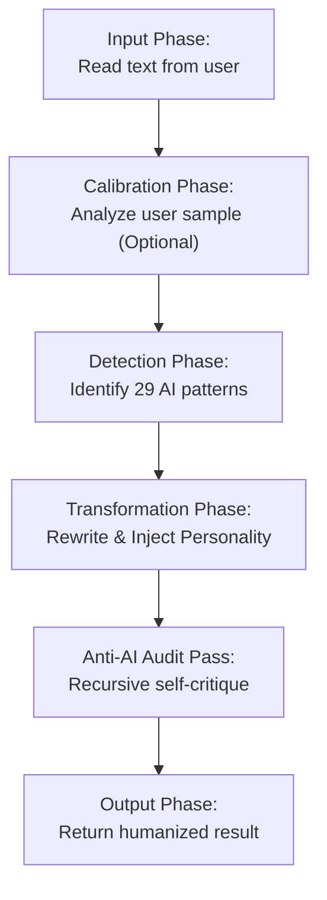
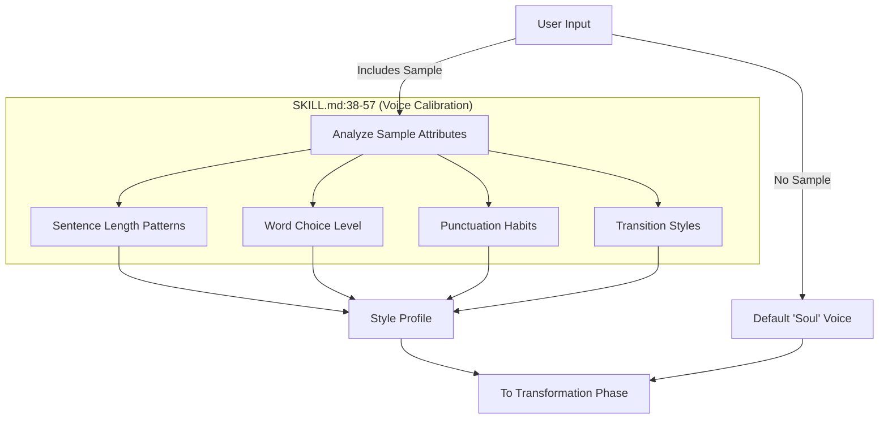
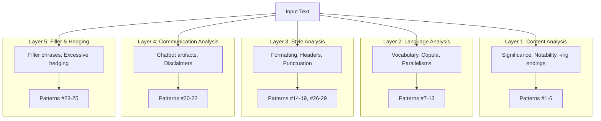
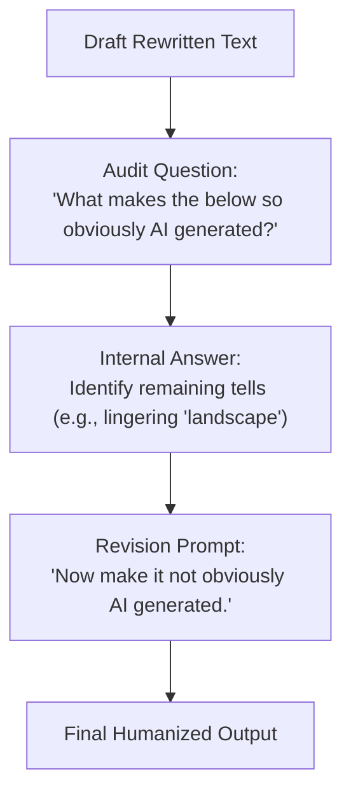

<!-- source: DeepWiki mcp.deepwiki.com · repo blader/humanizer · page 4.3 Processing Pipeline · fetched 2026-10-27 -->

# Processing Pipeline

Relevant source files

The following files were used as context for generating this wiki page:

- [README.md](README.md)
- [SKILL.md](SKILL.md)

This document describes the text transformation pipeline that executes when the Humanizer skill processes input text. It covers the six-phase execution model: input reading, optional voice calibration, pattern identification, rewriting, the anti-AI audit pass, and output generation. It also explains the dual-purpose architecture that combines technical pattern removal with creative personality injection.

## Pipeline Overview

The Humanizer skill executes a sequential six-phase pipeline when processing text. Each phase operates on the output of the previous phase, culminating in a specialized recursive audit pass to ensure the final result is indistinguishable from human writing.

**Pipeline Phases:**

| Phase | Primary Function | SKILL.md Reference | Allowed Tools |
|-------|-----------------|-------------------|---------------|
| Input | Read user-provided text | [SKILL.md:28-28]() | `Read`, `AskUserQuestion` |
| Calibration | Extract style from user sample | [SKILL.md:38-57]() | `Read` |
| Detection | Scan for 29 AI patterns | [SKILL.md:30-30]() | `Read`, `Grep` |
| Transformation | Rewrite text + inject "soul" | [SKILL.md:31-34]() | `Write`, `Edit` |
| Audit Pass | Final "obviously AI" critique | [SKILL.md:35-35]() | `Read` |
| Output | Present humanized text | [README.md:41-41]() | `Write` |

The allowed tools are specified in the YAML frontmatter at [SKILL.md:13-20]().

**Sources:** [SKILL.md:1-36](), [README.md:1-146]()

## Input and Voice Calibration Phase

The input phase accepts text through direct command invocation (`/humanizer`) or natural language. If a user provides a writing sample, the **Voice Calibration** sub-process triggers to ensure the output matches the user's unique style rather than a generic "human" voice.

The system analyzes sentence rhythm, word choices (e.g., "stuff" vs "elements"), and paragraph starts to create a style profile [SKILL.md:42-50](). If no sample is provided, it falls back to the "Personality and Soul" default behavior [SKILL.md:52-52]().

**Sources:** [SKILL.md:38-57](), [README.md:65-80]()

## Pattern Detection Phase

The detection phase scans input text using a multi-layer analysis approach covering 29 distinct patterns derived from Wikipedia's "Signs of AI writing" [SKILL.md:24-24]().

### Multi-Layer Analysis Architecture

**Pattern Library (v2.5.1):**
The system currently identifies 29 patterns across five categories [README.md:91-146](). Notable recent additions include:
- **Pattern #13:** Passive voice and subjectless fragments [SKILL.md:225-235]().
- **Pattern #26:** Hyphenated word pairs (e.g., "data-driven") [SKILL.md:364-374]().
- **Pattern #29:** Fragmented headers [SKILL.md:405-416]().

**Sources:** [SKILL.md:92-416](), [README.md:91-146]()

## Transformation and Personality Injection

Transformation involves two simultaneous operations: removing the "slop" (technical remediation) and adding "soul" (personality injection).

### Personality Injection Strategies
As per [SKILL.md:59-61](), sterile writing is as obvious as AI. The system applies specific "human" traits:

| Strategy | Action | SKILL.md Reference |
|----------|--------|-------------------|
| **Have Opinions** | React to facts rather than just reporting them | [SKILL.md:73-73]() |
| **Vary Rhythm** | Mix short, punchy sentences with long, flowing ones | [SKILL.md:75-75]() |
| **Acknowledge Complexity** | Express mixed feelings or uncertainty | [SKILL.md:77-77]() |
| **Use First-Person** | Use "I" to signal a real person thinking | [SKILL.md:79-79]() |
| **Let Mess In** | Include tangents, asides, or half-formed thoughts | [SKILL.md:81-81]() |

**Sources:** [SKILL.md:59-84]()

## The Anti-AI Audit Pass

Unique to this pipeline is the final recursive audit pass defined at [SKILL.md:35-35](). This acts as a quality assurance gate to catch lingering "tells" that individual pattern matching might miss.

This step ensures the model critiques its own output from an adversarial perspective before finalizing the text.

**Sources:** [SKILL.md:35-35]()

## Output Generation

The output phase returns the final text. If the transformation was successful, the text will have shifted from the "clean but soulless" style [SKILL.md:85-86]() to the "has a pulse" style [SKILL.md:88-89]().

**Example Shift:**
- **AI-ism:** "AI-assisted coding serves as an enduring testament..." [README.md:152-152]()
- **Humanized:** "I genuinely don't know how to feel about this one. 3 million lines of code..." [SKILL.md:89-89]()

**Sources:** [SKILL.md:85-90](), [README.md:147-156]()

---

