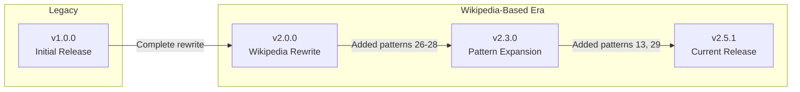
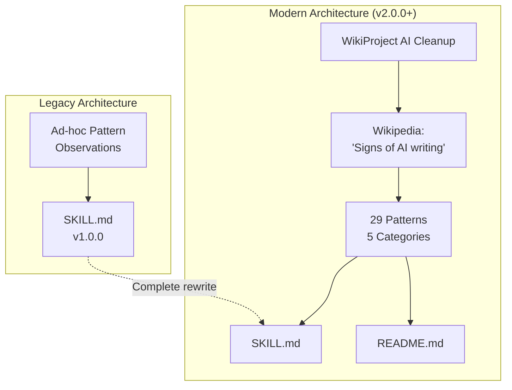
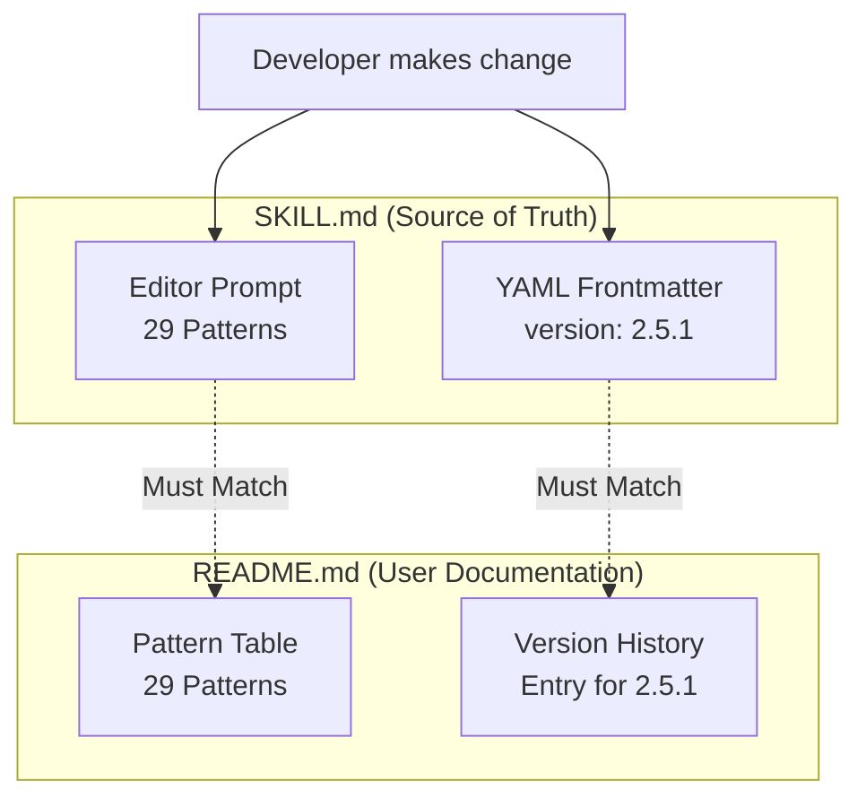

<!-- source: DeepWiki mcp.deepwiki.com · repo blader/humanizer · page 5.3 Version History and Evolution · fetched 2026-10-27 -->

# Version History and Evolution

Relevant source files

The following files were used as context for generating this wiki page:

- [README.md](README.md)
- [WARP.md](WARP.md)

## Purpose and Scope

This page documents the version history of the Humanizer skill, explaining major changes between releases, the criteria for version increments, and the synchronization protocol for version metadata. It covers the evolution from the initial 1.0.0 release, the critical 2.0.0 Wikipedia-based rewrite, and the recent expansion in the 2.3.0–2.5.1 cycle which increased the pattern set from 24 to 29. For guidance on maintaining version numbers during development, see [Synchronization Protocol](#5.2).

---

## Version Timeline and Release History

The Humanizer skill has evolved from a basic set of observations into a comprehensive 29-pattern framework. Version 2.0.0 established the Wikipedia-based foundation, while the 2.5.x branch represents the current state of the art in AI detection.

**Version Timeline Diagram**

Sources: [README.md:81-91](), [README.md:104-129]()

### Complete Version History Table

| Version | Type | Changes | Files Modified | Rationale |
|---------|------|---------|----------------|-----------|
| **1.0.0** | Major | Initial release with basic pattern detection | `SKILL.md`, `README.md` | First working implementation. |
| **2.0.0** | Major | Complete rewrite based on Wikipedia's "Signs of AI writing" | `SKILL.md`, `README.md` | Fundamental change in knowledge source and taxonomy. |
| **2.3.0** | Minor | Expanded pattern set to 28 patterns | `SKILL.md`, `README.md` | Added patterns #26 (Hyphenated pairs), #27 (Authority tropes), and #28 (Signposting). |
| **2.5.1** | Minor | Current version: 29 patterns | `SKILL.md`, `README.md` | Added #13 (Passive voice/fragments) and #29 (Fragmented headers). |

Sources: [README.md:91](), [README.md:114](), [README.md:126-129](), [WARP.md:42-51]()

---

## The 2.0.0 Watershed: Wikipedia-Based Rewrite

Version 2.0.0 represents a complete architectural pivot from ad-hoc observations to empirically-grounded analysis based on Wikipedia's research.

**Knowledge Source Evolution Diagram**

Sources: [README.md:81-91](), [WARP.md:12-22]()

### Expansion from 24 to 29 Patterns (v2.3.0–v2.5.1)

While the 2.0.0 release established the core 24 patterns, subsequent minor releases identified more nuanced AI-isms that required explicit detection logic.

**Pattern Addition History**

| Pattern ID | Name | Added In | Category |
|------------|------|----------|----------|
| **#26** | Hyphenated word pairs | v2.3.0 | Style |
| **#27** | Persuasive authority tropes | v2.3.0 | Style |
| **#28** | Signposting announcements | v2.3.0 | Style |
| **#13** | Passive voice / fragments | v2.5.1 | Language |
| **#29** | Fragmented headers | v2.5.1 | Style |

Sources: [README.md:114](), [README.md:126-129]()

---

## Versioning System and Metadata Synchronization

The Humanizer skill follows a synchronization protocol to ensure that the executable instructions in `SKILL.md` match the documentation in `README.md`.

**Version Metadata Synchronization Map**

Sources: [WARP.md:12-22](), [WARP.md:42-51]()

### Versioning Rules

1.  **MAJOR version bump**: Triggered by a fundamental change in behavior or a complete rewrite (e.g., 1.0.0 → 2.0.0). [WARP.md:42-47]()
2.  **MINOR version bump**: Triggered by adding new patterns (e.g., adding patterns 26-29) or improving detection logic. [README.md:91]()
3.  **PATCH version bump**: Triggered by documentation fixes or correcting examples. [WARP.md:52-53]()

### Documenting Non-Obvious Fixes

Per the maintenance guidelines, developers must document "non-obvious fixes" in the version history. These are changes made to handle tricky failure modes, such as:
*   Repeated mis-edits by the model.
*   Unexpected tone shifts in specific contexts.
*   Ambiguous pattern examples that led to incorrect rewrites.

Sources: [WARP.md:52-53]()

---

## Pattern Number Stability

Pattern numbers (currently #1 through #29) are treated as stable identifiers. This allows users and developers to refer to specific AI-isms (e.g., "Pattern #7: AI vocabulary") consistently across versions.

**Pattern Stability Rules**

*   **No Renumbering**: Do not change existing pattern numbers unless a MAJOR version bump is planned. [WARP.md:50-51]()
*   **Sequential Addition**: New patterns are added to the end of the list or within their respective categories while maintaining the global count. [README.md:91-145]()
*   **Source of Truth**: The `SKILL.md` prompt is the canonical list; the `README.md` table is a summarized reflection. [WARP.md:21-22]()

| Feature | Pre-2.3.0 | v2.5.1 (Current) |
|---------|-----------|------------------|
| Total Patterns | 24 | 29 |
| Categories | 5 | 5 |
| Source | Wikipedia | Wikipedia + Internal Research |

Sources: [README.md:91-145](), [WARP.md:12-22]()

---

