# Page: Overview

# Overview

<details>
<summary>Relevant source files</summary>

The following files were used as context for generating this wiki page:

- [README.md](README.md)
- [SKILL.md](SKILL.md)

</details>


## Purpose and Scope

This document provides a high-level overview of the Humanizer system: a Claude Code and OpenCode skill that detects and removes patterns characteristic of AI-generated text. It covers the system's architecture, the problem it solves, the pattern taxonomy it implements, and how the components interact.

The Humanizer is designed to bridge the gap between sterile, statistically-likely LLM output and natural, "soulful" human writing. It uses a library of 29 empirically-derived patterns to identify and remediate common "AI-isms."

Sources: [SKILL.md:1-10](), [README.md:1-4](), [WARP.md:5-9]()

---

## What is Humanizer

Humanizer is a file-based skill that transforms AI-generated text to sound more natural. It operates as a runtime artifact (`SKILL.md`) containing YAML metadata and pattern-matching instructions that compatible agents load and execute.

The system is based on Wikipedia's "Signs of AI writing" article, maintained by WikiProject AI Cleanup. This foundation provides empirical grounding: the patterns cataloged in `SKILL.md` derive from analysis of thousands of AI-generated text instances observed on Wikipedia.

**Key characteristics:**
- **Zero-compilation deployment**: Markdown files only, no binary dependencies.
- **File-based plugin architecture**: Installed in `~/.claude/skills/humanizer/` or `~/.config/opencode/skills/humanizer/`.
- **29 documented patterns**: Organized across 5 categories (Content, Language, Style, Communication, Filler).
- **Dual-purpose processing**: Pattern removal combined with personality injection.
- **YAML-driven configuration**: Explicit tool permissions (`Read`, `Write`, `Edit`, `Grep`, `Glob`, `AskUserQuestion`).

Sources: [README.md:5-40](), [SKILL.md:1-20](), [SKILL.md:24-25](), [WARP.md:5-9]()

---

## The Problem: Statistical Text Generation

AI language models generate text by predicting statistically likely next tokens. As noted in the system's key insights: "LLMs use statistical algorithms to guess what should come next. The result tends toward the most statistically likely result that applies to the widest variety of cases."

This produces characteristic failure modes:
- **Significance inflation**: Arbitrary aspects described as "pivotal moments" or "evolving landscapes."
- **Copula avoidance**: Overusing "serves as" or "boasts" instead of "is" or "has."
- **Promotional language**: Adjective-heavy descriptions like "nestled within the breathtaking region."
- **Vague attributions**: "Experts believe" or "observers have noted" without specific citations.
- **Formulaic structure**: Patterns like "Despite challenges... continues to thrive."

The system addresses not just mechanical patterns but also "soulless writing" that lacks human voice—monotonous rhythm, neutrality where opinion is warranted, and a lack of first-person perspective.

Sources: [SKILL.md:59-84](), [SKILL.md:94-105](), [README.md:87-90]()

---

## System Architecture: Three-File Design

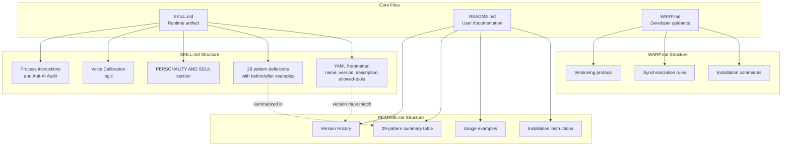

**Diagram 1: Three-File Architecture and Internal Structure**

The system consists of three Markdown files with distinct purposes:

| File | Purpose | Audience | Key Content |
|------|---------|----------|-------------|
| `SKILL.md` | Runtime artifact (source of truth) | Claude Code / OpenCode | YAML frontmatter, 29 patterns, `Voice Calibration`, `PERSONALITY AND SOUL` |
| `README.md` | User documentation | End users | Installation commands, usage examples, 29-pattern summary table, version history |
| `WARP.md` | Meta-documentation | Developers | Synchronization rules, versioning protocol, maintenance workflow |

The hierarchy is strict: `SKILL.md` defines behavior, `README.md` documents it, `WARP.md` governs maintenance. Version numbers in the YAML frontmatter ([SKILL.md:3]()) must match the version history in [README.md:154-162]().

Sources: [SKILL.md:1-20](), [README.md:1-162](), [WARP.md:1-52]()

---

## Pattern Taxonomy: 29 Patterns in 5 Categories

```mermaid
graph TB
    subgraph "Pattern Categories"
        CONTENT["CONTENT PATTERNS<br/>Patterns #1-6"]
        LANGUAGE["LANGUAGE AND GRAMMAR<br/>Patterns #7-13"]
        STYLE["STYLE PATTERNS<br/>Patterns #14-19, 26-29"]
        COMM["COMMUNICATION PATTERNS<br/>Patterns #20-22"]
        FILLER["FILLER AND HEDGING<br/>Patterns #23-25"]
    end
    
    subgraph "Content Examples"
        P1["#1: Significance inflation<br/>'pivotal moment'"]
        P3["#3: Superficial -ing<br/>'symbolizing... reflecting'"]
    end
    
    subgraph "Language Examples"
        P7["#7: AI vocabulary<br/>'additionally, testament'"]
        P8["#8: Copula avoidance<br/>'serves as' vs 'is'"]
        P13["#13: Passive voice<br/>Subjectless fragments"]
    end
    
    subgraph "Style Examples"
        P14["#14: Em dash overuse"]
        P26["#26: Hyphenated pairs<br/>'data-driven'"]
        P28["#28: Signposting<br/>'Let's dive in'"]
    end
    
    subgraph "Communication Examples"
        P20["#20: Chatbot artifacts<br/>'I hope this helps!'"]
        P22["#22: Sycophantic tone"]
    end
    
    CONTENT --> P1
    CONTENT --> P3
    LANGUAGE --> P7
    LANGUAGE --> P8
    LANGUAGE --> P13
    STYLE --> P14
    STYLE --> P26
    STYLE --> P28
    COMM --> P20
    COMM --> P22
```

**Diagram 2: Pattern Taxonomy with Code Entity References**

The 29 patterns are organized into 5 categories, each implemented as a section in `SKILL.md`:

| Category | Patterns | Section in SKILL.md |
|----------|----------|---------------------|
| Content Patterns | #1-6 | `## CONTENT PATTERNS` [SKILL.md:92-154]() |
| Language and Grammar | #7-13 | `## LANGUAGE AND GRAMMAR PATTERNS` [SKILL.md:156-241]() |
| Style Patterns | #14-19, 26-29 | `## STYLE PATTERNS` [SKILL.md:243-346]() |
| Communication Patterns | #20-22 | `## COMMUNICATION PATTERNS` [SKILL.md:348-388]() |
| Filler and Hedging | #23-25 | `## FILLER AND HEDGING` [SKILL.md:390-426]() |

Each pattern definition includes a "Words to watch" list (lexical triggers), a problem description, and a before/after example to guide the model's transformation logic.

Sources: [SKILL.md:92-426](), [README.md:91-145]()

---

## Processing Model: Detection and Remediation

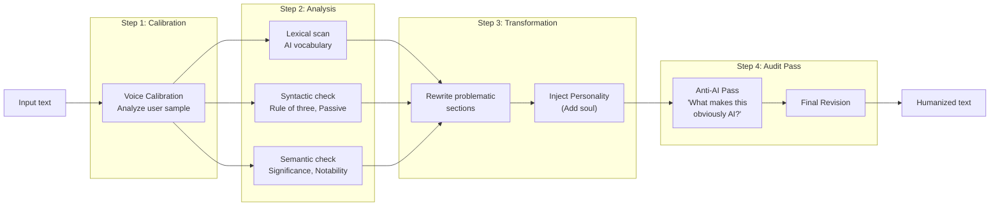

**Diagram 3: Processing Pipeline with Logic Flows**

The processing pipeline operates through distinct phases defined in the `## Your Task` section [SKILL.md:26-36]():

1.  **Voice Calibration (Optional)**: If a user provides a sample, the system analyzes sentence length patterns, word choice level, and punctuation habits to match the user's specific voice [SKILL.md:38-57]().
2.  **Pattern Identification**: Scanning for the 29 documented AI patterns [SKILL.md:30]().
3.  **Remediation and Personality Injection**: Replacing AI-isms with natural alternatives while adding "soul"—opinions, varied rhythm, and specific feelings [SKILL.md:31-34]().
4.  **Anti-AI Audit Pass**: A critical final step where the system asks itself "What makes the below so obviously AI generated?" and performs a final revision based on the remaining tells [SKILL.md:35]().

Sources: [SKILL.md:26-57](), [SKILL.md:433-461]()

---

## Runtime Integration: Skill Architecture

The system utilizes a standard skill directory structure for Claude Code and OpenCode. The `SKILL.md` file serves as the manifest and instruction set.

| Field | Value | Purpose |
|-------|-------|---------|
| `name` | `humanizer` | The command name used for invocation (`/humanizer`) [SKILL.md:2]() |
| `version` | `2.5.1` | Current release version [SKILL.md:3]() |
| `allowed-tools` | `Read, Write, Edit, Grep, Glob, AskUserQuestion` | Permissions granted to the skill to interact with files [SKILL.md:13-19]() |

**Installation paths:**
- Claude Code: `~/.claude/skills/humanizer/SKILL.md` [README.md:12-13]()
- OpenCode: `~/.config/opencode/skills/humanizer/SKILL.md` [README.md:28-29]()

Sources: [SKILL.md:1-20](), [README.md:5-40]()

---

## Synchronization Protocol

The `WARP.md` file defines the maintenance protocol to ensure the three files remain in sync:

- **Source of Truth**: `SKILL.md` is the primary file. Any logic or pattern changes must start here [WARP.md:21-22]().
- **Documentation Sync**: When patterns are added or removed in `SKILL.md`, the summary table in `README.md` must be updated to match [WARP.md:37-40]().
- **Versioning**: The version number in `SKILL.md` YAML must match the top of `README.md` and the `Version History` section [WARP.md:30-35]().

Sources: [WARP.md:21-52](), [README.md:154-162]()

---

# Page: Installation and Usage

# Installation and Usage

<details>
<summary>Relevant source files</summary>

The following files were used as context for generating this wiki page:

- [README.md](README.md)
- [WARP.md](WARP.md)

</details>


This page provides an overview of how to install and use the Humanizer skill in Claude Code and OpenCode. It covers the plugin architecture, file placement requirements, installation methods, and invocation patterns. For detailed installation instructions, see [Installation](#2.1). For comprehensive usage examples and invocation patterns, see [Using the Humanizer Skill](#2.2).

The Humanizer skill operates as a file-based plugin. Installation involves placing the `SKILL.md` file in a specific directory (e.g., `~/.claude/skills/humanizer/`), after which the host environment automatically discovers and loads it based on YAML frontmatter metadata [SKILL.md:1-18]().

---

## Plugin Architecture

The Humanizer skill leverages a file-based plugin system common to Claude Code and OpenCode. Each skill is defined by a `SKILL.md` file containing YAML frontmatter (metadata) and Markdown instructions (behavior) [WARP.md:8-9]().

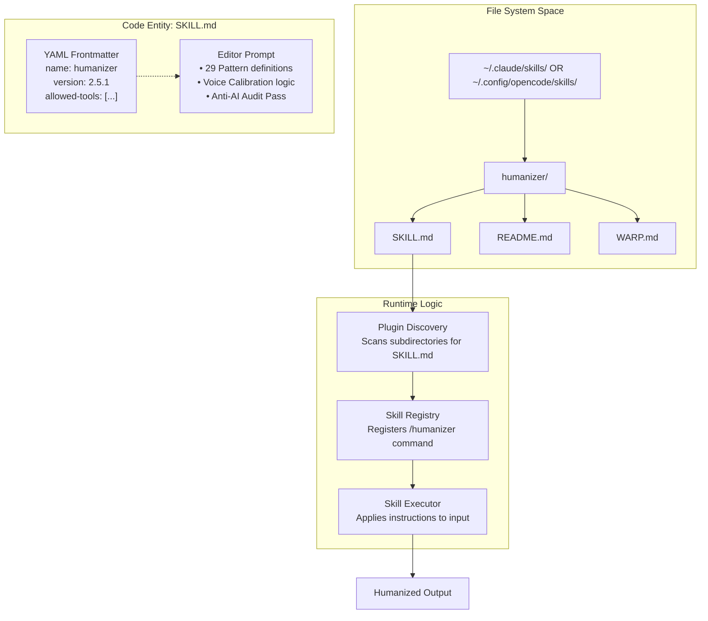

**Plugin Discovery and Loading Sequence**

The runtime loads skills in three phases:
1. **Discovery**: Scans subdirectories for `SKILL.md` files [README.md:9-37]().
2. **Parsing**: Extracts YAML frontmatter to determine skill name, version, and allowed tools [SKILL.md:1-18]().
3. **Registration**: Makes the skill available via command (`/humanizer`) and natural language invocation [README.md:46-63]().

Sources: [SKILL.md:1-18](), [README.md:9-37](), [WARP.md:8-9]()

---

## Directory Structure and File Placement

The Humanizer skill requires specific directory placement to be discovered. OpenCode also scans the Claude Code directory for compatibility [README.md:39]().

| Tool | Required Path | Required File |
|------|---------------|---------------|
| **Claude Code** | `~/.claude/skills/humanizer/` | `SKILL.md` |
| **OpenCode** | `~/.config/opencode/skills/humanizer/` | `SKILL.md` |

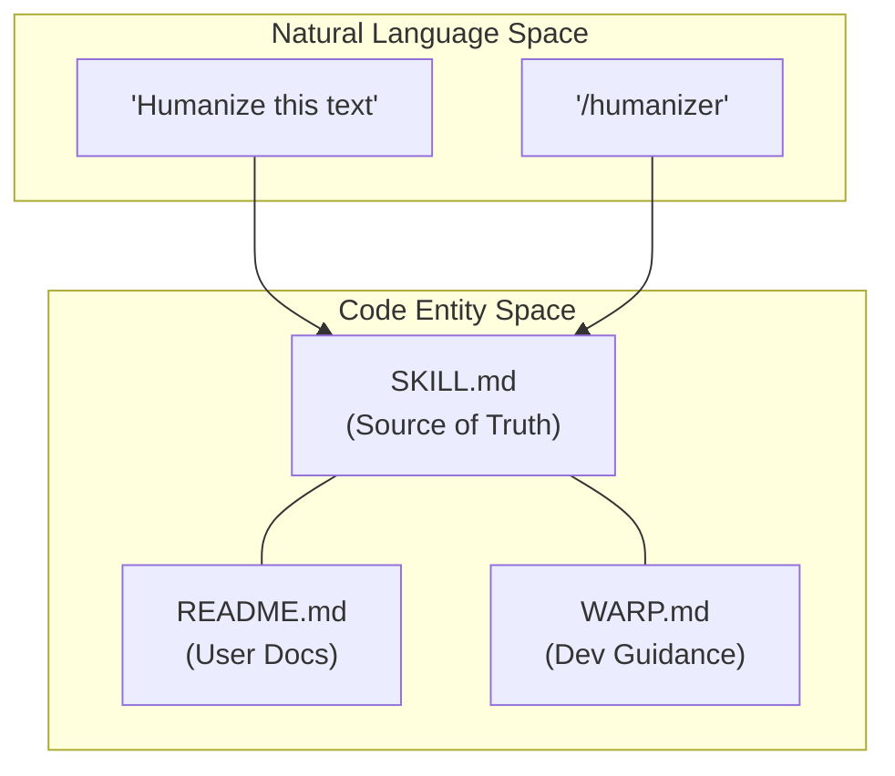

**File System Layout and Documentation Hierarchy**
- `SKILL.md`: The actual skill definition and "runtime" artifact [WARP.md:8-9]().
- `README.md`: Installation, usage, and a summarized table of the 29 patterns for humans [WARP.md:10]().
- `WARP.md`: Developer-facing guidance for maintaining the repository [WARP.md:1-3]().

Sources: [README.md:9-39](), [WARP.md:12-21]()

---

## Installation Methods

Users can choose between cloning the full repository or copying only the essential skill file.

1. **Git Clone Method** (Recommended):
   ```bash
   mkdir -p ~/.claude/skills
   git clone https://github.com/blader/humanizer.git ~/.claude/skills/humanizer
   ```
   This allows for easy updates via `git pull` [README.md:9-14]().

2. **Manual Copy Method**:
   ```bash
   mkdir -p ~/.claude/skills/humanizer
   cp SKILL.md ~/.claude/skills/humanizer/
   ```
   Useful if the repository is already downloaded locally [README.md:16-21]().

Detailed instructions for both Claude Code and OpenCode are provided in [Installation](#2.1).

Sources: [README.md:7-37](), [WARP.md:25-35]()

---

## Usage Patterns

Once installed, the Humanizer skill can be invoked through several patterns:

### Command and Prompting
The skill is typically invoked using the `/humanizer` command followed by the text to be processed [README.md:46-57](). It also responds to natural language requests like "Please humanize this text" [README.md:59-63]().

### Voice Calibration
A unique feature of the Humanizer is **Voice Calibration**. Users can provide a sample of their own writing (2-3 paragraphs) before the AI text. The skill analyzes sentence rhythm and word choices to match the user's personal style [README.md:65-79]().

### Processing Pipeline
The skill executes a multi-stage transformation:
1. **Pattern Identification**: Scans for the 29 AI writing patterns [README.md:91-145]().
2. **Remediation**: Rewrites the text to remove identified AI-isms [SKILL.md:406-410]().
3. **Anti-AI Audit**: Performs a second pass to catch lingering artifacts [README.md:85]().

For detailed usage examples and advanced calibration techniques, see [Using the Humanizer Skill](#2.2).

Sources: [README.md:41-85](), [SKILL.md:24-32]()

---

## Version Management

The skill version (currently **2.5.1**) is defined in the `SKILL.md` YAML frontmatter [SKILL.md:3](). Maintainers must ensure this version matches the `README.md` version history [WARP.md:42-46]().

| Version | Key Changes |
|---------|-------------|
| 2.0.0 | Complete rewrite based on Wikipedia's "Signs of AI writing" [README.md:83](). |
| 2.3.0 - 2.5.1 | Expansion from 24 to 29 patterns, including fragmented headers and persuasive authority tropes [README.md:126-129](). |

For maintenance workflows and synchronization protocols, see the [Developer Guide](#5).

Sources: [SKILL.md:3](), [README.md:133-145](), [WARP.md:42-53]()

---

# Page: Installation

# Installation

<details>
<summary>Relevant source files</summary>

The following files were used as context for generating this wiki page:

- [README.md](README.md)
- [WARP.md](WARP.md)

</details>


## Purpose and Scope

This page provides detailed instructions for installing the Humanizer skill into both **Claude Code** and **OpenCode**. It covers the directory structure requirements, two installation methods (git clone and manual copy), and file placement verification. For usage instructions after installation, see [Using the Humanizer Skill](). For information about maintaining and updating the skill files, see [Maintenance Guidelines]().

## Prerequisites

The Humanizer skill requires:

- **Claude Code** or **OpenCode** environment with skill loading capability.
- **File system access** to create directories in the respective configuration paths.
- **Git** (optional, only required for the git clone installation method).

The skill has no external binary dependencies; it is implemented as a Markdown-based skill artifact [WARP.md:5-9]().

## System-Specific Directory Structures

Both tools load skills from standardized directory hierarchies. While they have different default paths, OpenCode maintains compatibility by also scanning the Claude Code skills directory [README.md:39-40]().

### Claude Code Structure
**Path:** `~/.claude/skills/humanizer/` [README.md:12-13]()

### OpenCode Structure
**Path:** `~/.config/opencode/skills/humanizer/` [README.md:28-29]()

**Installation Directory Diagram**

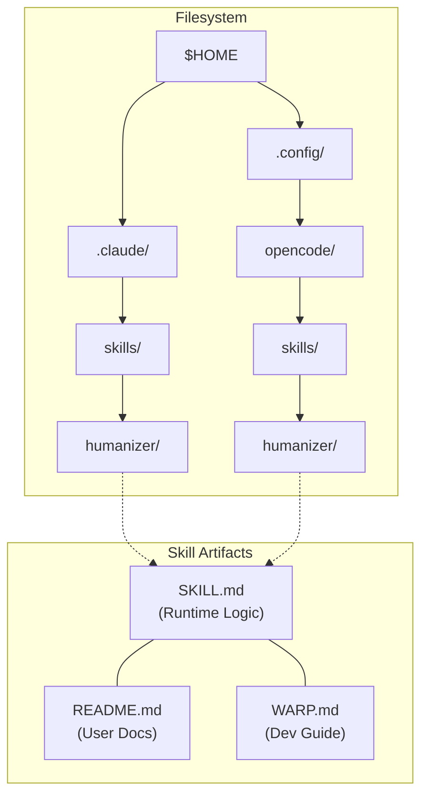

Sources: [README.md:7-40](), [WARP.md:12-21]()

### Required vs. Optional Files

| File | Status | Purpose |
|------|--------|---------|
| `SKILL.md` | **Required** | The "runtime" artifact containing YAML metadata and the editor prompt [WARP.md:8-9](). |
| `README.md` | Optional | Human-readable installation, usage, and pattern overview [WARP.md:10-10](). |
| `WARP.md` | Optional | Developer guidance and maintenance protocols [WARP.md:1-3](). |

Sources: [WARP.md:12-21]()

## Installation Method 1: Git Clone (Recommended)

The recommended method clones the repository directly into the skills directory. This allows for easy updates via `git pull`.

### For Claude Code
```bash
mkdir -p ~/.claude/skills
git clone https://github.com/blader/humanizer.git ~/.claude/skills/humanizer
```
Sources: [README.md:11-14](), [WARP.md:25-29]()

### For OpenCode
```bash
mkdir -p ~/.config/opencode/skills
git clone https://github.com/blader/humanizer.git ~/.config/opencode/skills/humanizer
```
Sources: [README.md:27-30]()

## Installation Method 2: Manual Copy

If you already have the repository elsewhere or wish to install only the core logic, copy the `SKILL.md` file manually.

### For Claude Code
```bash
mkdir -p ~/.claude/skills/humanizer
cp SKILL.md ~/.claude/skills/humanizer/
```
Sources: [README.md:18-21](), [WARP.md:33-35]()

### For OpenCode
```bash
mkdir -p ~/.config/opencode/skills/humanizer
cp SKILL.md ~/.config/opencode/skills/humanizer/
```
Sources: [README.md:34-37]()

## Data Flow and Runtime Loading

When the skill is invoked, the host application (Claude Code or OpenCode) parses the Markdown file to extract instructions and metadata.

**Skill Loading and Execution Flow**

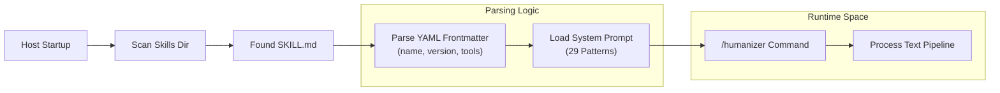

Sources: [WARP.md:8-16](), [README.md:91-145]()

## Verification

### Confirm Installation
Verify the directory contains the necessary runtime artifact:
```bash
# Claude Code
ls -l ~/.claude/skills/humanizer/SKILL.md

# OpenCode
ls -l ~/.config/opencode/skills/humanizer/SKILL.md
```

### Confirm Metadata
Check that the skill file contains the correct version and metadata:
```bash
head -n 10 ~/.claude/skills/humanizer/SKILL.md
```
Expected output should include `name: humanizer`, a version (e.g., `version: 2.5.1`), and `allowed-tools: []` [WARP.md:14-16]().

### Test Invocation
Restart your terminal or the AI tool and run:
```
/humanizer
```
If successful, the tool will acknowledge the command and wait for text input [README.md:43-57]().

## Troubleshooting

- **Command Not Found:** Ensure the directory is named exactly `humanizer`. Both Claude Code and OpenCode use the directory name to register the slash command.
- **Version Mismatch:** If the skill behavior seems outdated, verify that the `version` field in `SKILL.md` matches the latest release [WARP.md:42-46]().
- **OpenCode Compatibility:** If using OpenCode, remember that it also scans `~/.claude/skills/`, so you do not need to install it twice if you use both tools [README.md:39-40]().

Sources: [README.md:5-40](), [WARP.md:1-53]()

---

# Page: Using the Humanizer Skill

# Using the Humanizer Skill

<details>
<summary>Relevant source files</summary>

The following files were used as context for generating this wiki page:

- [README.md](README.md)
- [SKILL.md](SKILL.md)

</details>


This page explains how to invoke and use the Humanizer skill in Claude Code and OpenCode, including invocation methods, input/output formats, processing workflow, and practical usage examples.

---

## Invocation Methods

The Humanizer skill can be invoked in two ways within the terminal environment:

### Direct Skill Command

Use the `/humanizer` command. The model will then prompt for the text or context:

```bash
/humanizer

[paste your AI-generated text here]
```

### Natural Language Prompt

Alternatively, ask the model directly to humanize text. This triggers the skill because the skill's name and description match the request:

```text
Please humanize this text: [your text]
```

Both methods load the skill from the respective installation directory (e.g., `~/.claude/skills/humanizer/SKILL.md`) and execute the transformation pipeline.

Sources: [README.md:41-63](), [SKILL.md:1-12]()

---

## Skill Metadata and Configuration

The skill's YAML frontmatter defines its runtime identity and permissions within the Claude Code/OpenCode ecosystem.

**Code Entity Space Mapping:**

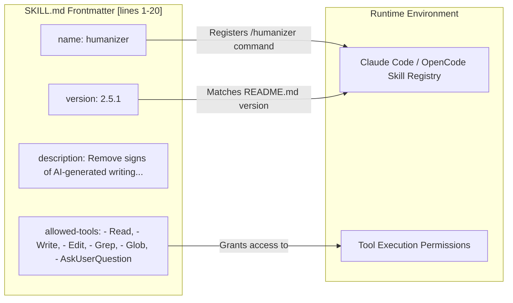

| Field | Value | Purpose |
|-------|-------|---------|
| `name` | `humanizer` | Identifier for skill invocation via `/` command. [SKILL.md:2]() |
| `version` | `2.5.1` | Current version (must match README.md). [SKILL.md:3]() |
| `allowed-tools` | `Read`, `Write`, `Edit`, `Grep`, `Glob`, `AskUserQuestion` | Tools the model is permitted to use to process files or ask for clarification. [SKILL.md:13-19]() |

Sources: [SKILL.md:1-20](), [README.md:3]()

---

## Voice Calibration

A unique feature of the Humanizer is **Voice Calibration**, which allows the skill to match a specific user's writing style rather than just defaulting to a generic "clean" tone.

### Input Expectations for Calibration
The skill can analyze a writing sample provided either inline or via a file path. It looks for:
- Sentence length patterns (short vs. long). [SKILL.md:43]()
- Word choice level (casual vs. academic). [SKILL.md:44]()
- Punctuation habits (dashes, semicolons, etc.). [SKILL.md:46]()

### Usage Pattern
```text
/humanizer

Use my writing style from ./docs/my_article.md as a reference.
Now humanize this text: [AI text]
```

Sources: [SKILL.md:38-57](), [README.md:65-80]()

---

## Processing Pipeline

The skill follows a multi-step transformation pipeline to ensure the output moves from "AI-generated" to "Human-sounding."

**Natural Language Space to Code Entity Space:**

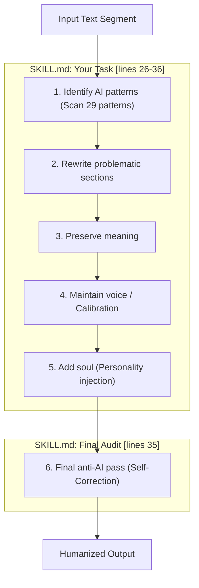

### Key Stages
1. **Pattern Identification**: Scans for the 29 patterns defined in `SKILL.md`. [SKILL.md:30]()
2. **Personality Injection**: Applies the "PERSONALITY AND SOUL" guidelines, such as adding opinions, varying rhythm, and acknowledging complexity. [SKILL.md:59-84]()
3. **Anti-AI Pass**: The model is prompted to perform a self-audit: *"What makes the below so obviously AI generated?"* and then revise based on its own findings. [SKILL.md:35]()

Sources: [SKILL.md:26-36](), [SKILL.md:59-91]()

---

## Pattern Detection Architecture

The skill employs multi-layer detection across 29 specific patterns categorized into five groups.

| Category | Patterns | Examples |
|----------|----------|----------|
| **Content** | 1–6 | Significance inflation, notability name-dropping. [SKILL.md:92-148]() |
| **Language** | 7–13 | AI vocabulary (e.g., "testament"), passive voice, rule of three. [SKILL.md:151-240]() |
| **Style** | 14–19, 26–29 | Em dash overuse, Title Case headings, fragmented headers. [SKILL.md:243-348]() |
| **Communication** | 20–22 | Chatbot artifacts ("I hope this helps"), sycophantic tone. [SKILL.md:351-377]() |
| **Filler & Hedging** | 23–25 | "In order to", excessive hedging, generic conclusions. [SKILL.md:380-405]() |

Sources: [SKILL.md:92-405](), [README.md:91-145]()

---

## Usage Examples

### Example 1: Removing "AI Slop"
**Input:**
> "The project stands as a testament to our commitment to innovation, marking a pivotal moment in the landscape."

**Command:**
`/humanizer [text]`

**Output:**
> "We built this to solve the latency issues we saw last quarter. It's a big step for the team."

**Analysis:**
- Removed "testament" (Pattern #7). [SKILL.md:154]()
- Removed "pivotal moment" (Pattern #1). [SKILL.md:96]()
- Simplified copula "stands as" (Pattern #8). [SKILL.md:183]()

### Example 2: Personality Injection
**Input:**
> "The data indicates that remote work has both benefits and drawbacks. Productivity is high but isolation is a factor."

**Output:**
> "I’m torn on remote work. On one hand, I'm shipping more code than ever. On the other, I sometimes realize I haven't spoken to a real person in three days. It’s a weird trade-off."

**Analysis:**
- Applied "Have opinions" rule. [SKILL.md:73]()
- Applied "Use 'I' when it fits". [SKILL.md:79]()

Sources: [SKILL.md:85-90](), [README.md:147-172]()

---

## Output and Interpretation

The skill produces the humanized text as its primary output. In some cases, it may provide a brief explanation of the "tells" it identified during the final anti-AI pass.

**Summary of Output Components:**
- **Revised Text**: The final version with patterns removed and voice applied.
- **Audit Findings**: (Optional) Brief list of what made the original text sound like an LLM. [SKILL.md:35]()

Sources: [SKILL.md:35](), [README.md:147-172]()

---

# Page: AI Writing Patterns

# AI Writing Patterns

<details>
<summary>Relevant source files</summary>

The following files were used as context for generating this wiki page:

- [README.md](README.md)
- [SKILL.md](SKILL.md)

</details>


## Purpose and Scope

This page documents the 29 AI writing patterns that the Humanizer skill detects and corrects. These patterns represent empirically observed characteristics of AI-generated text, derived from Wikipedia's "Signs of AI writing" guide maintained by WikiProject AI Cleanup. The patterns are organized into five categories and serve as the core knowledge base that drives the Humanizer's transformation engine.

The current version of the system (v2.5.1) has expanded the pattern library from the original 24 to 29 distinct markers. For implementation details on how these patterns are detected and remediated, see [Pattern Detection and Remediation](#4.4). For detailed examples and usage of each pattern category, see the child pages: [Content Patterns](#3.2), [Language and Grammar Patterns](#3.3), [Style Patterns](#3.4), [Communication Patterns](#3.5), and [Filler and Hedging Patterns](#3.6).

Sources: [SKILL.md:3-10](), [README.md:91-146]()

---

## Wikipedia Foundation

The Humanizer's pattern catalog is based on [Wikipedia:Signs of AI writing](https://en.wikipedia.org/wiki/Wikipedia:Signs_of_AI_writing), a comprehensive guide maintained by WikiProject AI Cleanup. This guide emerged from analysis of thousands of instances of AI-generated text submitted to Wikipedia.

### Empirical Basis

The patterns documented in `SKILL.md` are not theoretical constructs but empirical observations of how large language models actually write. As noted in the system's core logic:

> "LLMs use statistical algorithms to guess what should come next. The result tends toward the most statistically likely result that applies to the widest variety of cases." [SKILL.md:543-545]()

This statistical optimization toward "safest" outputs produces characteristic patterns:
- Inflated significance statements that apply broadly.
- Promotional language that avoids negative claims.
- Avoidance of simple constructions like "is" or "has" (Copula avoidance).
- Overuse of present participles ("-ing") to add apparent depth.
- Mechanical formatting patterns (em dashes, boldface, emojis).

### WikiProject AI Cleanup

WikiProject AI Cleanup continuously maintains and updates the source material as new AI writing patterns emerge. The Humanizer skill imports these patterns into executable transformation rules. Recent updates (v2.3.0 through v2.5.1) have added five new patterns—including hyphenated word pairs, persuasive authority tropes, and passive voice fragments—to keep pace with evolving LLM behaviors.

**Pattern Knowledge Flow:**

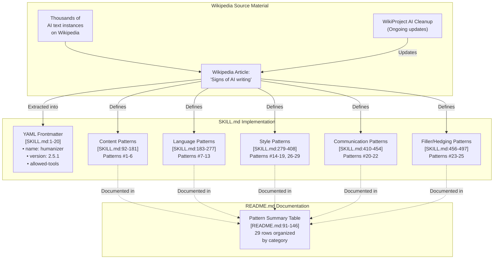

Sources: [SKILL.md:24-25](), [SKILL.md:543-545](), [README.md:81-90](), [README.md:179-183]()

---

## Pattern Taxonomy

The 29 patterns are organized into five functional categories. This categorization reflects different analytical layers: semantic (content), syntactic (grammar), stylistic (formatting), conversational (artifacts), and rhetorical (filler).

### Complete Pattern Catalog

| # | Pattern Name | Category | SKILL.md Reference |
|---|--------------|----------|-------------------|
| 1-6 | Content Patterns | Content | [SKILL.md:94-181]() |
| 7-13 | Language & Grammar | Language | [SKILL.md:185-277]() |
| 14-19, 26-29 | Style Patterns | Style | [SKILL.md:281-408]() |
| 20-22 | Communication | Communication | [SKILL.md:412-454]() |
| 23-25 | Filler & Hedging | Filler | [SKILL.md:458-497]() |

Sources: [SKILL.md:92-497](), [README.md:91-146]()

### Category Distribution

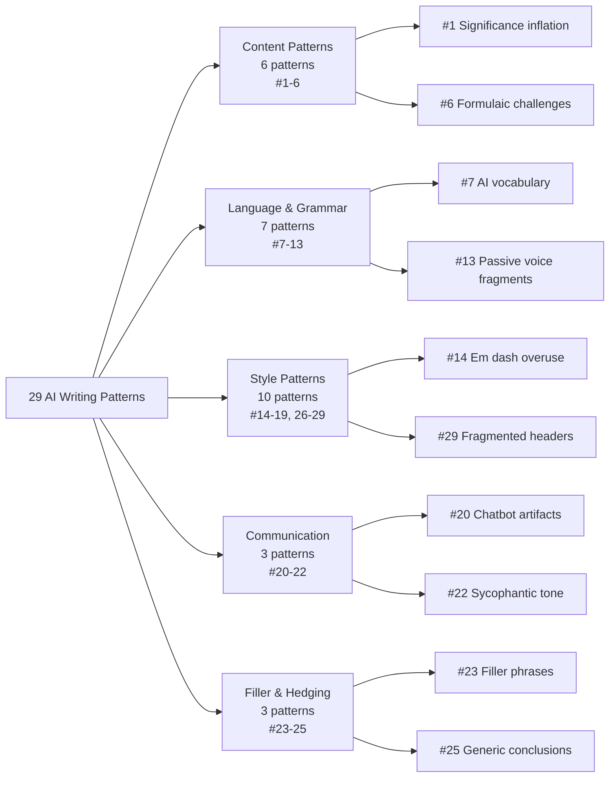

Sources: [SKILL.md:92-497](), [README.md:93-145]()

---

## Pattern Structure

Each pattern definition in `SKILL.md` follows a consistent structure optimized for the LLM editor.

### Pattern Definition Components

**Pattern Template Structure:**

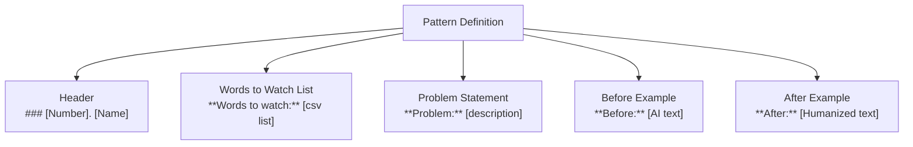

Sources: [SKILL.md:94-105]()

### Words-to-Watch Lists

Many patterns include curated keyword lists that serve as lexical detection triggers:

| Pattern | Words-to-Watch Example | Line Reference |
|---------|------------------------|----------------|
| #1 Significance inflation | `pivotal, testament, landscape, underscores` | [SKILL.md:96]() |
| #7 AI vocabulary | `Additionally, delve, crucial, showcase` | [SKILL.md:187]() |
| #8 Copula avoidance | `serves as, stands as, boasts, features` | [SKILL.md:201]() |
| #26 Hyphenated pairs | `cross-functional, data-driven, client-facing` | [SKILL.md:363]() |

Sources: [SKILL.md:96](), [SKILL.md:187](), [SKILL.md:201](), [SKILL.md:363]()

---

## Category Overview

### Content Patterns (Patterns #1-6)
Address meaning-level issues where AI inflates significance or uses vague attributions.
- **Key Patterns:** Significance inflation, Notability name-dropping, Superficial -ing analyses.
- For details, see [Content Patterns](#3.2).

### Language and Grammar Patterns (Patterns #7-13)
Address syntactic layer issues including word choice and sentence structure.
- **Key Patterns:** AI vocabulary, Copula avoidance, Rule of three, Passive voice (added in v2.5.1).
- For details, see [Language and Grammar Patterns](#3.3).

### Style Patterns (Patterns #14-19, 26-29)
Address formatting and typographic choices. This category saw the most expansion in recent versions.
- **Key Patterns:** Em dash overuse, Title Case headings, Hyphenated word pairs, Signposting announcements.
- For details, see [Style Patterns](#3.4).

### Communication Patterns (Patterns #20-22)
Remnants of chatbot dialogue and system limitations.
- **Key Patterns:** Chatbot artifacts ("I hope this helps"), Cutoff disclaimers, Sycophantic tone.
- For details, see [Communication Patterns](#3.5).

### Filler and Hedging Patterns (Patterns #23-25)
Address wordiness and over-qualification that dilutes the message.
- **Key Patterns:** Filler phrases ("in order to"), Excessive hedging, Generic conclusions.
- For details, see [Filler and Hedging Patterns](#3.6).

Sources: [SKILL.md:92-497](), [README.md:93-145]()

---

## Pattern Co-occurrence

AI-generated text typically exhibits multiple patterns simultaneously. The system's full example demonstrates how a single passage can contain over 20 patterns, from "significance inflation" to "sycophantic tone" and "em dash overuse".

**Full Example Analysis:** [SKILL.md:499-538]()

Sources: [SKILL.md:499-538]()

---

# Page: Pattern Overview and Categories

# Pattern Overview and Categories

<details>
<summary>Relevant source files</summary>

The following files were used as context for generating this wiki page:

- [README.md](README.md)
- [SKILL.md](SKILL.md)

</details>


## Purpose and Scope

This page introduces the taxonomic foundation of the Humanizer skill: the 29 AI writing patterns organized into five categories. It explains the Wikipedia source material, the categorical organization, and how patterns are numbered and structured in the codebase. Note that as of version 2.5.1, the pattern library has expanded from the original 24 to 29 total patterns to cover more nuanced stylistic and grammatical AI-isms.

Sources: [SKILL.md:3-10](), [README.md:91-145]()

## Wikipedia Foundation: Empirical Source Material

The Humanizer skill is based entirely on [Wikipedia's "Signs of AI writing" guide](https://en.wikipedia.org/wiki/Wikipedia:Signs_of_AI_writing), maintained by WikiProject AI Cleanup. This guide was created through empirical analysis of thousands of instances of AI-generated text appearing on Wikipedia after 2023.

### Key Insight from Wikipedia

The Wikipedia article states: "LLMs use statistical algorithms to guess what should come next. The result tends toward the most statistically likely result that applies to the widest variety of cases."

This observation explains why AI writing exhibits predictable patterns—it gravitates toward generic, statistically-likely constructions rather than specific, opinionated, or unusual language choices.

Sources: [README.md:83-90](), [SKILL.md:24-24]()

### Knowledge Flow: Wikipedia to SKILL.md

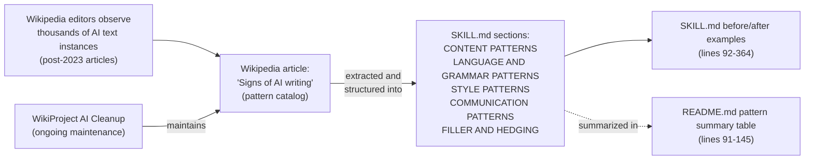

Sources: [README.md:83-91](), [SKILL.md:24-25](), [SKILL.md:92-364]()

## Pattern Taxonomy: Five Categories

The 29 patterns are organized into five categories based on the linguistic level they address. The current version (2.5.1) includes several recent additions to the Style and Language categories.

| Category | Pattern Count | Focus Area | Analysis Level |
|----------|--------------|------------|----------------|
| **Content Patterns** | 6 | What is said (semantic content) | Meaning and claims |
| **Language & Grammar** | 7 | How it's said (syntax and word choice) | Grammatical structures |
| **Style Patterns** | 10 | How it looks (formatting and typography) | Visual presentation |
| **Communication** | 3 | Chatbot conversation artifacts | Conversational context |
| **Filler & Hedging** | 3 | Unnecessary qualifiers and words | Rhetorical efficiency |

Sources: [README.md:91-145](), [SKILL.md:92-364]()

### Category Taxonomy Diagram

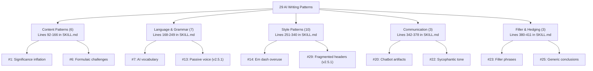

Sources: [SKILL.md:92-411](), [README.md:91-145]()

## Pattern Numbering System

Patterns are numbered sequentially from 1 to 29. Note that due to version updates (v2.3.0 through v2.5.1), the numbering in the Style category jumps from #19 to #26 to accommodate the expansion of the pattern set while maintaining internal categorization.

### Numbering Scheme (v2.5.1)

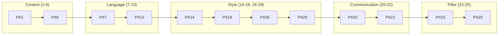

Sources: [README.md:91-145]()

### Pattern Numbering in Code

The pattern numbers appear in both documentation files. In `SKILL.md`, patterns are defined by their section headings, while `README.md` references them by number in its summary table.

| File | Pattern Reference Format | Line Examples |
|------|-------------------------|---------------|
| SKILL.md | Section headings with numbers | [SKILL.md:94](), [SKILL.md:168](), [SKILL.md:251]() |
| README.md | Table with `#` prefix | [README.md:97](), [README.md:108](), [README.md:120]() |

Sources: [SKILL.md:92-411](), [README.md:91-145]()

## Category Definitions and Analysis Levels

The system utilizes a multi-layer analysis approach, progressing from semantic content to surface-level formatting.

### Multi-Layer Analysis Architecture

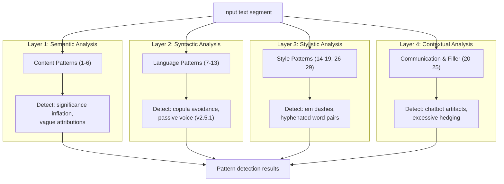

Sources: [SKILL.md:92-411]()

## Code Structure: Categories to SKILL.md Sections

The `SKILL.md` file implements the pattern taxonomy through a hierarchical section structure. Each category becomes a top-level section with H2 headings.

### SKILL.md Section Mapping

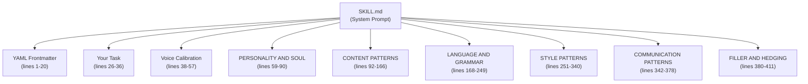

Sources: [SKILL.md:1-411]()

### Section Line Number Reference (v2.5.1)

| Category | Section Header Line | First Pattern Line | Pattern Count |
|----------|--------------------|--------------------|---------------|
| Content | [SKILL.md:92]() | [SKILL.md:94]() | 6 |
| Language & Grammar | [SKILL.md:168]() | [SKILL.md:170]() | 7 |
| Style | [SKILL.md:251]() | [SKILL.md:253]() | 10 |
| Communication | [SKILL.md:342]() | [SKILL.md:344]() | 3 |
| Filler & Hedging | [SKILL.md:380]() | [SKILL.md:382]() | 3 |

Sources: [SKILL.md:92-411]()

## Pattern Structure: Common Elements

Each pattern in `SKILL.md` follows a consistent structure:

1. **Pattern heading** (H3) - Number and name.
2. **Words to watch** - Lexical triggers (e.g., [SKILL.md:96]()).
3. **Problem statement** - Explanation of the AI-ism (e.g., [SKILL.md:98]()).
4. **Before example** - AI-generated text (e.g., [SKILL.md:100-101]()).
5. **After example** - Humanized correction (e.g., [SKILL.md:103-104]()).

Sources: [SKILL.md:92-411]()

---

# Page: Content Patterns

# Content Patterns

<details>
<summary>Relevant source files</summary>

The following files were used as context for generating this wiki page:

- [README.md](README.md)
- [SKILL.md](SKILL.md)

</details>


## Purpose and Scope

This page documents the six **Content Patterns** that the Humanizer skill detects and remediates. Content patterns address *what is said* rather than how it is said—they focus on semantic issues such as inflated significance, promotional language, superficial analysis, vague sourcing, and formulaic structural elements. These patterns represent the first tier of the 29 AI writing patterns identified by the system.

Sources: [SKILL.md:5-10](), [SKILL.md:92-154](), [README.md:93-102]()

---

## Pattern Category Overview

Content patterns represent semantic-level pathologies in AI-generated text. Unlike language patterns (which detect grammatical constructions) or style patterns (which detect formatting choices), content patterns identify issues with the *substance* of claims: exaggerated importance, unsupported assertions, superficial analysis masquerading as depth, and formulaic structure.

These patterns derive from Wikipedia's observation that "LLMs use statistical algorithms to guess what should come next. The result tends toward the most statistically likely result that applies to the widest variety of cases." This leads to text that is technically grammatical and stylistically polished, but semantically hollow—claiming significance without evidence, citing sources without context, and analyzing topics without substance.

Sources: [SKILL.md:22-24](), [README.md:81-91]()

---

## Content Pattern Architecture

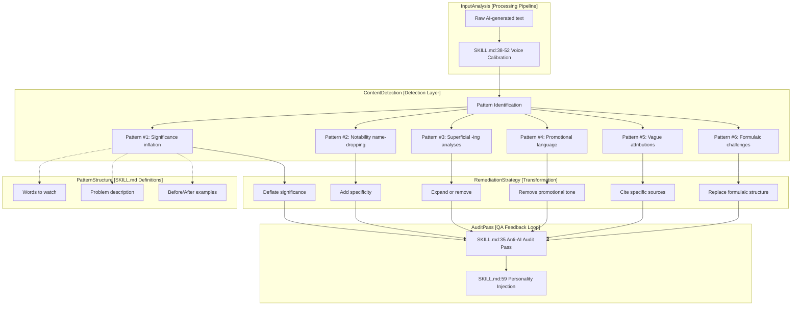

**Figure 1: Content Pattern Detection and Remediation Pipeline**

This diagram shows how content patterns operate within the detection pipeline. The identification phase dispatches to individual pattern detectors defined in `SKILL.md`. Each pattern (#1-#6) is defined by three components: a keyword list ("words to watch"), a problem description, and before/after examples. Pattern matches trigger specialized remediation strategies that transform the text semantically. The process concludes with an "Anti-AI Pass" to catch remaining tells.

Sources: [SKILL.md:26-35](), [SKILL.md:92-154](), [README.md:85]()

---

## Pattern Structure in SKILL.md

Each content pattern follows a consistent structure in the `SKILL.md` file to ensure the LLM understands the detection logic and the desired output state.

| Component | Purpose | Location Example |
|-----------|---------|-----------------|
| Pattern number and title | Identifies the pattern | `### 1. Undue Emphasis on Significance...` [SKILL.md:94]() |
| **Words to watch** | Lexical triggers for pattern detection | `**Words to watch:** stands/serves as, testament...` [SKILL.md:96]() |
| **Problem** | Explains why LLMs generate this pattern | `**Problem:** LLM writing puffs up importance...` [SKILL.md:98]() |
| **Before** | Example of AI-generated text with pattern | `> The Statistical Institute... marking a pivotal moment...` [SKILL.md:100]() |
| **After** | Humanized version with pattern removed | `> The Statistical Institute was established in 1989...` [SKILL.md:103]() |

Sources: [SKILL.md:94-105]()

---

## Pattern #1: Significance Inflation

**Pattern ID**: 1  
**Category**: Content  

### Definition
This pattern detects text that artificially inflates the importance of ordinary events by claiming they "mark pivotal moments" or "serve as testaments" without providing evidence.

### Detection Keywords
The following phrases trigger detection (stored in [SKILL.md:96]()):
`stands/serves as`, `is a testament/reminder`, `a vital/significant/crucial/pivotal/key role/moment`, `underscores/highlights its importance/significance`, `reflects broader`, `symbolizing its ongoing/enduring/lasting`, `key turning point`, `evolving landscape`, `focal point`, `indelible mark`.

### Remediation Strategy
**Before** ([SKILL.md:100-101]()): "The Statistical Institute of Catalonia was officially established in 1989, marking a pivotal moment in the evolution of regional statistics in Spain."  
**After** ([SKILL.md:103-104]()): "The Statistical Institute of Catalonia was established in 1989 to collect and publish regional statistics independently from Spain's national statistics office."

Sources: [SKILL.md:94-105]()

---

## Pattern #2: Notability Name-Dropping

**Pattern ID**: 2  
**Category**: Content  

### Definition
Detects attempts to establish notability by listing media outlets or follower counts without providing context about the actual contribution or claims.

### Detection Keywords
Keywords from [SKILL.md:109]():
`independent coverage`, `local/regional/national media outlets`, `written by a leading expert`, `active social media presence`.

### Remediation Strategy
**Before** ([SKILL.md:113-114]()): "Her views have been cited in The New York Times, BBC, Financial Times, and The Hindu. She maintains an active social media presence with over 500,000 followers."  
**After** ([SKILL.md:116-117]()): "In a 2024 New York Times interview, she argued that AI regulation should focus on outcomes rather than methods."

Sources: [SKILL.md:107-118]()

---

## Pattern #3: Superficial -ing Analyses

**Pattern ID**: 3  
**Category**: Content  

### Definition
Detects present participle phrases ("-ing" endings) appended to sentences to create the appearance of depth without adding substantive content.

### Detection Keywords
From [SKILL.md:122]():
`highlighting/underscoring/emphasizing...`, `ensuring...`, `reflecting/symbolizing...`, `contributing to...`, `cultivating/fostering...`, `showcasing...`.

### Remediation Strategy
**Before** ([SKILL.md:126-127]()): "...symbolizing Texas bluebonnets, the Gulf of Mexico, and the diverse Texan landscapes, reflecting the community's deep connection to the land."  
**After** ([SKILL.md:129-130]()): "The temple uses blue, green, and gold colors. The architect said these were chosen to reference local bluebonnets and the Gulf coast."

Sources: [SKILL.md:120-131]()

---

## Pattern #4: Promotional Language

**Pattern ID**: 4  
**Category**: Content  

### Definition
Detects language that reads like advertising or tourism promotion (non-neutral tone) rather than factual description.

### Detection Keywords
From [SKILL.md:135]():
`boasts a`, `vibrant`, `rich (figurative)`, `profound`, `nestled`, `in the heart of`, `groundbreaking`, `breathtaking`, `stunning`.

### Remediation Strategy
**Before** ([SKILL.md:139-140]()): "Nestled within the breathtaking region of Gonder in Ethiopia, Alamata Raya Kobo stands as a vibrant town..."  
**After** ([SKILL.md:142-143]()): "Alamata Raya Kobo is a town in the Gonder region of Ethiopia, known for its weekly market and 18th-century church."

Sources: [SKILL.md:133-144]()

---

## Pattern #5: Vague Attributions

**Pattern ID**: 5  
**Category**: Content  

### Definition
Detects claims attributed to vague, unverifiable authorities like "experts," "observers," or "industry reports."

### Detection Keywords
From [SKILL.md:148]():
`Industry reports`, `Observers have cited`, `Experts argue`, `Some critics argue`.

### Remediation Strategy
**Before** ([SKILL.md:152-153]()): "Experts believe it plays a crucial role in the regional ecosystem."  
**After** ([SKILL.md:155-156]()): "The Haolai River supports several endemic fish species, according to a 2019 survey by the Chinese Academy of Sciences."

Sources: [SKILL.md:146-157]()

---

## Pattern #6: Formulaic Challenges Sections

**Pattern ID**: 6  
**Category**: Content  

### Definition
Detects sections that follow a predictable "Despite challenges, it continues to thrive" template without providing specific facts.

### Detection Keywords
From [SKILL.md:161]():
`Despite its... faces several challenges...`, `Despite these challenges`, `Challenges and Legacy`.

### Remediation Strategy
**Before** ([SKILL.md:165-166]()): "Despite its industrial prosperity, Korattur faces challenges typical of urban areas... Despite these challenges... Korattur continues to thrive..."  
**After** ([SKILL.md:168-169]()): "Traffic congestion increased after 2015 when three new IT parks opened. The municipal corporation began a stormwater drainage project in 2022..."

Sources: [SKILL.md:159-170]()

---

## Pattern Detection Logic

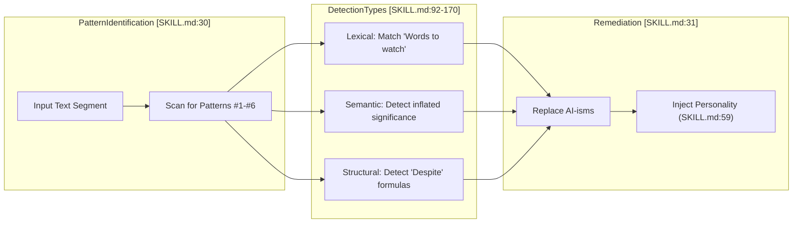

**Figure 2: Content Pattern Logic Flow**

This diagram illustrates how the `humanizer` skill identifies content patterns using three distinct methodologies: lexical matching of prohibited phrases, semantic analysis of claim weight, and structural analysis of formulaic sections. The result is a rewrite that replaces these patterns with natural alternatives and "personality" as defined in the `PERSONALITY AND SOUL` section of `SKILL.md`.

Sources: [SKILL.md:26-35](), [SKILL.md:59-91](), [SKILL.md:92-170]()

---

# Page: Language and Grammar Patterns

# Language and Grammar Patterns

<details>
<summary>Relevant source files</summary>

The following files were used as context for generating this wiki page:

- [README.md](README.md)
- [SKILL.md](SKILL.md)

</details>


## Purpose and Scope

This page documents the seven **Language and Grammar Patterns** (patterns #7-13) that the Humanizer skill detects and corrects. These patterns operate at the syntactic and lexical level, identifying how AI models structure sentences and choose vocabulary. Unlike content patterns (see [Content Patterns](#3.2)) which focus on semantic meaning, or style patterns (see [Style Patterns](#3.4)) which address formatting, language patterns target grammatical constructions and word choice that characterize statistical language models.

All patterns derive from [Wikipedia:Signs of AI writing](https://en.wikipedia.org/wiki/Wikipedia:Signs_of_AI_writing), maintained by WikiProject AI Cleanup. The patterns are implemented in [SKILL.md:156-247]() and documented in [README.md:104-115]().

**Sources:** [SKILL.md:1-469](), [README.md:1-143]()

---

## Pattern Catalog Structure

The seven language and grammar patterns are organized by detection complexity and remediation strategy. Pattern #13 was added in version 2.5.1 [SKILL.md:3]().

| Pattern # | Pattern Name | Detection Type | Remediation Strategy | Lines in SKILL.md |
|-----------|-------------|----------------|---------------------|-------------------|
| 7 | AI Vocabulary | Lexical (word list) | Replace | [158-169]() |
| 8 | Copula Avoidance | Syntactic (construction) | Simplify | [171-183]() |
| 9 | Negative Parallelisms | Syntactic (construction) | Simplify | [185-195]() |
| 10 | Rule of Three | Syntactic (grouping) | Simplify | [197-207]() |
| 11 | Elegant Variation | Semantic (synonym tracking) | Replace | [209-219]() |
| 12 | False Ranges | Semantic (logical validation) | Reformat | [221-231]() |
| 13 | Passive Voice / Fragments | Syntactic (voice) | Activate / Name Actor | [233-247]() |

**Sources:** [SKILL.md:156-247](), [README.md:104-115]()

---

## Pattern Detection Flow

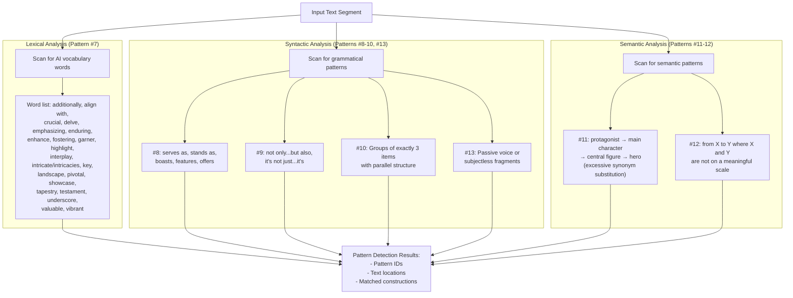

**Diagram: Language Pattern Detection Pipeline**

This diagram shows the detection architecture for language patterns. Lexical analysis (Pattern #7) performs string matching. Syntactic analysis (Patterns #8-10, #13) identifies grammatical constructions like copula substitutions, parallel structures, and passive voice. Semantic analysis (Patterns #11-12) requires understanding meaning to detect logical flaws in synonym usage and range constructions.

**Sources:** [SKILL.md:156-247]()

---

## Pattern #7: Overused AI Vocabulary

**Detection Mechanism:** Lexical scanning for high-frequency AI words.

**Words to Watch:** [SKILL.md:160]() defines the canonical list:
- `additionally`, `align with`, `crucial`, `delve`, `emphasizing`, `enduring`, `enhance`, `fostering`, `garner`, `highlight` (verb), `interplay`, `intricate`/`intricacies`, `key` (adjective), `landscape` (abstract noun), `pivotal`, `showcase`, `tapestry` (abstract noun), `testament`, `underscore` (verb), `valuable`, `vibrant`.

**Problem Statement:** [SKILL.md:162]() notes these words "appear far more frequently in post-2023 text. They often co-occur."

**Before/After Examples:**

```markdown
Before (SKILL.md:164-166):
> Additionally, a distinctive feature of Somali cuisine is the incorporation 
> of camel meat. An enduring testament to Italian colonial influence is the 
> widespread adoption of pasta in the local culinary landscape, showcasing 
> how these dishes have integrated into the traditional diet.

After (SKILL.md:167-169):
> Somali cuisine also includes camel meat, which is considered a delicacy. 
> Pasta dishes, introduced during Italian colonization, remain common, 
> especially in the south.
```

**Sources:** [SKILL.md:158-169](), [README.md:108]()

---

## Pattern #8: Copula Avoidance

**Detection Mechanism:** Syntactic pattern matching for `is`/`are` substitutions.

**Construction Patterns:** [SKILL.md:174]() lists:
- `serves as [noun]` / `stands as [noun]` / `marks [noun]` / `represents [noun]`
- `boasts [noun]` / `features [noun]` / `offers [noun]`

**Problem Statement:** [SKILL.md:176]() - "LLMs substitute elaborate constructions for simple copulas."

**Before/After Examples:**

```markdown
Before (SKILL.md:178-179):
> Gallery 825 serves as LAAA's exhibition space for contemporary art. 
> The gallery features four separate spaces and boasts over 3,000 square feet.

After (SKILL.md:180-182):
> Gallery 825 is LAAA's exhibition space for contemporary art. 
> The gallery has four rooms totaling 3,000 square feet.
```

**Sources:** [SKILL.md:171-183](), [README.md:109]()

---

## Pattern #9: Negative Parallelisms / Tailing Negations

**Detection Mechanism:** Syntactic pattern matching for parallel negative constructions or trailing clarifying negatives.

**Construction Patterns:** [SKILL.md:187]()
- `Not only X, but [also] Y`
- `It's not just [about] X; it's Y`
- `..., no guessing` / `..., no code required`

**Problem Statement:** [SKILL.md:188]() - "Constructions like 'Not only...but...' or 'It's not just about..., it's...' are overused. Tailing negations ('no configuration needed') are common in technical AI text."

**Before/After Examples:**

```markdown
Before (SKILL.md:190-191):
> It's not just about the beat riding under the vocals; it's part of the 
> aggression and atmosphere. It's not merely a song, it's a statement.

After (SKILL.md:192-194):
> The heavy beat adds to the aggressive tone.
```

**Sources:** [SKILL.md:185-195](), [README.md:110]()

---

## Pattern #10: Rule of Three Overuse

**Detection Mechanism:** Syntactic pattern matching for groups of exactly three parallel items.

**Problem Statement:** [SKILL.md:200]() - "LLMs force ideas into groups of three to appear comprehensive."

**Before/After Examples:**

```markdown
Before (SKILL.md:202-203):
> The event features keynote sessions, panel discussions, and networking 
> opportunities. Attendees can expect innovation, inspiration, and industry 
> insights.

After (SKILL.md:204-206):
> The event includes talks and panels. There's also time for informal 
> networking between sessions.
```

**Sources:** [SKILL.md:197-207](), [README.md:111]()

---

## Pattern #11: Elegant Variation (Synonym Cycling)

**Detection Mechanism:** Semantic tracking of synonyms for the same referent.

**Problem Statement:** [SKILL.md:212]() - "AI has repetition-penalty code causing excessive synonym substitution."

**Before/After Examples:**

```markdown
Before (SKILL.md:214-215):
> The protagonist faces many challenges. The main character must overcome 
> obstacles. The central figure eventually triumphs. The hero returns home.

After (SKILL.md:216-218):
> The protagonist faces many challenges but eventually triumphs and 
> returns home.
```

**Sources:** [SKILL.md:209-219](), [README.md:112]()

---

## Pattern #12: False Ranges

**Detection Mechanism:** Semantic validation of `from X to Y` constructions.

**Problem Statement:** [SKILL.md:224]() - "LLMs use 'from X to Y' constructions where X and Y aren't on a meaningful scale."

**Before/After Examples:**

```markdown
Before (SKILL.md:226-227):
> Our journey through the universe has taken us from the singularity of 
> the Big Bang to the grand cosmic web, from the birth and death of stars 
> to the enigmatic dance of dark matter.

After (SKILL.md:228-230):
> The book covers the Big Bang, star formation, and current theories 
> about dark matter.
```

**Sources:** [SKILL.md:221-231](), [README.md:113]()

---

## Pattern #13: Passive Voice and Subjectless Fragments

**Detection Mechanism:** Syntactic analysis for passive verb forms and sentences lacking a grammatical subject.

**Problem Statement:** [SKILL.md:236]() - "AI often uses passive voice to sound 'objective' or uses subjectless fragments in technical contexts ('No configuration file needed')."

**Before/After Examples:**

```markdown
Before (SKILL.md:238-241):
> The results were analyzed by the team. No configuration file needed. 
> Deployment can be achieved with a single command.

After (SKILL.md:242-246):
> The team analyzed the results. You don't need a configuration file. 
> Deploy the app with one command.
```

**Remediation Strategy:** Convert passive voice to active voice. For subjectless fragments, identify the actor (e.g., "You") and restructure into a complete sentence.

**Sources:** [SKILL.md:233-247](), [README.md:114]()

---

## Integration with Processing Pipeline

```mermaid
graph LR
    Input["Input Text"]
    
    Detect["Pattern Detection<br/>(SKILL.md:156-247)"]
    
    subgraph Remediation["Remediation Dispatch"]
        Lex["Lexical Replacement<br/>(Pattern #7)"]
        Syn["Syntactic Simplification<br/>(Patterns #8-10, #13)"]
        Sem["Semantic Repair<br/>(Patterns #11-12)"]
    end
    
    QA["Quality Assurance<br/>(SKILL.md:393-404)"]
    
    subgraph Checks["QA Checks for Language"]
        Check1["Natural read-aloud?"]
        Check2["Varied structure?"]
        Check5["Simple constructions?"]
    end
    
    Output["Humanized Text"]
    
    Input --> Detect
    
    Detect -->|"Pattern #7"| Lex
    Detect -->|"Patterns #8-10, #13"| Syn
    Detect -->|"Patterns #11-12"| Sem
    
    Lex --> QA
    Syn --> QA
    Sem --> QA
    
    QA --> Check1
    QA --> Check2
    QA --> Check5
    
    Check1 --> Output
    Check2 --> Output
    Check5 --> Output
```

**Diagram: Language Pattern Remediation Flow**

This diagram shows how language patterns integrate into the overall processing pipeline. Pattern detection occurs at [SKILL.md:156-247](). Remediation dispatches based on pattern type. Quality assurance at [SKILL.md:393-404]() ensures the output avoids AI vocabulary and uses simple, varied constructions.

**Sources:** [SKILL.md:156-247](), [SKILL.md:393-404]()

---

## Full Example Analysis

The comprehensive example at [SKILL.md:413-461]() demonstrates multiple language patterns in context:

```markdown
Before (SKILL.md:416-430, language patterns highlighted):
> AI-assisted coding [#8: serves as] an [#7: enduring testament] to the 
> transformative potential of large language models, marking a [#7: pivotal] 
> moment in the evolution of software development. In today's rapidly 
> [#7: evolving] technological [#7: landscape], these groundbreaking 
> tools—nestled at the intersection of research and practice—are reshaping 
> how engineers ideate, iterate, and deliver, [#7: underscoring] their 
> [#7: vital] role in modern workflows.
>
> At its core, the value proposition is clear: [#10: streamlining processes, 
> enhancing collaboration, and fostering alignment]. [#9: It's not just about 
> autocomplete; it's about] unlocking creativity at scale, ensuring that 
> organizations can remain agile while delivering seamless, intuitive, and 
> powerful experiences to users. The tool [#8: serves as] a catalyst. The 
> assistant [#8: functions as] a partner. The system [#8: stands as] a 
> foundation for innovation.
```

**Language Patterns Removed (from SKILL.md:443-461):**
- **Pattern #7:** `testament`, `pivotal`, `evolving`, `landscape`, `underscoring`, `vital`.
- **Pattern #8:** `serves as`, `functions as`, `stands as` → replaced with direct verbs.
- **Pattern #9:** `It's not just X; it's Y` → simplified to direct statement.
- **Pattern #10:** The forced triad of `streamlining... enhancing... fostering` is removed.

**Sources:** [SKILL.md:413-461](), [SKILL.md:443-461]()

---

# Page: Style Patterns

# Style Patterns

<details>
<summary>Relevant source files</summary>

The following files were used as context for generating this wiki page:

- [README.md](README.md)
- [SKILL.md](SKILL.md)

</details>


## Purpose and Scope

This page documents the 10 style patterns detected by the Humanizer skill. Style patterns are formatting and presentation choices that betray AI authorship—visual artifacts like excessive punctuation marks, typographic conventions, and structural layouts that appear more frequently in LLM-generated text than in human writing.

As of version 2.5.1, the pattern library has expanded from the original 6 to include 4 new patterns (26–29) addressing hyphenation, persuasive tropes, signposting, and header fragmentation.

**Sources:** [SKILL.md:3-10](), [README.md:116-130]()

## What Are Style Patterns?

Style patterns operate at the presentation layer—they concern how text *looks* rather than what it *says*. These are formatting choices, punctuation habits, and visual layouts that AI models statistically favor but that human writers use more sparingly or avoid entirely.

The 10 style patterns in the catalog are:

| Pattern # | Name | Signal |
|-----------|------|--------|
| 14 | Em dash overuse | Excessive use of `—` for parenthetical remarks |
| 15 | Boldface overuse | Mechanical bolding of acronyms and key phrases |
| 16 | Inline-header lists | Bullet points starting with `**Header:**` pattern |
| 17 | Title Case headings | Capitalizing All Main Words In Headings |
| 18 | Emojis | Decorative emojis (`🚀`, `💡`) in technical text |
| 19 | Curly quotes | Using `“curly”` instead of `"straight"` quotation marks |
| 26 | Hyphenated word pairs | Over-hyphenating common pairs like "data-driven" |
| 27 | Persuasive authority tropes | Phrases like "At its core" or "What matters is" |
| 28 | Signposting announcements | "Let's dive in" or "Here is what you need to know" |
| 29 | Fragmented headers | Short, vague headers followed by single sentences |

**Sources:** [SKILL.md:234-367](), [README.md:116-130]()

## Pattern Detection Flow

Style patterns are detected through Layer 4 (Stylistic Analysis) of the multi-layer detection system. Unlike semantic or syntactic analysis, stylistic analysis operates on formatting metadata and character-level features.

### Diagram: Style Pattern Identification Pipeline

```mermaid
graph TB
    Input["Input Text"]
    
    subgraph "Layer 4: Stylistic Analysis"
        ScanPunct["Punctuation Scanner<br/>Count em dashes (—)<br/>Identify quote types (“ vs \")"]
        ScanFormat["Formatting Scanner<br/>Detect **bold** patterns<br/>Detect emoji Unicode ranges"]
        ScanStructure["Structure Scanner<br/>Analyze heading capitalization<br/>Detect list item patterns"]
    end
    
    subgraph "Pattern Library (SKILL.md)"
        P14["Pattern #14<br/>Em Dash Overuse"]
        P15["Pattern #15<br/>Boldface Overuse"]
        P16["Pattern #16<br/>Inline-Header Lists"]
        P17["Pattern #17<br/>Title Case"]
        P18["Pattern #18<br/>Emojis"]
        P19["Pattern #19<br/>Curly Quotes"]
        P26["Pattern #26<br/>Hyphenated Pairs"]
        P27["Pattern #27<br/>Authority Tropes"]
        P28["Pattern #28<br/>Signposting"]
        P29["Pattern #29<br/>Fragmented Headers"]
    end
    
    Results["Style Pattern Detections<br/>Sent to Rewrite Module"]
    
    Input --> ScanPunct
    Input --> ScanFormat
    Input --> ScanStructure
    
    ScanPunct --> P14
    ScanPunct --> P19
    ScanFormat --> P15
    ScanFormat --> P18
    ScanStructure --> P16
    ScanStructure --> P17
    ScanStructure --> P26
    ScanStructure --> P27
    ScanStructure --> P28
    ScanStructure --> P29
    
    P14 --> Results
    P29 --> Results
```

**Sources:** [SKILL.md:234-367]()

## Pattern Catalog

### Pattern #14: Em Dash Overuse
**Problem:** LLMs use em dashes to mimic "punchy" sales writing. Humans use commas or periods more frequently.
- **Before:** "institutions—not the people—yet this continues—"
- **After:** Prefer commas or periods.
- **Remediation:** `REFORMAT`

### Pattern #15: Boldface Overuse
**Problem:** Mechanical bolding of acronyms or key phrases creates visual clutter.
- **Before:** "**OKRs**, **KPIs**, **BMC**"
- **After:** "OKRs, KPIs, BMC"
- **Remediation:** `REMOVE` (formatting only)

### Pattern #16: Inline-Header Lists
**Problem:** Bullet points starting with `**Header:**` that often repeat the description's first word.
- **Before:** "**Performance:** Performance improved"
- **After:** Convert to prose.
- **Remediation:** `SIMPLIFY`

### Pattern #17: Title Case Headings
**Problem:** AI defaults to capitalizing every word in a header.
- **Before:** "Strategic Negotiations And Partnerships"
- **After:** "Strategic negotiations and partnerships"
- **Remediation:** `REFORMAT`

### Pattern #18: Emojis
**Problem:** Decorative emojis (`🚀`, `💡`) in technical text are a major AI "tell."
- **Before:** "🚀 Launch Phase: 💡 Key Insight:"
- **After:** Remove emojis.
- **Remediation:** `REMOVE`

### Pattern #19: Curly Quotes
**Problem:** LLMs default to typographically correct curly quotes (`“ ”`), which can break code or search.
- **Before:** `said “the project”`
- **After:** `said "the project"`
- **Remediation:** `REFORMAT`

### Pattern #26: Hyphenated Word Pairs
**Problem:** AI over-hyphenates compound modifiers that humans leave separate.
- **Before:** "cross-functional, data-driven, client-facing"
- **After:** Drop hyphens on common word pairs.
- **Remediation:** `REFORMAT`

### Pattern #27: Persuasive Authority Tropes
**Problem:** Prefacing statements with "At its core" or "Ultimately" to sound profound.
- **Before:** "At its core, what matters is..."
- **After:** State the point directly.
- **Remediation:** `REMOVE` (phrase level)

### Pattern #28: Signposting Announcements
**Problem:** Chatbots announce what they are about to do.
- **Before:** "Let's dive in", "Here's what you need to know"
- **After:** Start with the content.
- **Remediation:** `REMOVE`

### Pattern #29: Fragmented Headers
**Problem:** Using a heading followed by a single, short sentence.
- **Before:** "## Performance" + "Speed matters."
- **After:** Let the heading do the work or merge into a larger section.
- **Remediation:** `EXPAND` or `SIMPLIFY`

**Sources:** [SKILL.md:234-367](), [README.md:116-130]()

## Implementation and Data Flow

The following diagram maps the style patterns to the remediation strategies used in the `humanizer` skill.

### Diagram: Remediation Strategy Mapping

```mermaid
graph LR
    subgraph "Patterns (SKILL.md)"
        P14_19_26["P14, P19, P26<br/>Punctuation/Typo"]
        P15_18_27_28["P15, P18, P27, P28<br/>Clutter/Artifacts"]
        P16_17["P16, P17<br/>Headings"]
        P29["P29<br/>Structure"]
    end

    subgraph "Remediation Strategy"
        REFORMAT["REFORMAT<br/>(Change characters/case)"]
        REMOVE["REMOVE<br/>(Delete elements)"]
        SIMPLIFY["SIMPLIFY<br/>(Convert to prose)"]
    end

    P14_19_26 --> REFORMAT
    P16_17 --> REFORMAT
    P15_18_27_28 --> REMOVE
    P29 --> SIMPLIFY
```

**Sources:** [SKILL.md:234-367](), [SKILL.md:392-410]()

## Full Style Transformation Example

This example demonstrates the simultaneous removal of multiple style patterns (15, 17, 18, 28, 29).

**Before (AI-Generated):**
> ### 🚀 Key Performance Metrics
> Let's dive into the metrics.
> 
> - **Speed:** Speed is a testament to our progress.
> - **Efficiency:** Efficiency has been optimized.

**After (Humanized):**
> ### Performance metrics
> 
> We measured a 20% increase in processing speed and reduced memory overhead by 15% across all nodes.

**Transformations Applied:**
1. **P17:** "Key Performance Metrics" -> "Performance metrics" (Sentence case).
2. **P18:** Removed 🚀 emoji.
3. **P28:** Removed "Let's dive into the metrics."
4. **P15:** Converted the list into a specific, factual sentence.
5. **P29:** Replaced the fragmented single-sentence structure with actual data.

**Sources:** [SKILL.md:413-461](), [README.md:147-165]()

## Style vs. Content Patterns

Style patterns are distinguished from other categories by operating on presentation rather than semantic meaning:

| Aspect | Style Patterns | Content Patterns |
|--------|----------------|------------------|
| **Analysis Layer** | Stylistic (formatting) | Semantic (meaning) |
| **Detection** | Character/Format scanning | Phrase matching/Context |
| **Primary Goal** | Clean visual "tells" | Remove inflated claims |
| **Example** | Em dashes, Emojis | "Pivotal moment", "Testament" |

**Sources:** [SKILL.md:92-367]()

---

# Page: Communication Patterns

# Communication Patterns

<details>
<summary>Relevant source files</summary>

The following files were used as context for generating this wiki page:

- [README.md](README.md)
- [SKILL.md](SKILL.md)

</details>


## Purpose and Scope

This page documents the three **Communication Patterns** (patterns #20-#22) detected and removed by the `humanizer` skill. These patterns are artifacts of conversational AI interaction that reveal text originated from chatbot dialogue rather than authored content.

Communication patterns differ from other AI writing signs in that they explicitly expose the chatbot medium itself—phrases like "I hope this helps!" or "Great question!" make it obvious that a human asked an AI to write something, and the AI's response was copied verbatim without removing the conversational wrapper.

For other pattern categories, see: [Content Patterns](#3.2), [Language and Grammar Patterns](#3.3), [Style Patterns](#3.4), and [Filler and Hedging Patterns](#3.6).

Sources: [SKILL.md:312-352](), [README.md:131-138]()

---

## Pattern Taxonomy

Communication patterns fall into three distinct subcategories based on their conversational function:

| Pattern # | Name | Function | Detection Basis |
|-----------|------|----------|-----------------|
| 20 | Chatbot Artifacts | Chatbot politeness/helpfulness signals | Lexical (specific phrases) |
| 21 | Knowledge-Cutoff Disclaimers | Training data limitation hedging | Lexical + semantic (temporal references) |
| 22 | Sycophantic Tone | People-pleasing affirmations | Lexical + pragmatic (excessive positivity) |

Sources: [SKILL.md:312-352](), [README.md:131-138]()

---

## Why Communication Patterns Occur

```mermaid
graph TB
    Training["LLM Training Data<br/>(Dialogue transcripts)"]
    
    UserPrompt["User: 'Write an article about X'"]
    
    LLM["LLM generates response"]
    
    ConvWrapper["Conversational Wrapper Applied:<br/>- Politeness ('I hope this helps')<br/>- Disclaimers ('As of my last update...')<br/>- Affirmation ('Great question!')"]
    
    Content["Actual Content:<br/>The article about X"]
    
    Copy["User copies response<br/>into document"]
    
    Artifact["Document contains<br/>chatbot artifacts"]
    
    Training -->|"Learned behavior:<br/>Be helpful, polite, humble"| LLM
    UserPrompt --> LLM
    LLM --> ConvWrapper
    LLM --> Content
    
    ConvWrapper -->|"Wrapper + Content"| Copy
    Content -->|"Wrapper + Content"| Copy
    
    Copy --> Artifact
```

**Diagram: Origin of Communication Patterns**

Communication patterns emerge because LLMs are trained on conversational data where being helpful, humble, and polite is rewarded. When users paste chatbot responses directly into documents, these conversational wrappers come along for the ride.

Sources: [SKILL.md:312-352](), [SKILL.md:464-468]()

---

## Pattern #20: Chatbot Artifacts

### Definition

Phrases that signal the text is a chatbot response to a user query, not standalone authored content. These are conversational politeness markers and meta-commentary about the response itself.

Sources: [SKILL.md:314-325]()

### Detection Triggers

The following lexical patterns trigger detection:

**Primary indicators:**
- `I hope this helps`
- `Let me know if...`
- `Would you like...`
- `Here is a...` (at start of response)
- `Of course!`
- `Certainly!`

**Meta-commentary:**
- `let me expand on`
- `if you'd like me to elaborate`
- `feel free to ask`

Sources: [SKILL.md:316-317]()

### Detection Flow

```mermaid
graph TB
    Input["Input text segment"]
    
    Scan["Lexical scan for trigger phrases"]
    
    Check1{"Contains<br/>'I hope this helps'<br/>or variants?"}
    
    Check2{"Contains<br/>'Let me know if'<br/>or variants?"}
    
    Check3{"Contains<br/>'Here is a...'<br/>at document start?"}
    
    Check4{"Contains<br/>'Of course!'<br/>'Certainly!'?"}
    
    Match["Pattern #20 detected"]
    
    NoMatch["No pattern #20"]
    
    Input --> Scan
    Scan --> Check1
    Check1 -->|Yes| Match
    Check1 -->|No| Check2
    Check2 -->|Yes| Match
    Check2 -->|No| Check3
    Check3 -->|Yes| Match
    Check3 -->|No| Check4
    Check4 -->|Yes| Match
    Check4 -->|No| NoMatch
```

**Diagram: Pattern #20 Detection Logic**

Sources: [SKILL.md:316-325]()

### Examples

**Before (contains artifacts):**
```
Here is an overview of the French Revolution. I hope this helps! 
Let me know if you'd like me to expand on any section.
```

**After (artifacts removed):**
```
The French Revolution began in 1789 when financial crisis and food 
shortages led to widespread unrest.
```

Sources: [SKILL.md:320-324](), [README.md:135]()

### Remediation Strategy

**Complete deletion.** Chatbot artifacts add no semantic value to the content itself. The remediation is straightforward:

1. Identify sentence(s) containing trigger phrases.
2. Remove entire sentence(s).
3. Ensure remaining content has proper opening (no "Additionally..." starting orphaned).

Sources: [SKILL.md:320-325]()

---

## Pattern #21: Knowledge-Cutoff Disclaimers

### Definition

Phrases that reveal the AI's training data limitations or temporal knowledge boundaries. These disclaimers acknowledge incomplete information based on the model's training cutoff date or corpus limitations.

Sources: [SKILL.md:327-340]()

### Detection Triggers

**Temporal disclaimers:**
- `as of [date]`
- `Up to my last training update`
- `as of my knowledge cutoff`

**Availability disclaimers:**
- `While specific details are limited/scarce...`
- `based on available information...`
- `not extensively documented in readily available sources`
- `details are not well documented`

Sources: [SKILL.md:330]()

### Examples

**Before (contains disclaimer):**
```
While specific details about the company's founding are not extensively 
documented in readily available sources, it appears to have been established 
sometime in the 1990s.
```

**After (replaced with specific information):**
```
The company was founded in 1994, according to its registration documents.
```

Sources: [SKILL.md:334-338](), [README.md:136]()

### Remediation Strategy

```mermaid
graph TD
    Detected["Pattern #21 detected:<br/>Cutoff disclaimer + vague claim"]
    
    Question{"Can specific<br/>information<br/>be found?"}
    
    Research["Research actual sources"]
    
    Replace["Replace disclaimer with<br/>specific sourced claim<br/>'According to [source], [fact]'"]
    
    Delete["Delete vague claim entirely"]
    
    Verify["Verify no orphaned<br/>sentence fragments remain"]
    
    Output["Remediated text"]
    
    Detected --> Question
    Question -->|Yes| Research
    Question -->|No| Delete
    Research --> Replace
    Replace --> Verify
    Delete --> Verify
    Verify --> Output
```

**Diagram: Pattern #21 Remediation Flow**

Sources: [SKILL.md:334-340]()

---

## Pattern #22: Sycophantic Tone

### Definition

Overly positive, people-pleasing language that flatters the reader or affirms their input. This tone is characteristic of AI assistants trained to be maximally agreeable and encouraging.

Sources: [SKILL.md:342-351]()

### Detection Triggers

**Affirmation phrases:**
- `Great question!`
- `You're absolutely right!`
- `That's an excellent point!`
- `You've hit on something important`

**Excessive positivity:**
- `Great observation about...`
- `You're correct that...`
- `Absolutely!` (as response opener)

Sources: [SKILL.md:344]()

### Examples

**Before (sycophantic tone):**
```
Great question! You're absolutely right that this is a complex topic. 
That's an excellent point about the economic factors.
```

**After (direct response):**
```
The economic factors you mentioned are relevant here.
```

Sources: [SKILL.md:346-350](), [README.md:137]()

---

## Multi-Pattern Detection and Remediation

Communication patterns frequently co-occur. The full example in `SKILL.md` demonstrates patterns appearing together:

```mermaid
graph TB
    Input["Input text:<br/>'Great question! Here is an essay.<br/>I hope this helps!'"]
    
    Detect20["Pattern #20 detected:<br/>'Here is...'<br/>'I hope this helps!'"]
    
    Detect22["Pattern #22 detected:<br/>'Great question!'"]
    
    Combined["Combined patterns detected<br/>Sentences: lines 1-2 of document"]
    
    Strategy["Remediation strategy:<br/>Delete entire opening<br/>Start document with actual content"]
    
    Output["Output:<br/>Document begins with first<br/>substantive sentence"]
    
    Input --> Detect20
    Input --> Detect22
    
    Detect20 --> Combined
    Detect22 --> Combined
    
    Combined --> Strategy
    Strategy --> Output
```

**Diagram: Multi-Pattern Detection Example**

When multiple communication patterns appear in the same segment, remediation involves deleting the entire conversational wrapper as a unit.

Sources: [SKILL.md:415-461](), [SKILL.md:443-459]()

---

## Summary Table: Communication Patterns

| Aspect | Pattern #20 | Pattern #21 | Pattern #22 |
|--------|-------------|-------------|-------------|
| **Name** | Chatbot Artifacts | Knowledge-Cutoff Disclaimers | Sycophantic Tone |
| **Detection** | Lexical (specific phrases) | Lexical + semantic | Lexical + pragmatic |
| **Primary Triggers** | "I hope this helps", "Let me know if" | "as of [date]", "details are limited" | "Great question!", "You're right!" |
| **Remediation** | Delete entirely | Research and replace OR delete | Delete affirmations, state directly |

Sources: [SKILL.md:312-352](), [README.md:131-138]()

---

# Page: Filler and Hedging Patterns

# Filler and Hedging Patterns

<details>
<summary>Relevant source files</summary>

The following files were used as context for generating this wiki page:

- [README.md](README.md)
- [SKILL.md](SKILL.md)

</details>


## Purpose and Scope

This page documents the three Filler and Hedging patterns (patterns 23-25) detected and corrected by the Humanizer skill. These patterns represent unnecessary wordiness and over-qualification that LLMs use to pad text and avoid appearing definitive. Unlike content-level issues or structural problems, filler and hedging patterns target rhetorical bloat: words that consume space without adding meaning.

The three patterns in this category are:
- **Pattern 23**: Filler Phrases - verbose constructions replaceable by shorter equivalents.
- **Pattern 24**: Excessive Hedging - over-qualification through stacked modal verbs.
- **Pattern 25**: Generic Conclusions - vague positive endings that add no information.

These patterns are defined in [SKILL.md:354-390]() and summarized in [README.md:141-145]().

**Sources**: [SKILL.md:354-390](), [README.md:141-145]()

---

## Pattern Category Overview

Filler and hedging patterns arise from two distinct LLM behaviors:

1. **Statistical padding**: LLMs extend sentences to match the statistically expected length for formal writing, inserting prepositional phrases and conjunctive constructions.
2. **Confidence suppression**: Training on human feedback that penalizes overconfidence causes LLMs to stack qualifiers ("could potentially possibly") to avoid making definitive claims.

The remediation strategy for this category is **direct simplification**: remove filler, collapse hedges to single qualifiers, and replace generic statements with specific facts.

**Sources**: [SKILL.md:354-390]()

---

## Pattern 23: Filler Phrases

### Description

Filler phrases are multi-word constructions that can be replaced by shorter equivalents without loss of meaning. These phrases appear in AI text because LLMs generate token sequences that match the statistical distribution of formal writing, where verbose constructions are common.

The pattern definition in [SKILL.md:356-365]() provides six before/after pairs as canonical examples. The underlying issue is that LLMs lack the editorial judgment to prefer brevity over "formal-sounding" complexity.

**Sources**: [SKILL.md:356-365](), [README.md:143]()

### Detection Criteria

Detection operates at the lexical level through pattern matching. The system scans for known filler constructions:

| Filler Construction | Trigger Phrase | Replacement |
|---------------------|----------------|-------------|
| Purpose inflation | "In order to" | "To" |
| Causality padding | "Due to the fact that" | "Because" |
| Temporal bloat | "At this point in time" | "Now" |
| Conditional expansion | "In the event that" | "If" |
| Capability wrapper | "has the ability to" | "can" |
| Emphasis filler | "It is important to note that" | (remove entirely) |

The detection logic is implicit in the before/after examples rather than encoded as explicit regex patterns. The AI processor learns from the examples in [SKILL.md:358-364]().

**Sources**: [SKILL.md:356-365]()

### Examples from Pattern Definition

```
Before: "In order to achieve this goal"
After:  "To achieve this"

Before: "Due to the fact that it was raining"
After:  "Because it was raining"

Before: "The system has the ability to process"
After:  "The system can process"
```

**Sources**: [SKILL.md:358-364]()

---

## Pattern 24: Excessive Hedging

### Description

Excessive hedging stacks modal verbs and qualifiers beyond what is needed to express uncertainty. The pattern manifests as chains like "could potentially possibly be argued that... might have some effect."

The root cause is that LLMs trained with RLHF learn that unqualified statements get negative feedback, so they over-apply hedging to avoid confident claims. The statistical model does not distinguish between appropriate caution and rhetorical paralysis.

**Sources**: [SKILL.md:368-377](), [README.md:144]()

### Detection Criteria

Detection targets sequences containing multiple hedging elements:
- **Modal verbs**: could, might, may, would, should
- **Adverbial qualifiers**: potentially, possibly, arguably, perhaps
- **Passive constructions**: "it could be argued that"
- **Epistemic markers**: "some", "certain"

The canonical example in [SKILL.md:372-373]() shows the extreme case: "could potentially possibly be argued that the policy might have some effect" — five hedging elements in one clause.

**Sources**: [SKILL.md:368-377]()

### Transformation Example

```mermaid
graph LR
    Input["<b>Input</b><br/>could potentially possibly be argued<br/>that the policy might have some effect"]
    
    Analyze["<b>Identify Hedges</b><br/>• could (modal)<br/>• potentially (adverb)<br/>• possibly (adverb)<br/>• be argued (passive)<br/>• might (modal)<br/>• some (quantifier)"]
    
    Collapse["<b>Collapse to Single</b><br/>Select strongest hedge:<br/>'may'"]
    
    Simplify["<b>Simplify Structure</b><br/>Remove passive voice<br/>Remove quantifier padding"]
    
    Output["<b>Output</b><br/>The policy may affect outcomes"]
    
    Input --> Analyze
    Analyze --> Collapse
    Collapse --> Simplify
    Simplify --> Output
```

**Sources**: [SKILL.md:372-376]()

### Remediation Strategy

The remediation strategy is **hedge collapse**: identify all hedging elements in a clause, select a single appropriate qualifier (typically "may" or "might"), and restructure the sentence to use active voice if necessary.

The pattern definition in [SKILL.md:372-376]() shows the transformation from five hedges to one. The resulting statement "The policy may affect outcomes" retains appropriate uncertainty without rhetorical excess.

**Sources**: [SKILL.md:372-377]()

---

## Pattern 25: Generic Conclusions

### Description

Generic conclusions are vague, upbeat statements that convey optimism without specific information. These conclusions appear because LLMs pattern-match on the expected structure of articles (introduction → body → conclusion) and generate statistically likely ending phrases.

**Sources**: [SKILL.md:380-388](), [README.md:145]()

### Detection Criteria

Detection identifies sentences containing:
- **Future-tense optimism**: "looks bright", "lie ahead", "promising future"
- **Journey metaphors**: "continue the journey", "path forward", "next chapter"
- **Vague positivity**: "exciting times", "great potential", "step in the right direction"

The canonical example in [SKILL.md:384-388]() demonstrates the pattern: three sentences that sound conclusive but provide zero factual information about actual plans.

**Sources**: [SKILL.md:380-388]()

### Before/After Comparison

```
Before:
"The future looks bright for the company. Exciting times 
lie ahead as they continue their journey toward excellence. 
This represents a major step in the right direction."

After:
"The company plans to open two more locations next year."
```

**Sources**: [SKILL.md:384-388]()

---

## Detection and Remediation Pipeline

The following diagram shows how filler and hedging patterns integrate into the multi-layer detection architecture described in [SKILL.md:22-35]() and the pattern library in [SKILL.md:354-390]().

```mermaid
graph TB
    Input["<b>Input Text Segment</b>"]
    
    subgraph Layer1["Lexical Analysis Layer"]
        FP["<b>Filler Phrase Detection</b><br/>Scan for constructions:<br/>• 'In order to'<br/>• 'Due to the fact that'<br/>[SKILL.md:358-364]"]
        
        GC["<b>Generic Conclusion Detection</b><br/>Scan for phrases:<br/>• 'future looks bright'<br/>• 'exciting times'<br/>[SKILL.md:384-388]"]
    end
    
    subgraph Layer2["Syntactic Analysis Layer"]
        EH["<b>Excessive Hedging Detection</b><br/>Identify sequences:<br/>• Modal verb chains<br/>• Stacked qualifiers<br/>[SKILL.md:372-376]"]
    end
    
    subgraph Results["Detection Results"]
        P23["<b>Pattern 23 Matches</b><br/>Locations of filler phrases"]
        P24["<b>Pattern 24 Matches</b><br/>Over-hedged clauses"]
        P25["<b>Pattern 25 Matches</b><br/>Generic conclusions"]
    end
    
    subgraph Remediation["Remediation Dispatch"]
        R23["<b>Direct Substitution</b><br/>'In order to' → 'To'"]
        
        R24["<b>Hedge Collapse</b><br/>Stack of 5 hedges → Single 'may'"]
        
        R25["<b>Replace with Specificity</b><br/>Generic statement → Concrete fact"]
    end
    
    Output["<b>Transformed Segment</b>"]
    
    Input --> FP
    Input --> GC
    Input --> EH
    
    FP --> P23
    GC --> P25
    EH --> P24
    
    P23 --> R23
    P24 --> R24
    P25 --> R25
    
    R23 --> Output
    R24 --> Output
    R25 --> Output
```

**Sources**: [SKILL.md:354-390](), [SKILL.md:26-35]()

---

## Pattern Definition Structure in SKILL.md

The filler and hedging patterns follow the standard pattern documentation structure used throughout the `SKILL.md` file.

```mermaid
graph TB
    Section["<b>## FILLER AND HEDGING</b><br/>[SKILL.md:354]"]
    
    P23["<b>### 23. Filler Phrases</b><br/>[SKILL.md:356-365]"]
    P23_Examples["<b>Before → After pairs</b><br/>6 canonical transformations<br/>[SKILL.md:358-364]"]
    
    P24["<b>### 24. Excessive Hedging</b><br/>[SKILL.md:368-377]"]
    P24_Problem["<b>Problem statement</b><br/>'Over-qualifying statements'<br/>[SKILL.md:370]"]
    P24_Example["<b>Example</b><br/>Before: 'could potentially possibly...'<br/>After: 'may...'<br/>[SKILL.md:372-376]"]
    
    P25["<b>### 25. Generic Positive Conclusions</b><br/>[SKILL.md:380-388]"]
    P25_Problem["<b>Problem statement</b><br/>'Vague upbeat endings'<br/>[SKILL.md:382]"]
    P25_Example["<b>Example</b><br/>3 sentences → 1 specific fact<br/>[SKILL.md:384-388]"]
    
    Section --> P23
    Section --> P24
    Section --> P25
    
    P23 --> P23_Examples
    P24 --> P24_Problem
    P24_Problem --> P24_Example
    P25 --> P25_Problem
    P25_Problem --> P25_Example
```

**Sources**: [SKILL.md:354-390]()

---

## Relationship to Other Pattern Categories

Filler and hedging patterns differ from other categories in their remediation approach:

| Category | Primary Strategy | Example |
|----------|------------------|---------|
| Content Patterns | Replace vague with specific | "Experts say" → "2019 survey by..." |
| Language Patterns | Simplify constructions | "serves as" → "is" |
| Style Patterns | Reformat or remove | Em dash → comma |
| Communication Patterns | Delete artifacts | "I hope this helps!" → (delete) |
| **Filler/Hedging** | **Condense or delete** | "In order to" → "To" |

The key distinction is that filler and hedging patterns target **redundancy** rather than **incorrectness**. The before versions are grammatically valid and semantically meaningful — they are just unnecessarily verbose.

**Sources**: [SKILL.md:92-390](), [README.md:93-145]()

---

## Synchronization Requirements

Changes to filler and hedging patterns must be synchronized between `SKILL.md` and `README.md` following the protocol defined in `WARP.md`.

- **Pattern Numbers**: Must match exactly (currently 23, 24, 25).
- **Examples**: Before/After examples in `README.md` must be derived from the canonical examples in `SKILL.md`.
- **Version History**: Any changes to these patterns must be documented in the version history section of `README.md`.

**Sources**: [README.md:141-145](), [README.md:175-200](), [WARP.md:15-45]()

---

# Page: Architecture and Implementation

# Architecture and Implementation

<details>
<summary>Relevant source files</summary>

The following files were used as context for generating this wiki page:

- [README.md](README.md)
- [SKILL.md](SKILL.md)
- [WARP.md](WARP.md)

</details>


## Purpose and Scope

This page documents the technical architecture of the Humanizer system, explaining how a set of Markdown files implements a sophisticated text transformation pipeline. It covers the three-file structure, runtime loading mechanism, pattern detection layers, and transformation strategies.

For installation procedures and user-facing invocation methods, see [Installation and Usage](#2). For detailed documentation of the 29 patterns themselves, see [AI Writing Patterns](#3). For maintenance workflows and version synchronization, see [Developer Guide](#5).

---

## Three-File System Architecture

The Humanizer system consists of three Markdown files, each serving a distinct architectural purpose:

| File | Role | Audience | Authority Level |
|------|------|----------|----------------|
| `SKILL.md` | Runtime artifact | Claude Code / OpenCode | **Source of truth** |
| `README.md` | User documentation | Human developers/users | Derived from SKILL.md |
| `WARP.md` | Meta-documentation | Repository maintainers | Governance rules |

**Source-of-Truth Hierarchy**

```mermaid
graph TB
    subgraph "External Knowledge Source"
        Wikipedia["Wikipedia article:<br/>'Signs of AI writing'"]
    end
    
    subgraph "Core Files"
        SKILL["SKILL.md<br/>(Runtime Artifact)"]
        README["README.md<br/>(User Docs)"]
        WARP["WARP.md<br/>(Meta-Docs)"]
    end
    
    subgraph "Runtime Environment"
        ClaudeCode["Claude Code<br/>~/.claude/skills/humanizer/"]
        OpenCode["OpenCode<br/>~/.config/opencode/skills/"]
    end
    
    Wikipedia -->|"Pattern definitions"| SKILL
    SKILL -->|"Defines behavior for"| ClaudeCode
    SKILL -->|"Defines behavior for"| OpenCode
    SKILL -.->|"Must stay consistent with"| README
    WARP -->|"Governs maintenance of"| SKILL
    WARP -->|"Governs maintenance of"| README
    
    style SKILL stroke-width:3px
```

The hierarchy enforces a strict update protocol: changes are made to `SKILL.md` first, then propagated to `README.md` following synchronization rules defined in `WARP.md`.

**Sources:** [WARP.md:6-21](), [SKILL.md:1-20](), [README.md:1-146]()

---

## YAML Frontmatter and Runtime Loading

The `SKILL.md` file begins with YAML frontmatter that defines metadata consumed by the Claude Code and OpenCode runtimes:

**Frontmatter Structure**

```mermaid
graph LR
    SkillFile["SKILL.md"]
    
    subgraph "YAML Frontmatter (lines 1-20)"
        Name["name: humanizer"]
        Version["version: 2.5.1"]
        Description["description: |<br/>Multi-line description"]
        Tools["allowed-tools:<br/>- Read<br/>- Write<br/>- Edit<br/>- Grep<br/>- Glob<br/>- AskUserQuestion"]
    end
    
    subgraph "Markdown Content"
        Instructions["Pattern definitions<br/>Processing instructions<br/>Examples"]
    end
    
    SkillFile --> Name
    SkillFile --> Version
    SkillFile --> Description
    SkillFile --> Tools
    SkillFile --> Instructions
```

| Field | Type | Purpose | Location |
|-------|------|---------|----------|
| `name` | String | Skill identifier for invocation | [SKILL.md:2]() |
| `version` | Semver | Version tracking (must match README) | [SKILL.md:3]() |
| `description` | Multi-line string | Skill capabilities summary | [SKILL.md:4-10]() |
| `allowed-tools` | Array | Permitted tool invocations | [SKILL.md:13-19]() |

The runtime loads this frontmatter to register the skill, then parses the Markdown content as the transformation prompt.

**Sources:** [SKILL.md:1-20](), [WARP.md:13-16]()

---

## Pattern Catalog Structure

The 29 patterns are organized into five categories within `SKILL.md`, each corresponding to a different analysis layer:

**Pattern Organization in SKILL.md**

```mermaid
graph TB
    subgraph "Pattern Catalog"
        Content["CONTENT PATTERNS<br/>Patterns 1-6"]
        Language["LANGUAGE AND GRAMMAR<br/>Patterns 7-13"]
        Style["STYLE PATTERNS<br/>Patterns 14-19, 26-29"]
        Communication["COMMUNICATION PATTERNS<br/>Patterns 20-22"]
        Filler["FILLER AND HEDGING<br/>Patterns 23-25"]
    end
    
    subgraph "Pattern Entry Structure"
        Title["### Pattern Title"]
        Watch["**Words to watch:** list"]
        Problem["**Problem:** description"]
        Before["**Before:** example"]
        After["**After:** example"]
    end
    
    Content --> Title
    Language --> Title
    Style --> Title
    Communication --> Title
    Filler --> Title
```

Each pattern entry follows a consistent template that enables both human comprehension and AI pattern-matching during transformation.

**Sources:** [SKILL.md:92-412](), [README.md:91-146]()

---

## Processing Pipeline: Dual-Purpose Architecture

The transformation pipeline operates through two parallel processing paths that merge before a final quality assurance audit:

**Processing Pipeline with Code Entities**

```mermaid
graph TB
    Input["User Input Text"]
    
    subgraph "Initial Phase"
        Calibration["Voice Calibration (Optional)<br/>(SKILL.md lines 38-57)"]
        ScanPatterns["Scan for 29 patterns<br/>(SKILL.md lines 92-412)"]
    end
    
    subgraph "Technical Path: Rule-Based Removal"
        ApplyPatterns["Apply pattern-specific fixes<br/>(lines 92-412 Before/After)"]
        Vocabulary["Replace AI vocabulary<br/>(line 190: 'Additionally' → 'also')"]
        Formatting["Fix formatting<br/>(lines 296-412: em dashes, boldface, headers)"]
    end
    
    subgraph "Creative Path: Personality Injection"
        SoulCheck["Soul assessment<br/>(SKILL.md lines 59-84)"]
        AddVoice["Inject personality:<br/>- Vary rhythm<br/>- Add opinions<br/>- Use 'I' when appropriate<br/>- Specificity over facts"]
    end
    
    subgraph "Audit Loop"
        Merge["Merge results"]
        AntiAIAudit["Anti-AI Audit Pass (line 35):<br/>'What makes the below so<br/>obviously AI generated?'"]
        FinalRevision["Final Revision"]
    end
    
    Output["Humanized Text"]
    
    Input --> Calibration
    Calibration --> ScanPatterns
    
    ScanPatterns --> ApplyPatterns
    ScanPatterns --> SoulCheck
    
    ApplyPatterns --> Merge
    SoulCheck --> AddVoice --> Merge
    
    Merge --> AntiAIAudit
    AntiAIAudit --> FinalRevision
    FinalRevision --> Output
```

**Technical Path** applies mechanical transformations based on pattern rules (e.g., lexical replacement, syntactic simplification).

**Creative Path** addresses the harder problem of "soulless" writing by detecting monotonous rhythm and injecting authentic voice, opinions, and varied sentence structures.

**Sources:** [SKILL.md:26-35](), [SKILL.md:38-57](), [SKILL.md:59-90]()

---

## Multi-Layer Pattern Detection

Pattern detection employs four distinct analysis layers:

**Four-Layer Detection Architecture**

```mermaid
graph TB
    InputSegment["Text Segment"]
    
    subgraph "Layer 1: Lexical Analysis"
        Lexical["String Matching<br/>Pattern 7 (line 190): vocabulary<br/>Pattern 23 (line 391): filler phrases"]
    end
    
    subgraph "Layer 2: Syntactic Analysis"
        Syntactic["Grammar Patterns<br/>Pattern 8 (line 211): copula avoidance<br/>Pattern 10 (line 241): rule of three"]
    end
    
    subgraph "Layer 3: Semantic Analysis"
        Semantic["Meaning and Context<br/>Pattern 1 (line 94): significance inflation<br/>Pattern 4 (line 133): promotional language"]
    end
    
    subgraph "Layer 4: Stylistic Analysis"
        Stylistic["Formatting & Meta-style<br/>Pattern 14 (line 296): em dashes<br/>Pattern 17 (line 331): Title Case"]
    end
    
    InputSegment --> Lexical
    InputSegment --> Syntactic
    InputSegment --> Semantic
    InputSegment --> Stylistic
```

| Layer | Analysis Type | Example Patterns |
|-------|---------------|------------------|
| **Lexical** | String/phrase matching | AI vocabulary (#7), filler phrases (#23), chatbot artifacts (#20) |
| **Syntactic** | Grammatical structure | Copula avoidance (#8), negative parallelisms (#9), passive voice (#13) |
| **Semantic** | Meaning and context | Significance inflation (#1), vague attributions (#5), promotional language (#4) |
| **Stylistic** | Formatting metadata | Em dash overuse (#14), boldface (#15), Title Case (#17), emojis (#18) |

**Sources:** [SKILL.md:92-412](), [README.md:91-146]()

---

## Remediation Strategies

Once patterns are detected, the system applies specific remediation strategies:

1.  **Replace**: Simple substitution (e.g., "Additionally" → "also" [SKILL.md:190]()).
2.  **Remove**: Deletion (e.g., chatbot artifacts [SKILL.md:353](), emojis [SKILL.md:344]()).
3.  **Expand**: Adding specificity to vague claims (e.g., Pattern #5 [SKILL.md:150]()).
4.  **Simplify**: Reducing complex constructions (e.g., copula avoidance [SKILL.md:211]()).
5.  **Reformat**: Fixing styling (e.g., Title Case to sentence case [SKILL.md:331]()).

**Sources:** [SKILL.md:92-412]()

---

## Quality Assurance and Personality Injection

The QA process involves a recursive loop:
1.  **Anti-AI Pass**: The model asks itself, "What makes the below so obviously AI generated?" [SKILL.md:35]().
2.  **Personality Injection**: Applying the "Soul" criteria—varying rhythm, having opinions, and acknowledging complexity [SKILL.md:71-84]().

This ensures the output is not just pattern-free but genuinely human-sounding.

**Sources:** [SKILL.md:35](), [SKILL.md:59-90]()

---

## File Synchronization Protocol

Strict consistency is maintained between `SKILL.md` and `README.md` as governed by `WARP.md`:

- **Version number match**: [SKILL.md:3]() and [README.md:135]() must be identical.
- **Pattern numbering**: Consistent across both files (currently 29 patterns).
- **Version history**: Updated in `README.md` whenever `SKILL.md` behavior changes.

**Sources:** [WARP.md:42-53](), [SKILL.md:3](), [README.md:91]()

---

# Page: System Architecture

# System Architecture

<details>
<summary>Relevant source files</summary>

The following files were used as context for generating this wiki page:

- [SKILL.md](SKILL.md)
- [WARP.md](WARP.md)

</details>


## Purpose and Scope

This document describes the high-level architecture of the Humanizer system, including the three-file structure, the Claude Code and OpenCode plugin mechanisms, and the source-of-truth hierarchy that governs file relationships. This architecture supports a text transformation pipeline that removes AI writing patterns and injects personality.

## Architectural Overview

The Humanizer system is implemented as a **file-based skill** consisting of three Markdown files. Unlike traditional software systems that require compilation or runtime dependencies, the entire system is deployed by placing a single Markdown file (`SKILL.md`) in a specific directory location. The architecture prioritizes simplicity, maintainability, and zero-dependency deployment.

The system follows a strict source-of-truth hierarchy:
1. Wikipedia article "Signs of AI writing" provides the foundational pattern taxonomy [SKILL.md:24-24]().
2. `SKILL.md` implements these patterns as executable AI instructions and contains the runtime YAML frontmatter [SKILL.md:1-20]().
3. `README.md` documents the patterns for human users [README.md:1-171]().
4. `WARP.md` provides meta-guidance for maintaining the first two files [WARP.md:1-53]().

**Sources:** [SKILL.md:1-469](), [README.md:1-171](), [WARP.md:1-53]()

## Three-File Architecture

The system's modularity is defined by the interaction between three primary files, each serving a distinct role in the development and execution lifecycle.

```mermaid
graph TB
    subgraph External["External Knowledge Source"]
        Wikipedia["Wikipedia: Signs of AI Writing<br/>Source material for 29 patterns"]
    end
    
    subgraph CoreFiles["Core System Files"]
        SKILL["SKILL.md<br/>Runtime Artifact<br/>YAML Frontmatter (Metadata)<br/>Editor Prompt (Instructions)"]
        README["README.md<br/>User Documentation<br/>Installation & Usage<br/>Pattern Summary Table"]
        WARP["WARP.md<br/>Developer Guidance<br/>Synchronization Protocol<br/>Maintenance Workflow"]
    end
    
    subgraph Runtime["AI Runtime (Claude Code / OpenCode)"]
        SkillsDir["~/.claude/skills/humanizer/<br/>~/.config/opencode/skills/humanizer/"]
        Parser["YAML Parser<br/>Reads Metadata"]
        Executor["Instruction Executor<br/>Applies 29-Pattern Catalog"]
    end
    
    Wikipedia -->|"Pattern definitions"| SKILL
    SKILL -->|"Source of truth"| README
    SKILL -->|"Deployed to"| SkillsDir
    WARP -->|"Governs maintenance of"| SKILL
    WARP -->|"Governs maintenance of"| README
    
    SkillsDir -->|"Loads"| Parser
    Parser -->|"Parses metadata"| Executor
    SKILL -->|"Contains instructions"| Executor
    
    README -.->|"Must stay consistent with"| SKILL
```

**Figure 1: Three-File Architecture and Relationships**

| File | Purpose | Primary Audience | Key Components |
|------|---------|------------------|--------------|
| `SKILL.md` | Runtime artifact consumed by the AI agent | Claude Code / OpenCode | YAML frontmatter [SKILL.md:1-20](), Voice Calibration [SKILL.md:38-57](), 29-Pattern Catalog [SKILL.md:92-416]() |
| `README.md` | User documentation and installation guide | End users | Installation instructions [README.md:11-30](), Usage patterns [README.md:32-48](), Pattern table [README.md:57-124]() |
| `WARP.md` | Meta-documentation for maintainers | Developers | File relationships [WARP.md:12-21](), Synchronization protocol [WARP.md:42-53]() |

**Sources:** [SKILL.md:1-20](), [README.md:11-124](), [WARP.md:1-53]()

## YAML Frontmatter and Runtime Mapping

The `SKILL.md` file begins with YAML frontmatter that configures the skill's metadata and permissions, which are mapped directly to the runtime environment's capabilities.

```mermaid
graph LR
    subgraph Frontmatter["SKILL.md YAML (Lines 1-20)"]
        Name["name: humanizer"]
        Version["version: 2.5.1"]
        Description["description: 'Remove signs of AI...'"]
        Compatibility["compatibility: claude-code opencode"]
        Tools["allowed-tools:<br/>- Read<br/>- Write<br/>- Edit<br/>- Grep<br/>- Glob<br/>- AskUserQuestion"]
    end
    
    subgraph Runtime["Runtime Behavior"]
        SkillID["Skill identifier: /humanizer"]
        VersionCheck["Version tracking"]
        DescDisplay["Help text display"]
        PlatformCheck["Compatibility enforcement"]
        Permissions["Tool permission enforcement"]
    end
    
    Name --> SkillID
    Version --> VersionCheck
    Description --> DescDisplay
    Compatibility --> PlatformCheck
    Tools --> Permissions
```

**Figure 2: YAML Frontmatter to Runtime Mapping**

The frontmatter controls:
- **`name`** [SKILL.md:2](): Determines the invocation command (`/humanizer`).
- **`version`** [SKILL.md:3](): Must match the version in `README.md` [README.md:161-171]() and [WARP.md:43-46]().
- **`compatibility`** [SKILL.md:12](): Explicitly supports `claude-code` and `opencode`.
- **`allowed-tools`** [SKILL.md:13-19](): Whitelist of tools the skill can invoke to process files.

**Sources:** [SKILL.md:1-20](), [WARP.md:42-46](), [README.md:161-171]()

## Plugin Architecture (Claude Code & OpenCode)

The system supports a dual-platform plugin architecture. Discovery and registration are handled by the host application scanning specific local directories.

```mermaid
graph TB
    subgraph Installation["Installation Paths"]
        ClaudePath["~/.claude/skills/humanizer/"]
        OpenCodePath["~/.config/opencode/skills/humanizer/"]
    end
    
    subgraph FileSystem["File System Structure"]
        SkillFile["SKILL.md<br/>(Required for Runtime)"]
        ReadmeFile["README.md<br/>(Optional for Runtime)"]
    end
    
    subgraph Runtime["Skill Loading Process"]
        Discovery["Skill Discovery<br/>Scans directories"]
        YAMLParse["Parse YAML frontmatter<br/>(Lines 1-20)"]
        LoadInstructions["Load pattern instructions<br/>(Lines 22-469)"]
        RegisterSkill["Register /humanizer command"]
    end
    
    subgraph Execution["User Invocation"]
        UserCmd["User types: /humanizer"]
        Calibration["Optional Voice Calibration<br/>(Lines 38-57)"]
        PatternMatch["Apply 29 Patterns<br/>(Lines 92-416)"]
        AntiAIPass["Final Anti-AI Pass<br/>(Line 35)"]
    end
    
    ClaudePath --> SkillFile
    OpenCodePath --> SkillFile
    SkillFile --> Discovery
    Discovery --> YAMLParse
    YAMLParse --> LoadInstructions
    LoadInstructions --> RegisterSkill
    
    RegisterSkill --> UserCmd
    UserCmd --> Calibration
    Calibration --> PatternMatch
    PatternMatch --> AntiAIPass
```

**Figure 3: Plugin Loading and Execution Flow**

1. **Discovery**: The host (Claude Code or OpenCode) scans the designated skill directory [README.md:11-30]().
2. **Registration**: The host parses the YAML `name` and registers the `/humanizer` command [SKILL.md:2]().
3. **Instruction Loading**: The remainder of `SKILL.md` is treated as a system prompt for the writing editor [SKILL.md:24-35]().
4. **Processing**: The skill executes a multi-step pipeline: voice calibration [SKILL.md:40-52](), pattern remediation [SKILL.md:92-416](), and a final "anti-AI audit pass" [SKILL.md:35-35]().

**Sources:** [SKILL.md:1-57](), [SKILL.md:92-416](), [README.md:11-30](), [WARP.md:37-40]()

## Source-of-Truth Hierarchy

To prevent documentation drift, the system enforces a strict hierarchy where `SKILL.md` is the primary source of truth for behavior and pattern definitions.

```mermaid
graph TB
    subgraph Truth["Source of Truth"]
        SKILLPatterns["SKILL.md Pattern Catalog<br/>29 Patterns (Lines 92-416)"]
        SKILLVersion["SKILL.md Version<br/>(Line 3)"]
    end
    
    subgraph Derived["Derived Documentation"]
        READMETable["README.md Pattern Table<br/>(Lines 57-124)"]
        READMEHistory["README.md Version History<br/>(Lines 161-171)"]
    end
    
    subgraph Governance["Governance (WARP.md)"]
        SyncProtocol["Synchronization Protocol<br/>(Lines 42-53)"]
    end
    
    SKILLPatterns -->|"Must be mirrored in"| READMETable
    SKILLVersion -->|"Must match"| READMEHistory
    SyncProtocol -->|"Enforces consistency"| Truth
    SyncProtocol -->|"Enforces consistency"| Derived
```

**Figure 4: Source-of-Truth Hierarchy**

| Requirement | Enforcement |
|-------------|-------------|
| **Pattern Consistency** | The 29 patterns defined in `SKILL.md` [SKILL.md:92-416]() must align with the summary table in `README.md` [README.md:57-124](). |
| **Version Sync** | The `version` field in `SKILL.md` [SKILL.md:3]() must match the latest entry in `README.md`'s Version History [README.md:163-171](). |
| **Update Workflow** | Developers must edit `SKILL.md` first, then update `README.md` to maintain consistency [WARP.md:21-21](). |

**Sources:** [SKILL.md:3-3](), [SKILL.md:92-416](), [README.md:57-124](), [README.md:161-171](), [WARP.md:12-21](), [WARP.md:42-53]()

---

# Page: File Structure and Components

# File Structure and Components

<details>
<summary>Relevant source files</summary>

The following files were used as context for generating this wiki page:

- [README.md](README.md)
- [SKILL.md](SKILL.md)
- [WARP.md](WARP.md)

</details>


This page provides detailed documentation of the three core files in the Humanizer repository: `SKILL.md` (runtime artifact), `README.md` (user documentation), and `WARP.md` (meta-documentation). Each section explains the internal structure, content organization, and specific components within these files. For information about how these files relate to each other and the overall system architecture, see [System Architecture](#4.1). For maintenance workflows and synchronization requirements, see [Synchronization Protocol](#5.2).

---

## Overview: Three-File System

The Humanizer skill consists of exactly three Markdown files, each serving a distinct purpose and audience.

```mermaid
graph LR
    subgraph "Three Core Files"
        SKILL["SKILL.md<br/>(Runtime Artifact)"]
        README["README.md<br/>(User Documentation)"]
        WARP["WARP.md<br/>(Developer Guidance)"]
    end
    
    subgraph "Audiences"
        Claude["Claude Code Runtime"]
        EndUser["End Users"]
        Developer["Developers/Maintainers"]
    end
    
    SKILL -->|"Loaded by"| Claude
    README -->|"Read by"| EndUser
    WARP -->|"Guides"| Developer
    
    Developer -->|"Edits (source of truth)"| SKILL
    Developer -->|"Updates (derived)"| README
    Developer -->|"Follows rules from"| WARP
```

**Sources:** [README.md:1-158](), [SKILL.md:1-512](), [WARP.md:1-53]()

---

## SKILL.md: Runtime Artifact

`SKILL.md` is the authoritative source of truth consumed directly by the Claude Code and OpenCode runtimes. It consists of two main components: YAML frontmatter (metadata) and the editor prompt (processing instructions).

### YAML Frontmatter Structure

The frontmatter at [SKILL.md:1-20]() defines metadata and runtime configuration:

| Field | Type | Purpose | Value |
|-------|------|---------|-------|
| `name` | String | Skill identifier for invocation | `humanizer` |
| `version` | String (SemVer) | Version tracking (must match README) | `2.5.1` |
| `description` | Multi-line string | Skill summary and pattern preview | [SKILL.md:4-10]() |
| `allowed-tools` | Array | Permitted Claude Code tools | `[Read, Write, Edit, Grep, Glob, AskUserQuestion]` |

```mermaid
graph TB
    Frontmatter["YAML Frontmatter<br/>(SKILL.md:1-20)"]
    
    Name["name: humanizer"]
    Version["version: 2.5.1"]
    Description["description: |<br/>Multi-line overview<br/>of patterns"]
    Tools["allowed-tools:<br/>- Read<br/>- Write<br/>- Edit<br/>- Grep<br/>- Glob<br/>- AskUserQuestion"]
    
    Frontmatter --> Name
    Frontmatter --> Version
    Frontmatter --> Description
    Frontmatter --> Tools
    
    Name -->|"Used for"| Invocation["/humanizer command"]
    Version -->|"Must match"| READMEVersion["README.md version history"]
    Tools -->|"Restricts"| Runtime["Claude Code capabilities"]
```

**Sources:** [SKILL.md:1-20]()

### Editor Prompt Structure

The editor prompt begins at [SKILL.md:22]() and contains the complete processing instructions. It is organized into several functional blocks:

```mermaid
graph TB
    EditorPrompt["Editor Prompt<br/>(SKILL.md:22-512)"]
    
    Task["Your Task<br/>(SKILL.md:26-36)"]
    Calibration["Voice Calibration<br/>(SKILL.md:38-57)"]
    Personality["PERSONALITY AND SOUL<br/>(SKILL.md:59-90)"]
    Content["CONTENT PATTERNS<br/>(SKILL.md:92-184)"]
    Language["LANGUAGE AND GRAMMAR<br/>(SKILL.md:186-285)"]
    Style["STYLE PATTERNS<br/>(SKILL.md:287-431)"]
    Communication["COMMUNICATION PATTERNS<br/>(SKILL.md:433-473)"]
    Filler["FILLER AND HEDGING<br/>(SKILL.md:475-512)"]
    
    EditorPrompt --> Task
    EditorPrompt --> Calibration
    EditorPrompt --> Personality
    EditorPrompt --> Content
    EditorPrompt --> Language
    EditorPrompt --> Style
    EditorPrompt --> Communication
    EditorPrompt --> Filler
```

**Sources:** [SKILL.md:22-512]()

### Pattern Entry Structure

Each of the 29 patterns follows a consistent structure. For example, Pattern #1 at [SKILL.md:94-105]():

| Component | Purpose | Example Content |
|-----------|---------|-----------------|
| Pattern Number & Title | Identifies the pattern | `### 1. Undue Emphasis on Significance, Legacy, and Broader Trends` |
| **Words to watch** | Lexical triggers for detection | `stands/serves as, is a testament/reminder, pivotal/crucial role` |
| **Problem** | Explains why this is AI-like | `LLM writing puffs up importance by adding statements...` |
| **Before** | AI-generated example | `marking a pivotal moment in the evolution of...` |
| **After** | Humanized version | `was established in 1989 to collect regional statistics` |

```mermaid
graph LR
    Pattern["Pattern Entry"]
    
    Title["Pattern Number & Title<br/>(e.g., SKILL.md:94)"]
    Words["'Words to watch'<br/>(e.g., SKILL.md:96)"]
    Problem["'Problem' explanation<br/>(e.g., SKILL.md:98)"]
    Before["'Before' example<br/>(e.g., SKILL.md:100-101)"]
    After["'After' example<br/>(e.g., SKILL.md:103-104)"]
    
    Pattern --> Title
    Pattern --> Words
    Pattern --> Problem
    Pattern --> Before
    Pattern --> After
    
    Words -->|"Used by"| LexicalAnalysis["Lexical detection layer"]
    Problem -->|"Informs"| SemanticAnalysis["Semantic understanding"]
    Before -->|"Training data"| Transform["Transformation logic"]
    After -->|"Training data"| Transform
```

**Sources:** [SKILL.md:94-105](), [SKILL.md:188-198](), [SKILL.md:289-298]()

### Pattern Categories and Distribution (v2.5.1)

The 29 patterns are grouped into five categories:

| Category | Line Range | Pattern Count | Pattern Numbers |
|----------|------------|---------------|-----------------|
| CONTENT PATTERNS | [SKILL.md:92-184]() | 6 | #1-6 |
| LANGUAGE AND GRAMMAR | [SKILL.md:186-285]() | 7 | #7-13 |
| STYLE PATTERNS | [SKILL.md:287-431]() | 10 | #14-19, #26-29 |
| COMMUNICATION PATTERNS | [SKILL.md:433-473]() | 3 | #20-22 |
| FILLER AND HEDGING | [SKILL.md:475-512]() | 3 | #23-25 |

**Sources:** [SKILL.md:92-512]()

---

## README.md: User Documentation

`README.md` serves as human-readable documentation for end users. It mirrors content from `SKILL.md` but in a more compact format, including installation paths and usage examples.

### Document Structure

```mermaid
graph TB
    README["README.md"]
    
    Title["Title & Description<br/>(README.md:1-3)"]
    Install["Installation<br/>(README.md:5-40)"]
    Usage["Usage<br/>(README.md:41-80)"]
    Overview["Overview<br/>(README.md:81-90)"]
    Patterns["29 Patterns Table<br/>(README.md:91-146)"]
    Example["Full Example<br/>(README.md:147-158)"]
    
    README --> Title
    README --> Install
    README --> Usage
    README --> Overview
    README --> Patterns
    README --> Example
```

**Sources:** [README.md:1-158]()

### Installation and Usage Components

The `README.md` provides specific commands for both Claude Code and OpenCode:

- **Installation Paths:** `~/.claude/skills/humanizer` [README.md:13]() and `~/.config/opencode/skills/humanizer` [README.md:29]().
- **Voice Calibration:** Instructions for matching personal writing styles [README.md:65-80]().
- **Command Invocation:** Documentation of the `/humanizer` command [README.md:46, 54]().

**Sources:** [README.md:5-80]()

---

## WARP.md: Developer Guidance

`WARP.md` provides meta-documentation for developers. It explains the relationship between files and critical synchronization requirements.

### Key Files Section

The "Key files (and how they relate)" section at [WARP.md:12-21]() defines the source-of-truth hierarchy:

| File | Role | Key Content |
|------|------|-------------|
| `SKILL.md` | **Source of truth** | YAML frontmatter, canonical pattern list, and detailed prompt logic. |
| `README.md` | Derived documentation | Installation, usage, and a summarized 29-pattern table. |

Critical rule from [WARP.md:21]():
> When changing behavior/content, treat `SKILL.md` as the source of truth, and update `README.md` to stay consistent.

**Sources:** [WARP.md:12-21]()

### Versioning and Synchronization

The "Making changes safely" section at [WARP.md:41-53]() defines requirements for versioning and prompt maintenance:

- **Version Matching:** `SKILL.md` frontmatter `version` [SKILL.md:3]() must match the project's state.
- **Pattern Stability:** Maintainers must keep pattern numbering stable [WARP.md:50]() because the `README.md` table references them [README.md:95-145]().
- **Non-obvious fixes:** Tricky failure mode resolutions should be documented [WARP.md:53]().

```mermaid
graph TB
    Change["Developer Makes Change"]
    
    Decision{"What changed?"}
    
    VersionBump["Version bump"]
    PatternEdit["Pattern content/examples"]
    
    SyncVersion["Update both:<br/>SKILL.md frontmatter<br/>README.md version history"]
    SyncPatterns["Update:<br/>README.md pattern table<br/>Check pattern numbering"]
    
    Change --> Decision
    Decision --> VersionBump
    Decision --> PatternEdit
    
    VersionBump --> SyncVersion
    PatternEdit --> SyncPatterns
```

**Sources:** [WARP.md:41-53]()

---

## Validation Checklist

From [WARP.md:48-53](), maintainers must verify:

| Check | SKILL.md Location | README.md Location | Requirement |
|-------|-------------------|-------------------|-------------|
| YAML valid | [SKILL.md:1-20]() | N/A | Valid YAML syntax, proper indentation |
| Version match | [SKILL.md:3]() | N/A | Current project version (v2.5.1) |
| Pattern numbers | [SKILL.md:94-512]() | [README.md:95-145]() | Sequential 1-29, no gaps |
| Pattern Count | [SKILL.md:7]() | [README.md:91]() | Must reflect 29 patterns |

**Sources:** [SKILL.md:1-512](), [README.md:1-158](), [WARP.md:41-53]()

---

# Page: Processing Pipeline

# Processing Pipeline

<details>
<summary>Relevant source files</summary>

The following files were used as context for generating this wiki page:

- [README.md](README.md)
- [SKILL.md](SKILL.md)

</details>


This document describes the text transformation pipeline that executes when the Humanizer skill processes input text. It covers the six-phase execution model: input reading, optional voice calibration, pattern identification, rewriting, the anti-AI audit pass, and output generation. It also explains the dual-purpose architecture that combines technical pattern removal with creative personality injection.

## Pipeline Overview

The Humanizer skill executes a sequential six-phase pipeline when processing text. Each phase operates on the output of the previous phase, culminating in a specialized recursive audit pass to ensure the final result is indistinguishable from human writing.

```mermaid
graph TD
    Input["Input Phase:<br/>Read text from user"]
    Calibrate["Calibration Phase:<br/>Analyze user sample (Optional)"]
    Detect["Detection Phase:<br/>Identify 29 AI patterns"]
    Transform["Transformation Phase:<br/>Rewrite & Inject Personality"]
    Audit["Anti-AI Audit Pass:<br/>Recursive self-critique"]
    Output["Output Phase:<br/>Return humanized result"]
    
    Input --> Calibrate
    Calibrate --> Detect
    Detect --> Transform
    Transform --> Audit
    Audit --> Output
```

**Pipeline Phases:**

| Phase | Primary Function | SKILL.md Reference | Allowed Tools |
|-------|-----------------|-------------------|---------------|
| Input | Read user-provided text | [SKILL.md:28-28]() | `Read`, `AskUserQuestion` |
| Calibration | Extract style from user sample | [SKILL.md:38-57]() | `Read` |
| Detection | Scan for 29 AI patterns | [SKILL.md:30-30]() | `Read`, `Grep` |
| Transformation | Rewrite text + inject "soul" | [SKILL.md:31-34]() | `Write`, `Edit` |
| Audit Pass | Final "obviously AI" critique | [SKILL.md:35-35]() | `Read` |
| Output | Present humanized text | [README.md:41-41]() | `Write` |

The allowed tools are specified in the YAML frontmatter at [SKILL.md:13-20]().

**Sources:** [SKILL.md:1-36](), [README.md:1-146]()

## Input and Voice Calibration Phase

The input phase accepts text through direct command invocation (`/humanizer`) or natural language. If a user provides a writing sample, the **Voice Calibration** sub-process triggers to ensure the output matches the user's unique style rather than a generic "human" voice.

```mermaid
graph TB
    User["User Input"]
    
    subgraph "SKILL.md:38-57 (Voice Calibration)"
        Analysis["Analyze Sample Attributes"]
        S1["Sentence Length Patterns"]
        S2["Word Choice Level"]
        S3["Punctuation Habits"]
        S4["Transition Styles"]
    end
    
    User -->|"Includes Sample"| Analysis
    Analysis --> S1
    Analysis --> S2
    Analysis --> S3
    Analysis --> S4
    
    S1 & S2 & S3 & S4 --> StyleProfile["Style Profile"]
    User -->|"No Sample"| Default["Default 'Soul' Voice"]
    
    StyleProfile --> Transform["To Transformation Phase"]
    Default --> Transform
```

The system analyzes sentence rhythm, word choices (e.g., "stuff" vs "elements"), and paragraph starts to create a style profile [SKILL.md:42-50](). If no sample is provided, it falls back to the "Personality and Soul" default behavior [SKILL.md:52-52]().

**Sources:** [SKILL.md:38-57](), [README.md:65-80]()

## Pattern Detection Phase

The detection phase scans input text using a multi-layer analysis approach covering 29 distinct patterns derived from Wikipedia's "Signs of AI writing" [SKILL.md:24-24]().

### Multi-Layer Analysis Architecture

```mermaid
graph TB
    InputText["Input Text"]
    
    subgraph "Layer 1: Content Analysis"
        L1["Significance, Notability, -ing endings"]
        L1_P["Patterns #1-6"]
    end
    
    subgraph "Layer 2: Language Analysis"
        L2["Vocabulary, Copula, Parallelisms"]
        L2_P["Patterns #7-13"]
    end
    
    subgraph "Layer 3: Style Analysis"
        L3["Formatting, Headers, Punctuation"]
        L3_P["Patterns #14-19, #26-29"]
    end
    
    subgraph "Layer 4: Communication Analysis"
        L4["Chatbot artifacts, Disclaimers"]
        L4_P["Patterns #20-22"]
    end
    
    subgraph "Layer 5: Filler & Hedging"
        L5["Filler phrases, Excessive hedging"]
        L5_P["Patterns #23-25"]
    end
    
    InputText --> L1 & L2 & L3 & L4 & L5
    L1 --> L1_P
    L2 --> L2_P
    L3 --> L3_P
    L4 --> L4_P
    L5 --> L5_P
```

**Pattern Library (v2.5.1):**
The system currently identifies 29 patterns across five categories [README.md:91-146](). Notable recent additions include:
- **Pattern #13:** Passive voice and subjectless fragments [SKILL.md:225-235]().
- **Pattern #26:** Hyphenated word pairs (e.g., "data-driven") [SKILL.md:364-374]().
- **Pattern #29:** Fragmented headers [SKILL.md:405-416]().

**Sources:** [SKILL.md:92-416](), [README.md:91-146]()

## Transformation and Personality Injection

Transformation involves two simultaneous operations: removing the "slop" (technical remediation) and adding "soul" (personality injection).

### Personality Injection Strategies
As per [SKILL.md:59-61](), sterile writing is as obvious as AI. The system applies specific "human" traits:

| Strategy | Action | SKILL.md Reference |
|----------|--------|-------------------|
| **Have Opinions** | React to facts rather than just reporting them | [SKILL.md:73-73]() |
| **Vary Rhythm** | Mix short, punchy sentences with long, flowing ones | [SKILL.md:75-75]() |
| **Acknowledge Complexity** | Express mixed feelings or uncertainty | [SKILL.md:77-77]() |
| **Use First-Person** | Use "I" to signal a real person thinking | [SKILL.md:79-79]() |
| **Let Mess In** | Include tangents, asides, or half-formed thoughts | [SKILL.md:81-81]() |

**Sources:** [SKILL.md:59-84]()

## The Anti-AI Audit Pass

Unique to this pipeline is the final recursive audit pass defined at [SKILL.md:35-35](). This acts as a quality assurance gate to catch lingering "tells" that individual pattern matching might miss.

```mermaid
graph TD
    Draft["Draft Rewritten Text"]
    
    Critique["Audit Question:<br/>'What makes the below so obviously AI generated?'"]
    
    Response["Internal Answer:<br/>Identify remaining tells (e.g., lingering 'landscape')"]
    
    Revise["Revision Prompt:<br/>'Now make it not obviously AI generated.'"]
    
    Final["Final Humanized Output"]
    
    Draft --> Critique
    Critique --> Response
    Response --> Revise
    Revise --> Final
```

This step ensures the model critiques its own output from an adversarial perspective before finalizing the text.

**Sources:** [SKILL.md:35-35]()

## Output Generation

The output phase returns the final text. If the transformation was successful, the text will have shifted from the "clean but soulless" style [SKILL.md:85-86]() to the "has a pulse" style [SKILL.md:88-89]().

**Example Shift:**
- **AI-ism:** "AI-assisted coding serves as an enduring testament..." [README.md:152-152]()
- **Humanized:** "I genuinely don't know how to feel about this one. 3 million lines of code..." [SKILL.md:89-89]()

**Sources:** [SKILL.md:85-90](), [README.md:147-156]()

---

# Page: Pattern Detection and Remediation

# Pattern Detection and Remediation

<details>
<summary>Relevant source files</summary>

The following files were used as context for generating this wiki page:

- [README.md](README.md)
- [SKILL.md](SKILL.md)

</details>


This page documents the technical mechanisms by which the Humanizer skill identifies AI writing patterns in input text and applies appropriate transformations to remediate them. It covers the four-layer detection architecture (lexical, syntactic, semantic, stylistic), the pattern catalog structure, and the remediation strategies employed by the system.

For information about the overall processing pipeline and how detection fits into the complete transformation workflow, see [Processing Pipeline](#4.3). For details on the quality assurance checks that validate remediation effectiveness, see [Quality Assurance and Personality Injection](#4.5).

---

## Detection Architecture Overview

The Humanizer employs a multi-layer analysis architecture that scans input text at four distinct levels of abstraction. Each layer operates independently and can identify different categories of AI writing patterns. The detection system processes text segments and produces a set of pattern matches, each associated with a pattern ID (1-29), text location, and implicit confidence based on the specificity of the match.

```mermaid
graph TB
    Input["Input Text"]
    
    subgraph DetectionEngine["Detection Engine (SKILL.md)"]
        Lexical["Layer 1: Lexical Analysis"]
        Syntactic["Layer 2: Syntactic Analysis"]
        Semantic["Layer 3: Semantic Analysis"]
        Stylistic["Layer 4: Stylistic Analysis"]
    end
    
    subgraph PatternCatalog["Pattern Catalog (SKILL.md)"]
        ContentPatterns["Content Patterns (#1-6)"]
        LanguagePatterns["Language Patterns (#7-13)"]
        StylePatterns["Style Patterns (#14-19, #26-29)"]
        CommunicationPatterns["Communication Patterns (#20-22)"]
        FillerPatterns["Filler Patterns (#23-25)"]
    end
    
    subgraph MatchResults["Detection Results"]
        Matches["Pattern Matches:<br/>- Pattern ID<br/>- Text span<br/>- Context"]
    end
    
    subgraph RemediationDispatch["Remediation Dispatch"]
        Router["Strategy Router"]
        Replace["Replace"]
        Remove["Remove"]
        Expand["Expand"]
        Simplify["Simplify"]
        Reformat["Reformat"]
    end
    
    Input --> Lexical
    Input --> Syntactic
    Input --> Semantic
    Input --> Stylistic
    
    Lexical --> ContentPatterns
    Lexical --> LanguagePatterns
    Lexical --> CommunicationPatterns
    Lexical --> FillerPatterns
    
    Syntactic --> LanguagePatterns
    
    Semantic --> ContentPatterns
    
    Stylistic --> StylePatterns
    
    ContentPatterns --> Matches
    LanguagePatterns --> Matches
    StylePatterns --> Matches
    CommunicationPatterns --> Matches
    FillerPatterns --> Matches
    
    Matches --> Router
    
    Router --> Replace
    Router --> Remove
    Router --> Expand
    Router --> Simplify
    Router --> Reformat
```

**Detection-to-Remediation Architecture**

Sources: [SKILL.md:26-36](), [README.md:91-145]()

---

## Four-Layer Analysis System

### Layer 1: Lexical Analysis

Lexical analysis performs direct pattern matching against known AI vocabulary, filler phrases, and chatbot artifacts. This is the most straightforward detection layer, operating on surface-level text features.

**Pattern Categories Detected:**
- Pattern #7: AI vocabulary words [SKILL.md:162-170]()
- Pattern #20: Chatbot artifacts [SKILL.md:330-341]()
- Pattern #23: Filler phrases [SKILL.md:372-381]()
- Pattern #24: Excessive hedging [SKILL.md:383-393]()

**Detection Mechanism:**

The lexical layer scans for specific word sequences and phrases enumerated in the pattern catalog. For example:

| Pattern | Detection Target | Example Match |
|---------|------------------|---------------|
| #7 (AI vocabulary) | `Additionally`, `testament`, `landscape`, `showcasing`, `delve`, `intricate`, `tapestry` | "Additionally, a distinctive feature..." |
| #20 (Chatbot artifacts) | `I hope this helps`, `Let me know`, `Would you like...`, `Certainly!` | "I hope this helps! Let me know if..." |
| #23 (Filler phrases) | `In order to`, `Due to the fact that`, `At this point in time` | "In order to achieve this goal" |
| #24 (Excessive hedging) | `could potentially possibly`, `might have some effect` | "It could potentially possibly be argued" |

```mermaid
graph LR
    TextSegment["Text Segment"]
    
    subgraph LexicalScanner["Lexical Scanner"]
        WordList1["AI Vocabulary List<br/>(Pattern #7)"]
        WordList2["Chatbot Phrases<br/>(Pattern #20)"]
        WordList3["Filler Phrases<br/>(Pattern #23)"]
        WordList4["Hedging Phrases<br/>(Pattern #24)"]
    end
    
    subgraph Matches["Match Output"]
        Match1["Pattern #7 matches:<br/>- 'Additionally' at pos X<br/>- 'testament' at pos Y"]
        Match2["Pattern #20 matches:<br/>- 'I hope this helps' at pos Z"]
        Match3["Pattern #23 matches:<br/>- 'In order to' at pos W"]
    end
    
    TextSegment --> WordList1
    TextSegment --> WordList2
    TextSegment --> WordList3
    TextSegment --> WordList4
    
    WordList1 --> Match1
    WordList2 --> Match2
    WordList3 --> Match3
```

**Lexical Pattern Matching Flow**

Sources: [SKILL.md:162-170](), [SKILL.md:330-341](), [SKILL.md:372-393]()

---

### Layer 2: Syntactic Analysis

Syntactic analysis identifies grammatical constructions and sentence patterns characteristic of AI-generated text. This layer operates on the structural level, detecting how words are arranged rather than which specific words appear.

**Pattern Categories Detected:**
- Pattern #8: Copula avoidance [SKILL.md:188-199]()
- Pattern #9: Negative parallelisms [SKILL.md:201-211]()
- Pattern #10: Rule of three [SKILL.md:213-223]()
- Pattern #11: Synonym cycling (elegant variation) [SKILL.md:225-235]()
- Pattern #12: False ranges [SKILL.md:237-247]()
- Pattern #13: Passive voice / subjectless fragments [SKILL.md:249-259]()

**Detection Mechanism:**

The syntactic layer recognizes grammatical patterns through structural matching:

| Pattern | Syntactic Structure | Example |
|---------|---------------------|---------|
| #8 (Copula avoidance) | `[subject] serves as [noun]` | "Gallery 825 serves as LAAA's exhibition space" |
| #9 (Negative parallelisms) | `It's not just X, it's Y` | "It's not just about the beat; it's part of the aggression" |
| #10 (Rule of three) | Lists of exactly 3 items | "innovation, inspiration, and insights" |
| #13 (Passive voice) | Subjectless fragments | "No configuration file needed" |

```mermaid
graph TB
    Sentence["Input Sentence"]
    
    subgraph SyntacticParser["Syntactic Parser"]
        VerbPhraseAnalysis["Verb Phrase Analysis<br/>(detects 'serves as', 'boasts', 'features')"]
        ParallelismDetection["Parallelism Detection<br/>(detects 'not just X, but Y')"]
        ListAnalysis["List Structure Analysis<br/>(counts coordinated items)"]
        PassiveAnalysis["Passive/Subjectless Detection<br/>(detects 'No X needed')"]
    end
    
    subgraph PatternMatches["Syntactic Matches"]
        Match8["Pattern #8: Copula avoidance"]
        Match9["Pattern #9: Negative parallelism"]
        Match10["Pattern #10: Rule of three"]
        Match13["Pattern #13: Passive voice"]
    end
    
    Sentence --> VerbPhraseAnalysis
    Sentence --> ParallelismDetection
    Sentence --> ListAnalysis
    Sentence --> PassiveAnalysis
    
    VerbPhraseAnalysis --> Match8
    ParallelismDetection --> Match9
    ListAnalysis --> Match10
    PassiveAnalysis --> Match13
```

**Syntactic Pattern Analysis Flow**

Sources: [SKILL.md:188-259]()

---

### Layer 3: Semantic Analysis

Semantic analysis operates at the meaning level, identifying content that exhibits AI-characteristic interpretations, attributions, or framing. This requires contextual understanding beyond surface features.

**Pattern Categories Detected:**
- Pattern #1: Significance inflation [SKILL.md:94-105]()
- Pattern #2: Notability name-dropping [SKILL.md:107-118]()
- Pattern #3: Superficial -ing analyses [SKILL.md:120-131]()
- Pattern #4: Promotional language [SKILL.md:133-144]()
- Pattern #5: Vague attributions [SKILL.md:146-159]()
- Pattern #27: Persuasive authority tropes [SKILL.md:304-314]()

**Detection Mechanism:**

The semantic layer identifies patterns through meaning-level analysis:

| Pattern | Semantic Indicator | Example |
|---------|-------------------|---------|
| #1 (Significance inflation) | Grandiose claims about importance | "marking a pivotal moment in the evolution of..." |
| #3 (Superficial -ing) | Present participle phrases adding fake depth | "reflecting the community's deep connection to the land" |
| #27 (Authority tropes) | Pseudo-philosophical framing | "At its core, what matters is..." |

Sources: [SKILL.md:94-159](), [SKILL.md:304-314]()

---

### Layer 4: Stylistic Analysis

Stylistic analysis examines formatting, punctuation, and visual presentation patterns. This layer detects AI writing signatures that appear in how text is formatted rather than what it says.

**Pattern Categories Detected:**
- Pattern #14: Em dash overuse [SKILL.md:262-273]()
- Pattern #15: Boldface overuse [SKILL.md:275-285]()
- Pattern #16: Inline-header lists [SKILL.md:288-299]()
- Pattern #17: Title Case headings [SKILL.md:301-311]()
- Pattern #18: Emojis [SKILL.md:314-325]()
- Pattern #26: Hyphenated word pairs [SKILL.md:292-302]()
- Pattern #28: Signposting announcements [SKILL.md:316-326]()

**Detection Mechanism:**

| Pattern | Stylistic Feature | Detection Method |
|---------|------------------|------------------|
| #14 (Em dash overuse) | Frequency of `—` (em dash) | Count em dashes per sentence; flag if excessive |
| #16 (Inline-header lists) | Bullet items starting with `**Header:**` | Regex match for bold headers in lists |
| #28 (Signposting) | Phrases announcing future content | Detect "Let's dive in", "Here's what you need to know" |

Sources: [SKILL.md:262-326]()

---

## Pattern Catalog Structure

The pattern catalog is defined in [SKILL.md:94-396]() and organized into five categorical sections. Each pattern entry follows a consistent structure optimized for both human readability and AI processing.

### Catalog Organization (v2.5.1)

```mermaid
graph TB
    PatternCatalog["Pattern Catalog<br/>(29 patterns total)"]
    
    subgraph ContentSection["CONTENT PATTERNS<br/>(Patterns #1-6)"]
        P1["#1: Significance inflation"]
        P2["#2: Notability emphasis"]
        P3["#3: Superficial -ing"]
        P4["#4: Promotional language"]
        P5["#5: Vague attributions"]
        P6["#6: Formulaic challenges"]
    end
    
    subgraph LanguageSection["LANGUAGE PATTERNS<br/>(Patterns #7-13)"]
        P7["#7: AI vocabulary"]
        P8["#8: Copula avoidance"]
        P9["#9: Negative parallelisms"]
        P10["#10: Rule of three"]
        P11["#11: Synonym cycling"]
        P12["#12: False ranges"]
        P13["#13: Passive voice"]
    end
    
    subgraph StyleSection["STYLE PATTERNS<br/>(Patterns #14-19, #26-29)"]
        P14["#14: Em dash overuse"]
        P15["#15: Boldface overuse"]
        P16["#16: Inline-header lists"]
        P17["#17: Title Case headings"]
        P18["#18: Emojis"]
        P19["#19: Curly quotes"]
        P26["#26: Hyphenated word pairs"]
        P27["#27: Authority tropes"]
        P28["#28: Signposting"]
        P29["#29: Fragmented headers"]
    end
    
    subgraph CommunicationSection["COMMUNICATION PATTERNS<br/>(Patterns #20-22)"]
        P20["#20: Chatbot artifacts"]
        P21["#21: Cutoff disclaimers"]
        P22["#22: Sycophantic tone"]
    end
    
    subgraph FillerSection["FILLER AND HEDGING<br/>(Patterns #23-25)"]
        P23["#23: Filler phrases"]
        P24["#24: Excessive hedging"]
        P25["#25: Generic conclusions"]
    end
    
    PatternCatalog --> ContentSection
    PatternCatalog --> LanguageSection
    PatternCatalog --> StyleSection
    PatternCatalog --> CommunicationSection
    PatternCatalog --> FillerSection
```

Sources: [SKILL.md:94-396](), [README.md:91-145]()

---

## Remediation Strategies

### Strategy 1: Replace
**Application:** Simple word or phrase substitution where a direct equivalent exists.
- **Pattern #7 (AI vocabulary):** `Additionally` → `also` [SKILL.md:162-170]()
- **Pattern #23 (Filler phrases):** `In order to` → `To` [SKILL.md:372-381]()

### Strategy 2: Remove
**Application:** Complete deletion of content that adds no value.
- **Pattern #18 (Emojis):** Remove entirely [SKILL.md:314-325]()
- **Pattern #20 (Chatbot artifacts):** Remove `I hope this helps!` [SKILL.md:330-341]()
- **Pattern #28 (Signposting):** Remove "Let's dive in" [SKILL.md:316-326]()

### Strategy 3: Expand
**Application:** Replace vague or generic content with specific, verifiable information.
- **Pattern #5 (Vague attributions):** Replace `Experts believe` with specific source citation [SKILL.md:146-159]()
- **Pattern #25 (Generic conclusions):** Replace `The future looks bright` with specific plans [SKILL.md:395-405]()

### Strategy 4: Simplify
**Application:** Reduce grammatical complexity.
- **Pattern #8 (Copula avoidance):** `serves as` → `is` [SKILL.md:188-199]()
- **Pattern #13 (Passive voice):** Convert subjectless fragments to active voice [SKILL.md:249-259]()

### Strategy 5: Reformat
**Application:** Fix visual presentation and formatting.
- **Pattern #14 (Em dash overuse):** Replace `—` with commas or periods [SKILL.md:262-273]()
- **Pattern #16 (Inline-header lists):** Convert to prose [SKILL.md:288-299]()

Sources: [SKILL.md:94-405]()

---

# Page: Quality Assurance and Personality Injection

# Quality Assurance and Personality Injection

<details>
<summary>Relevant source files</summary>

The following files were used as context for generating this wiki page:

- [README.md](README.md)
- [SKILL.md](SKILL.md)

</details>


## Purpose and Scope

This document covers the quality assurance framework and personality injection mechanisms that ensure Humanizer's output is not merely pattern-free but genuinely human-sounding. While pattern detection and remediation handles the technical removal of AI writing markers, this component addresses the more challenging problem: preventing sterile, voiceless output that is technically "clean" but obviously machine-generated.

The quality assurance system implements a mandatory anti-AI audit pass and a feedback loop that triggers re-processing when output fails validation. The personality injection system provides concrete guidelines for adding "soul" to writing—opinions, varied rhythm, complexity acknowledgment, first-person perspective, and emotional specificity.

---

## Dual-Purpose Processing Architecture

The Humanizer employs a parallel processing model that separates technical pattern removal from creative personality enhancement. Both processes operate simultaneously on input text and merge before the final quality validation pass.

```mermaid
graph TB
    Input["Input: AI-Generated Text"]
    
    subgraph "Technical Path: Pattern Removal"
        PatternDetect["Identify AI patterns<br/>(SKILL.md:30)"]
        PatternRewrite["Rewrite problematic sections<br/>(SKILL.md:31)"]
    end
    
    subgraph "Creative Path: Personality Injection"
        SoulAssess["Assess Soul/Personality<br/>(SKILL.md:59-70)"]
        VoiceInject["Inject Personality Guidelines<br/>(SKILL.md:71-84)"]
    end
    
    Merge["Initial Humanized Draft<br/>(SKILL.md:32-34)"]
    
    subgraph "QA Feedback Loop"
        AuditPass["Anti-AI Audit Pass<br/>(SKILL.md:35)"]
        SelfCritique["'What makes this obviously AI?'<br/>(SKILL.md:35)"]
        FinalRevision["Final Revision<br/>(SKILL.md:35)"]
    end
    
    Output["Output: Final Humanized Text"]
    
    Input --> PatternDetect
    Input --> SoulAssess
    
    PatternDetect --> PatternRewrite
    SoulAssess --> VoiceInject
    
    PatternRewrite --> Merge
    VoiceInject --> Merge
    
    Merge --> AuditPass
    AuditPass --> SelfCritique
    SelfCritique --> FinalRevision
    FinalRevision --> Output
```

**Sources:** [SKILL.md:26-36](), [SKILL.md:59-90]()

This architecture ensures that text passing through Humanizer undergoes both mechanical pattern correction and holistic voice enhancement. The final audit pass prevents output of text that meets technical criteria but fails human authenticity tests.

---

## Quality Assurance Framework: The Anti-AI Pass

The primary QA mechanism is the **Final Anti-AI Pass**. Unlike standard LLM editing, Humanizer is instructed to perform a self-adversarial audit as the final step of the processing pipeline.

### The Audit Protocol
As defined in the system instructions, the model must perform a two-step internal dialogue before finalizing the output:

1.  **Detection:** Ask: "What makes the below so obviously AI generated?" [SKILL.md:35]()
2.  **Remediation:** Answer briefly with remaining "tells," then prompt: "Now make it not obviously AI generated." and perform the final revision. [SKILL.md:35]()

### Quality Check Priorities
During this pass, the system prioritizes five core transformation tasks:
1.  **Identify AI patterns:** Scan for the 29 documented patterns. [SKILL.md:30]()
2.  **Rewrite problematic sections:** Replace AI-isms with natural alternatives. [SKILL.md:31]()
3.  **Preserve meaning:** Ensure the core message is not lost during humanization. [SKILL.md:32]()
4.  **Maintain voice:** Match the intended tone (formal, casual, etc.). [SKILL.md:33]()
5.  **Add soul:** Inject personality to move beyond "clean but sterile" text. [SKILL.md:34]()

**Sources:** [SKILL.md:26-36](), [README.md:85-86]()

---

## Personality Injection System

The personality injection system addresses the core problem that removing AI patterns is insufficient—output must also have an authentic human voice. This system provides concrete, actionable guidelines for adding "soul" to writing.

### Soul Assessment: Identifying Soulless Writing

Even text that passes all 29 pattern checks can exhibit telltale signs of machine generation. The soul assessment phase evaluates indicators of voiceless writing:

| Indicator | Description | Location |
|-----------|-------------|----------|
| **Uniformity** | Every sentence is the same length and structure | [SKILL.md:64]() |
| **Neutrality** | No opinions, just neutral reporting | [SKILL.md:65]() |
| **Certainty** | No acknowledgment of uncertainty or mixed feelings | [SKILL.md:66]() |
| **Detachment** | No first-person perspective when appropriate | [SKILL.md:67]() |
| **Sterility** | No humor, no edge, no personality | [SKILL.md:68]() |
| **Formality** | Reads like a Wikipedia article or press release | [SKILL.md:69]() |

**Sources:** [SKILL.md:59-70]()

### Voice Injection Guidelines

The system implements specific techniques for adding authentic voice to text:

#### 1. Opinion Injection
**Directive:** "Have opinions. Don't just report facts - react to them." [SKILL.md:73]()
**Logic:** Real humans react to the information they share. Neutral listing of pros and cons is a common AI "tell."

#### 2. Rhythm Variation
**Directive:** "Vary your rhythm. Short punchy sentences. Then longer ones... Mix it up." [SKILL.md:75]()
**Logic:** Algorithmic text often clusters around a mean sentence length. Human writing uses cadence for emphasis.

#### 3. Complexity Acknowledgment
**Directive:** "Acknowledge complexity. Real humans have mixed feelings." [SKILL.md:77]()
**Logic:** Replacing "This is impressive" with "This is impressive but also kind of unsettling" creates a human-like cognitive dissonance. [SKILL.md:77-78]()

#### 4. First-Person Perspective
**Directive:** "Use 'I' when it fits. First person isn't unprofessional - it's honest." [SKILL.md:79]()
**Logic:** Phrases like "I keep coming back to..." or "Here's what gets me..." signal a real person is thinking. [SKILL.md:79-80]()

#### 5. Structural Imperfection
**Directive:** "Let some mess in. Perfect structure feels algorithmic." [SKILL.md:81]()
**Logic:** Tangents, asides, and half-formed thoughts mimic the natural human thought process.

**Sources:** [SKILL.md:71-84]()

---

## Voice Calibration

The Humanizer includes an optional calibration step to match a specific user's writing style rather than relying on the default "soul" settings.

### Calibration Logic
If a user provides a sample, the system performs a specific analysis before rewriting:

```mermaid
graph LR
    Sample["User Writing Sample"]
    
    subgraph "Analysis Phase (SKILL.md:42-48)"
        Length["Sentence length patterns"]
        WordChoice["Word choice level"]
        ParaStart["Paragraph start habits"]
        Punctuation["Punctuation habits"]
        Tics["Verbal tics/phrases"]
        Transitions["Transition handling"]
    end
    
    Apply["Apply to Rewrite<br/>(SKILL.md:50)"]
    
    Sample --> Length
    Sample --> WordChoice
    Sample --> ParaStart
    Sample --> Punctuation
    Sample --> Tics
    Sample --> Transitions
    
    Length --> Apply
    WordChoice --> Apply
    ParaStart --> Apply
    Punctuation --> Apply
    Tics --> Apply
    Transitions --> Apply
```

**Sources:** [SKILL.md:38-52](), [README.md:65-80]()

### Implementation Detail
When a sample is provided, the system is instructed to replace AI patterns with patterns identified in the sample. For example, if a user uses "stuff" and "things," the system must not "upgrade" them to "elements" and "components" during humanization. [SKILL.md:50]()

---

## Personality Transformation Example

The system demonstrates the difference between technically clean but soulless text versus genuinely humanized output through a canonical example:

### Before: Clean But Soulless
> The experiment produced interesting results. The agents generated 3 million lines of code. Some developers were impressed while others were skeptical. The implications remain unclear. [SKILL.md:86]()

### After: Has a Pulse
> I genuinely don't know how to feel about this one. 3 million lines of code, generated while the humans presumably slept. Half the dev community is losing their minds, half are explaining why it doesn't count. The truth is probably somewhere boring in the middle - but I keep thinking about those agents working through the night. [SKILL.md:89]()

**Analysis of Transformation:**
1.  **First Person:** Added "I genuinely don't know." [SKILL.md:79]()
2.  **Rhythm:** Mixed short sentences with longer, descriptive ones. [SKILL.md:75]()
3.  **Specific Feelings:** Replaced "implications remain unclear" with "somewhere boring in the middle" and the image of agents "working through the night." [SKILL.md:83]()

**Sources:** [SKILL.md:85-90]()

---

# Page: Developer Guide

# Developer Guide

<details>
<summary>Relevant source files</summary>

The following files were used as context for generating this wiki page:

- [LICENSE](LICENSE)
- [SKILL.md](SKILL.md)
- [WARP.md](WARP.md)

</details>


## Purpose and Scope

This guide is for developers and maintainers who need to modify, update, or contribute to the Humanizer skill. It covers the maintenance workflow, file synchronization requirements, versioning protocols, and development best practices specific to this Markdown-based Claude Code skill.

For installation and usage instructions, see [Installation and Usage](#2). For detailed pattern documentation, see [AI Writing Patterns](#3). For technical architecture details, see [Architecture and Implementation](#4).

The Humanizer repository differs from traditional codebases in that it contains no executable code—only three Markdown files that define runtime behavior, user documentation, and maintenance guidance respectively.

Sources: [WARP.md:1-6](), [SKILL.md:1-20]()

---

## Repository Structure

The Humanizer skill consists of three Markdown files with distinct purposes and audiences. Understanding their relationships is critical for maintenance.

### File Relationships and Synchronization

```mermaid
graph TB
    subgraph "Source Files"
        SKILL["SKILL.md<br/>(Source of Truth)"]
        README["README.md<br/>(User Documentation)"]
        WARP["WARP.md<br/>(Developer Guidance)"]
    end
    
    subgraph "SKILL.md Components"
        YAML["YAML Frontmatter<br/>lines 1-20<br/>• name: humanizer<br/>• version: 2.5.1<br/>• description<br/>• allowed-tools"]
        EditorPrompt["Editor Prompt<br/>lines 22-end<br/>• 29 patterns with examples<br/>• Voice Calibration<br/>• Personality & Soul"]
    end
    
    subgraph "README.md Components"
        Install["Installation<br/>(Setup instructions)"]
        Usage["Usage<br/>(Command examples)"]
        PatternTable["Pattern Table<br/>(Must match SKILL.md)"]
        VersionHistory["Version History<br/>(v1.0.0 to v2.5.1)"]
    end
    
    subgraph "Synchronization Requirements"
        VersionSync["Version numbers<br/>must match"]
        PatternSync["Pattern numbers<br/>must match (29 total)"]
        ExampleSync["Examples should<br/>be consistent"]
    end
    
    SKILL --> YAML
    SKILL --> EditorPrompt
    README --> Install
    README --> Usage
    README --> PatternTable
    README --> VersionHistory
    
    YAML -.->|"version field"| VersionSync
    VersionHistory -.->|"version entries"| VersionSync
    
    EditorPrompt -.->|"pattern numbers 1-29"| PatternSync
    PatternTable -.->|"pattern numbers 1-29"| PatternSync
    
    EditorPrompt -.->|"detailed examples"| ExampleSync
    PatternTable -.->|"summarized examples"| ExampleSync
    
    WARP -->|"defines rules for"| VersionSync
    WARP -->|"defines rules for"| PatternSync
    
    style SKILL stroke-dasharray: 5 5
    style README stroke-dasharray: 5 5
    style WARP stroke-dasharray: 5 5
```

**Key File Locations:**

| File | Purpose | Primary Audience | Lines of Interest |
|------|---------|------------------|-------------------|
| `SKILL.md` | Runtime artifact loaded by Claude Code | Claude AI | [SKILL.md:1-20]() (YAML), [SKILL.md:92-350]() (patterns) |
| `README.md` | Installation and usage documentation | End users | (Usage & Version History) |
| `WARP.md` | Maintenance guidelines | Developers | [WARP.md:12-21]() (file relationships), [WARP.md:42-53]() (editing rules) |

Sources: [WARP.md:12-21](), [SKILL.md:1-20]()

---

## Developer Workflow

The following diagram illustrates the complete workflow for making changes to the Humanizer skill, from initial edit through deployment.

```mermaid
graph TB
    Start["Developer identifies<br/>needed change"]
    
    subgraph "Step 1: Consultation"
        ReadWARP["Read WARP.md<br/>for guidance<br/>[WARP.md:42-53]"]
    end
    
    subgraph "Step 2: Edit Source of Truth"
        EditYAML{"Changing<br/>metadata?"}
        EditPatterns{"Changing<br/>patterns?"}
        EditInstructions{"Changing<br/>instructions?"}
        
        ModifyYAML["Edit YAML frontmatter<br/>[SKILL.md:1-20]<br/>• Bump version<br/>• Update description"]
        
        ModifyPatterns["Edit pattern definitions<br/>[SKILL.md:92-350]<br/>• Update examples<br/>• Add patterns (e.g. 25-29)"]
        
        ModifyProcess["Edit processing logic<br/>[SKILL.md:26-36]<br/>• Update Task steps<br/>• Voice Calibration"]
    end
    
    subgraph "Step 3: Synchronize README"
        CheckSync{"What needs<br/>sync?"}
        
        SyncVersion["Update README version history<br/>Add entry for v2.5.1<br/>or current version"]
        
        SyncTable["Update pattern table<br/>Ensure all 29 patterns<br/>match SKILL.md"]
    end
    
    subgraph "Step 4: Validation"
        CheckYAML["Validate YAML syntax<br/>(indentation, colons)"]
        CheckNumbers["Verify pattern numbers<br/>1-29 consistent"]
        CheckVersions["Confirm version numbers<br/>match across files"]
    end
    
    subgraph "Step 5: Deployment"
        Commit["Git commit<br/>(both files together)"]
        Push["Git push to GitHub"]
        Install["Test installation:<br/>cp SKILL.md<br/>~/.claude/skills/humanizer/"]
    end
    
    Start --> ReadWARP
    ReadWARP --> EditYAML
    ReadWARP --> EditPatterns
    ReadWARP --> EditInstructions
    
    EditYAML -->|"Yes"| ModifyYAML
    EditPatterns -->|"Yes"| ModifyPatterns
    EditInstructions -->|"Yes"| ModifyProcess
    
    ModifyYAML --> CheckSync
    ModifyPatterns --> CheckSync
    ModifyProcess --> CheckSync
    
    CheckSync -->|"Version bumped"| SyncVersion
    CheckSync -->|"Pattern changed"| SyncTable
    
    SyncVersion --> CheckYAML
    SyncTable --> CheckYAML
    
    CheckYAML --> CheckNumbers
    CheckNumbers --> CheckVersions
    CheckVersions --> Commit
    
    Commit --> Push
    Push --> Install
    
    style ModifyYAML stroke-width:2px
    style ModifyPatterns stroke-width:2px
    style SyncVersion stroke-width:2px
    style SyncTable stroke-width:2px
```

Sources: [WARP.md:42-53](), [SKILL.md:1-350]()

---

## YAML Frontmatter Structure

The YAML frontmatter in `SKILL.md` defines the skill's metadata and capabilities. This structure is parsed by Claude Code at runtime.

```mermaid
graph LR
    subgraph "YAML Frontmatter [SKILL.md:1-20]"
        Name["name: humanizer<br/>(Skill identifier)"]
        Version["version: 2.5.1<br/>(Semantic versioning)"]
        Description["description: |<br/>(Multi-line text)"]
        Tools["allowed-tools:<br/>(List of capabilities)"]
    end
    
    subgraph "Allowed Tools [SKILL.md:13-19]"
        Read["- Read"]
        Write["- Write"]
        Edit["- Edit"]
        Grep["- Grep"]
        Glob["- Glob"]
        Ask["- AskUserQuestion"]
    end
    
    subgraph "Claude Code Runtime"
        Parser["YAML Parser"]
        Registry["Skill Registry"]
    end
    
    Name --> Parser
    Version --> Parser
    Description --> Parser
    Tools --> Parser
    
    Read --> Tools
    Write --> Tools
    Edit --> Tools
    Grep --> Tools
    Glob --> Tools
    Ask --> Tools
    
    Parser --> Registry
```

**Critical YAML Fields:**

| Field | Type | Purpose | Editing Rules |
|-------|------|---------|---------------|
| `name` | String | Skill identifier used in `/humanizer` command | Never change (breaks existing installations) [SKILL.md:2]() |
| `version` | String | Semantic version number | Must match README version history [SKILL.md:3](), [WARP.md:43-46]() |
| `description` | Multi-line | Displayed in skill list | Update when behavior changes significantly [SKILL.md:4-10]() |
| `allowed-tools` | List | Permissions for file operations | Current tools: Read, Write, Edit, Grep, Glob, AskUserQuestion [SKILL.md:13-19]() |

Sources: [SKILL.md:1-20](), [WARP.md:43-46]()

---

## Key Development Concepts

### Source of Truth Hierarchy

The repository maintains a strict hierarchy to prevent documentation drift:

1. **SKILL.md** is the canonical source of truth for all behavior and pattern definitions [WARP.md:21]().
2. **README.md** is derived documentation that must be updated to match SKILL.md changes [WARP.md:21]().
3. **WARP.md** is meta-documentation that defines the synchronization rules [WARP.md:1-3]().

**Rule:** Never edit README.md independently. Always edit SKILL.md first, then synchronize README.md according to the rules in WARP.md.

Sources: [WARP.md:12-21]()

### Pattern Numbering Stability

The patterns are numbered 1-29 across both SKILL.md and README.md. Pattern numbers are referenced in:

- [SKILL.md:92-350]() - Detailed pattern definitions with examples.
- User documentation and README pattern summaries.

**Rule:** Keep the pattern numbering stable unless intentionally re-numbering. The numbering in SKILL.md must remain consistent with the README table.

Sources: [WARP.md:49-50](), [SKILL.md:92-350]()

### Versioning Protocol

Version numbers use semantic versioning and must be synchronized:

- **SKILL.md YAML frontmatter:** [SKILL.md:3]() - `version: 2.5.1`
- **README.md version history:** Must contain a matching entry describing changes.

**Rule:** Every version bump requires a corresponding entry in README.md version history describing what changed.

Sources: [WARP.md:42-46](), [SKILL.md:3]()

### Non-Obvious Fixes

When fixing tricky failure modes (e.g., repeated mis-edits or unexpected tone shifts), document the fix in README.md's version history. This helps future maintainers understand why certain prompt instructions exist.

Sources: [WARP.md:51-53]()

---

## Validation Checklist

Before committing changes, verify:

- [ ] YAML frontmatter is syntactically valid [SKILL.md:1-20]().
- [ ] Version number in [SKILL.md:3]() matches the latest entry in README.md.
- [ ] Pattern numbers 1-29 are consistent between SKILL.md and README.md [WARP.md:49-50]().
- [ ] Non-obvious fixes are documented in the version history [WARP.md:51-53]().
- [ ] Both SKILL.md and README.md are committed together to maintain sync.

Sources: [WARP.md:42-53]()

---

## Next Steps

For detailed information on specific maintenance tasks:

- **[Maintenance Guidelines](#5.1)** — Explain WARP.md's role as meta-documentation and the workflow for making changes.
- **[Synchronization Protocol](#5.2)** — Document critical synchronization requirements for versioning and the 29-pattern set.
- **[Version History and Evolution](#5.3)** — Document the history through v2.5.1, including the major v2.0.0 rewrite and recent pattern additions.

Sources: [WARP.md:1-53]()

---

# Page: Maintenance Guidelines

# Maintenance Guidelines

<details>
<summary>Relevant source files</summary>

The following files were used as context for generating this wiki page:

- [SKILL.md](SKILL.md)
- [WARP.md](WARP.md)

</details>


## Purpose and Scope

This page documents the maintenance workflow for the Humanizer skill, including editing procedures, synchronization requirements, and validation checks. It explains the role of `WARP.md` as meta-documentation, the source-of-truth hierarchy between files, and the rules for keeping `SKILL.md` and `README.md` consistent.

The current version of the system (v2.5.1) tracks 29 distinct AI writing patterns. Maintaining this catalog requires strict adherence to synchronization protocols to prevent documentation drift between the runtime instructions and the user-facing documentation.

**Sources:** [WARP.md:1-53](), [SKILL.md:1-20](), [README.md:1-25]()

---

## WARP.md: Meta-Documentation for Developers

`WARP.md` serves as the developer's guide for maintaining the Humanizer skill. It provides authoritative guidance on the file structure, editing workflow, and synchronization requirements.

### Role and Contents

| Aspect | Description |
|--------|-------------|
| **Primary Audience** | Developers and maintainers (especially WARP IDE users) |
| **File Location** | [WARP.md:1-53]() |
| **Key Sections** | Repository overview, file relationships, common commands, safe editing procedures |
| **Authority** | Defines maintenance rules that prevent documentation drift |

The file explicitly states the three-file architecture at [WARP.md:12-21]():

- **`SKILL.md`**: The runtime artifact. Claude Code reads the YAML frontmatter and the editor prompt [WARP.md:8-9]().
- **`README.md`**: Human-readable documentation for installation, usage, and a compact overview of patterns [WARP.md:10-10]().
- **`WARP.md`**: Meta-documentation that guides maintenance of the other two [WARP.md:3-4]().

### Key Maintenance Principle

The fundamental rule for any modification as stated in [WARP.md:21]():

> When changing behavior/content, treat `SKILL.md` as the source of truth, and update `README.md` to stay consistent.

**Sources:** [WARP.md:1-21]()

---

## Source-of-Truth Hierarchy

```mermaid
graph TB
    subgraph "File Hierarchy"
        SKILL["SKILL.md<br/>(Source of Truth)"]
        README["README.md<br/>(Derived Documentation)"]
        WARP["WARP.md<br/>(Meta-Documentation)"]
    end
    
    subgraph "SKILL.md Components"
        YAML["YAML Frontmatter<br/>Lines 1-20"]
        PatternDefs["Pattern Definitions<br/>29 patterns with examples"]
        EditorPrompt["Editor Prompt<br/>Processing instructions"]
        
        YAML_Fields["• name: humanizer<br/>• version: 2.5.1<br/>• description: ...<br/>• allowed-tools: [...]"]
    end
    
    subgraph "README.md Components"
        PatternTable["Pattern Summary Table<br/>Lines 55-121"]
        VersionHistory["Version History<br/>Lines 159-172"]
        Installation["Installation Instructions<br/>Lines 6-27"]
    end
    
    SKILL --> PatternDefs
    SKILL --> YAML
    SKILL --> EditorPrompt
    
    YAML --> YAML_Fields
    
    README --> PatternTable
    README --> VersionHistory
    README --> Installation
    
    WARP -.->|"Guides editing of"| SKILL
    WARP -.->|"Defines sync rules for"| README
    
    SKILL -.->|"Pattern content flows to"| PatternTable
    YAML_Fields -.->|"Version must match"| VersionHistory
    
    style SKILL stroke-width:2px
    style WARP stroke-dasharray: 5 5
```

**Diagram: File Structure and Component Relationships**

The hierarchy enforces unidirectional flow: changes start in `SKILL.md`, propagate to `README.md`, and `WARP.md` governs the process.

**Sources:** [WARP.md:12-21](), [SKILL.md:1-20](), [README.md:55-172]()

---

## YAML Frontmatter Requirements

The YAML frontmatter at [SKILL.md:1-20]() contains the skill's metadata and runtime configuration. This section must maintain valid YAML formatting for the skill to be recognized by `claude-code` or `opencode`.

### Frontmatter Structure

```yaml
---
name: humanizer
version: 2.5.1
description: |
  Remove signs of AI-generated writing from text. Use when editing or reviewing
  text to make it sound more natural and human-written. Based on Wikipedia's
  comprehensive "Signs of AI writing" guide. Detects and fixes patterns including:
  inflated symbolism, promotional language, superficial -ing analyses, vague
  attributions, em dash overuse, rule of three, AI vocabulary words, passive
  voice, negative parallelisms, and filler phrases.
license: MIT
compatibility: claude-code opencode
allowed-tools:
  - Read
  - Write
  - Edit
  - Grep
  - Glob
  - AskUserQuestion
---
```

### Required Fields

| Field | Type | Purpose | Validation |
|-------|------|---------|------------|
| `name` | string | Skill identifier used by Claude Code | Must be `humanizer` [SKILL.md:2]() |
| `version` | string | Semantic version number | Must match `README.md` version history [WARP.md:46]() |
| `description` | multiline string | Skill purpose and capabilities | Summarizes key pattern categories [SKILL.md:4-10]() |
| `allowed-tools` | list | Tools the skill can invoke | Must include: Read, Write, Edit, Grep, Glob, AskUserQuestion [SKILL.md:13-19]() |

**Critical Rule from [WARP.md:49]():** Preserve valid YAML frontmatter formatting and indentation when editing.

**Sources:** [SKILL.md:1-20](), [WARP.md:42-50]()

---

## Editing Workflow

```mermaid
graph TB
    Start["Developer identifies<br/>needed change"]
    
    ReadWARP["Read WARP.md<br/>for guidance"]
    
    EditSKILL["Edit SKILL.md<br/>(source of truth)"]
    
    DecisionType{"What type<br/>of change?"}
    
    PatternChange["Pattern content/examples<br/>modified"]
    VersionBump["Version number<br/>incremented"]
    NonObviousFix["Non-obvious fix<br/>implemented"]
    MinorEdit["Minor edit<br/>(typos, formatting)"]
    
    SyncPatterns["Update README.md:<br/>• Pattern summary table<br/>• Check pattern numbering<br/>• Update examples"]
    
    SyncVersion["Update README.md:<br/>• Add version history entry<br/>• Match version number in YAML"]
    
    SyncFix["Update README.md:<br/>• Document fix in version history<br/>• Explain failure mode"]
    
    NoSync["No README.md<br/>update needed"]
    
    ValidateYAML["Validate YAML<br/>frontmatter syntax"]
    ValidatePatterns["Check pattern<br/>numbering consistency"]
    ValidateVersions["Verify version<br/>numbers match"]
    
    CommitBoth["Commit both files<br/>together atomically"]
    
    Start --> ReadWARP
    ReadWARP --> EditSKILL
    EditSKILL --> DecisionType
    
    DecisionType -->|"Pattern changes"| PatternChange
    DecisionType -->|"Version bump"| VersionBump
    DecisionType -->|"Tricky fix"| NonObviousFix
    DecisionType -->|"Minor fix"| MinorEdit
    
    SyncPatterns --> ValidateYAML
    SyncVersion --> ValidateYAML
    SyncFix --> ValidateYAML
    NoSync --> ValidateYAML
    
    ValidateYAML --> ValidatePatterns
    ValidatePatterns --> ValidateVersions
    ValidateVersions --> CommitBoth
```

**Diagram: Maintenance Workflow Decision Tree**

### Step-by-Step Process

1. **Read guidance**: Consult [WARP.md:1-53]() before making changes.
2. **Edit source of truth**: Make all behavior/content changes in `SKILL.md` first.
3. **Determine sync requirements**: Use the decision tree above to identify what needs updating in `README.md`.
4. **Update README.md**: Apply required synchronization updates (e.g., the pattern table at [README.md:55-121]()).
5. **Validate**: Run through validation checklist.
6. **Commit atomically**: Commit both files together to prevent partial updates [WARP.md:46-47]().

**Sources:** [WARP.md:41-53](), [SKILL.md:1-20](), [README.md:159-172]()

---

## Synchronization Rules

### Synchronization Triggers

The following changes to `SKILL.md` require corresponding updates to `README.md`:

#### 1. Pattern Content Changes
**Trigger:** Modifications to pattern definitions, examples, or word lists in the `SKILL.md` pattern library.
**Required Updates:**
- Update the pattern summary table at [README.md:55-121]().
- Verify pattern numbers (currently #1-#29) remain consistent [WARP.md:50]().
- Ensure the categorization (Content, Language, Style, Communication, Filler) matches.

#### 2. Version Number Changes
**Trigger:** Version field modified in YAML frontmatter at [SKILL.md:3]().
**Required Updates:**
- Add new entry to "Version History" at [README.md:159-172]().
- Ensure version number matches exactly between files [WARP.md:46]().

#### 3. Non-Obvious Fixes
**Trigger:** Changes that address tricky failure modes, such as repeated mis-edits or unexpected tone shifts [WARP.md:52]().
**Required Updates:**
- Document the fix in the version history at [README.md:159-172]().
- Explain **why** the change was made to prevent future regressions.

### Pattern Numbering Stability
From [WARP.md:50-51]():
> Keep the pattern numbering stable unless you’re intentionally re-numbering (since the README table and examples reference the same numbering).

Pattern numbers serve as stable identifiers. As of v2.5.1, there are 29 patterns.

**Sources:** [WARP.md:42-53](), [SKILL.md:3-20](), [README.md:55-172]()

---

## Validation Checklist

Before committing changes, verify all items in this checklist:

### YAML Frontmatter Validation
- [ ] Valid YAML syntax (no tabs, correct indentation) [WARP.md:49]().
- [ ] All required fields present: `name`, `version`, `description`, `allowed-tools` [SKILL.md:1-20]().
- [ ] `allowed-tools` list includes `Read`, `Write`, `Edit`, `Grep`, `Glob`, `AskUserQuestion` [SKILL.md:13-19]().

### Pattern Consistency Validation
- [ ] Pattern numbers are consistent (#1-#29) in both `SKILL.md` and `README.md` [WARP.md:50]().
- [ ] Pattern names match exactly between the summary table [README.md:55-121]() and the detailed sections in `SKILL.md`.
- [ ] All patterns have both "Before" and "After" examples.

### Version Synchronization Validation
- [ ] Version in `SKILL.md` YAML [SKILL.md:3]() matches the top entry in `README.md` Version History [README.md:160]().
- [ ] Version follows Semantic Versioning (X.Y.Z).
- [ ] Change description is present for the new version.

**Sources:** [WARP.md:42-53](), [SKILL.md:1-20](), [README.md:55-172]()

---

# Page: Synchronization Protocol

# Synchronization Protocol

<details>
<summary>Relevant source files</summary>

The following files were used as context for generating this wiki page:

- [README.md](README.md)
- [WARP.md](WARP.md)

</details>


## Purpose and Scope

This document specifies the synchronization requirements between `SKILL.md` and `README.md`, the two core files that must remain consistent with each other. It covers version number matching, pattern numbering stability (currently 29 patterns), content update triggers, and validation procedures.

For general maintenance guidelines and editing workflows, see [Maintenance Guidelines](#5.1). For information about the version history and when to document fixes, see [Version History and Evolution](#5.3).

**Sources:** [WARP.md:1-56](), [README.md:91-146]()

---

## Source-of-Truth Hierarchy

The Humanizer system maintains a strict source-of-truth hierarchy between its files:

| File | Role | Authority Level |
|------|------|----------------|
| `SKILL.md` | Runtime artifact consumed by Claude Code | **Source of truth** |
| `README.md` | User-facing documentation | **Derived from SKILL.md** |
| `WARP.md` | Developer maintenance guidance | **Governs synchronization** |

**Primary Rule:** When changing behavior or content, edit `SKILL.md` first, then update `README.md` to maintain consistency.

```mermaid
graph TB
    "Developer"["Developer makes change"]
    
    "EditSkill"["Edit SKILL.md<br/>(source of truth)"]
    
    "CheckTrigger"{"Does change<br/>require README<br/>update?"}
    
    "UpdateReadme"["Update README.md<br/>(derived documentation)"]
    
    "Commit"["Atomic commit:<br/>both files together"]
    
    "Developer" --> "EditSkill"
    "EditSkill" --> "CheckTrigger"
    "CheckTrigger" -->|"Yes"| "UpdateReadme"
    "CheckTrigger" -->|"No"| "Commit"
    "UpdateReadme" --> "Commit"
```

**Diagram: Edit Workflow - SKILL.md First**

**Sources:** [WARP.md:21-22](), [WARP.md:42-56]()

---

## Synchronization Points

The following elements must remain synchronized between `SKILL.md` and `README.md`:

```mermaid
graph LR
    subgraph "SKILL_File" ["SKILL.md"]
        "YAML_version"["YAML frontmatter:<br/>version: 2.5.1"]
        
        "YAML_desc"["YAML frontmatter:<br/>description field"]
        
        "Pattern_Content"["29 pattern definitions"]
        
        "Pattern_Examples"["Before/After examples<br/>for each pattern"]
    end
    
    subgraph "README_File" ["README.md"]
        "Version_History"["Version History section"]
        
        "Overview_Desc"["Overview section"]
        
        "Pattern_Table"["29 Patterns table"]
        
        "Table_Examples"["Before/After columns<br/>in pattern table"]
    end
    
    "YAML_version" -->|"Must match"| "Version_History"
    "YAML_desc" -.->|"Should align"| "Overview_Desc"
    "Pattern_Content" -->|"Pattern numbers 1-29"| "Pattern_Table"
    "Pattern_Examples" -.->|"Summarized in"| "Table_Examples"
```

**Diagram: Synchronization Points Between SKILL.md and README.md**

**Sources:** [SKILL.md:1-18](), [README.md:91-146](), [WARP.md:12-22]()

---

## Version Number Consistency

Version numbers appear in two locations and **must match exactly**:

### Location 1: SKILL.md YAML Frontmatter

[SKILL.md:1-3]()
```yaml
---
name: humanizer
version: 2.5.1
```

The `version` field in the YAML frontmatter is read by Claude Code at runtime.

### Location 2: README.md Version History

[README.md:204-210]()
```markdown
## Version History

- **2.5.1** - Added pattern #13 (Passive voice / subjectless fragments)
- **2.5.0** - Added anti-AI audit pass and second rewrite step
- **2.4.0** - Added pattern #29 (Fragmented headers)
...
```

The most recent version in the Version History section must match the YAML frontmatter version.

### Versioning Format

Version numbers follow semantic versioning: `MAJOR.MINOR.PATCH`

- **MAJOR**: Breaking changes to skill behavior or API.
- **MINOR**: New patterns added (e.g., expanding from 24 to 29 patterns), significant behavior changes.
- **PATCH**: Bug fixes, example corrections, non-functional changes.

**Sources:** [SKILL.md:3](), [README.md:204-210](), [WARP.md:42-46]()

---

## Pattern Number Stability

The system currently detects **29 patterns**. These numbers must remain stable across both files. The numbering scheme maps patterns to categories:

| Pattern Range | Category | Count |
|---------------|----------|-------|
| #1-6 | Content Patterns | 6 |
| #7-13 | Language & Grammar Patterns | 7 |
| #14-19, #26-29 | Style Patterns | 10 |
| #20-22 | Communication Patterns | 3 |
| #23-25 | Filler & Hedging Patterns | 3 |

### Why Stability Matters

1. **Cross-references**: README.md examples and history reference pattern numbers (e.g., "Added pattern #13").
2. **User familiarity**: Users may refer to patterns by number in prompts.
3. **Internal Logic**: `SKILL.md` instructions are organized by these IDs.

### When Renumbering Is Allowed

Renumbering is permitted only when:
- Adding a new major version (MAJOR bump).
- Explicitly documented in version history.
- Both files updated atomically to prevent broken links.

**Sources:** [README.md:91-146](), [WARP.md:50]()

---

## Update Triggers

Three types of changes require README.md synchronization:

```mermaid
graph TB
    "Change"["Change to SKILL.md"]
    
    "Trigger1"{"Pattern content<br/>or examples<br/>modified?"}
    
    "Trigger2"{"Version number<br/>bumped?"}
    
    "Trigger3"{"Non-obvious fix<br/>implemented?"}
    
    "Action1"["Update README.md:<br/>• Pattern summary table<br/>• Pattern examples<br/>• Check pattern numbers"]
    
    "Action2"["Update README.md:<br/>• Add version history entry<br/>• Match version number"]
    
    "Action3"["Update README.md:<br/>• Document in version history<br/>• Explain rationale"]
    
    "NoUpdate"["No README update needed"]
    
    "Change" --> "Trigger1"
    "Trigger1" -->|"Yes"| "Action1"
    "Trigger1" -->|"No"| "Trigger2"
    
    "Trigger2" -->|"Yes"| "Action2"
    "Trigger2" -->|"No"| "Trigger3"
    
    "Trigger3" -->|"Yes"| "Action3"
    "Trigger3" -->|"No"| "NoUpdate"
    
    "Action1" --> "Validate"
    "Action2" --> "Validate"
    "Action3" --> "Validate"
    
    "Validate"["Run validation checklist"]
```

**Diagram: Decision Tree for README.md Updates**

### Trigger 1: Pattern Changes

When modifying pattern definitions, examples, or wording in `SKILL.md`:

**Required updates to README.md:**
- Pattern summary table [README.md:91-146]()
- Before/After examples in table cells.
- Verify pattern numbering consistency (especially when adding patterns like #26-29).
- Update overview description if pattern count changes (e.g., "29 Patterns Detected").

### Trigger 2: Version Bumps

When incrementing version in `SKILL.md` frontmatter:

**Required updates to README.md:**
- Add new entry to Version History [README.md:204-210]().
- Entry must include version number and description of changes.
- Version number must match YAML frontmatter exactly.

### Trigger 3: Non-Obvious Fixes

When fixing tricky failure modes (e.g., repeated mis-edits or unexpected tone shifts):

**Required updates to README.md:**
- Add version history entry explaining the fix.
- Document **why** it was tricky to provide context for future maintainers.

**Sources:** [WARP.md:52-56](), [README.md:204-210]()

---

## Validation Checklist

Before committing changes, validate synchronization using this four-step checklist:

```mermaid
graph TB
    "Start"["Changes to SKILL.md<br/>and/or README.md"]
    
    "Check1"["✓ YAML frontmatter valid?<br/>• Valid YAML syntax<br/>• Required fields present<br/>• Proper indentation"]
    
    "Check2"["✓ Pattern numbers consistent?<br/>• Numbers 1-29 present<br/>• Same numbers in both files<br/>• No gaps or duplicates"]
    
    "Check3"["✓ Version numbers match?<br/>• SKILL.md YAML version<br/>• README.md latest entry<br/>• Exact string match"]
    
    "Check4"["✓ Examples complete?<br/>• All patterns have examples<br/>• Before/After present<br/>• Table cells not empty"]
    
    "Pass"{"All checks<br/>passed?"}
    
    "Commit"["Commit both files<br/>atomically"]
    
    "Fix"["Fix validation errors"]
    
    "Start" --> "Check1"
    "Check1" --> "Check2"
    "Check2" --> "Check3"
    "Check3" --> "Check4"
    "Check4" --> "Pass"
    
    "Pass" -->|"Yes"| "Commit"
    "Pass" -->|"No"| "Fix"
    "Fix" --> "Check1"
```

**Diagram: Validation Checklist Flow**

### Check 1: YAML Frontmatter Valid

Verify [SKILL.md:1-18]() contains valid YAML syntax.

### Check 2: Pattern Numbers Consistent

Verify patterns 1-29 exist in both files:
- **In SKILL.md**: All patterns must be defined in the editor prompt.
- **In README.md**: [README.md:91-146]() - All 29 patterns in the tables.

### Check 3: Version Numbers Match

Compare:
- [SKILL.md:3]() - `version: X.Y.Z`
- [README.md:206]() - First entry in version history.

### Check 4: Examples Complete

Verify all patterns have Before/After examples in both files.

**Sources:** [WARP.md:48-50](), [SKILL.md:1-18](), [README.md:91-146](), [README.md:204-210]()

---

## Atomic Commit Requirements

Both `SKILL.md` and `README.md` must be updated in a **single atomic commit** when synchronization is required.

### Rationale

Splitting updates across multiple commits creates intermediate states where version numbers don't match or documentation is out of sync with the runtime artifact.

### Commit Message Format

When updating both files:

```
Update to version X.Y.Z: [brief description]

- SKILL.md: [specific changes]
- README.md: [synchronization updates]
```

**Sources:** [WARP.md:42-56]()

---

# Page: Version History and Evolution

# Version History and Evolution

<details>
<summary>Relevant source files</summary>

The following files were used as context for generating this wiki page:

- [README.md](README.md)
- [WARP.md](WARP.md)

</details>


## Purpose and Scope

This page documents the version history of the Humanizer skill, explaining major changes between releases, the criteria for version increments, and the synchronization protocol for version metadata. It covers the evolution from the initial 1.0.0 release, the critical 2.0.0 Wikipedia-based rewrite, and the recent expansion in the 2.3.0–2.5.1 cycle which increased the pattern set from 24 to 29. For guidance on maintaining version numbers during development, see [Synchronization Protocol](#5.2).

---

## Version Timeline and Release History

The Humanizer skill has evolved from a basic set of observations into a comprehensive 29-pattern framework. Version 2.0.0 established the Wikipedia-based foundation, while the 2.5.x branch represents the current state of the art in AI detection.

**Version Timeline Diagram**

```mermaid
graph LR
    V1["v1.0.0<br/>Initial Release"]
    V2["v2.0.0<br/>Wikipedia Rewrite"]
    V23["v2.3.0<br/>Pattern Expansion"]
    V251["v2.5.1<br/>Current Release"]
    
    V1 -->|"Complete rewrite"| V2
    V2 -->|"Added patterns 26-28"| V23
    V23 -->|"Added patterns 13, 29"| V251
    
    subgraph "Legacy"
        V1
    end
    
    subgraph "Wikipedia-Based Era"
        V2
        V23
        V251
    end
```

Sources: [README.md:81-91](), [README.md:104-129]()

### Complete Version History Table

| Version | Type | Changes | Files Modified | Rationale |
|---------|------|---------|----------------|-----------|
| **1.0.0** | Major | Initial release with basic pattern detection | `SKILL.md`, `README.md` | First working implementation. |
| **2.0.0** | Major | Complete rewrite based on Wikipedia's "Signs of AI writing" | `SKILL.md`, `README.md` | Fundamental change in knowledge source and taxonomy. |
| **2.3.0** | Minor | Expanded pattern set to 28 patterns | `SKILL.md`, `README.md` | Added patterns #26 (Hyphenated pairs), #27 (Authority tropes), and #28 (Signposting). |
| **2.5.1** | Minor | Current version: 29 patterns | `SKILL.md`, `README.md` | Added #13 (Passive voice/fragments) and #29 (Fragmented headers). |

Sources: [README.md:91](), [README.md:114](), [README.md:126-129](), [WARP.md:42-51]()

---

## The 2.0.0 Watershed: Wikipedia-Based Rewrite

Version 2.0.0 represents a complete architectural pivot from ad-hoc observations to empirically-grounded analysis based on Wikipedia's research.

**Knowledge Source Evolution Diagram**

```mermaid
graph TB
    subgraph "Legacy Architecture"
        V1_Source["Ad-hoc Pattern<br/>Observations"]
        V1_SKILL["SKILL.md<br/>v1.0.0"]
        V1_Source --> V1_SKILL
    end
    
    subgraph "Modern Architecture (v2.0.0+)"
        WP_Article["Wikipedia:<br/>'Signs of AI writing'"]
        WP_Project["WikiProject AI Cleanup"]
        V2_Taxonomy["29 Patterns<br/>5 Categories"]
        V2_SKILL["SKILL.md"]
        V2_README["README.md"]
        
        WP_Project --> WP_Article
        WP_Article --> V2_Taxonomy
        V2_Taxonomy --> V2_SKILL
        V2_Taxonomy --> V2_README
    end
    
    V1_SKILL -.->|"Complete rewrite"| V2_SKILL
```

Sources: [README.md:81-91](), [WARP.md:12-22]()

### Expansion from 24 to 29 Patterns (v2.3.0–v2.5.1)

While the 2.0.0 release established the core 24 patterns, subsequent minor releases identified more nuanced AI-isms that required explicit detection logic.

**Pattern Addition History**

| Pattern ID | Name | Added In | Category |
|------------|------|----------|----------|
| **#26** | Hyphenated word pairs | v2.3.0 | Style |
| **#27** | Persuasive authority tropes | v2.3.0 | Style |
| **#28** | Signposting announcements | v2.3.0 | Style |
| **#13** | Passive voice / fragments | v2.5.1 | Language |
| **#29** | Fragmented headers | v2.5.1 | Style |

Sources: [README.md:114](), [README.md:126-129]()

---

## Versioning System and Metadata Synchronization

The Humanizer skill follows a synchronization protocol to ensure that the executable instructions in `SKILL.md` match the documentation in `README.md`.

**Version Metadata Synchronization Map**

```mermaid
graph TB
    Developer["Developer makes change"]
    
    subgraph "SKILL.md (Source of Truth)"
        SKILL_YAML["YAML Frontmatter<br/>version: 2.5.1"]
        SKILL_PROMPT["Editor Prompt<br/>29 Patterns"]
    end
    
    subgraph "README.md (User Documentation)"
        README_Table["Pattern Table<br/>29 Patterns"]
        README_History["Version History<br/>Entry for 2.5.1"]
    end
    
    Developer --> SKILL_YAML
    Developer --> SKILL_PROMPT
    SKILL_YAML -.->|"Must Match"| README_History
    SKILL_PROMPT -.->|"Must Match"| README_Table
```

Sources: [WARP.md:12-22](), [WARP.md:42-51]()

### Versioning Rules

1.  **MAJOR version bump**: Triggered by a fundamental change in behavior or a complete rewrite (e.g., 1.0.0 → 2.0.0). [WARP.md:42-47]()
2.  **MINOR version bump**: Triggered by adding new patterns (e.g., adding patterns 26-29) or improving detection logic. [README.md:91]()
3.  **PATCH version bump**: Triggered by documentation fixes or correcting examples. [WARP.md:52-53]()

### Documenting Non-Obvious Fixes

Per the maintenance guidelines, developers must document "non-obvious fixes" in the version history. These are changes made to handle tricky failure modes, such as:
*   Repeated mis-edits by the model.
*   Unexpected tone shifts in specific contexts.
*   Ambiguous pattern examples that led to incorrect rewrites.

Sources: [WARP.md:52-53]()

---

## Pattern Number Stability

Pattern numbers (currently #1 through #29) are treated as stable identifiers. This allows users and developers to refer to specific AI-isms (e.g., "Pattern #7: AI vocabulary") consistently across versions.

**Pattern Stability Rules**

*   **No Renumbering**: Do not change existing pattern numbers unless a MAJOR version bump is planned. [WARP.md:50-51]()
*   **Sequential Addition**: New patterns are added to the end of the list or within their respective categories while maintaining the global count. [README.md:91-145]()
*   **Source of Truth**: The `SKILL.md` prompt is the canonical list; the `README.md` table is a summarized reflection. [WARP.md:21-22]()

| Feature | Pre-2.3.0 | v2.5.1 (Current) |
|---------|-----------|------------------|
| Total Patterns | 24 | 29 |
| Categories | 5 | 5 |
| Source | Wikipedia | Wikipedia + Internal Research |

Sources: [README.md:91-145](), [WARP.md:12-22]()

---

# Page: Glossary

# Glossary

<details>
<summary>Relevant source files</summary>

The following files were used as context for generating this wiki page:

- [LICENSE](LICENSE)
- [README.md](README.md)
- [SKILL.md](SKILL.md)
- [WARP.md](WARP.md)

</details>


This glossary provides definitions for codebase-specific terms, jargon, and architectural concepts used in the Humanizer skill. It serves as a reference for onboarding engineers and users to understand the internal logic, pattern categorization, and processing pipeline of the system.

## System Components and Files

### SKILL.md
The primary "runtime" artifact and source of truth for the Humanizer skill [WARP.md:8-9](). It contains YAML frontmatter for metadata (name, version, allowed tools) and the core editor prompt that directs the AI's behavior [SKILL.md:1-20]().

### README.md
The user-facing documentation containing installation instructions, usage examples, and a summarized table of the 29 AI writing patterns [README.md:1-146](). It must be kept in sync with `SKILL.md` regarding versioning and pattern numbering [WARP.md:21-21]().

### WARP.md
Meta-documentation providing guidance for developers and automated tools (like Warp) on how to interact with the repository, maintain file synchronization, and handle versioning [WARP.md:1-53]().

### YAML Frontmatter
The metadata block at the top of `SKILL.md` [SKILL.md:1-20](). It defines the skill's capabilities for Claude Code and OpenCode, including the `allowed-tools` (Read, Write, Edit, Grep, Glob, AskUserQuestion) the AI can use during execution [SKILL.md:13-19]().

**Sources:** [SKILL.md:1-20](), [README.md:1-146](), [WARP.md:1-53]()

---

## Processing Concepts

### Anti-AI Audit Pass
A recursive quality assurance step where the model is prompted to critique its own output by asking, "What makes the below so obviously AI generated?" [SKILL.md:35-35](). The model identifies remaining "tells" and performs a final revision to ensure a natural result [README.md:85-85]().

### Voice Calibration
An optional initialization phase where the user provides a writing sample [SKILL.md:38-38](). The system analyzes sentence rhythm, word choice level, punctuation habits, and transitions to match the user's specific "soul" rather than falling back to a default neutral tone [SKILL.md:40-52]().

### Personality and Soul
A design philosophy in the prompt that prioritizes "messy" human elements—such as opinions, first-person perspective, and varying rhythms—over sterile, perfectly structured, but "soulless" text [SKILL.md:59-84]().

### Wikipedia Foundation
The skill's logic is derived from the "Signs of AI writing" guide maintained by Wikipedia's WikiProject AI Cleanup [SKILL.md:24-24](). This foundation provides the empirical basis for the 29 patterns detected by the system [README.md:83-83]().

**Sources:** [SKILL.md:24-84](), [README.md:83-85]()

---

## Pattern Categories

### Content Patterns
Patterns involving the substance of the text, such as "Significance inflation" (overstating the importance of a topic) or "Vague attributions" (using "experts say" without citations) [SKILL.md:92-146]().

### Language Patterns
Lexical and syntactic "tells," including "AI vocabulary" (words like *testament*, *landscape*, *pivotal*) and "Copula avoidance" (using *serves as* instead of *is*) [SKILL.md:200-264]().

### Style Patterns
Formatting and stylistic choices common in LLM outputs, such as "Em dash overuse," "Inline-header lists," and "Title Case Headings" [SKILL.md:289-400]().

### Communication Patterns
Artifacts of the chatbot-user interaction, such as "Chatbot artifacts" (e.g., "I hope this helps!") and "Sycophantic tone" [SKILL.md:402-430]().

### Filler and Hedging
Phrases that add word count without meaning or excessively qualify statements, such as "In order to" or "could potentially possibly" [SKILL.md:432-463]().

**Sources:** [SKILL.md:92-463](), [README.md:93-146]()

---

## Data Flow and Entity Mapping

The following diagrams illustrate how abstract concepts like "Humanization" are mapped to specific code entities and how data flows through the system.

### Diagram 1: Skill Invocation and Entity Mapping
This diagram bridges the user's natural language command to the specific files and sections that handle the request.

```mermaid
graph TD
    User["User Command: '/humanizer'"] -- "Triggers" --> ClaudeCode["Claude Code / OpenCode Runtime"]
    ClaudeCode -- "Reads Metadata" --> Frontmatter["SKILL.md: YAML Frontmatter"]
    Frontmatter -- "Validates Tools" --> Tools["Allowed Tools (Read/Write/Edit)"]
    ClaudeCode -- "Executes Instructions" --> EditorPrompt["SKILL.md: Your Task Section"]
    
    subgraph "Logic Processing"
        EditorPrompt -- "1. Identify" --> PatternCatalog["SKILL.md: CONTENT/LANGUAGE/STYLE PATTERNS"]
        EditorPrompt -- "2. Analyze" --> VoiceCalib["SKILL.md: Voice Calibration Section"]
        EditorPrompt -- "3. Rewrite" --> SoulInject["SKILL.md: PERSONALITY AND SOUL Section"]
        EditorPrompt -- "4. Audit" --> AntiAI["SKILL.md: Final Anti-AI Pass"]
    end
    
    PatternCatalog -- "References" --> Wikipedia["Wikipedia 'Signs of AI writing'"]
```
**Sources:** [SKILL.md:1-37](), [WARP.md:8-16](), [README.md:41-63]()

### Diagram 2: The Transformation Pipeline
This diagram shows the technical flow of text as it is processed by the instructions defined in the codebase.

```mermaid
graph LR
    Input["Input Text (AI-Generated)"] --> Read["Tool: Read"]
    Read --> Calibrate["Voice Calibration (Optional)"]
    
    subgraph "Transformation Loop"
        Calibrate --> PatternMatch["Pattern Identification (29 Patterns)"]
        PatternMatch --> Rewrite["Primary Rewrite (Match Voice/Soul)"]
        Rewrite --> Audit["Anti-AI Audit Pass (Self-Critique)"]
        Audit --> FinalRevision["Final Natural Language Output"]
    end
    
    FinalRevision --> Write["Tool: Write / Edit"]
    Write --> Output["Humanized Text"]
```
**Sources:** [SKILL.md:26-35](), [SKILL.md:38-52](), [README.md:85-85]()

---

## Technical Terms Table

| Term | Definition | Code Pointer |
|:---|:---|:---|
| **Copula Avoidance** | The tendency of AI to avoid simple verbs like "is" or "has" in favor of "serves as" or "boasts." | [SKILL.md:215-225]() |
| **False Ranges** | Phrases that imply a spectrum where none exists (e.g., "from X to Y"). | [SKILL.md:251-264]() |
| **Rule of Three** | The AI's habit of grouping adjectives or nouns in triplets for rhythmic balance. | [SKILL.md:237-243]() |
| **Signposting** | Announcements of what the text is about to do (e.g., "Let's dive in"). | [SKILL.md:389-393]() |
| **Sycophantic Tone** | Excessive politeness or agreement with the user's prompt. | [SKILL.md:423-430]() |
| **-ing Endings** | Present participle phrases tacked onto sentences to add superficial depth. | [SKILL.md:120-131]() |
| **Fragmented Headers** | Using a header followed immediately by a short, disconnected sentence. | [SKILL.md:395-400]() |
| **Significance Inflation** | Adding "pivotal" or "testament" to make mundane facts seem historic. | [SKILL.md:94-105]() |

**Sources:** [SKILL.md:94-430](), [README.md:93-146]()