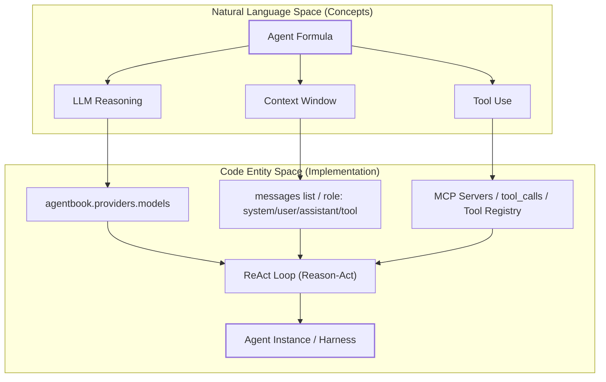
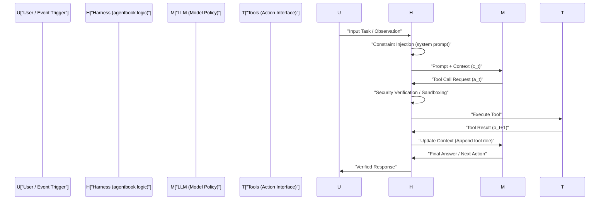

<!-- source: DeepWiki mcp.deepwiki.com · repo bojieli/ai-agent-book · page 1 Overview: AI Agent Engineering Book · fetched 2026-10-27 -->

# Overview: AI Agent Engineering Book

Relevant source files

The following files were used as context for generating this wiki page:

- [README.md](README.md)
- [book/chapter1.md](book/chapter1.md)
- [book/chapter10.md](book/chapter10.md)
- [book/chapter2.md](book/chapter2.md)
- [book/chapter3.md](book/chapter3.md)
- [book/chapter4.md](book/chapter4.md)
- [book/chapter5.md](book/chapter5.md)
- [book/chapter6.md](book/chapter6.md)
- [book/chapter7.md](book/chapter7.md)
- [book/chapter8.md](book/chapter8.md)
- [book/chapter9.md](book/chapter9.md)
- [book/reference-answers.md](book/reference-answers.md)
- [docs/ar/README.md](docs/ar/README.md)
- [docs/en/README.md](docs/en/README.md)
- [docs/es/README.md](docs/es/README.md)
- [docs/ja/README.md](docs/ja/README.md)
- [docs/ko/README.md](docs/ko/README.md)
- [docs/ru/README.md](docs/ru/README.md)
- [docs/ta/README.md](docs/ta/README.md)
- [docs/tr/README.md](docs/tr/README.md)
- [docs/vi/README.md](docs/vi/README.md)
- [docs/zh-TW/README.md](docs/zh-TW/README.md)

This repository serves as a comprehensive guide and reference implementation for building production-grade AI Agents. It is centered around the core engineering formula: **Agent = LLM + Context + Tools** [README.md:10](). While Large Language Models (LLMs) provide the "reasoning engine," the repository emphasizes **Harness Engineering**—the surrounding infrastructure of constraints, verification, and memory that transforms a raw model into a reliable autonomous system [book/chapter1.md:25-28]().

The project bridges the gap between theoretical AI research and practical software engineering, providing a 10-chapter manuscript alongside **108配套实验** (108 companion experiments) [README.md:10-12]().

## The Core Formula: Agent = LLM + Context + Tools

The architecture of every agent in this repository follows a unified structural philosophy described in the introductory chapters [book/chapter1.md:13-19]():

| Component | Role | Chapter Focus |
| :--- | :--- | :--- |
| **LLM** | The **"Brain"**: Reasoning engine, intent recognition, and decision making via Policy. | Ch. 8 (Post-training) |
| **Context** | The **"Eyes"**: Observation Space including environment info, memory, and task progress. | Ch. 2 (Context Eng), Ch. 3 (Memory) |
| **Tools** | The **"Hands/Feet"**: Action Space including APIs, code execution, and messaging. | Ch. 4 (Tools), Ch. 5 (Coding Agent) |

### From Natural Language to Code Entities

The following diagram illustrates how the conceptual "Agent" formula maps to specific software entities within the codebase, particularly within the `agentbook/` shared package and chapter experiments.

**Conceptual to Implementation Mapping**

Sources: [book/chapter1.md:11-28](), [book/chapter2.md:47-56](), [README.md:10-12]()

## Harness Engineering Philosophy

A recurring theme is that "Model-as-an-Agent" is insufficient for production. Instead, the project advocates for **Harness Engineering**: the engineering effort outside the model (the "缰绳与挽具" or reins and harness) that provides safety, reliability, and persistence [book/chapter1.md:25-28](). The Harness is responsible for constructing context, exposing tool interfaces, and implementing "Poka-yoke" (error-proofing) mechanisms like circuit breakers and verification loops [book/chapter7.md:17-19]().

**The Harness Execution Flow**

Sources: [book/chapter1.md:23-28](), [book/chapter2.md:31-37](), [book/chapter2.md:99-101]()

## Repository Structure

The repository is organized to support both readers of the book and developers looking for reference implementations.

*   **`book/`**: Contains the manuscript source (Markdown), LaTeX templates, and the build pipeline for the PDF [README.md:39-47]().
*   **`chapter1/` to `chapter10/`**: Independent, executable Python projects corresponding to each chapter's technical focus [README.md:60-68]().
*   **`agentbook/`**: A shared package containing LLM provider registries and core utilities used across experiments.
*   **`cursor-chats/`**: Development logs showing how AI-assisted coding was used to build the repository itself.
*   **`slides/`**: A 42-lesson Slidev-based video course derived from the manuscript [README.md:16]().

For a detailed breakdown of the file layout and environment setup, see [Repository Structure and Getting Started](#1.1).

## Publication Pipeline

The book is a software product using a sophisticated pipeline:
*   **Pandoc & XeLaTeX**: Converts Markdown into professional formats using the `ElegantBook` LaTeX class [README.md:41-52]().
*   **Localization**: Supports **14 languages** (English, Spanish, Traditional Chinese, etc.) via community contributions [README.md:22-35]().
*   **Static Site**: A multi-language MkDocs site with full-text search and chapter folding [README.md:37]().

For details on the build system, see [Book Publication Pipeline](#1.2) and [Online Documentation Site and Localization](#1.3).

## Chapter Roadmap (v2.0)

The book was recently updated to v2.0, reorganizing content for better interaction and evaluation flows [README.md:12-14]().

1.  **🚀 AI Agent Fundamentals**: The ReAct loop and the "Agent = LLM + Context + Tools" formula [README.md:62]().
2.  **🎯 Context Engineering**: KV Cache optimization, Prompt Engineering, and Agent Skills [README.md:63]().
3.  **📚 User Memory & Knowledge**: RAG pipelines, structured indexing, and memory evaluation [README.md:64]().
4.  **🛠️ Tools**: MCP protocol, Perception/Execution/Collaboration tools, and active tool discovery [README.md:65]().
5.  **💻 Coding Agent**: Production-grade Coding Agent architecture (OpenClaw style) and ACI design [README.md:66]().
6.  **🎙️ Interaction**: Expanding Observation and Action spaces (Multimodal, Computer Use, Voice, and Asynchronous events) [README.md:64]().
7.  **🎯 Agent Evaluation**: Environment types, τ²-bench, and ELO leaderboards [README.md:65]().
8.  **🧠 Model Post-Training**: SFT, RL (PPO/GRPO), and VLA robot training [README.md:66]().
9.  **🔄 Continuous Evolution**: Experience learning, trajectory-based optimization, and prompt distillation [README.md:67]().
10. **🤝 Multi-Agent Collaboration**: Topologies, context sharing vs. isolation, and collective intelligence [README.md:68]().

Sources: [README.md:55-68](), [book/chapter1.md:9]()

---

