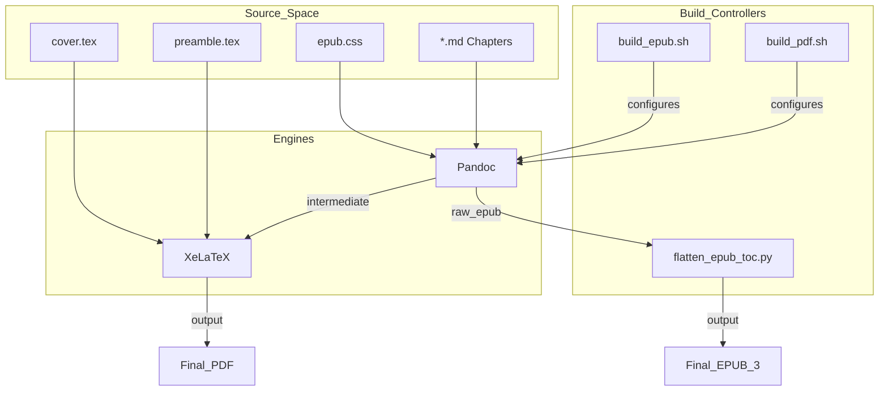
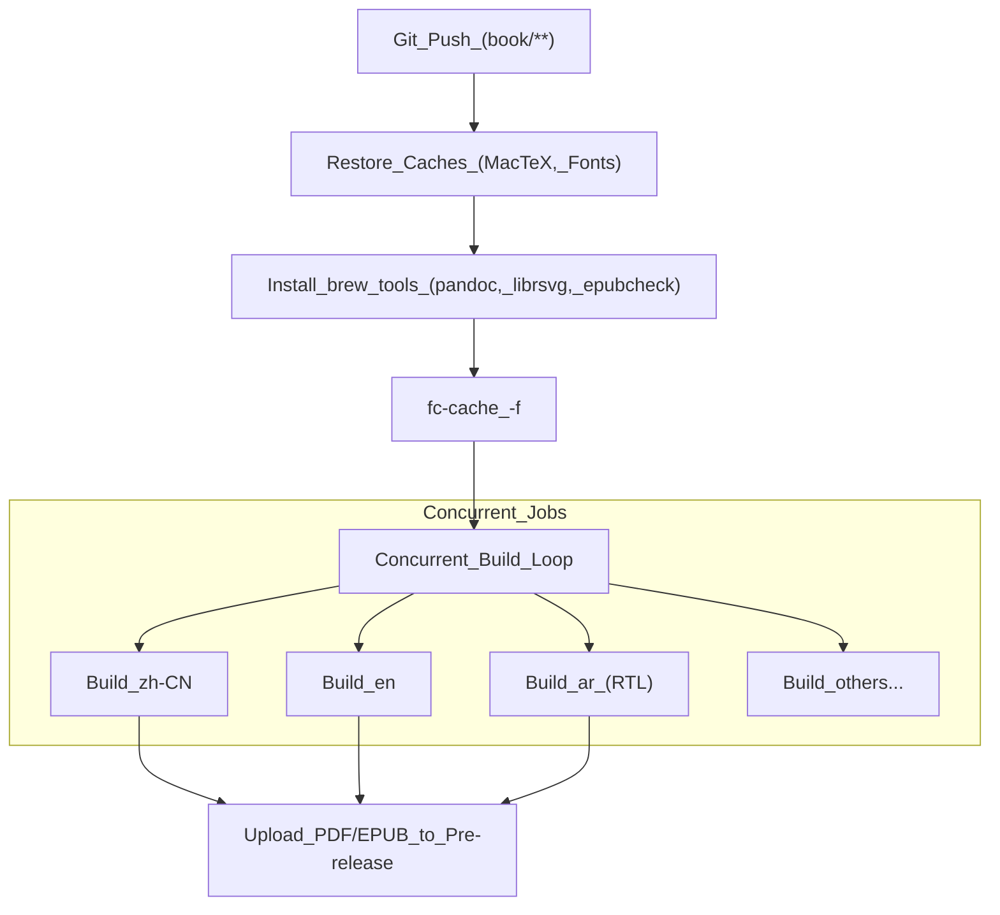

<!-- source: DeepWiki mcp.deepwiki.com · repo bojieli/ai-agent-book · page 1.2 Book Publication Pipeline · fetched 2026-10-27 -->

# Book Publication Pipeline

Relevant source files

The following files were used as context for generating this wiki page:

- [.github/scripts/install_apple_fonts.sh](.github/scripts/install_apple_fonts.sh)
- [.github/workflows/build-latest.yml](.github/workflows/build-latest.yml)
- [EPUB.md](EPUB.md)
- [README.en.md](README.en.md)
- [README.ta.md](README.ta.md)
- [README.vi.md](README.vi.md)
- [README.zhtw.md](README.zhtw.md)
- [book-en/build_pdf.sh](book-en/build_pdf.sh)
- [book-en/cover.tex](book-en/cover.tex)
- [book-ja/build_pdf.sh](book-ja/build_pdf.sh)
- [book-ja/cover.tex](book-ja/cover.tex)
- [book-ko/build_pdf.sh](book-ko/build_pdf.sh)
- [book-ko/crossref.lua](book-ko/crossref.lua)
- [book-ko/images/fig3-8.svg](book-ko/images/fig3-8.svg)
- [book-ko/korean_spacing.lua](book-ko/korean_spacing.lua)
- [book-ko/preamble.tex](book-ko/preamble.tex)
- [book-ta/build_pdf.sh](book-ta/build_pdf.sh)
- [book-ta/cover.tex](book-ta/cover.tex)
- [book-ta/tamil-fonts.tex](book-ta/tamil-fonts.tex)
- [book-vi/build_pdf.sh](book-vi/build_pdf.sh)
- [book-vi/cover.tex](book-vi/cover.tex)
- [book-zhtw/build_pdf.sh](book-zhtw/build_pdf.sh)
- [book-zhtw/cover.tex](book-zhtw/cover.tex)
- [book/.gitignore](book/.gitignore)
- [book/build_pdf.sh](book/build_pdf.sh)
- [book/cover.tex](book/cover.tex)
- [build_epub.sh](build_epub.sh)
- [docs/LEARNING.zhtw.md](docs/LEARNING.zhtw.md)
- [epub.css](epub.css)
- [flatten_epub_toc.py](flatten_epub_toc.py)
- [tests/test_flatten_epub_toc.py](tests/test_flatten_epub_toc.py)

The book publication pipeline is a sophisticated build system designed to convert Markdown manuscripts into professionally typeset PDF and EPUB editions. It leverages **Pandoc** as the core document converter, **XeLaTeX** for high-quality multi-language typesetting, and a suite of **Lua filters**, **Python scripts**, and **GitHub Actions** to automate the transformation from raw text to distribution-ready artifacts.

## Build System Architecture

The pipeline is orchestrated by language-specific shell scripts that sequence the transformation using the `ElegantBook` LaTeX class for PDFs and a custom CSS/Python pipeline for EPUBs.

### Core PDF Build Sequence
The primary entry point for the Chinese edition is `book/build_pdf.sh`, with similar scripts for other languages like `book-en/build_pdf.sh` and `book-ko/build_pdf.sh`.
1.  **Chapter Assembly**: Defines the ordered sequence of Markdown files [book/build_pdf.sh:15-28]().
2.  **Runtime Environment Tweaks**: Adjusts XeTeX memory limits (`extra_mem_top=8000000`) to handle large documents [book-ko/build_pdf.sh:21-24]().
3.  **Metadata Injection**: Sets document attributes such as author, title-meta, and theme (`cyan`) [book/build_pdf.sh:49-55]().
4.  **Transformation Pipeline**: Executes `pandoc` with specialized Lua filters for semantic processing [book/build_pdf.sh:40-45]().
5.  **LaTeX Rendering**: Uses the `xelatex` engine to process the `preamble.tex` and `cover.tex` files [book/build_pdf.sh:43-57]().

### EPUB Generation Pipeline
EPUB generation is managed by `build_epub.sh`, which supports 15+ languages including Arabic (RTL) and Hebrew [build_epub.sh:3]().
1.  **PDF-to-Cover Extraction**: Uses `pdftoppm` to extract the first page of the corresponding PDF as the EPUB cover [EPUB.md:5]().
2.  **Pandoc Conversion**: Converts Markdown to `epub3` using `epub.css` for styling [build_epub.sh:12-28]().
3.  **TOC Flattening**: Runs `flatten_epub_toc.py` to strip section numbers from labels and maintain nested hierarchy in `nav.xhtml` and `toc.ncx` [flatten_epub_toc.py:2-3]().
4.  **RTL Support**: For Arabic (`ar`) and Hebrew (`he`), the pipeline sets `page-progression-direction="rtl"` in the OPF package and applies RTL directions to XHTML files [flatten_epub_toc.py:164-176]().

**Figure 1.2.1: Multi-Format Publication Pipeline**

**Sources:** [book/build_pdf.sh:1-60](), [build_epub.sh:30-165](), [flatten_epub_toc.py:152-185](), [EPUB.md:1-35]()

## Specialized Lua Filters

The pipeline uses Lua filters to extend Markdown syntax without polluting source text with raw LaTeX or HTML.

*   **`crossref.lua`**: Automates internal linking for figures and chapters. It scans for patterns like `图N-M` or `第N章` and converts them into clickable `\hyperref` links [book/build_pdf.sh:44]().
*   **`experiment_box.lua`**: Detects headers starting with "Experiment" or "Review Questions" and wraps the content in `tcolorbox` environments (`experimentbox` or `questionbox`) [book-ko/preamble.tex:107-119]().
*   **`korean_spacing.lua`**: Handles specific spacing requirements for the Korean edition, ensuring CJK/Latin boundaries are handled correctly [book-ko/build_pdf.sh:60](), [book-ko/preamble.tex:52-55]().
*   **`epub_external_links.lua`**: Processes links specifically for the EPUB format to ensure they open correctly in various readers [.github/workflows/build-latest.yml:28]().

**Sources:** [book/build_pdf.sh:44-45](), [book-ko/preamble.tex:107-119](), [book-ko/build_pdf.sh:60]()

## Multi-Language CI/CD Pipeline

The build process is fully automated via GitHub Actions in `.github/workflows/build-latest.yml`.

### Environment and Caching
*   **Runners**: Uses `macos-latest` to leverage native Apple font rendering and Homebrew tools [ .github/workflows/build-latest.yml:67]().
*   **Caching**: Caches the MacTeX tree (~5 min) and document fonts (~2 min) to reduce build times [ .github/workflows/build-latest.yml:71-98]().
*   **Font Installation**: Installs a wide array of fonts including Noto Sans CJK (SC/TC/JP/KR), Arabic fonts (Amiri, Naskh), and Tamil fonts [ .github/workflows/build-latest.yml:132-143]().

### Concurrent Builds
The workflow builds multiple language editions concurrently. It iterates through a list of languages (zh-CN, zh-TW, en, es, id, ru, vi, ta, ar, tr, ko, hu, he) and captures output per language to prevent log interleaving [ .github/workflows/build-latest.yml:160-172]().

**Figure 1.2.2: CI/CD Build Logic (`build-latest.yml`)**

**Sources:** [ .github/workflows/build-latest.yml:8-30](), [ .github/workflows/build-latest.yml:132-150](), [ .github/workflows/build-latest.yml:160-172]()

## EPUB Styling and Post-Processing

EPUBs are styled to match the PDF "ElegantBook" cyan theme using `epub.css`.

*   **Typography**: Uses `system-ui` with fallbacks to CJK fonts like "PingFang SC" and "Noto Sans CJK" [epub.css:34-37]().
*   **Code Blocks**: Styled with a grey background (`--code-bg: #f5f5f5`) and automatic word-wrapping to prevent horizontal scrolling on mobile devices [epub.css:237-253]().
*   **Post-Processing**: `flatten_epub_toc.py` modifies the EPUB ZIP package directly. It:
    *   Removes `section-header-number` spans from `nav.xhtml` to keep the TOC clean [flatten_epub_toc.py:47-62]().
    *   Ensures `playOrder` in `toc.ncx` follows a depth-first search order for Apple Books compatibility [flatten_epub_toc.py:133-143]().
    *   Sets `dir="rtl"` for Arabic and Hebrew editions [flatten_epub_toc.py:94-98]().

**Sources:** [epub.css:7-15](), [epub.css:237-253](), [flatten_epub_toc.py:47-62](), [flatten_epub_toc.py:133-143]()

---

