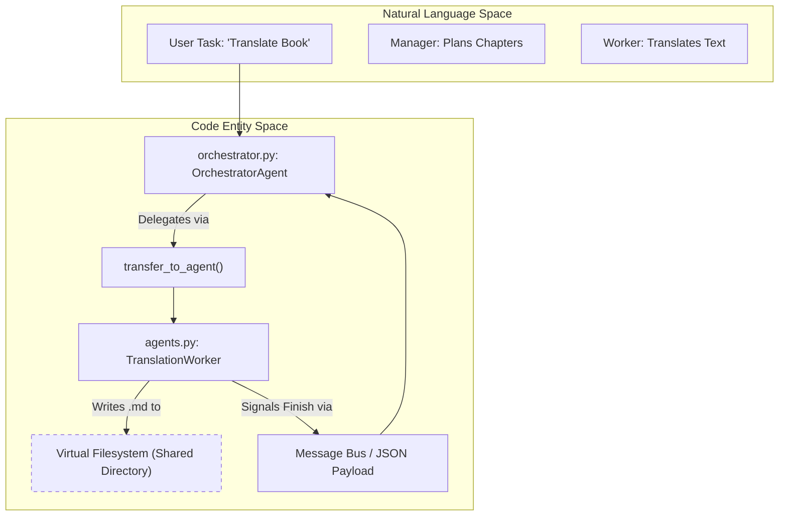
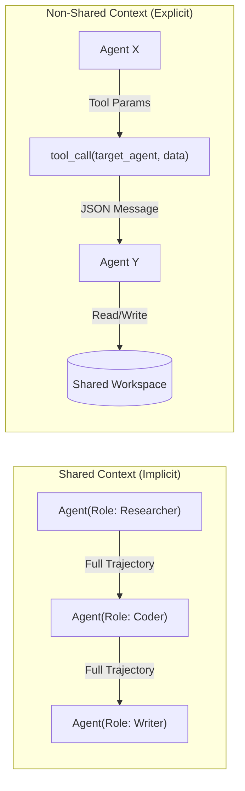

<!-- source: DeepWiki mcp.deepwiki.com · repo bojieli/ai-agent-book · page 11 Multi-Agent Systems (Chapter 10) · fetched 2026-10-27 -->

# Multi-Agent Systems (Chapter 10)

Relevant source files

The following files were used as context for generating this wiki page:

- [book-ar/chapter10.ar.md](book-ar/chapter10.ar.md)
- [book-en/chapter10.md](book-en/chapter10.md)
- [book-es/chapter10.es.md](book-es/chapter10.es.md)
- [book-hu/chapter10.md](book-hu/chapter10.md)
- [book-id/chapter10.md](book-id/chapter10.md)
- [book-ja/chapter10.ja.md](book-ja/chapter10.ja.md)
- [book-ko/chapter10.ko.md](book-ko/chapter10.ko.md)
- [book-ru/chapter10.md](book-ru/chapter10.md)
- [book-ta/chapter10.ta.md](book-ta/chapter10.ta.md)
- [book-tr/chapter10.tr.md](book-tr/chapter10.tr.md)
- [book-vi/chapter10.vi.md](book-vi/chapter10.vi.md)
- [book-zhtw/chapter10.zhtw.md](book-zhtw/chapter10.zhtw.md)
- [chapter10/book-translation/README.md](chapter10/book-translation/README.md)
- [chapter10/book-translation/agents.py](chapter10/book-translation/agents.py)
- [chapter10/book-translation/demo.py](chapter10/book-translation/demo.py)
- [chapter10/multi-role-transfer/README.md](chapter10/multi-role-transfer/README.md)
- [chapter10/multi-role-transfer/demo.py](chapter10/multi-role-transfer/demo.py)
- [chapter10/multi-role-transfer/orchestrator.py](chapter10/multi-role-transfer/orchestrator.py)
- [chapter10/parallel-web-research/README.md](chapter10/parallel-web-research/README.md)
- [chapter10/parallel-web-research/agents.py](chapter10/parallel-web-research/agents.py)
- [chapter10/parallel-web-research/demo.py](chapter10/parallel-web-research/demo.py)
- [chapter10/parallel-web-research/sources.py](chapter10/parallel-web-research/sources.py)
- [chapter10/parallel-web-research/test_completed_worker_ack_regression.py](chapter10/parallel-web-research/test_completed_worker_ack_regression.py)
- [chapter10/parallel-web-research/test_worker_terminate_before_task.py](chapter10/parallel-web-research/test_worker_terminate_before_task.py)
- [chapter10/parallel-web-research/validation/latest.json](chapter10/parallel-web-research/validation/latest.json)
- [chapter10/staged-system-prompt/README.md](chapter10/staged-system-prompt/README.md)
- [chapter10/staged-system-prompt/agent.py](chapter10/staged-system-prompt/agent.py)
- [chapter10/staged-system-prompt/demo.py](chapter10/staged-system-prompt/demo.py)
- [tests/test_ch10_multi_role_transfer_unhashable_target.py](tests/test_ch10_multi_role_transfer_unhashable_target.py)
- [tests/test_ch10_orchestrator_non_dict_tool_arguments.py](tests/test_ch10_orchestrator_non_dict_tool_arguments.py)

This page provides a high-level overview of multi-agent collaboration architectures. While a single Agent (defined as LLM + Context + Tools) is powerful, complex real-world tasks often exceed the capabilities or context window of a single instance. Multi-agent systems (MAS) allow for specialized roles, parallel execution, and emergent collective intelligence that can surpass individual expert performance [book-en/chapter10.md:3-7]().

The engineering of these systems focuses on two primary dimensions: **Context Sharing** (how information moves) and **Collaboration Topology** (how control flows) [book-en/chapter10.md:11-13]().

## Multi-Agent Classification Framework

Designing a multi-agent system requires making fundamental architectural decisions based on the task's complexity, safety requirements, and token budget.

### 1. Context Sharing Strategies
This dimension determines how agents access the conversation history and task trajectory [book-en/chapter10.md:15-17]().

*   **Shared Context (Implicit Coordination):** A subsequent Agent receives the complete conversation history and trajectory of the preceding Agent [book-en/chapter10.md:19-19](). While the system prompt or tool set may change (effectively switching roles), the memory remains continuous. This is often implemented via `transfer_to_agent` [book-en/chapter10.md:88-88]().
*   **Non-Shared Context (Explicit Coordination):** Each Agent maintains an independent context and conversation history. Information is passed through explicit mechanisms like **Tool call parameters**, **Shared file systems**, or a **Message bus** [book-en/chapter10.md:21-27](). This maps to the Inter-Process Communication (IPC) paradigms of shared memory and message passing [book-en/chapter10.md:23-29]().

### 2. Collaboration Topologies
Topologies define the structure of control and information flow between agents [book-en/chapter10.md:33-35]().

*   **Peer Collaboration Pattern:** A small number of Agents (typically 2-3) interact as equals, forming an iterative improvement loop (e.g., proposer and reviewer) [book-en/chapter10.md:37-37]().
*   **Manager Pattern (Orchestration):** A centralized Manager Agent is responsible for task planning and scheduling, while multiple sub-agents handle specific subtasks [book-en/chapter10.md:38-38]().
*   **Decentralized Pattern:** There is no runtime central controller; Agents communicate with each other like humans to collaborate on tasks [book-en/chapter10.md:39-39]().

For a detailed breakdown of these patterns and the "New Information" utility framework, see **[Context Sharing and Collaboration Topologies](#11.1)**.

**Sources:** [book-en/chapter10.md:11-40]()

---

## The "New Information" Utility Framework

Multi-agent systems are only effective if the collaboration introduces **new information** that a single agent could not generate alone during its initial reasoning [book-en/chapter10.md:47-51]().

| Collaboration Mode | New Information Source | Effectiveness |
| :--- | :--- | :--- |
| Self-Review | None (same model reading own text) | Low/Harmful [book-zhtw/chapter10.zhtw.md:55]() |
| Multi-Agent Debate | None (static text analysis) | Marginal [book-zhtw/chapter10.zhtw.md:56]() |
| **Execution Feedback** | **Compiler/Test results (RLEF)** | **High** [book-zhtw/chapter10.zhtw.md:57]() |
| **Visual Feedback** | **UI Screenshots/Rendering** | **High** [book-zhtw/chapter10.zhtw.md:58]() |
| **Tool Feedback** | **External API/Search results** | **High** [book-zhtw/chapter10.zhtw.md:59]() |

**Sources:** [book-zhtw/chapter10.zhtw.md:47-66]()

---

## Infrastructure and Protocols

Building robust MAS requires a data plane for shared assets and a control plane for inter-agent communication, often referred to as "Graph Engineering" [book-en/chapter10.md:41-41]().

### Virtual Filesystem and Concurrency
To collaborate on complex projects, agents need a structured data plane. The repository emphasizes the **Shared File System** as the "shared memory" of the agent world [book-en/chapter10.md:29-29]().
1.  **Shared Workspace:** Common directory for intermediate artifacts like code, documents, or data [book-en/chapter10.md:26-26]().
2.  **Concurrency Control:** Managing parallel access to the filesystem to prevent race conditions during artifact exchange.

### The A2A (Agent-to-Agent) Protocol
Effective collaboration requires a standardized communication protocol. The codebase treats agents as distinct processes within an "Operating System" framework [book-zhtw/chapter10.zhtw.md:107-118]():
*   **fork/spawn:** Creating sub-agents to handle delegated work [book-zhtw/chapter10.zhtw.md:116]().
*   **Message Bus:** An intermediary for asynchronous message delivery [book-en/chapter10.md:27-27]().
*   **Budget Awareness:** Managing "Step Budgets" (tool call limits) to prevent agents from saturating resources without progress [book-ja/chapter10.ja.md:72-74]().

For details on the VFS, A2A protocol, and emergent agent societies, see **[Virtual Filesystem, Concurrency, and A2A Protocol](#11.2)**.

---

## Architecture Mapping: Natural Language to Code

The following diagrams bridge conceptual MAS patterns to the specific code entities used in the experiments.

### Orchestration Pattern Code Mapping
Title: Orchestration Pattern Code Mapping

**Sources:** [book-en/chapter10.md:38-39](), [chapter10/multi-role-transfer/orchestrator.py]()

### Context Strategy Implementation
Title: Context Strategy Implementation

**Sources:** [book-en/chapter10.md:19-27](), [book-zhtw/chapter10.zhtw.md:88-89]()

---

## Child Pages
- **[Context Sharing and Collaboration Topologies](#11.1)**: Detailed analysis of `transfer_to_agent`, Peer/Orchestration/Decentralized patterns, and budget-aware scaling (Chapter 10 experiments like `multi-role-transfer` and `parallel-web-research`).
- **[Virtual Filesystem, Concurrency, and A2A Protocol](#11.2)**: Deep dive into the data plane, inter-agent communication via tool parameters and message buses, and the A2A-style interoperability model.

---

