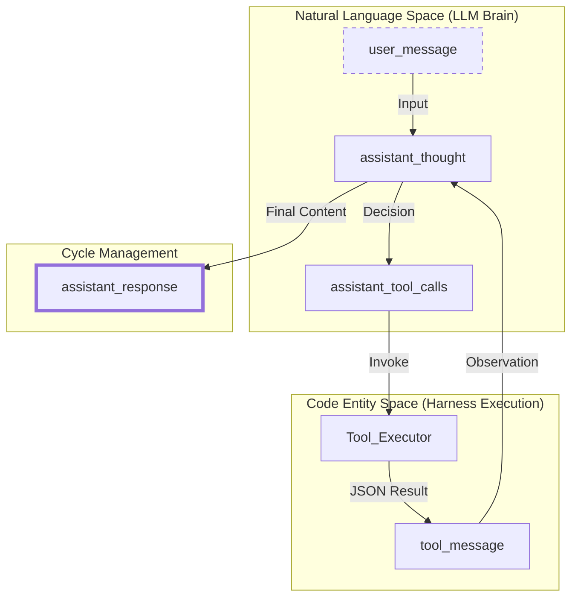
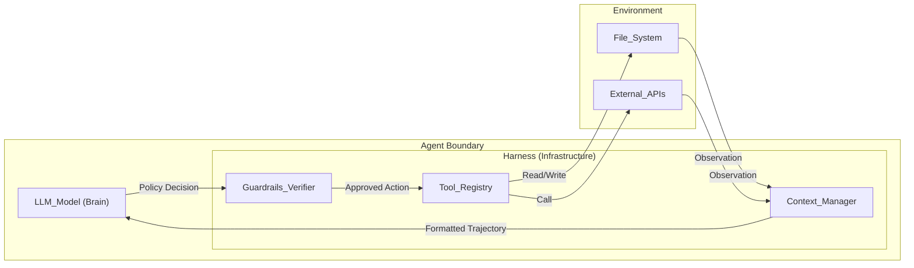

<!-- source: DeepWiki mcp.deepwiki.com · repo bojieli/ai-agent-book · page 2.1 The ReAct Loop and Tool Calling · fetched 2026-10-27 -->

# The ReAct Loop and Tool Calling

Relevant source files

The following files were used as context for generating this wiki page:

- [book-ar/chapter1.ar.md](book-ar/chapter1.ar.md)
- [book-ar/chapter2.ar.md](book-ar/chapter2.ar.md)
- [book-en/chapter1.md](book-en/chapter1.md)
- [book-en/chapter2.md](book-en/chapter2.md)
- [book-es/chapter1.es.md](book-es/chapter1.es.md)
- [book-es/chapter2.es.md](book-es/chapter2.es.md)
- [book-hu/chapter1.md](book-hu/chapter1.md)
- [book-id/chapter1.md](book-id/chapter1.md)
- [book-id/chapter2.md](book-id/chapter2.md)
- [book-ja/chapter1.ja.md](book-ja/chapter1.ja.md)
- [book-ja/chapter2.ja.md](book-ja/chapter2.ja.md)
- [book-ko/chapter1.ko.md](book-ko/chapter1.ko.md)
- [book-ko/chapter2.ko.md](book-ko/chapter2.ko.md)
- [book-ru/chapter1.md](book-ru/chapter1.md)
- [book-ru/chapter2.md](book-ru/chapter2.md)
- [book-ta/chapter1.ta.md](book-ta/chapter1.ta.md)
- [book-ta/chapter2.ta.md](book-ta/chapter2.ta.md)
- [book-tr/chapter1.tr.md](book-tr/chapter1.tr.md)
- [book-tr/chapter2.tr.md](book-tr/chapter2.tr.md)
- [book-vi/chapter1.vi.md](book-vi/chapter1.vi.md)
- [book-vi/chapter2.vi.md](book-vi/chapter2.vi.md)
- [book-zhtw/chapter1.zhtw.md](book-zhtw/chapter1.zhtw.md)
- [book-zhtw/chapter2.zhtw.md](book-zhtw/chapter2.zhtw.md)
- [chapter1/context/grounding.py](chapter1/context/grounding.py)
- [chapter1/context/requirements.txt](chapter1/context/requirements.txt)
- [chapter1/context/run_experiment_1_1.py](chapter1/context/run_experiment_1_1.py)
- [chapter1/context/test_experiment_1_1.py](chapter1/context/test_experiment_1_1.py)
- [chapter1/context/test_grounding.py](chapter1/context/test_grounding.py)
- [chapter1/context/test_main_result_semantics.py](chapter1/context/test_main_result_semantics.py)
- [chapter1/context/tests/test_malformed_tool_json.py](chapter1/context/tests/test_malformed_tool_json.py)
- [chapter1/context/validation/latest.json](chapter1/context/validation/latest.json)
- [chapter1/context/validation/probes_20260825T/index.json](chapter1/context/validation/probes_20260825T/index.json)
- [chapter1/context/validation/real_20260901T163146Z/evidence.json](chapter1/context/validation/real_20260901T163146Z/evidence.json)
- [chapter1/context/validation/real_20260901T163146Z/evidence.sha256](chapter1/context/validation/real_20260901T163146Z/evidence.sha256)

This page provides a technical deep dive into the **ReAct (Reason-Act-Observe)** execution cycle, which serves as the foundational operational logic for modern AI Agents. It explores the four-step tool calling protocol, the management of execution trajectories, and the implementation details of the message-based communication loop.

## The ReAct Execution Cycle

The ReAct pattern combines reasoning (internal thought) and acting (external tool use) in an iterative loop. This cycle allows an Agent to decompose complex tasks, execute actions, observe outcomes, and refine its strategy dynamically based on environmental feedback [book-en/chapter1.md:79-81]().

### The Four-Step Tool Calling Protocol

Tool calling (also known as Function Calling) is the mechanism by which the LLM interacts with the external world. The process follows a strict four-step protocol at the API level [book-en/chapter1.md:80-82]():

1.  **Declaration**: The developer defines available tools, including their names, purposes, and parameter schemas (typically using JSON Schema), in the context provided to the model [book-en/chapter1.md:83-92]().
2.  **Decision**: The LLM autonomously judges whether a tool is needed, which tool to call, and what arguments to pass based on the user request [book-en/chapter1.md:86-92]().
3.  **Execution**: The Agent framework (Harness) executes the tool (e.g., calling an API or running code) and captures the result [book-en/chapter1.md:94-98]().
4.  **Response**: The tool result is appended to the message history, and the model generates a final response or plans the next action based on this observation [book-en/chapter1.md:94-98]().

### ReAct Data Flow Diagram

The following diagram maps the logical ReAct loop to the data structures and roles defined in modern LLM APIs, bridging the gap between reasoning and code execution.

**Title: ReAct Loop to Message History Mapping**

Sources: [book-en/chapter1.md:79-98](), [book-zhtw/chapter2.zhtw.md:45-56]()

## Trajectory Management

A **Trajectory** is the complete sequence of reasoning steps, tool calls, and observations generated during a task. This sequence is maintained in the `messages` list to provide the model with a "memory" of the current session [book-en/chapter2.md:31-35]().

### Context Structure and Roles
In a ReAct loop, the context is reconstructed for every API call. Each model call is stateless, meaning the entire history must be sent each time [book-zhtw/chapter2.zhtw.md:35-36](). The API uses specific roles to identify message types [book-zhtw/chapter2.zhtw.md:45-54]():

*   **system**: Developer-written rules, identity definitions, and tool descriptions [book-zhtw/chapter2.zhtw.md:49-49]().
*   **user**: Direct input from the end-user [book-zhtw/chapter2.zhtw.md:50-50]().
*   **assistant**: The model's generated thoughts and tool-call requests [book-zhtw/chapter2.zhtw.md:51-51]().
*   **tool**: The output of a tool execution, linked to a specific call via `tool_call_id` [book-zhtw/chapter2.zhtw.md:52-52]().

### Trajectory Sequence Example
| Step | Role | Entity / Data | Function |
| :--- | :--- | :--- | :--- |
| 1 | `system` | `Instructions + Tools` | Capability Definition [book-zhtw/chapter2.zhtw.md:109-113]() |
| 2 | `user` | "Weather in Vancouver?" | Task Initiation [book-zhtw/chapter2.zhtw.md:115-117]() |
| 3 | `assistant` | `tool_calls: get_weather` | Reasoning/Action Decision [book-zhtw/chapter2.zhtw.md:151-152]() |
| 4 | `tool` | `{"temp": 12, "unit": "c"}` | Observation Result [book-zhtw/chapter2.zhtw.md:94-98]() |
| 5 | `assistant` | "It is currently 12°C..." | Final Answer Generation [book-zhtw/chapter2.zhtw.md:94-98]() |

Sources: [book-en/chapter2.md:31-35](), [book-zhtw/chapter2.zhtw.md:45-56](), [book-zhtw/chapter2.zhtw.md:103-152]()

## Common Failure Modes in the Loop

Engineering a robust ReAct loop requires handling several specific failure modes that occur at the boundary between the model and the execution harness.

### 1. Tool JSON Errors
The model may generate malformed JSON or arguments that do not adhere to the defined schema. The harness must validate the `arguments` field in `assistant_tool_calls` before execution [chapter1/context/tests/test_malformed_tool_json.py:1-20]().

### 2. Missing Tool Results
If the model requests multiple tool calls (parallel tool calling), the harness must provide a corresponding `tool` message for *every* `tool_call_id`. Missing results often cause the model to hang or repeat the request [book-zhtw/chapter2.zhtw.md:101-102]().

### 3. Infinite Looping
A "hallucination loop" occurs when the model repeatedly calls the same tool with the same parameters despite receiving an error or the same result. Harness implementations typically include a `max_iterations` circuit breaker to prevent token exhaustion [book-en/chapter1.md:25-27]().

## Harness Engineering Philosophy

The **Harness** is the engineering shell that surrounds the LLM "Brain" to make it a reliable Agent system [book-en/chapter1.md:23-25]().

**Title: Model-Harness Boundary and Code Entities**

Sources: [book-en/chapter1.md:11-27](), [book-en/chapter2.md:1-5]()

*   **Context Management**: Handles the reconstruction of the `messages` list and ensures `system` instructions remain at the head of the context window [book-zhtw/chapter2.zhtw.md:49-56]().
*   **Observation Space**: Translates environment state into text/JSON that the model can "see" [book-en/chapter1.md:37-41]().
*   **Action Space**: Translates tool call requests into actual system operations, enforcing safety boundaries and sandboxing [book-en/chapter1.md:103-107]().

Sources: [book-en/chapter1.md:11-41](), [book-en/chapter2.md:1-5](), [book-zhtw/chapter2.zhtw.md:31-56]()

---

