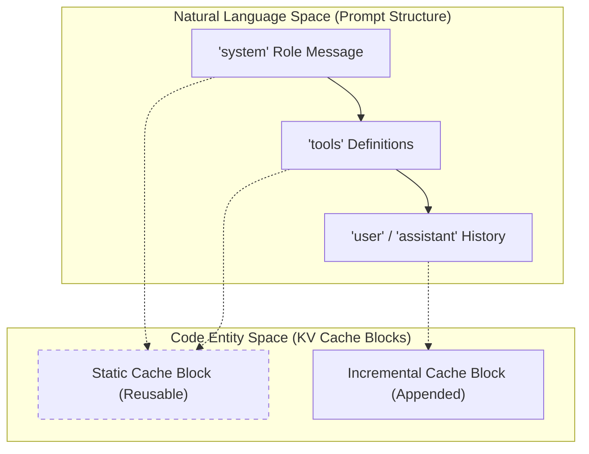
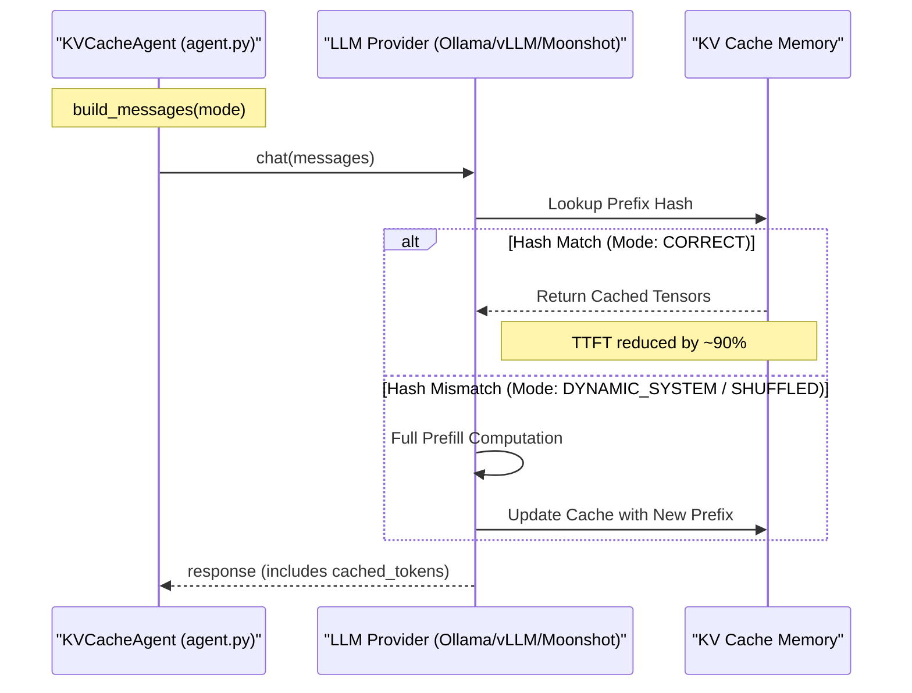

<!-- source: DeepWiki mcp.deepwiki.com · repo bojieli/ai-agent-book · page 3.1 KV Cache Optimization and Prompt Engineering · fetched 2026-10-27 -->

# KV Cache Optimization and Prompt Engineering

Relevant source files

The following files were used as context for generating this wiki page:

- [chapter2/attention_visualization/README.md](chapter2/attention_visualization/README.md)
- [chapter2/context-compression/README.md](chapter2/context-compression/README.md)
- [chapter2/context-compression/experiment.py](chapter2/context-compression/experiment.py)
- [chapter2/context-compression/main.py](chapter2/context-compression/main.py)
- [chapter2/context-compression/quickstart.py](chapter2/context-compression/quickstart.py)
- [chapter2/context-compression/run_all_strategies.py](chapter2/context-compression/run_all_strategies.py)
- [chapter2/kv-cache/README.md](chapter2/kv-cache/README.md)
- [chapter2/kv-cache/agent.py](chapter2/kv-cache/agent.py)
- [chapter2/kv-cache/main.py](chapter2/kv-cache/main.py)
- [chapter2/local_llm_serving/README.md](chapter2/local_llm_serving/README.md)
- [chapter2/local_llm_serving/agent.py](chapter2/local_llm_serving/agent.py)
- [chapter2/local_llm_serving/check_compatibility.py](chapter2/local_llm_serving/check_compatibility.py)
- [chapter2/local_llm_serving/demo_streaming.py](chapter2/local_llm_serving/demo_streaming.py)
- [chapter2/local_llm_serving/main.py](chapter2/local_llm_serving/main.py)
- [chapter2/local_llm_serving/ollama_native.py](chapter2/local_llm_serving/ollama_native.py)
- [chapter2/local_llm_serving/requirements.txt](chapter2/local_llm_serving/requirements.txt)
- [chapter2/local_llm_serving/setup.sh](chapter2/local_llm_serving/setup.sh)
- [chapter2/local_llm_serving/test_ollama_thinking.py](chapter2/local_llm_serving/test_ollama_thinking.py)
- [chapter2/local_llm_serving/test_parallel_tools.py](chapter2/local_llm_serving/test_parallel_tools.py)
- [chapter2/local_llm_serving/test_vllm_structured_streaming.py](chapter2/local_llm_serving/test_vllm_structured_streaming.py)
- [chapter2/prompt-engineering/README.md](chapter2/prompt-engineering/README.md)
- [chapter2/prompt-engineering/run_ablation.py](chapter2/prompt-engineering/run_ablation.py)
- [chapter2/system-hint/CHANGELOG.md](chapter2/system-hint/CHANGELOG.md)
- [chapter2/system-hint/README.md](chapter2/system-hint/README.md)
- [chapter2/system-hint/agent.py](chapter2/system-hint/agent.py)
- [chapter2/system-hint/config.py](chapter2/system-hint/config.py)
- [chapter2/system-hint/main.py](chapter2/system-hint/main.py)
- [chapter2/system-hint/test_basic.py](chapter2/system-hint/test_basic.py)
- [chapter2/system-hint/test_malformed_tool_json.py](chapter2/system-hint/test_malformed_tool_json.py)
- [chapter3/agentic-rag-for-user-memory/config.py](chapter3/agentic-rag-for-user-memory/config.py)
- [chapter3/agentic-rag/config.py](chapter3/agentic-rag/config.py)
- [chapter3/contextual-retrieval-for-user-memory/config.py](chapter3/contextual-retrieval-for-user-memory/config.py)
- [chapter3/contextual-retrieval/config.py](chapter3/contextual-retrieval/config.py)
- [chapter3/log-sanitization/agent.py](chapter3/log-sanitization/agent.py)
- [chapter3/log-sanitization/config.py](chapter3/log-sanitization/config.py)
- [tests/test_ch1_ch2_system_hint_tool_error_null.py](tests/test_ch1_ch2_system_hint_tool_error_null.py)

This page explains the mechanics of the Key-Value (KV) Cache, the technical requirements for prefix stability, and the implementation of Prompt Cache APIs. It contrasts correct engineering patterns with common anti-patterns that degrade performance and provides an overview of experimental results from the `chapter2/kv-cache/`, `chapter2/prompt-engineering/`, and `chapter2/local_llm_serving/` directories.

## KV Cache Mechanics and Prefix Stability

The KV Cache is a memory optimization in Transformer-based models that stores the Key and Value tensors of previous tokens to avoid redundant computations during auto-regressive generation. For an Agent, the efficiency of this cache is determined by **Prefix Stability**: if the beginning of a prompt remains identical across multiple turns, the model can reuse the cached computations, significantly reducing Time to First Token (TTFT) and computational cost [chapter2/kv-cache/README.md:20-22]().

### The "Static Prefix + Dynamic Trajectory" Structure
To maximize KV Cache utilization, the context should be structured into a static part and a growing part. The `KVCacheMode.CORRECT` implementation in the experiment demonstrates this by maintaining a stable message list and appending results rather than rebuilding the full context from scratch [chapter2/kv-cache/agent.py:59-61]().

| Component | Content | Stability |
| :--- | :--- | :--- |
| **Static Prefix** | `system` prompt, `tools` definitions, and few-shot examples | High (Should never change) |
| **Dynamic Trajectory** | Conversation history (`user`, `assistant`, `tool` messages) | Low (Appends new tokens) |

**Prefix Stability Requirement Diagram**
This diagram maps the logical structure of a prompt to the underlying Transformer cache mechanism as implemented in `chapter2/kv-cache/agent.py`.

Sources: [chapter2/kv-cache/agent.py:59-62](), [chapter2/kv-cache/README.md:20-24](), [chapter2/kv-cache/agent.py:151-174]()

## Implementation Modes: Correct vs. Anti-Patterns

The `chapter2/kv-cache/` experiment defines six distinct modes to measure the impact of context management on cache hits and TTFT [chapter2/kv-cache/agent.py:59-67]().

### The Six Implementation Modes

1.  **CORRECT**: Stable context with a fixed system prompt and consistent tool order [chapter2/kv-cache/agent.py:61]().
2.  **DYNAMIC_SYSTEM**: Adds a timestamp to the system prompt in every request, forcing a full context recompute [chapter2/kv-cache/agent.py:62]().
3.  **SHUFFLED_TOOLS**: Randomizes the order of tool definitions each request, which breaks the prefix hash even if the tools are identical [chapter2/kv-cache/agent.py:63]().
4.  **DYNAMIC_PROFILE**: Simulates a common production error where user metadata (like "credits remaining") is injected into the system prompt, causing invalidation [chapter2/kv-cache/agent.py:64]().
5.  **SLIDING_WINDOW**: Only keeps the most recent $N$ messages. While it limits total tokens, it breaks cache continuity once the "window" moves [chapter2/kv-cache/agent.py:65]().
6.  **TEXT_FORMAT**: Formats the entire history as a single plain text block instead of structured messages, breaking provider-level optimizations [chapter2/kv-cache/agent.py:66]().

### Prompt Cache Data Flow
The following diagram illustrates how the `KVCacheMode` logic affects the interaction with LLM backends like Moonshot or vLLM.

Sources: [chapter2/kv-cache/agent.py:80-92](), [chapter2/kv-cache/README.md:55-62](), [chapter2/kv-cache/README.md:103-110]()

## Local LLM Serving and Tool Calling

Experiment 2-1 covers local deployment using Ollama and vLLM. The `chapter2/local_llm_serving/` project provides a unified entry point for cross-platform tool calling [chapter2/local_llm_serving/README.md:14-18]().

*   **vLLM Backend**: Optimized for Linux/WSL2 with NVIDIA GPUs, supporting continuous batching and high-performance KV cache management [chapter2/local_llm_serving/README.md:78-80]().
*   **Ollama Backend**: Default for macOS and Windows, providing an OpenAI-compatible API for models like Qwen3 [chapter2/local_llm_serving/README.md:73-75]().
*   **Parallel Tool Execution**: The `OllamaNativeAgent` and `VLLMToolAgent` implement `_execute_tool_calls` using a `ThreadPoolExecutor` to run independent tool calls concurrently, which is critical for minimizing latency in complex ReAct loops [chapter2/local_llm_serving/ollama_native.py:102-104](), [chapter2/local_llm_serving/agent.py:146-148]().
*   **Reasoning Stream Handling**: For models supporting thinking (e.g., Kimi, Qwen3), the `OllamaNativeAgent` handles the `thinking` field vs raw `<think>` tags, ensuring reasoning is captured even when streaming [chapter2/local_llm_serving/README.md:193-196](), [chapter2/local_llm_serving/test_ollama_thinking.py:47-66]().

Sources: [chapter2/local_llm_serving/agent.py:20-37](), [chapter2/local_llm_serving/ollama_native.py:17-37](), [chapter2/local_llm_serving/test_parallel_tools.py:55-60]()

## Advanced Trajectory Management

### System Hints and Status Bars
The `SystemHintAgent` in `chapter2/system-hint/` demonstrates advanced context management by injecting meta-information into the trajectory [chapter2/system-hint/agent.py:88-91]().
*   **Timestamps**: Allows the agent to understand the temporal sequence of events [chapter2/system-hint/agent.py:73]().
*   **Tool Counter**: Prevents infinite loops by tracking how many times a tool has been called [chapter2/system-hint/agent.py:74]().
*   **TODO List**: A structured state tracking mechanism that the agent updates using `rewrite_todo_list` and `update_todo_status` [chapter2/system-hint/agent.py:157-166]().
*   **System State**: Injects environment details like the `current_directory` to provide context for tool execution [chapter2/system-hint/agent.py:77](), [chapter2/system-hint/agent.py:144]().

### Context Compression
`chapter2/context-compression/` evaluates six strategies for managing long histories, including **Context-Aware Summarization** (query-focused) and **Windowed Context** (keeping latest full content while compressing history) [chapter2/context-compression/README.md:35-64]().

**Compression Strategy Comparison Table**

| Strategy | Description | Pros | Cons |
| :--- | :--- | :--- | :--- |
| **Individual Summary** | Summarize each page/tool result separately [chapter2/context-compression/README.md:42-45]() | Preserves detail | High LLM call count |
| **Combined Summary** | Concatenate all and summarize once [chapter2/context-compression/README.md:47-50]() | Better overview | May lose attribution |
| **Context-Aware** | Query-focused summary [chapter2/context-compression/README.md:52-54]() | High relevance | Extra LLM overhead |
| **Windowed** | Keep latest $N$, compress old [chapter2/context-compression/README.md:60-64]() | Balance | Potential context break |

Sources: [chapter2/system-hint/agent.py:71-82](), [chapter2/context-compression/README.md:35-64](), [chapter2/system-hint/README.md:52-78]()

---

