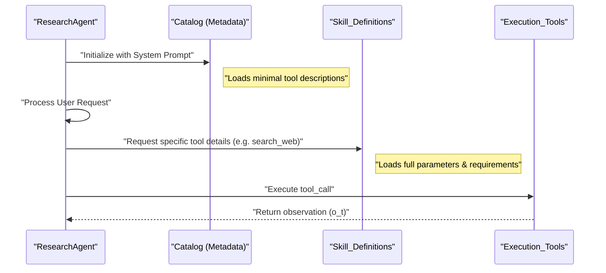
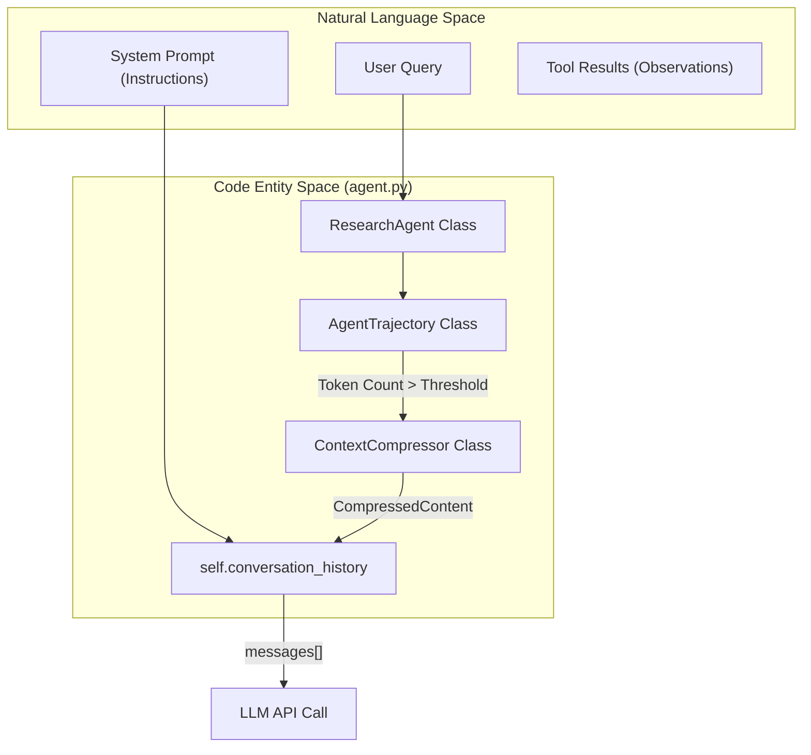

<!-- source: DeepWiki mcp.deepwiki.com · repo bojieli/ai-agent-book · page 3.2 Agent Skills, Status Bar, and Context Compression · fetched 2026-10-27 -->

# Agent Skills, Status Bar, and Context Compression

Relevant source files

The following files were used as context for generating this wiki page:

- [book-ar/chapter2.ar.md](book-ar/chapter2.ar.md)
- [book-en/chapter2.md](book-en/chapter2.md)
- [book-es/chapter2.es.md](book-es/chapter2.es.md)
- [book-id/chapter2.md](book-id/chapter2.md)
- [book-ja/chapter2.ja.md](book-ja/chapter2.ja.md)
- [book-ko/chapter2.ko.md](book-ko/chapter2.ko.md)
- [book-ru/chapter2.md](book-ru/chapter2.md)
- [book-ta/chapter2.ta.md](book-ta/chapter2.ta.md)
- [book-tr/chapter2.tr.md](book-tr/chapter2.tr.md)
- [book-vi/chapter2.vi.md](book-vi/chapter2.vi.md)
- [book-zhtw/chapter2.zhtw.md](book-zhtw/chapter2.zhtw.md)
- [chapter2/context-compression/agent.py](chapter2/context-compression/agent.py)
- [chapter2/context-compression/compression_strategies.py](chapter2/context-compression/compression_strategies.py)
- [chapter2/context-compression/config.py](chapter2/context-compression/config.py)
- [chapter2/context-compression/env.example](chapter2/context-compression/env.example)
- [chapter2/context-compression/test_malformed_tool_json.py](chapter2/context-compression/test_malformed_tool_json.py)
- [chapter2/context-compression/test_null_content_compression.py](chapter2/context-compression/test_null_content_compression.py)
- [chapter2/system-hint/env.example](chapter2/system-hint/env.example)
- [chapter3/contextual-retrieval-for-user-memory/contextual_evaluator.py](chapter3/contextual-retrieval-for-user-memory/contextual_evaluator.py)

This page documents the technical implementation of advanced context engineering techniques within the AI Agent framework. It covers the hierarchical **Agent Skills** system for progressive tool disclosure, the **Status Bar** pattern for out-of-band state communication, and systematic **Context Compression** strategies to manage the "context rot" inherent in long-running agent trajectories.

## 1. Agent Skills System

The Agent Skills system solves the "context saturation" problem where providing descriptions for hundreds of tools simultaneously degrades model performance and increases KV cache costs. It employs a **progressive disclosure** architecture that keeps the initial system prompt lean [chapter2/context-compression/agent.py:111-143]().

### 1.1 Hierarchical Structure
The system is organized into three layers of increasing detail:
1.  **Metadata Layer**: A lightweight catalog of available skills. Only the `name` and `description` are typically loaded into the system prompt at startup to minimize initial token usage.
2.  **Core Skill Layer**: Detailed workflows and primary tool logic. This is loaded only when the Agent decides a specific skill is required, often triggered by a search for capabilities [chapter2/context-compression/agent.py:121-139]().
3.  **Sub-document Layer**: Specialized reference files and executable scripts loaded for deep task execution.

### 1.2 Skill Routing Data Flow
The implementation uses an isomorphic loader to simulate the progressive disclosure mechanism.

**Skill Discovery and Execution Logic**

*Sources: [chapter2/context-compression/agent.py:111-168](), [book-en/chapter2.md:31-37]()*

## 2. Agent Status Bar Pattern

The Status Bar is a "meta-information side-channel" implemented via **System Hints**. It provides the agent with real-time state tracking, timestamps, and error context without polluting the permanent conversation history.

### 2.1 System Hint and Status Tracking
The `ResearchAgent` maintains a `trajectory` using the `AgentTrajectory` class to track internal state [chapter2/context-compression/agent.py:49-63]():
*   **Temporal Context**: The `start_time` and `end_time` are tracked to calculate execution duration [chapter2/context-compression/agent.py:62-63]().
*   **Token Monitoring**: Tracks `total_tokens_used`, `prompt_tokens_used`, and `completion_tokens_used` to manage budget and context window limits [chapter2/context-compression/agent.py:52-54]().
*   **Context Health**: Monitors `last_prompt_tokens` and `context_overflows` to trigger compression when the model's limit is approached [chapter2/context-compression/agent.py:59-60]().

### 2.2 Status Bar Implementation
| Code Entity | Role in Status Tracking |
| :--- | :--- |
| `ToolCall` | Represents a single tool interaction, including `timestamp` and `id` [chapter2/context-compression/agent.py:35-45]() |
| `AgentTrajectory` | Aggregates all `ToolCall` objects and token metrics [chapter2/context-compression/agent.py:49-51]() |
| `today` | Dynamic date injection in system prompt to prevent temporal disorientation [chapter2/context-compression/agent.py:115-141]() |

*Sources: [chapter2/context-compression/agent.py:34-65](), [chapter2/context-compression/agent.py:111-143]()*

## 3. Context Compression Strategies

Context compression addresses "context rot"—the accumulation of irrelevant tool outputs that lead to context window overflow and increased latency. The `ContextCompressor` class manages these transformations [chapter2/context-compression/agent.py:100]().

### 3.1 Compression Strategies and Failure Modes
The framework defines a `CompressionStrategy` enum to handle different scenarios [chapter2/context-compression/agent.py:74]():

1.  **NO_COMPRESSION**: The default lossless approach, providing the complete message history [book-en/chapter2.md:35]().
2.  **Context-Aware Compression**: Summarizes tool results based on the specific `query` and existing `conversation_history` to retain only relevant information [chapter2/context-compression/agent.py:100]().
3.  **Failure Modes**:
    *   **Null Content**: Handled by specific tests to ensure the compressor doesn't crash on empty tool outputs.
    *   **Malformed Tool JSON**: Occurs when the model generates invalid arguments; caught during the `ToolCall` lifecycle [chapter2/context-compression/agent.py:38]().
    *   **Summary Drift**: The risk that repeated summarization loses critical "needle-in-a-haystack" details over long trajectories.

### 3.2 Context Management Data Flow
The `ResearchAgent` acts as the harness, coordinating between the LLM and the `ContextCompressor`.

**Context Compression and Token Flow**

*Sources: [chapter2/context-compression/agent.py:49-66](), [chapter2/context-compression/agent.py:100-107](), [book-en/chapter2.md:31-35]()*

## 4. Implementation Details

### 4.1 Tool Call Lifecycle
Every interaction with the environment is encapsulated in a `ToolCall` object [chapter2/context-compression/agent.py:35](). This object stores the `tool_name`, `arguments`, and the `result`. If compression is active, the `compressed_result` field (of type `CompressedContent`) stores the transformed output to be sent to the LLM in subsequent rounds [chapter2/context-compression/agent.py:37-40]().

### 4.2 Streaming and Reasoning Models
The agent includes a `_reasoning_safe_temperature` utility to handle specific model constraints, such as Kimi K3 or GPT-5, which may only accept a temperature of 1.0 [chapter2/context-compression/agent.py:22-27](). This ensures the context engineering remains compatible with advanced reasoning models that have strict parameter requirements.

*Sources: [chapter2/context-compression/agent.py:22-45](), [chapter2/context-compression/agent.py:88-96]()*

---

