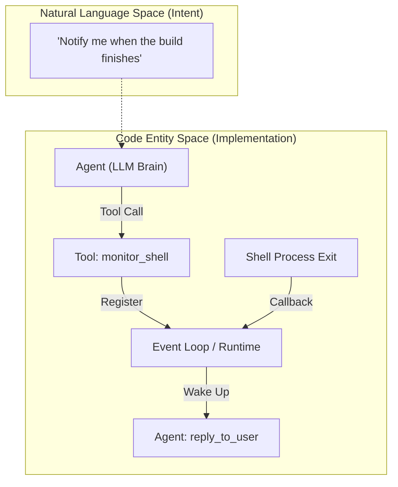
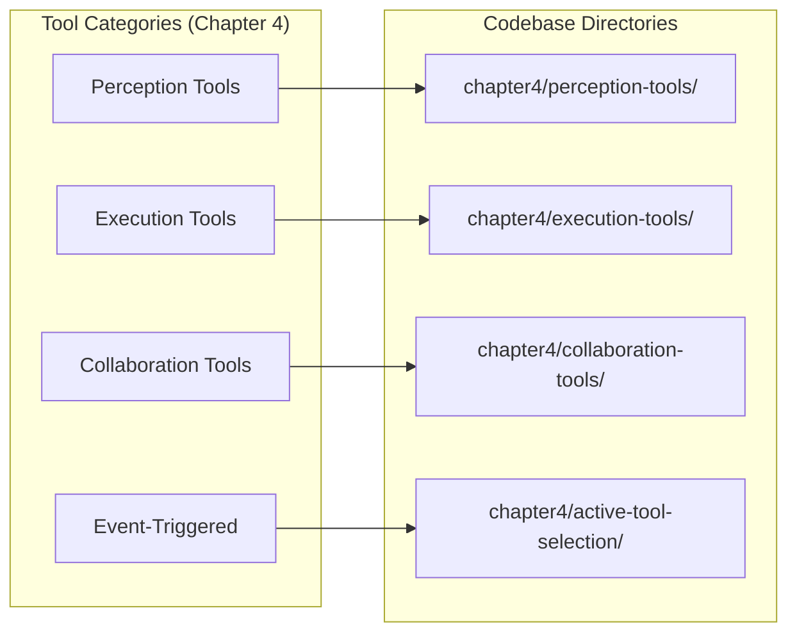

<!-- source: DeepWiki mcp.deepwiki.com · repo bojieli/ai-agent-book · page 5 Tool Integration and Event-Driven Agents (Chapter 4) · fetched 2026-10-27 -->

# Tool Integration and Event-Driven Agents (Chapter 4)

Relevant source files

The following files were used as context for generating this wiki page:

- [book-ar/chapter4.ar.md](book-ar/chapter4.ar.md)
- [book-en/chapter4.md](book-en/chapter4.md)
- [book-es/chapter4.es.md](book-es/chapter4.es.md)
- [book-he/chapter4.he.md](book-he/chapter4.he.md)
- [book-hu/chapter4.md](book-hu/chapter4.md)
- [book-id/chapter4.md](book-id/chapter4.md)
- [book-ja/chapter4.ja.md](book-ja/chapter4.ja.md)
- [book-ko/chapter4.ko.md](book-ko/chapter4.ko.md)
- [book-ru/chapter4.md](book-ru/chapter4.md)
- [book-ta/chapter4.ta.md](book-ta/chapter4.ta.md)
- [book-tr/chapter4.tr.md](book-tr/chapter4.tr.md)
- [book-vi/chapter4.vi.md](book-vi/chapter4.vi.md)
- [book-zhtw/chapter4.zhtw.md](book-zhtw/chapter4.zhtw.md)

This page provides an overview of how AI Agents interface with the digital world through tools and respond to external stimuli via event-driven architectures. While the LLM serves as the "brain," tools provide the "hands, feet, and senses" necessary to connect the language model to the real digital world [book-en/chapter4.md:3]().

## Overview of Tool Categories

In the Agent architecture, tools are classified into five functional categories based on their **Invocation Direction** (who initiates) and **Target of Action** (what it acts on) [book-en/chapter4.md:9-11]().

| Tool Category | Invocation Direction | Target of Action | Purpose |
| :--- | :--- | :--- | :--- |
| **Perception Tools** | Agent actively invokes | Acquire information | Obtain data (e.g., `web_search`, `grep_file`, `read_file`) [book-en/chapter4.md:21](). |
| **Execution Tools** | Agent actively invokes | Change the world | Modify the environment (e.g., `shell_exec`, `write_file`, `send_email`) [book-en/chapter4.md:23](). |
| **Collaboration Tools** | Agent actively invokes | Drive other Agents/Humans | Parallelism and specialization (e.g., `spawn_subagent`, `list_agents`) [book-en/chapter4.md:25](). |
| **User Communication** | Agent actively invokes | Convey information to user | Multi-channel messaging (e.g., `reply_to_user`, `send_card_to_user`) [book-en/chapter4.md:27](). |
| **Event-Triggered Tools** | Agent registers, external triggers | Drive Agent execution | Autonomous reaction to time or external events (e.g., `set_timer`, `monitor_shell`) [book-en/chapter4.md:29](). |

### Tool Design Principles (ACI)
Designing tools for Agents (**Agent-Computer Interface** or **ACI**) focuses on making tools friendly to models rather than humans [book-en/chapter4.md:35](). Key principles include:

*   **Forms of Expression**: Choosing between **Dedicated Tools** (structured, schema-constrained) and **Skills** (natural language descriptions executed via general executors like `bash`) [book-ja/chapter4.ja.md:40-43]().
*   **Generality vs. Specificity**: Preferring general tools like `code_interpreter` to provide "meta-capabilities," unless security, auditing, or complex parameter structures require a dedicated tool [book-ja/chapter4.ja.md:49-53]().
*   **Descriptive Precision**: Using clear boundary conditions (what the tool *cannot* do) and providing 1-5 concrete calling examples to improve model selection accuracy [book-zhtw/chapter4.zhtw.md:81-87]().
*   **Code Orchestration**: Allowing the model to generate scripts that chain multiple tool calls together, keeping intermediate data in the execution environment to save context tokens [book-zhtw/chapter4.zhtw.md:73]().

Sources: [book-en/chapter4.md:7-37](), [book-ja/chapter4.ja.md:38-61](), [book-zhtw/chapter4.zhtw.md:73-91]()

---

## Model Context Protocol (MCP) and Tool Ecosystems

The **Model Context Protocol (MCP)** and **Skill Hubs** are the two primary channels for distributing Agent capabilities [book-en/chapter4.md:5](). MCP standardizes the communication between the Agent "Host" and the tool "Server," significantly lowering the cost of adding new capabilities to a single command [book-en/chapter4.md:5]().

For a deep dive into MCP implementation, tool discovery, and patterns like the **Proposer-Reviewer** model, see **[Model Context Protocol (MCP) and Tool Design](#5.1)**.

---

## Event-Driven Architecture

Traditional Agents operate in a passive request-response mode. Production-grade Agents require an **Event-Driven Architecture** to act autonomously at specified times or react to external events like new emails or system alerts [book-en/chapter4.md:29]().

### Registration and Triggering
Event-triggered tools involve two distinct moments:
1.  **Registration**: The Agent actively invokes a tool (e.g., `connect_channel`) to declare interest in specific events [book-en/chapter4.md:29]().
2.  **Triggering**: An external event asynchronously calls back to wake the Agent and start processing [book-en/chapter4.md:29]().

### System Component Mapping
The following diagram bridges the conceptual event-driven flow to the system entities.

**Event-Driven Interaction Flow**

Sources: [book-en/chapter4.md:29-31](), [book-zhtw/chapter4.zhtw.md:35]()

For details on async execution strategies, safe points, and validation, see **[Event-Driven Agent Architecture](#5.2)**.

---

## Tool Integration to Code Mapping

The codebase organizes experiments by tool category to demonstrate ACI principles and integration strategies.

**Tool Implementation Mapping**

Sources: [book-en/chapter4.md:21-31](), [book-ar/chapter4.ar.md:7]()

---

## Child Pages
*   **[Model Context Protocol (MCP) and Tool Design](#5.1)**: Deep dive into tool design principles (ACI, idempotency), MCP client-server structures, and specific implementations for Perception, Execution, and Collaboration tools.
*   **[Event-Driven Agent Architecture](#5.2)**: Technical implementation of event loops, asynchronous triggers (cron/webhooks), and strategies for handling parallel or queued agent tasks safely.

---

