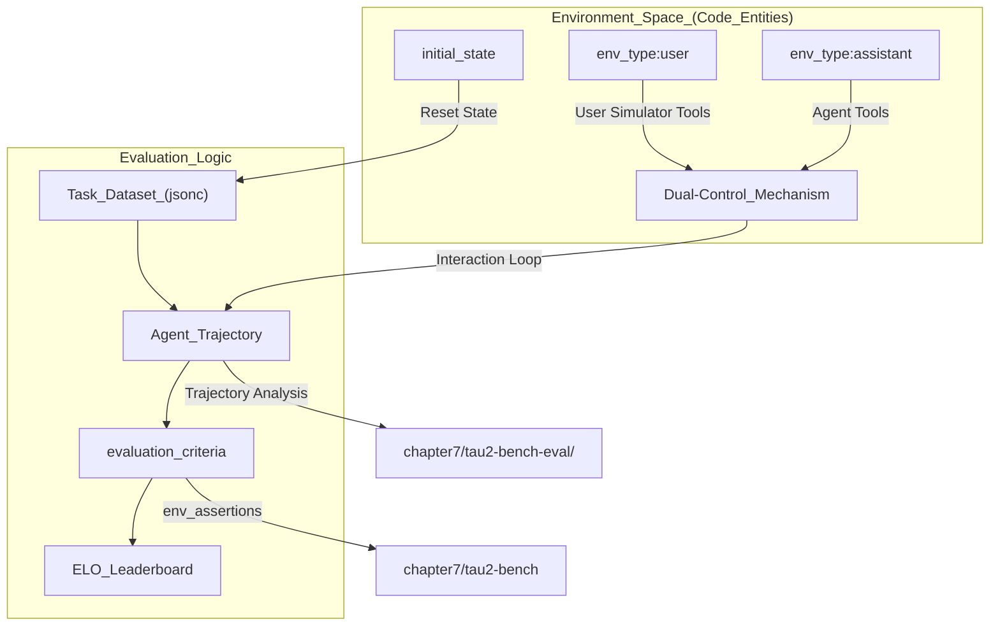
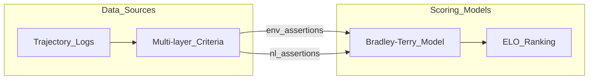

<!-- source: DeepWiki mcp.deepwiki.com · repo bojieli/ai-agent-book · page 7 Agent Evaluation and Benchmarking (Chapter 6) · fetched 2026-10-27 -->

# Agent Evaluation and Benchmarking (Chapter 6)

Relevant source files

The following files were used as context for generating this wiki page:

- [book-ar/chapter6.ar.md](book-ar/chapter6.ar.md)
- [book-ar/chapter7.ar.md](book-ar/chapter7.ar.md)
- [book-en/chapter6.md](book-en/chapter6.md)
- [book-en/chapter7.md](book-en/chapter7.md)
- [book-es/chapter6.es.md](book-es/chapter6.es.md)
- [book-es/chapter7.es.md](book-es/chapter7.es.md)
- [book-hu/chapter6.md](book-hu/chapter6.md)
- [book-hu/chapter7.md](book-hu/chapter7.md)
- [book-id/chapter6.md](book-id/chapter6.md)
- [book-id/chapter7.md](book-id/chapter7.md)
- [book-ja/chapter6.ja.md](book-ja/chapter6.ja.md)
- [book-ja/chapter7.ja.md](book-ja/chapter7.ja.md)
- [book-ko/chapter6.ko.md](book-ko/chapter6.ko.md)
- [book-ko/chapter7.ko.md](book-ko/chapter7.ko.md)
- [book-ru/chapter6.md](book-ru/chapter6.md)
- [book-ru/chapter7.md](book-ru/chapter7.md)
- [book-ta/chapter6.ta.md](book-ta/chapter6.ta.md)
- [book-ta/chapter7.ta.md](book-ta/chapter7.ta.md)
- [book-tr/chapter6.tr.md](book-tr/chapter6.tr.md)
- [book-tr/chapter7.tr.md](book-tr/chapter7.tr.md)
- [book-vi/chapter6.vi.md](book-vi/chapter6.vi.md)
- [book-vi/chapter7.vi.md](book-vi/chapter7.vi.md)
- [book-zhtw/chapter6.zhtw.md](book-zhtw/chapter6.zhtw.md)
- [book-zhtw/chapter7.zhtw.md](book-zhtw/chapter7.zhtw.md)

Building production-grade AI Agents requires moving beyond intuition to data-driven decision-making. Evaluation provides the scientific basis for choosing models, designing tools, and structuring context. In the **Harness** framework (Model + Context + Tools + Constrain + Verify + Correct), evaluation serves as the core of the **Verify** component.

This page provides a high-level overview of the evaluation infrastructure, environments, and scoring methodologies used to benchmark agents within the `ai-agent-book` repository.

## Overview of the Evaluation Framework

Evaluation in the context of agents is not just about the model; it is about the **Model + Harness** combination [book-en/chapter7.md:17-18](). A powerful model in a poorly designed harness (weak tools, cluttered prompts) will underperform a weaker model in a highly optimized harness.

The evaluation system is structured into four stages:
1.  **Task Definition**: Where tasks come from and how cognitive boundaries are modeled [book-en/chapter7.md:21-23]().
2.  **Verification**: Who verifies the result (User Simulators, Environment Assertions, or LLM-as-a-Judge) [book-en/chapter7.md:21-23]().
3.  **Scoring**: What counts as success (Pass@k, Rubrics, ELO) [book-en/chapter7.md:21-23]().
4.  **Decision Making**: How scores turn into engineering actions (Model swap, ablation, or deployment) [book-en/chapter7.md:21-23]().

### System Architecture: Bridging Code and Logic
The following diagram maps the logical evaluation components to the implementation patterns found in the codebase, specifically focusing on the environment abstractions and scoring loops.

**Agent Evaluation Flow**

**Sources:** [book-en/chapter7.md:34-82](), [book-en/chapter7.md:111-122](), [book-en/chapter7.md:129-132]()

---

## 7.1 Evaluation Environments and Benchmarks

Agent evaluation requires environments that can maintain state and simulate interaction. The codebase utilizes a taxonomy of environments based on their complexity and isolation needs, with a particular focus on **Dual-Control** mechanisms where both the agent and the simulated user have their own toolsets [book-en/chapter7.md:111-122]().

### Key Environment Concepts
*   **Progressive Information Disclosure**: Modeling the user's cognitive boundary so the agent must clarify needs rather than receiving full specs upfront [book-en/chapter7.md:87-89]().
*   **Fact Anchoring (Grounding)**: Ensuring user simulators base responses on tool results rather than hallucinating success [book-en/chapter7.md:89-91]().
*   **Environment Assertions**: Verifying final states (e.g., internet speed, account status) rather than just text matching [book-en/chapter7.md:93-95]().

### Major Benchmarks Covered
The repository integrates several industry-standard benchmarks:
*   **τ²-bench**: Focused on structured business processes (e.g., telecom, retail) using dual-control environments [book-en/chapter7.md:25-27]().
*   **GAIA & SWE-Bench**: Tasks requiring tool use and autonomous code generation.
*   **AndroidWorld**: Mobile GUI automation evaluation.

For details, see [Evaluation Environments and Benchmarks](#7.1).

**Sources:** [book-en/chapter7.md:25-82](), [book-en/chapter7.md:87-95](), [book-en/chapter7.md:111-122]()

---

## 7.2 Scoring, Metrics, and the ELO Leaderboard

Quantifying agent performance requires measuring reliability, efficiency, and safety through multi-dimensional rubrics and statistical models.

### Metrics and Analysis
*   **Pass@k**: Measuring the probability of at least one success in $k$ attempts, useful for "Technical Wonders" (high-complexity, low-frequency tasks) [book-en/chapter7.md:133-136]().
*   **Model Swap Experiments**: Fixing the Harness and changing the model to determine if the bottleneck is model capability or system design [book-en/chapter7.md:17-18]().
*   **Ablation Studies**: Disabling specific Harness components (e.g., memory, specific tools) to measure their contribution to success [book-en/chapter7.md:15-16]().

### The ELO Leaderboard System
To compare agents objectively, the repository implements an ELO-based leaderboard approach. This allows for relative ranking of models even when benchmarks are noisy or rapidly evolving.

**Leaderboard Implementation Mapping**

**Sources:** [book-en/chapter7.md:17-18](), [book-en/chapter7.md:91-93](), [book-en/chapter7.md:133-136]()

For details, see [Scoring, Metrics, and the ELO Leaderboard](#7.2).

---

## Summary of Chapter 6 Experiments
*   **`chapter7/tau2-bench`**: Implementation of the telecom domain evaluation [book-en/chapter7.md:27-27]().
*   **`chapter7/tau2-bench-eval`**: Sample execution records and failure mode analysis [book-en/chapter7.md:103-105]().
*   **`chapter6/`**: Core interaction experiments (Async, Event-driven, Computer Use) which provide the action space for evaluation.

**Sources:** [book-en/chapter7.md:27-27](), [book-en/chapter7.md:103-105](), [book-en/chapter6.md:33-35]()

---

