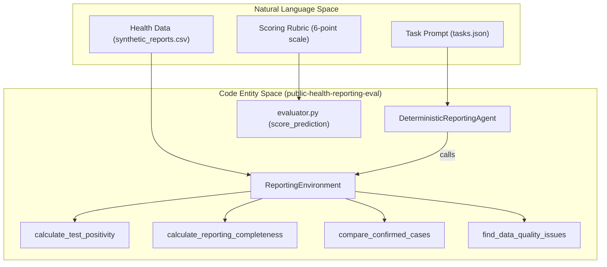
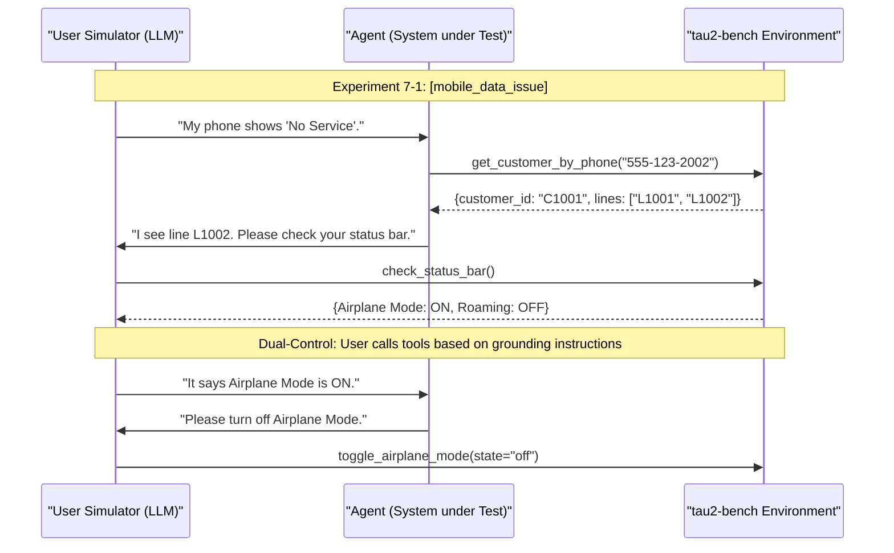
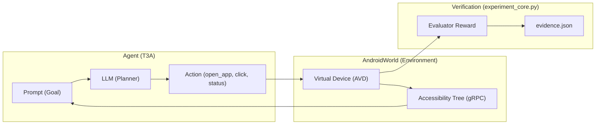

<!-- source: DeepWiki mcp.deepwiki.com · repo bojieli/ai-agent-book · page 7.1 Evaluation Environments and Benchmarks · fetched 2026-10-27 -->

# Evaluation Environments and Benchmarks

Relevant source files

The following files were used as context for generating this wiki page:

- [book-ar/chapter7.ar.md](book-ar/chapter7.ar.md)
- [book-en/chapter7.md](book-en/chapter7.md)
- [book-es/chapter7.es.md](book-es/chapter7.es.md)
- [book-hu/chapter7.md](book-hu/chapter7.md)
- [book-id/chapter7.md](book-id/chapter7.md)
- [book-ja/chapter7.ja.md](book-ja/chapter7.ja.md)
- [book-ko/chapter7.ko.md](book-ko/chapter7.ko.md)
- [book-ru/chapter7.md](book-ru/chapter7.md)
- [book-ta/chapter7.ta.md](book-ta/chapter7.ta.md)
- [book-tr/chapter7.tr.md](book-tr/chapter7.tr.md)
- [book-vi/chapter7.vi.md](book-vi/chapter7.vi.md)
- [book-zhtw/chapter7.zhtw.md](book-zhtw/chapter7.zhtw.md)
- [chapter10/README.ja.md](chapter10/README.ja.md)
- [chapter6/EXPERIMENT_LEDGER.md](chapter6/EXPERIMENT_LEDGER.md)
- [chapter6/README.ar.md](chapter6/README.ar.md)
- [chapter6/README.en.md](chapter6/README.en.md)
- [chapter6/README.hu.md](chapter6/README.hu.md)
- [chapter6/README.id.md](chapter6/README.id.md)
- [chapter6/README.ja.md](chapter6/README.ja.md)
- [chapter6/README.md](chapter6/README.md)
- [chapter6/README.ru.md](chapter6/README.ru.md)
- [chapter6/README.ta.md](chapter6/README.ta.md)
- [chapter6/README.tr.md](chapter6/README.tr.md)
- [chapter6/README.vi.md](chapter6/README.vi.md)
- [chapter6/README.zh-TW.md](chapter6/README.zh-TW.md)

The evaluation of AI Agents is a core component of the Harness engineering philosophy, serving as the "Verify" layer in the Agent = LLM + Context + Tools formula. Unlike traditional LLM evaluation, Agent evaluation must assess the combination of the model and its surrounding Harness (prompts, tools, and constraints) [book-en/chapter7.md:17-17](). This page documents the taxonomy of automated evaluation environments, the simulation of human-computer interaction, and the industry-standard benchmarks used to measure Agent performance.

## Evaluation Environment Taxonomy

Agent evaluation requires a repeatable, automated environment that manages task definitions, state, and tool interfaces. The repository adopts a hierarchical environment design to accommodate different levels of task complexity and state persistence.

### Environment Types and State
The framework distinguishes between different environment types based on their handling of state and tool interactions:

| Environment Type | State Persistence | Tool Support | Typical Use Case |
| :--- | :--- | :--- | :--- |
| **Single-Turn** | None | No | Single-turn Q&A, math problems |
| **Tool-Based** | None | Multi-turn | Search-based information synthesis |
| **Stateful-Tool** | Persistent | Multi-turn | Database record modification |
| **Sandbox** | Persistent + Isolated | Multi-turn | Code execution and testing |

A critical insight is that evaluation results should be used for **Comparative Experiments** (changing one variable) and **Ablation Experiments** (disabling one component) to distinguish between model capability bottlenecks and Harness design flaws [book-en/chapter7.md:15-17]().

### Implementation Mapping: Public Health Reporting Case Study
The `chapter6/public-health-reporting-eval/` experiment demonstrates a stateful implementation where an agent interacts with synthetic DHIS2-style data [chapter6/public-health-reporting-eval/README.md:5-7]().

**Reporting Evaluation Architecture**

Sources: [chapter6/public-health-reporting-eval/reporting_tools.py:20-149](), [chapter6/public-health-reporting-eval/evaluator.py:48-81](), [chapter6/public-health-reporting-eval/agent.py:1-25]()

## Human-Agent Interaction Simulation

For tasks requiring dialogue (e.g., customer support), the environment must simulate a human user. The core challenge is avoiding "information leakage" where the Agent receives all details upfront.

### Progressive Information Disclosure
In real scenarios, users rarely provide complete requirements initially. The evaluation environment employs **Progressive Information Disclosure**, where the user's knowledge is modeled as a restricted field (`known_info`), and the Agent must actively inquire to uncover hidden details (`unknown_info`) [book-en/chapter7.md:85-85]().

### τ²-bench (Dual-Control)
The repository uses **τ²-bench** to evaluate agents in complex service domains like telecom. A key feature is the **Dual-Control** mechanism: the simulated user has their own set of tools (e.g., `check_status_bar`, `toggle_airplane_mode`) to manipulate the environment state independently of the Agent [book-en/chapter7.md:117-119]().

**Dual-Control Interaction Flow**

Sources: [book-en/chapter7.md:34-82](), [book-en/chapter7.md:111-122](), [chapter6/tau2-bench-eval/README.md:45-60]()

## Major Benchmarks and Validation Conventions

The repository references and implements experiments across several high-impact benchmarks that test different Agent capabilities.

### Task Definition Components
A standard evaluation task in the repo (exemplified by τ²-bench) consists of four parts [book-en/chapter7.md:31-82]():
1.  **Ticket/Prompt**: The initial instruction given to the Agent.
2.  **User Scenario**: Behavioral specs for the simulator, including `known_info` and `grounding` rules (preventing the simulator from making up tool results).
3.  **Initial State**: Actions to reset the environment for both `user` and `assistant` sides.
4.  **Evaluation Criteria**: A mix of `env_assertions` (final state), `actions` (process check), and `nl_assertions` (communication check).

### AndroidWorld and OSWorld
Benchmarks like **AndroidWorld** evaluate GUI automation. **Experiment 6-11** in the repo uses a "Text-only / accessibility-tree style mobile agent" (T3A) to navigate virtual devices [chapter6/android-world/README.md:14-14](). It utilizes `experiment_core.py` for evidence aggregation and recording results in `evidence.json` [chapter6/android-world/README.md:22-23]().

**AndroidWorld T3A Execution Loop**

Sources: [chapter6/android-world/README.md:31-35](), [chapter6/android-world/experiment_core.py:1-20](), [chapter6/EXPERIMENT_LEDGER.md:19-19]()

## Scoring Principles

### Pass@k and Reliability
For research and discovery tasks (e.g., finding security vulnerabilities), the repository uses **Pass@k**—the probability that at least one of $k$ generated trajectories is successful [book-en/chapter7.md:133-135](). This highlights the "Technical Wonder" or capability ceiling of the agent.

### Failure Attribution
Evaluation systems in the repo are designed to distinguish between:
*   **Model Capability Failure**: The Agent reads the correct information (e.g., a phone number mismatch) but fails to correct its internal state [book-en/chapter7.md:124-126]().
*   **Harness Design Failure**: The Agent fails because the prompt is ambiguous or the tool interface is too restrictive [book-en/chapter7.md:17-17]().

Sources: [book-en/chapter7.md:15-23](), [book-en/chapter7.md:133-142](), [chapter6/EXPERIMENT_LEDGER.md:1-25]()

---

