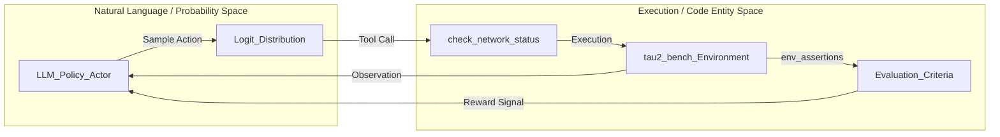
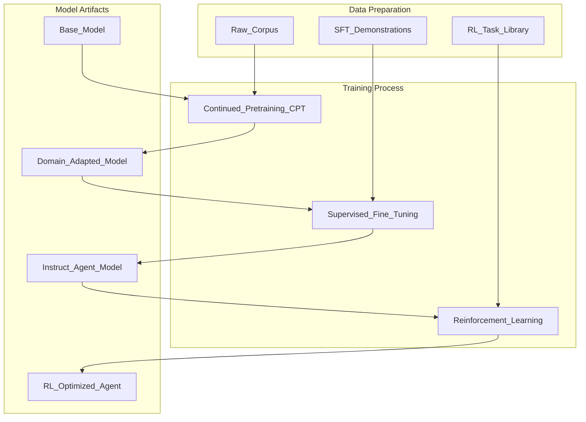

<!-- source: DeepWiki mcp.deepwiki.com · repo bojieli/ai-agent-book · page 8 Model Post-Training: SFT, RLVR, and RLVP (Chapter 7) · fetched 2026-10-27 -->

# Model Post-Training: SFT, RLVR, and RLVP (Chapter 7)

Relevant source files

The following files were used as context for generating this wiki page:

- [book-ar/chapter7.ar.md](book-ar/chapter7.ar.md)
- [book-en/chapter7.md](book-en/chapter7.md)
- [book-en/chapter8.md](book-en/chapter8.md)
- [book-es/chapter7.es.md](book-es/chapter7.es.md)
- [book-es/chapter8.es.md](book-es/chapter8.es.md)
- [book-he/chapter8.he.md](book-he/chapter8.he.md)
- [book-hu/chapter7.md](book-hu/chapter7.md)
- [book-hu/chapter8.md](book-hu/chapter8.md)
- [book-id/chapter7.md](book-id/chapter7.md)
- [book-id/chapter8.md](book-id/chapter8.md)
- [book-ja/chapter7.ja.md](book-ja/chapter7.ja.md)
- [book-ja/chapter8.ja.md](book-ja/chapter8.ja.md)
- [book-ko/chapter7.ko.md](book-ko/chapter7.ko.md)
- [book-ko/chapter8.ko.md](book-ko/chapter8.ko.md)
- [book-ru/chapter7.md](book-ru/chapter7.md)
- [book-ru/chapter8.md](book-ru/chapter8.md)
- [book-ta/chapter7.ta.md](book-ta/chapter7.ta.md)
- [book-ta/chapter8.ta.md](book-ta/chapter8.ta.md)
- [book-tr/chapter7.tr.md](book-tr/chapter7.tr.md)
- [book-tr/chapter8.tr.md](book-tr/chapter8.tr.md)
- [book-vi/chapter7.vi.md](book-vi/chapter7.vi.md)
- [book-vi/chapter8.vi.md](book-vi/chapter8.vi.md)
- [book-zhtw/chapter7.zhtw.md](book-zhtw/chapter7.zhtw.md)
- [book-zhtw/chapter8.zhtw.md](book-zhtw/chapter8.zhtw.md)

This page provides a high-level overview of the post-training pipeline used to transform a base Large Language Model (LLM) into a functional AI Agent. While pre-training provides the foundational "world knowledge," post-training focuses on aligning the model to follow instructions, use tools reliably, and generalize strategies across diverse environments.

The core philosophy of this chapter is: **SFT for memory and protocol stabilization, RL for strategy generalization and performance ceilings.**

## The Four Stages of Model Capability
Modern model development is divided into four distinct phases. The transition from a raw base model to an Agent follows this structured pipeline.

| Stage | Data Type | Optimization Goal | Outcome |
| :--- | :--- | :--- | :--- |
| **Pre-training** | Massive raw internet text | Next Token Prediction (NTP) | Language rules & world knowledge |
| **Mid-training** | Domain/Target documents | NTP (Continued) | Specialized knowledge & reasoning |
| **SFT** | Input-Output pairs | NTP with Loss Masking | Instruction following & tool protocol |
| **RL** | Task + Reward Function | Maximize Expected Reward | Strategy generalization & exploration |

Sources: [book-en/chapter8.md:7-12](), [book-en/chapter8.md:30-37]()

---

## 8.1 Supervised Fine-Tuning and Preference Optimization
Supervised Fine-Tuning (SFT) is the "cold start" phase of post-training. It uses high-quality demonstrations to teach the model the "Agent Protocol"—how to format JSON, when to call a tool, and how to structure a thought process.

*   **SFT & Loss Masking**: Mathematically identical to pre-training but applies a mask to the prompt tokens, calculating gradients only on the assistant's response [book-en/chapter8.md:36-36]().
*   **LoRA (Low-Rank Adaptation)**: A parameter-efficient method that updates only a small fraction of the model's weights, making it feasible for domain-specific agent tuning.
*   **Preference Optimization**: Approaches like DPO (Direct Preference Optimization) align model behavior with human or environmental preferences without requiring a complex reward model.
*   **Protocol Stabilization**: SFT is used to establish the baseline behavior for tool-calling agents, ensuring they adhere to schemas before undergoing reinforcement learning.

For details, see [Supervised Fine-Tuning and Preference Optimization](#8.1).

---

## 8.2 Reinforcement Learning: PPO, GRPO, RLVR, and RLVP
Reinforcement Learning (RL) allows an Agent to explore beyond its training data. Unlike SFT, which encourages the model to "mimic" a demonstration, RL encourages the model to "solve" the task by maximizing a reward signal.

### RL Methodologies
*   **PPO (Proximal Policy Optimization)**: The traditional actor-critic framework using a value network to stabilize training [book-en/chapter8.md:19-19]().
*   **GRPO (Group Relative Policy Optimization)**: A more efficient approach that eliminates the value network by using group-relative scores, popular in reasoning-heavy tasks [book-en/chapter8.md:19-19]().
*   **RLVR (Reinforcement Learning from Verifiable Rewards)**: Using sandboxed environments (e.g., code execution results, math verifiers) to provide objective rewards rather than subjective LLM judgments.
*   **RLVP (Reinforcement Learning from Verified Penalties)**: A technique to shape the Agent's path by penalizing invalid actions or dangerous trajectories.

### Agent-Environment Interaction
The RL loop bridges the model's internal probability space with external execution environments. In the `tau2-bench` telecom domain, this involves a **Dual-Control** mechanism where both the Agent and a User Simulator interact with a shared environment [book-en/chapter7.md:103-103]().

**Diagram: RL Loop and Code Entity Mapping**

Sources: [book-en/chapter7.md:21-23](), [book-en/chapter7.md:68-80](), [book-en/chapter7.md:113-117]()

For details, see [Reinforcement Learning: PPO, GRPO, RLVR, and RLVP](#8.2).

---

## 8.3 Specialized Training: VLA, Multilingual, and Audio Models
Standard post-training is often insufficient for specialized Agent domains. This section covers specialized training tracks for different modalities.

*   **VLA (Vision-Language-Action)**: Training models for robotics where the output is physical control signals rather than just text.
*   **Multilingual Reasoning**: Post-training focused on cross-lingual transfer, ensuring reasoning capabilities are preserved across languages.
*   **Audio Models**: Training for real-time speech interaction, focusing on paralinguistic tags and low-latency response generation.

**Diagram: Post-Training Data Flow for Agents**

Sources: [book-en/chapter8.md:7-14](), [book-en/chapter8.md:30-37]()

For details, see [Specialized Training: VLA, Multilingual, and Audio Models](#8.3).

---

## Why RL is Essential for Agents
The "Agent" use case demands RL for three primary reasons:
1.  **Overcoming the Data Ceiling**: SFT is limited by the quality of the human demonstrator. RL can discover strategies that the teacher never considered [book-en/chapter8.md:12-12]().
2.  **Generalization**: SFT tends to memorize demonstrations, while RL learns a transferable strategy under distribution shifts [book-en/chapter8.md:18-18]().
3.  **Harness vs. Model**: Evaluation must distinguish between "insufficient model capability" and "Harness design flaws" using techniques like **Model Swap Experiments** [book-en/chapter7.md:17-17]().

Sources: [book-en/chapter7.md:17-19](), [book-en/chapter8.md:12-19]()

---

