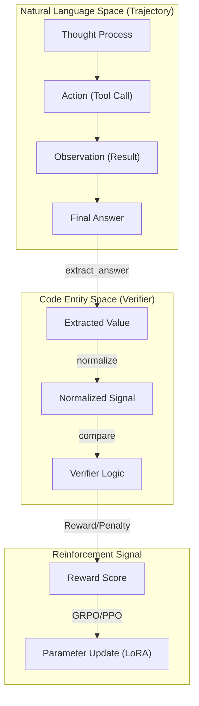
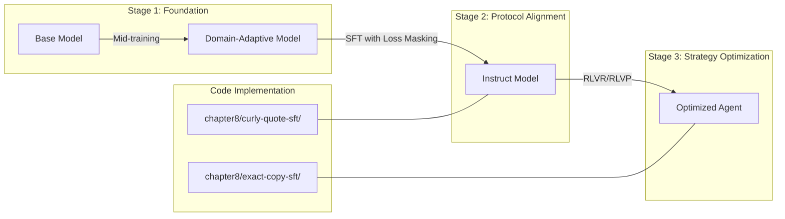

<!-- source: DeepWiki mcp.deepwiki.com · repo bojieli/ai-agent-book · page 8.2 Reinforcement Learning: PPO, GRPO, RLVR, and RLVP · fetched 2026-10-27 -->

# Reinforcement Learning: PPO, GRPO, RLVR, and RLVP

Relevant source files

The following files were used as context for generating this wiki page:

- [book-en/chapter8.md](book-en/chapter8.md)
- [book-es/chapter8.es.md](book-es/chapter8.es.md)
- [book-he/chapter8.he.md](book-he/chapter8.he.md)
- [book-hu/chapter8.md](book-hu/chapter8.md)
- [book-id/chapter8.md](book-id/chapter8.md)
- [book-ja/chapter8.ja.md](book-ja/chapter8.ja.md)
- [book-ko/chapter8.ko.md](book-ko/chapter8.ko.md)
- [book-ru/chapter8.md](book-ru/chapter8.md)
- [book-ta/chapter8.ta.md](book-ta/chapter8.ta.md)
- [book-tr/chapter8.tr.md](book-tr/chapter8.tr.md)
- [book-vi/chapter8.vi.md](book-vi/chapter8.vi.md)
- [book-zhtw/chapter8.zhtw.md](book-zhtw/chapter8.zhtw.md)
- [chapter7/EXPERIMENT_LEDGER.md](chapter7/EXPERIMENT_LEDGER.md)
- [chapter7/README.ar.md](chapter7/README.ar.md)
- [chapter7/README.en.md](chapter7/README.en.md)
- [chapter7/README.es.md](chapter7/README.es.md)
- [chapter7/README.hu.md](chapter7/README.hu.md)
- [chapter7/README.id.md](chapter7/README.id.md)
- [chapter7/README.ja.md](chapter7/README.ja.md)
- [chapter7/README.ko.md](chapter7/README.ko.md)
- [chapter7/README.md](chapter7/README.md)
- [chapter7/README.ru.md](chapter7/README.ru.md)
- [chapter7/README.ta.md](chapter7/README.ta.md)
- [chapter7/README.tr.md](chapter7/README.tr.md)
- [chapter7/README.vi.md](chapter7/README.vi.md)
- [chapter7/README.zh-TW.md](chapter7/README.zh-TW.md)

The core formula of this repository is **Agent = LLM + Context + Tools**. This page focuses on optimizing the "Brain" (the LLM) through post-training techniques to better utilize context and tools. While Supervised Fine-Tuning (SFT) is effective for format stabilization and protocol adherence, Reinforcement Learning (RL) is essential for strategy generalization and performance in unseen scenarios.

## Overview of Model Capability Development

Modern model capabilities are developed in a four-part pipeline. While Pre-training provides the foundation, post-training (SFT and RL) shapes the behavior and decision-making strategies of the agent [book-en/chapter8.md:7-12]().

| Stage | Data Used | Optimization Objective | What Is Learned | Typical Cost |
| :--- | :--- | :--- | :--- | :--- |
| **Pre-training** | Massive raw internet text | Predict the next token (NTP) | Language rules, world knowledge | Very High |
| **Mid-training** | Domain/Target corpus | Continued NTP (all tokens) | Domain knowledge, specialized skills | Medium to High |
| **SFT** | Instruction-Output pairs | NTP (Response-only loss) | Format, style, protocols | Low |
| **RL** | Task + Reward Function | Maximize Expected Reward | Generalizable decision strategies | High |

Sources: [book-en/chapter8.md:7-14](), [book-en/chapter8.md:30-37](), [book-ko/chapter8.ko.md:29-36](), [book-zhtw/chapter8.zhtw.md:30-37]()

## The SFT vs. RL Generalization Gap

A key finding throughout the repository's experiments is that **SFT tends to memorize demonstrations while RL generalizes better** [book-en/chapter8.md:18-19]().

*   **SFT (Supervised Fine-Tuning)**: Mathematically identical to pre-training, but uses "Loss Masking" to only calculate gradients on the response tokens [book-en/chapter8.md:54-60](). It is highly efficient for encoding "Protocol Knowledge" (how to speak/act) but prone to overfitting on surface patterns if the data lacks diversity [book-en/chapter8.md:61-64]().
*   **RL (Reinforcement Learning)**: Does not imitate tokens; instead, it lets the model explore multiple paths and increases the probability of high-reward behaviors [book-zhtw/chapter8.zhtw.md:91-92](). This "mode-seeking" behavior concentrates probability mass on successful strategies rather than just covering the distribution of demonstrations [book-zhtw/chapter8.zhtw.md:106-108]().

Sources: [book-en/chapter8.md:16-19](), [book-en/chapter8.md:54-64](), [book-zhtw/chapter8.zhtw.md:86-108]()

## RL Algorithms: PPO and GRPO

### Proximal Policy Optimization (PPO)
PPO is the standard Actor-Critic architecture for alignment. It requires a Value Network (Critic) to estimate expected rewards and calculate the "Advantage" of specific actions.

### Group Relative Policy Optimization (GRPO)
GRPO is increasingly used for agentic tasks to save VRAM. It removes the Critic network by sampling a group of responses for each prompt and using the group's mean reward as the baseline [book-zhtw/chapter8.zhtw.md:19-20]().
*   **KL Constraint**: Ensures the policy does not drift too far from the reference model to prevent "reward hacking" or catastrophic forgetting.
*   **Adaptive Sampling**: Balances exploration of different reasoning modes (e.g., Chain-of-Thought vs. Direct Answer).

Sources: [book-en/chapter8.md:19-20](), [book-zhtw/chapter8.zhtw.md:19-20](), [book-zhtw/chapter8.zhtw.md:65-66]()

## Verifiable Rewards: RLVR and RLVP

For tool-use and sandboxable tasks, rewards are derived from the environment rather than human labels.

### RLVR (Reinforcement Learning from Verifiable Rewards)
RLVR relies on objective outcomes (e.g., code execution, math answer verification).
*   **Pre-requisites**: The model must have "Capability Support" (non-zero `pass@k` rate) before RL can effectively amplify successful behaviors [book-zhtw/chapter8.zhtw.md:70-82]().
*   **Cold-start**: If the model cannot generate valid formats (e.g., JSON), SFT is used to "stabilize the protocol" before RL begins [book-zhtw/chapter8.zhtw.md:71-73]().

### RLVP (Reinforcement Learning from Verified Penalties)
RLVP focuses on shaping the trajectory by penalizing violations.
*   **Safety & Efficiency**: Penalties are applied for infinite loops in tool calls, violating system constraints, or inefficient resource usage.

Sources: [book-zhtw/chapter8.zhtw.md:68-84](), [chapter7/README.md:46-49]()

## Training Implementation: LoRA

The repository treats **LoRA (Low-Rank Adaptation)** as the default engineering choice for post-training due to its efficiency [book-ko/chapter8.ko.md:65]().
*   **MLP Coverage**: LoRA must be applied to all major weight matrices, especially the MLP layers which contain the most parameters [book-zhtw/chapter8.zhtw.md:66]().
*   **Learning Rates**: The optimal learning rate for LoRA is typically 10x higher than that of full-parameter fine-tuning [book-zhtw/chapter8.zhtw.md:66]().
*   **Rank Selection**: SFT benefits from medium-high ranks (64-256), while RL can succeed with lower ranks (8-32) or even `rank=1` [book-zhtw/chapter8.zhtw.md:66]().

Sources: [book-ko/chapter8.ko.md:65-66](), [book-zhtw/chapter8.zhtw.md:65-66]()

## Data Flow: From Environment to Parameters

The following diagram maps the transition from natural language reasoning to the verifiable code entities that drive reinforcement.

**Verifiable Reward Data Flow**

Sources: [book-zhtw/chapter8.zhtw.md:68-84](), [chapter7/README.md:9-18]()

## Architecture: The Post-Training Pipeline

The following diagram illustrates the relationship between the different training stages as implemented in the `chapter8/` experiments.

**Agent Post-Training Pipeline**

Sources: [book-en/chapter8.md:7-14](), [chapter7/README.md:46-49](), [book-zhtw/chapter8.zhtw.md:30-37]()

## Decision Framework: When to use SFT vs. RL

| Scenario | Recommended Approach | Reason |
| :--- | :--- | :--- |
| Missing domain knowledge | **Mid-training** | SFT is too sparse to absorb massive factual associations [book-ko/chapter8.ko.md:52](). |
| Unstable output format | **SFT** | Rapidly encodes protocol mapping with high sample efficiency [book-zhtw/chapter8.zhtw.md:64](). |
| High labeling cost | **RL** | Uses environment feedback instead of human demonstrations [book-en/chapter8.md:12](). |
| Strategy refinement | **RL** | Explores better decision paths than the teacher's examples [book-zhtw/chapter8.zhtw.md:91-92](). |

Sources: [book-en/chapter8.md:12-20](), [book-ko/chapter8.ko.md:52](), [book-zhtw/chapter8.zhtw.md:64-92]()

---

