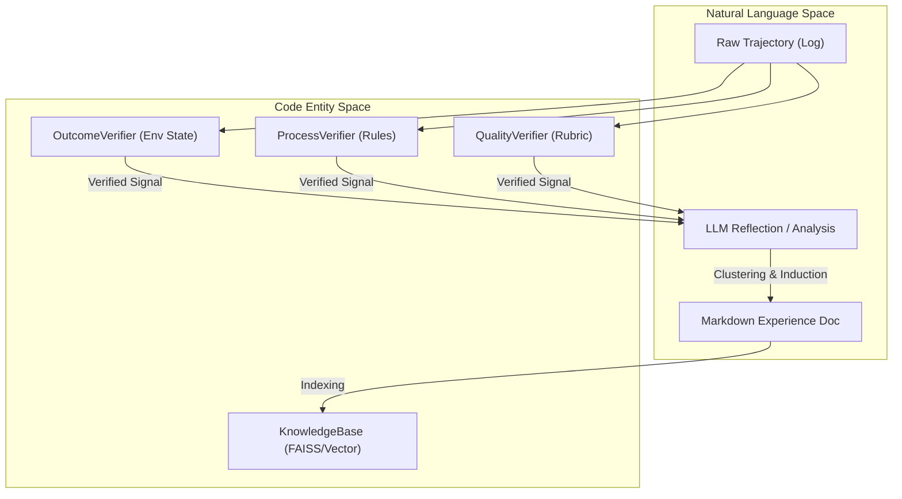
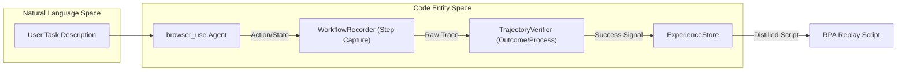

<!-- source: DeepWiki mcp.deepwiki.com · repo bojieli/ai-agent-book · page 9.1 Experience Learning and RPA Workflow Recording · fetched 2026-10-27 -->

# 9.1 Experience Learning and RPA Workflow Recording

Relevant source files

The following files were used as context for generating this wiki page:

- [book-ar/chapter9.ar.md](book-ar/chapter9.ar.md)
- [book-en/chapter9.md](book-en/chapter9.md)
- [book-es/chapter9.es.md](book-es/chapter9.es.md)
- [book-hu/chapter9.md](book-hu/chapter9.md)
- [book-id/chapter9.md](book-id/chapter9.md)
- [book-ja/chapter9.ja.md](book-ja/chapter9.ja.md)
- [book-ko/chapter9.ko.md](book-ko/chapter9.ko.md)
- [book-ru/chapter9.md](book-ru/chapter9.md)
- [book-ta/chapter9.ta.md](book-ta/chapter9.ta.md)
- [book-tr/chapter9.tr.md](book-tr/chapter9.tr.md)
- [book-vi/chapter9.vi.md](book-vi/chapter9.vi.md)
- [book-zhtw/chapter9.zhtw.md](book-zhtw/chapter9.zhtw.md)
- [chapter4/README.en.md](chapter4/README.en.md)
- [chapter4/README.ta.md](chapter4/README.ta.md)
- [chapter4/README.vi.md](chapter4/README.vi.md)
- [chapter9/README.ar.md](chapter9/README.ar.md)
- [chapter9/README.en.md](chapter9/README.en.md)
- [chapter9/README.ja.md](chapter9/README.ja.md)
- [chapter9/README.ru.md](chapter9/README.ru.md)
- [chapter9/README.ta.md](chapter9/README.ta.md)
- [chapter9/README.tr.md](chapter9/README.tr.md)
- [chapter9/README.vi.md](chapter9/README.vi.md)
- [chapter9/README.zh-TW.md](chapter9/README.zh-TW.md)

This page documents the mechanisms through which an Agent evolves externally by accumulating strategies, recording workflows, and creating new tools without modifying model weights. It covers the core "Experience-Reflection-Storage" loop, semantic experience retrieval, browser-based RPA recording, and the multi-layer trajectory verification patterns used to turn operational runs into reliable signals.

## Overview: Continual Evolution vs. Continual Learning

The repository distinguishes between **Continual Learning** (model weight updates) and **Continual Evolution** (system-level updates) [book-en/chapter9.md:11-13](). While foundation models cannot yet reliably update their parameters after every inference without risking catastrophic forgetting or policy drift [book-en/chapter9.md:9-11](), a system can evolve by:
1.  Recording operational evidence and trajectories [book-en/chapter9.md:11-12]().
2.  Verifying outcomes and processes [book-en/chapter9.md:27-29]().
3.  Extracting common patterns from multiple trajectories [book-en/chapter9.md:74-76]().
4.  Updating external knowledge, instructions (Prompts), or programs (Tools) [book-en/chapter9.md:53-55]().

## The Learning-Application Loop

The core philosophy is to treat the Agent's exploration as a source of structured knowledge. Instead of relying solely on the transient context window, the system captures successful trajectories, reflects on them to extract generalizable insights, and stores them for future retrieval.

### Experience Taxonomy
The system categorizes externalized learning into four distinct outputs based on the nature of the information and the target carrier:

| Update Method | Suitable Content | Key Advantage |
|:---|:---|:---|
| **Experience Knowledge Base** | Facts, experience patterns, exceptions | Fast updates, traceable, on-demand search [book-en/chapter9.md:63-63]() |
| **Prompts and Skills** | Principles and operating procedures | Interpretable, controllable scope [book-en/chapter9.md:64-64]() |
| **Programs and Harness** | Deterministic procedures, tools, constraints | Testable, stable execution, low cost [book-en/chapter9.md:65-65]() |
| **Model Parameters** | High-dimensional perception, style, implicit strategy | Strong generalization, low overhead [book-en/chapter9.md:66-66]() |

Sources: [book-en/chapter9.md:53-68]()

---

## Trajectory Verification: LLM-as-Judge

Continual evolution starts with **Evaluation**, not summarization [book-en/chapter9.md:21-22](). A correct outcome does not imply a correct process (e.g., deleting failing tests to pass a build) [book-en/chapter9.md:23-24](). The repository implements a three-layer verification structure to ensure signals are reliable.

### Three-Layer Verification Structure
The system moves from deterministic environmental ground truth to nuanced LLM-based judgment:

1.  **Outcome Verifier (Bottom Layer)**: Reads test results, database states, and tool returns to confirm if the task was actually completed [book-en/chapter9.md:27-28]().
2.  **Process Verifier (Middle Layer)**: Checks business rules, permissions, and action sequences to ensure the task was handled in an allowed manner [book-en/chapter9.md:27-29]().
3.  **Quality Verifier (Upper Layer)**: Evaluates language and strategy according to a predefined **Rubric** to judge if the handling was appropriate [book-en/chapter9.md:27-30]().

### Experience Distillation Pipeline
A complete pipeline for turning trajectories into formal knowledge follows five steps:
1.  **Preservation**: Store immutable trajectories and environmental results [book-en/chapter9.md:82-82]().
2.  **Analysis**: Generate structured analysis per run (task type, strategies, errors) [book-en/chapter9.md:82-82]().
3.  **Aggregation**: Group executions by task family and create evidence tables showing support/refutation for candidate patterns [book-en/chapter9.md:82-82]().
4.  **Formalization**: Write candidates that meet the support threshold into formal Markdown knowledge documents [book-en/chapter9.md:82-82]().
5.  **Evaluation**: Test the transfer effect on new tasks not used in distillation [book-en/chapter9.md:82-83]().

### Data Flow: From Trajectory to Knowledge

Sources: [book-en/chapter9.md:27-32](), [book-en/chapter9.md:78-83]()

---

## Browser-Use RPA: Workflow Recording and Replay

In the context of computer use, experience learning often takes the form of converting expensive multimodal LLM reasoning into low-cost RPA (Robotic Process Automation) scripts.

### Workflow Capture and Reflection
Raw trajectories are often too noisy for direct reuse [book-en/chapter9.md:74-74](). The system maintains three layers of data for browser tasks:
*   **Immutable Raw Trajectories**: Used for auditing [book-en/chapter9.md:74-74]().
*   **Execution Analysis**: Records success/failure and candidate lessons [book-en/chapter9.md:74-74]().
*   **Markdown Knowledge**: Future-oriented documents specifying applicable scenarios, recommended strategies, and prohibited actions [book-en/chapter9.md:74-75]().

### RPA Recording Pattern

Sources: [book-en/chapter9.md:74-78](), [book-en/chapter9.md:15-16]()

---

## System Prompt Learning

When multiple trajectories expose the same strategy error that can be described in language, the experience is elevated to a **System Prompt** or **Skill** [book-en/chapter9.md:94-94]().

### The "Min-Diff" Evolution Pattern
Updating prompts follows a "Minimal Diff + Rollback" mode to ensure safety:
*   **Boundary Set**: A collection of tasks that previously failed, used to verify the improvement [book-en/chapter9.md:98-99]().
*   **Retention Set**: A collection of tasks that previously worked, used to ensure no regression occurs [book-en/chapter9.md:98-99]().
*   **Audit**: Modifications must be minimal diffs with clear sources, rather than full rewrites [book-en/chapter9.md:98-98]().

### Example: Transfer Boundary Regularization
In the $\tau^2$-bench environment, an agent might repeatedly fail by calling tools with missing parameters or failing to hand over to a human [book-en/chapter9.md:100-102](). By summarizing these failures (e.g., 19 failed trajectories), the model can generate new rules:
*   **Actionable Rule**: "If a tool fails three times, transfer to human" [book-en/chapter9.md:108-108]().
*   **Responsibility Shift**: "Network/SIM issues belong to the user side; guide the user instead of calling internal tools" [book-en/chapter9.md:106-106]().

Sources: [book-en/chapter9.md:92-111]()

---

