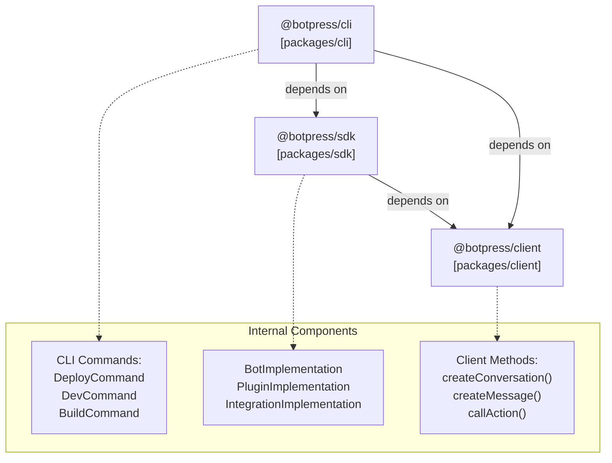
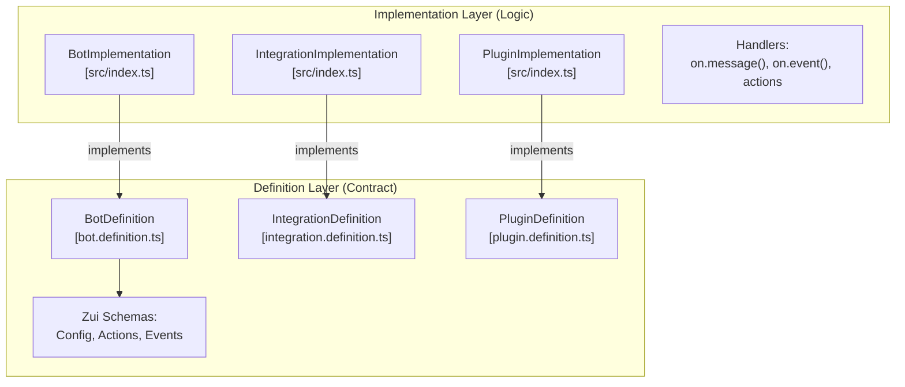
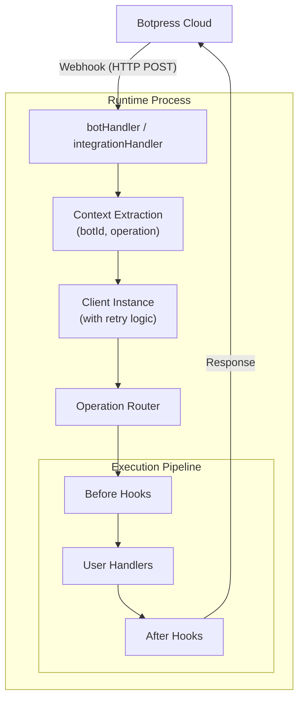
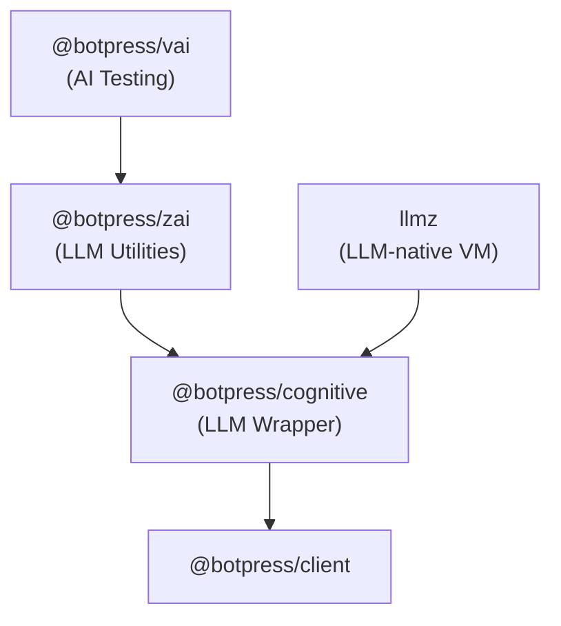

<!-- source: DeepWiki mcp.deepwiki.com · repo botpress/botpress · page 1.1 Architecture · fetched 2026-10-27 -->

# Architecture

Relevant source files

The following files were used as context for generating this wiki page:

- [package.json](package.json)
- [packages/cli/package.json](packages/cli/package.json)
- [packages/cli/templates/empty-bot/package.json](packages/cli/templates/empty-bot/package.json)
- [packages/cli/templates/empty-integration/package.json](packages/cli/templates/empty-integration/package.json)
- [packages/cli/templates/empty-plugin/package.json](packages/cli/templates/empty-plugin/package.json)
- [packages/cli/templates/hello-world/package.json](packages/cli/templates/hello-world/package.json)
- [packages/cli/templates/webhook-message/package.json](packages/cli/templates/webhook-message/package.json)
- [packages/client/package.json](packages/client/package.json)
- [packages/cognitive/package.json](packages/cognitive/package.json)
- [packages/llmz/package.json](packages/llmz/package.json)
- [packages/sdk/package.json](packages/sdk/package.json)
- [packages/sdk/src/bot/definition.ts](packages/sdk/src/bot/definition.ts)
- [packages/sdk/src/index.ts](packages/sdk/src/index.ts)
- [packages/sdk/src/integration/definition/index.ts](packages/sdk/src/integration/definition/index.ts)
- [packages/sdk/src/interface/definition.ts](packages/sdk/src/interface/definition.ts)
- [packages/sdk/src/plugin/definition.ts](packages/sdk/src/plugin/definition.ts)
- [packages/vai/package.json](packages/vai/package.json)
- [packages/zai/package.json](packages/zai/package.json)
- [pnpm-lock.yaml](pnpm-lock.yaml)

## Purpose and Scope

This page describes the high-level architecture of the Botpress monorepo, explaining how core packages, integrations, plugins, bots, and interfaces are organized and interact. It covers the dependency hierarchy, the distinction between definition and implementation layers, and the runtime server architecture.

---

## Monorepo Organization

The Botpress repository is a pnpm workspace-based monorepo. It manages dependencies using pnpm and orchestrates builds with Turbo.

| Directory | Package Type | Purpose |
|-----------|-------------|---------|
| `packages/` | Core packages | Foundational tools: CLI, SDK, Client, and AI/LLM utilities (`llmz`, `zai`, `cognitive`). |
| `integrations/` | Integration packages | External platform connectors (Slack, OpenAI, WhatsApp, etc.). |
| `interfaces/` | Interface definitions | Contracts for standardized capabilities (e.g., `llm`, `hitl`). |
| `plugins/` | Plugin packages | Reusable bot extensions (e.g., `hitl`, `file-synchronizer`). |
| `bots/` | Example bots | Reference implementations (e.g., `bugbuster`, `hello-world`). |

The workspace uses pnpm's `workspace:*` protocol for internal dependencies, ensuring that packages always reference the local versions during development.

**Sources:** [pnpm-lock.yaml:1-100](), [package.json:1-74]()

---

## Core Dependency Stack

The Botpress platform is built on a three-tier dependency hierarchy:

### @botpress/client
The foundational package providing HTTP communication with the Botpress platform API. It wraps the API into a type-safe TypeScript client.
- **Key Files:** [packages/client/package.json:1-45]()
- **Functionality:** Handles retries (via `axios-retry`) and provides dual Node.js/Browser support [packages/client/package.json:27-32]().

### @botpress/sdk
The development SDK for building bots, integrations, and plugins. It provides the base classes and runtime logic for the platform.
- **Key Classes:** `BotImplementation`, `IntegrationImplementation`, `PluginImplementation`.
- **Key Files:** [packages/sdk/package.json:1-45](), [packages/sdk/src/index.ts:1-87]().

### @botpress/cli
The command-line interface for project scaffolding, local development, and deployment.
- **Binary:** `bp` [packages/cli/package.json:22-24]().
- **Key Functionality:** Bundling code via `esbuild` and generating types via `bp gen` [packages/cli/package.json:5-15]().

**Sources:** [packages/cli/package.json:1-78](), [packages/sdk/package.json:1-46](), [packages/client/package.json:1-45]()

---

## Definition vs Implementation Pattern

Botpress uses a two-layer architecture pattern to separate the **contract** (what it does) from the **logic** (how it does it).

### Definition Layer
The definition layer declares the **contract** using the `@bpinternal/zui` schema system.
- **BotDefinition:** [packages/sdk/src/bot/definition.ts]()
- **IntegrationDefinition:** [packages/sdk/src/integration/definition/index.ts]()
- **PluginDefinition:** [packages/sdk/src/plugin/definition.ts]()

### Implementation Layer
The implementation layer provides the **runtime logic**.
- **BotImplementation:** [packages/sdk/src/bot/implementation.ts:40-452]()
- **PluginImplementation:** [packages/sdk/src/plugin/implementation.ts:55-513]()

**Sources:** [packages/sdk/src/bot/implementation.ts:33-452](), [packages/sdk/src/plugin/implementation.ts:41-513]()

---

## Project Type Architecture

### Bots
Bots orchestrate conversations by consuming integrations and plugins. They are defined by a `bot.definition.ts` and implemented in `src/index.ts`.
- **Reference Implementation:** `bots/hello-world` [packages/cli/templates/hello-world/package.json:1-17]().
- **Logic:** Bots register `messageHandlers`, `eventHandlers`, and `actionHandlers` [packages/sdk/src/bot/implementation.ts:105-275]().

### Integrations
Integrations connect Botpress to external platforms (e.g., Slack, WhatsApp).
- **Lifecycle:** Includes `register`, `unregister`, and a `handler` for incoming webhooks.
- **Reference Implementation:** `empty-integration` [packages/cli/templates/empty-integration/package.json:1-16]().

### Plugins
Plugins are reusable units of logic that can be injected into bots to extend their functionality.
- **Mechanism:** Plugins can define their own actions, events, and states which are merged into the bot's runtime context [packages/sdk/src/plugin/implementation.ts:55-513]().

### Interfaces
Interfaces (found in `interfaces/`) define standardized contracts that integrations can implement, allowing bots to interact with different platforms using the same code (e.g., the `llm` interface).
- **Interface Definition:** [packages/sdk/src/interface/definition.ts]()

**Sources:** [packages/cli/templates/hello-world/package.json:1-17](), [packages/sdk/src/bot/implementation.ts:40-452](), [packages/sdk/src/plugin/implementation.ts:55-513]()

---

## Runtime Server Architecture

When a bot or integration is deployed, it runs as a server that handles webhooks from the Botpress platform.

- **Context:** Extracted from headers like `x-bp-bot-id` and `x-bp-operation`.
- **Client:** A `BotSpecificClient` is instantiated for every request, providing scoped access to the platform API.
- **Pipeline:** Handlers are executed in order: `before_incoming_message` -> `on.message` -> `after_incoming_message`.

**Sources:** [packages/sdk/src/bot/implementation.ts:105-275](), [packages/sdk/src/bot/server/index.ts:15-312]()

---

## AI and LLM Architecture

Botpress includes a sophisticated AI stack built on top of the core Client and SDK.

- **@botpress/cognitive:** A wrapper for various LLM providers (OpenAI, Anthropic, etc.) providing a unified interface for text generation.
- **@botpress/zai:** A utility library for schema-based LLM interactions using Zui [packages/zai/package.json:1-67]().
- **llmz:** An LLM-native TypeScript VM built on top of Zui and QuickJS [packages/llmz/package.json:1-100]().
- **@botpress/vai:** A framework for AI-driven testing and validation [packages/vai/package.json:1-52]().

**Sources:** [packages/zai/package.json:1-67](), [packages/llmz/package.json:1-100](), [packages/cognitive/package.json:1-51](), [packages/vai/package.json:1-52]()

---

