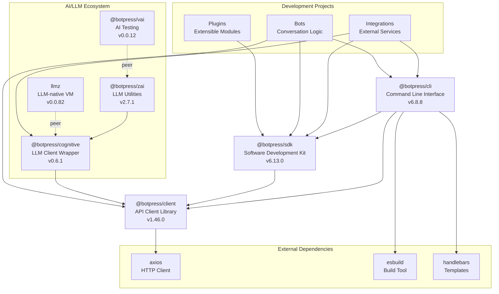
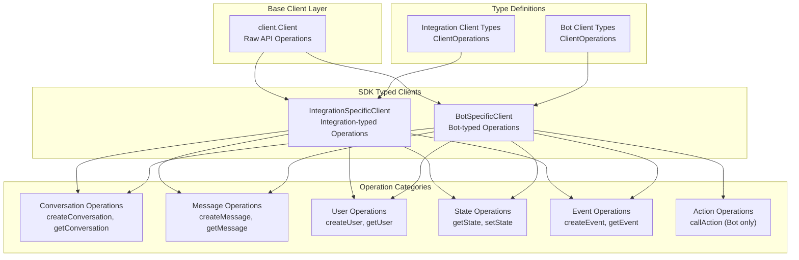
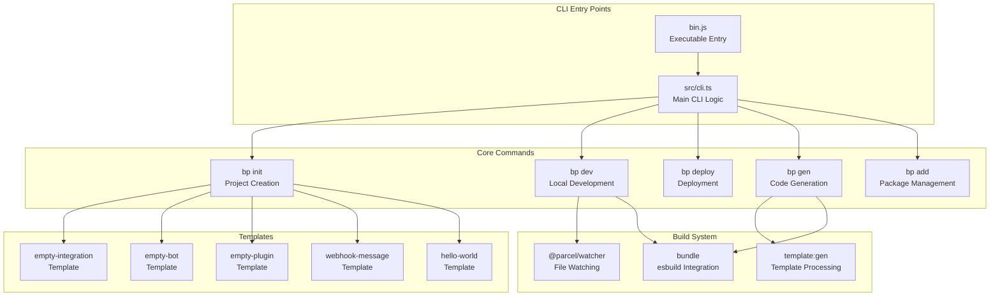
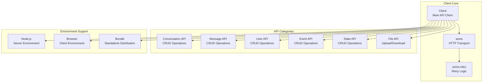
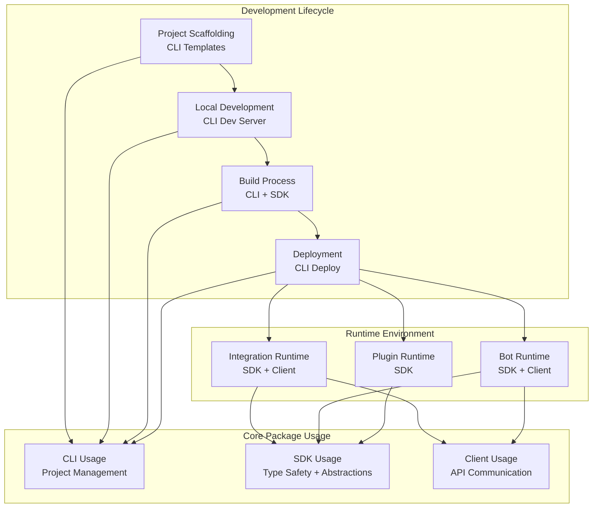

<!-- source: DeepWiki mcp.deepwiki.com · repo botpress/botpress · page 2 Core Packages · fetched 2026-10-27 -->

# Core Packages

Relevant source files

The following files were used as context for generating this wiki page:

- [package.json](package.json)
- [packages/cli/package.json](packages/cli/package.json)
- [packages/cli/templates/empty-bot/package.json](packages/cli/templates/empty-bot/package.json)
- [packages/cli/templates/empty-integration/package.json](packages/cli/templates/empty-integration/package.json)
- [packages/cli/templates/empty-plugin/package.json](packages/cli/templates/empty-plugin/package.json)
- [packages/cli/templates/hello-world/package.json](packages/cli/templates/hello-world/package.json)
- [packages/cli/templates/webhook-message/package.json](packages/cli/templates/webhook-message/package.json)
- [packages/client/package.json](packages/client/package.json)
- [packages/client/src/index.ts](packages/client/src/index.ts)
- [packages/cognitive/package.json](packages/cognitive/package.json)
- [packages/llmz/package.json](packages/llmz/package.json)
- [packages/sdk/package.json](packages/sdk/package.json)
- [packages/sdk/src/index.ts](packages/sdk/src/index.ts)
- [packages/vai/package.json](packages/vai/package.json)
- [packages/zai/package.json](packages/zai/package.json)
- [pnpm-lock.yaml](pnpm-lock.yaml)

This document covers the core packages that form the Botpress development toolkit. The primary packages are `@botpress/sdk`, `@botpress/cli`, and `@botpress/client`, which provide the essential building blocks for creating integrations, bots, and plugins. Additionally, the AI/LLM ecosystem packages (`@botpress/cognitive`, `@botpress/zai`, `llmz`, `@botpress/vai`) provide utilities for working with language models.

For information about the integration framework that uses these packages, see [Integration Framework](#4). For details about CLI commands and development workflows, see [CLI & Development Tools](#3). For specific documentation on each package, see:
- SDK details in [SDK](#2.1)
- CLI details in [CLI](#2.2)
- Client details in [Client](#2.3)
- AI/LLM packages in [AI/LLM Packages](#2.4)

## Package Overview

The core packages form a layered architecture where each package serves a specific purpose in the development stack:

### Package Dependency Architecture

Sources: [packages/cli/package.json:2-3](), [packages/sdk/package.json:2-3](), [packages/client/package.json:2-3](), [packages/cognitive/package.json:2-3](), [packages/zai/package.json:2-4](), [packages/llmz/package.json:2-5](), [packages/vai/package.json:2-3](), [pnpm-lock.yaml:22-30]()

### Package Responsibilities

| Package | Purpose | Key Features |
|---------|---------|--------------|
| `@botpress/client` | Low-level API client | HTTP client, authentication, raw API operations |
| `@botpress/sdk` | Development framework | Type-safe wrappers, definition schemas, build tools |
| `@botpress/cli` | Development tooling | Project scaffolding, deployment, local development |
| `@botpress/cognitive` | LLM client wrapper | Model registry, cost tracking, streaming support |
| `@botpress/zai` | LLM utilities | Schema validation, prompt helpers, token counting |
| `llmz` | LLM-native VM | TypeScript VM for LLM execution |
| `@botpress/vai` | AI testing framework | LLM-based test assertions for vitest |

## SDK Architecture

The SDK provides typed client wrappers that enhance the base client with type safety and domain-specific operations. It is designed to run in both Node.js and browser environments.

### SDK Client Type System

Sources: [packages/sdk/src/index.ts:1-10](), [packages/sdk/package.json:5-7](), [packages/sdk/package.json:22-26]()

### IntegrationSpecificClient

The `IntegrationSpecificClient` provides type-safe operations for integrations. It ensures that when an integration interacts with the Botpress API, it respects the schemas defined in its `IntegrationDefinition`.

Key features:
- **Type-safe conversations**: Channel-specific conversation creation with typed tags.
- **Typed messages**: Message operations with payload and tag type inference.
- **State management**: Integration-specific state operations.
- **Event handling**: Typed event creation and retrieval.

Sources: [packages/sdk/package.json:2-4](), [packages/sdk/package.json:22-26]()

### BotSpecificClient

The `BotSpecificClient` extends functionality for bot implementations, allowing them to interact with integrations and manage their own internal state and tables.

Additional bot-specific features:
- **Action calls**: `callAction` for invoking integration actions.
- **Client hooks**: Before/after operation hooks for customization.
- **Table operations**: CRUD operations on bot tables.
- **Workflow management**: Workflow creation and execution.

Sources: [packages/sdk/package.json:2-4](), [packages/sdk/package.json:22-26]()

## CLI Package

The CLI package (`@botpress/cli`) provides development tools and project management capabilities via the `bp` command.

### CLI Command Structure

Sources: [packages/cli/package.json:22-24](), [packages/cli/package.json:5-15](), [packages/cli/templates/empty-integration/package.json:1-16](), [packages/cli/templates/empty-bot/package.json:1-15]()

### CLI Dependencies and Build Tools

The CLI integrates multiple build and development tools to streamline the developer experience:

| Dependency | Purpose | Usage |
|------------|---------|-------|
| `esbuild` | JavaScript bundling | Fast compilation and bundling of TypeScript projects for deployment |
| `handlebars` | Template engine | Scaffolding new projects from templates |
| `@parcel/watcher` | File watching | Powering the `bp dev` hot-reload cycle |
| `prettier` | Code formatting | Automated formatting of generated code |
| `dotenv` | Environment variables | Loading secrets and configuration for local development |

Sources: [packages/cli/package.json:48](), [packages/cli/package.json:49](), [packages/cli/package.json:36](), [packages/cli/package.json:53](), [packages/cli/package.json:47]()

## Client Package

The client package (`@botpress/client`) provides the foundational HTTP client for Botpress API operations, using `axios` with retry logic.

### Client Architecture

Sources: [packages/client/package.json:27-31](), [packages/client/src/index.ts:1-5](), [packages/client/package.json:17-23]()

### Client Build Targets

The client package supports multiple deployment environments to ensure it can be used in both backend scripts and frontend dashboards:

| Build Target | Purpose | Output |
|--------------|---------|--------|
| `build:node` | Node.js servers | CommonJS/ESM modules |
| `build:browser` | Web browsers | Browser-compatible bundle |
| `build:bundle` | Standalone distribution | Self-contained bundle for direct inclusion |

Sources: [packages/client/package.json:20-23]()

## Development Workflow Integration

The core packages work together to provide a complete development lifecycle, from local coding to production deployment.

### Package Integration Flow

Sources: [packages/cli/package.json:5-15](), [packages/sdk/package.json:11-17](), [packages/client/package.json:17-23]()

### Version Management

The packages maintain coordinated versioning across the monorepo to ensure compatibility:

| Package | Version | Role |
|---------|---------|------|
| `@botpress/client` | 1.46.0 | Stable API client |
| `@botpress/sdk` | 6.13.0 | Development framework |
| `@botpress/cli` | 6.8.8 | Development tools |

Sources: [packages/client/package.json:3](), [packages/sdk/package.json:3](), [packages/cli/package.json:3](), [pnpm-lock.yaml:20-30]()

---

