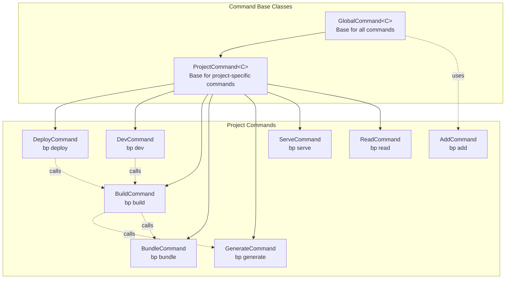
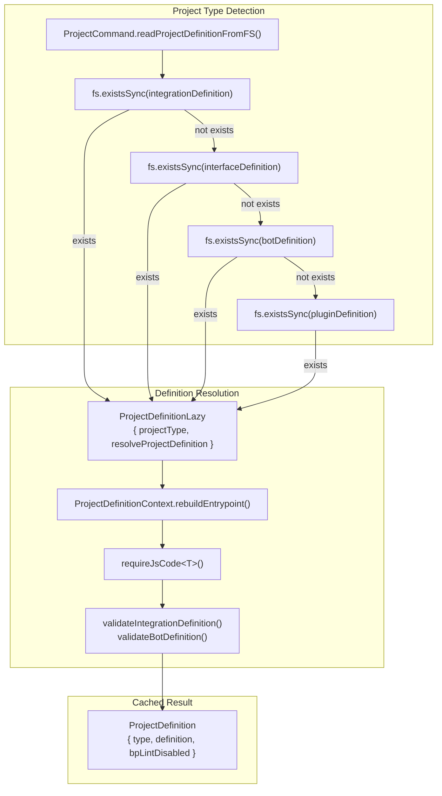
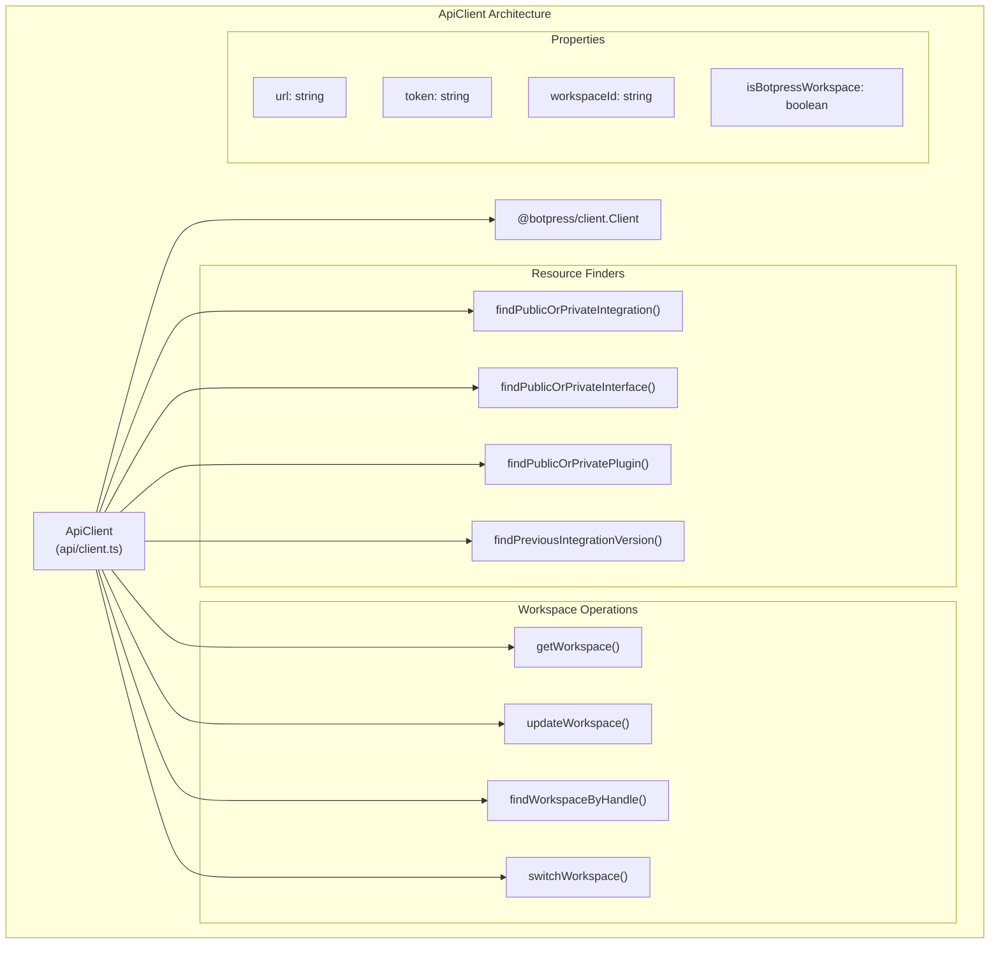

<!-- source: DeepWiki mcp.deepwiki.com · repo botpress/botpress · page 2.2 CLI · fetched 2026-10-27 -->

# CLI

Relevant source files

The following files were used as context for generating this wiki page:

- [packages/cli/e2e/api.ts](packages/cli/e2e/api.ts)
- [packages/cli/e2e/defaults.ts](packages/cli/e2e/defaults.ts)
- [packages/cli/e2e/index.ts](packages/cli/e2e/index.ts)
- [packages/cli/e2e/tests/bot-secrets.ts](packages/cli/e2e/tests/bot-secrets.ts)
- [packages/cli/e2e/tests/create-deploy-bot-with-dependencies.ts](packages/cli/e2e/tests/create-deploy-bot-with-dependencies.ts)
- [packages/cli/e2e/tests/create-deploy-bot.ts](packages/cli/e2e/tests/create-deploy-bot.ts)
- [packages/cli/e2e/tests/create-deploy-integration.ts](packages/cli/e2e/tests/create-deploy-integration.ts)
- [packages/cli/e2e/tests/dev-bot.ts](packages/cli/e2e/tests/dev-bot.ts)
- [packages/cli/e2e/tests/install-interfaces.ts](packages/cli/e2e/tests/install-interfaces.ts)
- [packages/cli/e2e/tests/install-package.ts](packages/cli/e2e/tests/install-package.ts)
- [packages/cli/e2e/tests/install-plugins.ts](packages/cli/e2e/tests/install-plugins.ts)
- [packages/cli/e2e/tests/integration-secrets.ts](packages/cli/e2e/tests/integration-secrets.ts)
- [packages/cli/e2e/tests/manage-workspace-handle.ts](packages/cli/e2e/tests/manage-workspace-handle.ts)
- [packages/cli/e2e/typings.ts](packages/cli/e2e/typings.ts)
- [packages/cli/e2e/utils.ts](packages/cli/e2e/utils.ts)
- [packages/cli/src/api/client.ts](packages/cli/src/api/client.ts)
- [packages/cli/src/api/types.ts](packages/cli/src/api/types.ts)
- [packages/cli/src/cli.ts](packages/cli/src/cli.ts)
- [packages/cli/src/code-generation/bot-implementation/index.ts](packages/cli/src/code-generation/bot-implementation/index.ts)
- [packages/cli/src/code-generation/generators.ts](packages/cli/src/code-generation/generators.ts)
- [packages/cli/src/code-generation/integration-implementation/index.ts](packages/cli/src/code-generation/integration-implementation/index.ts)
- [packages/cli/src/code-generation/plugin-package/plugin-package-definition/index.ts](packages/cli/src/code-generation/plugin-package/plugin-package-definition/index.ts)
- [packages/cli/src/code-generation/plugin-package/plugin-package-definition/typings.ts](packages/cli/src/code-generation/plugin-package/plugin-package-definition/typings.ts)
- [packages/cli/src/code-generation/secret-module.ts](packages/cli/src/code-generation/secret-module.ts)
- [packages/cli/src/code-generation/typings.ts](packages/cli/src/code-generation/typings.ts)
- [packages/cli/src/command-definitions.ts](packages/cli/src/command-definitions.ts)
- [packages/cli/src/command-implementations/add-command.ts](packages/cli/src/command-implementations/add-command.ts)
- [packages/cli/src/command-implementations/base-command.ts](packages/cli/src/command-implementations/base-command.ts)
- [packages/cli/src/command-implementations/bot-commands.ts](packages/cli/src/command-implementations/bot-commands.ts)
- [packages/cli/src/command-implementations/build-command.ts](packages/cli/src/command-implementations/build-command.ts)
- [packages/cli/src/command-implementations/bundle-command.ts](packages/cli/src/command-implementations/bundle-command.ts)
- [packages/cli/src/command-implementations/deploy-command.ts](packages/cli/src/command-implementations/deploy-command.ts)
- [packages/cli/src/command-implementations/dev-command.ts](packages/cli/src/command-implementations/dev-command.ts)
- [packages/cli/src/command-implementations/global-command.ts](packages/cli/src/command-implementations/global-command.ts)
- [packages/cli/src/command-implementations/index.ts](packages/cli/src/command-implementations/index.ts)
- [packages/cli/src/command-implementations/init-command.ts](packages/cli/src/command-implementations/init-command.ts)
- [packages/cli/src/command-implementations/integration-commands.ts](packages/cli/src/command-implementations/integration-commands.ts)
- [packages/cli/src/command-implementations/interface-commands.ts](packages/cli/src/command-implementations/interface-commands.ts)
- [packages/cli/src/command-implementations/plugin-commands.ts](packages/cli/src/command-implementations/plugin-commands.ts)
- [packages/cli/src/command-implementations/profile-commands.ts](packages/cli/src/command-implementations/profile-commands.ts)
- [packages/cli/src/command-implementations/project-command.ts](packages/cli/src/command-implementations/project-command.ts)
- [packages/cli/src/command-implementations/serve-command.ts](packages/cli/src/command-implementations/serve-command.ts)
- [packages/cli/src/config.test.ts](packages/cli/src/config.test.ts)
- [packages/cli/src/config.ts](packages/cli/src/config.ts)
- [packages/cli/src/consts.ts](packages/cli/src/consts.ts)
- [packages/cli/src/errors.test.ts](packages/cli/src/errors.test.ts)
- [packages/cli/src/errors.ts](packages/cli/src/errors.ts)
- [packages/cli/src/index.ts](packages/cli/src/index.ts)
- [packages/cli/src/init.ts](packages/cli/src/init.ts)
- [packages/cli/src/package-ref.test.ts](packages/cli/src/package-ref.test.ts)
- [packages/cli/src/package-ref.ts](packages/cli/src/package-ref.ts)
- [packages/cli/src/register-yargs.ts](packages/cli/src/register-yargs.ts)
- [packages/cli/src/root.ts](packages/cli/src/root.ts)
- [packages/cli/src/utils/cache-utils.ts](packages/cli/src/utils/cache-utils.ts)
- [packages/cli/src/utils/esbuild-utils.test.ts](packages/cli/src/utils/esbuild-utils.test.ts)
- [packages/cli/src/utils/esbuild-utils.ts](packages/cli/src/utils/esbuild-utils.ts)
- [packages/cli/src/utils/index.ts](packages/cli/src/utils/index.ts)
- [packages/cli/src/utils/json-utils.ts](packages/cli/src/utils/json-utils.ts)
- [packages/cli/src/utils/pkgjson-utils.ts](packages/cli/src/utils/pkgjson-utils.ts)
- [packages/cli/src/utils/prompt-utils.ts](packages/cli/src/utils/prompt-utils.ts)
- [packages/cli/src/utils/record-utils.test.ts](packages/cli/src/utils/record-utils.test.ts)
- [packages/cli/src/utils/record-utils.ts](packages/cli/src/utils/record-utils.ts)
- [packages/cli/src/utils/semver-utils.ts](packages/cli/src/utils/semver-utils.ts)
- [packages/cli/src/utils/tunnel-utils.ts](packages/cli/src/utils/tunnel-utils.ts)
- [packages/cli/src/worker/child-entrypoint.ts](packages/cli/src/worker/child-entrypoint.ts)
- [packages/cli/tsconfig.json](packages/cli/tsconfig.json)
- [packages/cognitive/build.ts](packages/cognitive/build.ts)
- [packages/llmz/examples/package.json](packages/llmz/examples/package.json)
- [packages/llmz/src/prompts/dual-modes.ts](packages/llmz/src/prompts/dual-modes.ts)
- [packages/llmz/src/typings.ts](packages/llmz/src/typings.ts)
- [packages/sdk/src/version-utils.ts](packages/sdk/src/version-utils.ts)
- [packages/sdk/src/zui.ts](packages/sdk/src/zui.ts)
- [scripts/upload-sandbox-scripts.ts](scripts/upload-sandbox-scripts.ts)

## Purpose and Scope

The **@botpress/cli** package provides the `bp` command-line interface for managing the lifecycle of Botpress projects (bots, integrations, plugins, and interfaces). It handles project initialization, dependency management, code generation, building, local development, and deployment to the Botpress platform.

For information about the SDK that the CLI depends on, see [SDK](#2.1). For deployment pipelines and CI/CD workflows, see [6.2 CI/CD Pipeline]().

---

## Overview

The CLI is distributed as an npm package with a binary entry point at [packages/cli/package.json:28-28](). The main implementation is built and bundled to [packages/cli/dist/cli.js](). It provides a command-line interface that orchestrates:

- **Project scaffolding** via templates [packages/cli/src/command-implementations/init-command.ts:9-11]()
- **Dependency management** for integrations, plugins, and interfaces [packages/cli/src/command-implementations/add-command.ts:38-42]()
- **Code generation** from definitions to TypeScript typings [packages/cli/src/command-implementations/project-command.ts:9-9]()
- **Building and bundling** with esbuild [packages/cli/src/command-implementations/bundle-command.ts:60-60]()
- **Local development** with hot reload and tunneling [packages/cli/src/command-implementations/dev-command.ts:158-180]()
- **Deployment** to Botpress cloud infrastructure [packages/cli/src/command-implementations/deploy-command.ts:16-42]()

**Key Design Patterns:**
- Command pattern with class hierarchy: `GlobalCommand` → `ProjectCommand` → specific command implementations [packages/cli/src/command-implementations/index.ts:1-15]()
- API client wrapper (`ApiClient`) for all Botpress platform interactions [packages/cli/src/api/client.ts:29-37]()
- Build context caching for incremental builds [packages/cli/src/utils/esbuild-utils.ts:31-48]()
- File system caching for project state [packages/cli/src/command-implementations/project-command.ts:134-136]()

Sources: [packages/cli/package.json:1-73](), [packages/cli/src/command-implementations/global-command.ts:43-56](), [packages/cli/src/command-implementations/project-command.ts:116-124]()

---

## Command Class Hierarchy

**GlobalCommand** provides:
- Logger instance [packages/cli/src/command-implementations/base-command.ts:14-14]()
- Prompt utilities via `CLIPrompt` [packages/cli/src/command-implementations/global-command.ts:45-45]()
- API client creation via `ensureLoginAndCreateClient()` [packages/cli/src/command-implementations/global-command.ts:166-174]()
- Bootstrap lifecycle method [packages/cli/src/command-implementations/global-command.ts:66-77]()

**ProjectCommand** adds:
- Project path resolution via `ProjectPaths` [packages/cli/src/command-implementations/project-command.ts:130-132]()
- Project definition reading from filesystem [packages/cli/src/command-implementations/project-command.ts:155-198]()
- Project cache management (`projectCache`) [packages/cli/src/command-implementations/project-command.ts:134-136]()
- Definition context for incremental builds (`ProjectDefinitionContext`) [packages/cli/src/command-implementations/project-command.ts:84-111]()
- Dependency resolution methods (`prepareBotDependencies`, `prepareIntegrationDependencies`) [packages/cli/src/command-implementations/project-command.ts:546-608]()
- Secret prompting utilities [packages/cli/src/command-implementations/project-command.ts:323-394]()

Sources: [packages/cli/src/command-implementations/global-command.ts:43-175](), [packages/cli/src/command-implementations/project-command.ts:116-200]()

---

## Project Types and Definition Loading

The CLI supports four project types, each with a corresponding definition file:

| Project Type | Definition File | Purpose |
|-------------|----------------|---------|
| **integration** | `integration.definition.ts` | External service connector |
| **interface** | `interface.definition.ts` | Shared contract between integrations |
| **bot** | `bot.definition.ts` | Conversational AI application |
| **plugin** | `plugin.definition.ts` | Bot functionality extension |

**Definition Loading Process:**

1. **Type Detection** - Checks for existence of definition files in order: integration → interface → bot → plugin [packages/cli/src/command-implementations/project-command.ts:138-153]().

2. **Lazy Resolution** - Returns a `ProjectDefinitionLazy` object with:
   - `projectType`: The detected type [packages/cli/src/command-implementations/project-command.ts:155-198]()
   - `resolveProjectDefinition`: Async function to build and load the definition.

3. **Build and Require** - When resolution is invoked:
   - Runs `esbuild` on the definition file via `ProjectDefinitionContext.rebuildEntrypoint()` [packages/cli/src/command-implementations/project-command.ts:98-100]().
   - Executes bundled JavaScript with `requireJsCode()` to extract the default export [packages/cli/src/command-implementations/project-command.ts:93-95]().
   - Caches the result in `ProjectDefinitionContext._codeCache` to avoid rebuilding [packages/cli/src/command-implementations/project-command.ts:89-95]().

4. **Validation** - For integrations and bots, validates the definition structure using `validateIntegrationDefinition` and `validateBotDefinition` [packages/cli/src/command-implementations/project-command.ts:223-223]().

Sources: [packages/cli/src/command-implementations/project-command.ts:138-279](), [packages/cli/src/command-implementations/project-command.ts:84-111]()

---

## Core Commands

### Init Command (Project Scaffolding)

The `bp init` command scaffolds new projects from templates. Templates are managed via `ProjectTemplates` [packages/cli/src/command-implementations/init-command.ts:9-9]():

| Template | Package Name | Purpose |
|----------|-------------|---------|
| `empty-bot` | `@bp-templates/empty-bot` | Minimal bot project |
| `empty-integration` | `@bp-templates/empty-integration` | Minimal integration project |
| `empty-plugin` | `@bp-templates/empty-plugin` | Minimal plugin project |
| `hello-world` | `@bp-templates/hello-world` | Bot with example handlers |

The initialization process prompts for project type [packages/cli/src/command-implementations/init-command.ts:69-83](), workspace handle [packages/cli/src/command-implementations/init-command.ts:53-67](), and template [packages/cli/src/command-implementations/init-command.ts:102-119]().

Sources: [packages/cli/src/command-implementations/init-command.ts:20-51](), [packages/cli/src/project-templates.ts]()

---

### Add Command (Dependency Management)

```mermaid
graph TB
    subgraph "bp add Execution Flow"
        ParseRef["Parse Package Reference<br/>parsePackageRef()"]
        CheckType["Determine Reference Type"]
        
        subgraph "Local Package (path:...)"
            ReadLocal["Read Local Project<br/>_readProject()"]
            BuildLocal["Build Definition<br/>prepareCreateIntegrationBody()"]
            LocalPkg["Local Package<br/>{ path, name, version }"]
        end
        
        subgraph "Remote Package (name@version)"
            LoginAPI["ensureLoginAndCreateClient()"]
            FetchInt["api.findPublicOrPrivateIntegration()"]
            FetchIface["api.findPublicOrPrivateInterface()"]
            FetchPlug["api.findPublicOrPrivatePlugin()"]
            RemotePkg["Remote Package<br/>{ name, version, id }"]
        end
        
        Generate["generateIntegrationPackage()<br/>generateInterfacePackage()<br/>generatePluginPackage()"]
        Install["Write Files to<br/>bp_modules/&lt;package-name&gt;/"]
        UpdatePkgJson["Add to bpDependencies<br/>in package.json"]
    end
    
    ParseRef --> CheckType
    CheckType -->|"path:..."| ReadLocal
    CheckType -->|"name@version"| LoginAPI
    
    ReadLocal --> BuildLocal
    BuildLocal --> LocalPkg
    
    LoginAPI --> FetchInt
    FetchInt --> FetchIface
    FetchIface --> FetchPlug
    FetchPlug --> RemotePkg
    
    LocalPkg --> Generate
    RemotePkg --> Generate
    Generate --> Install
    Install --> UpdatePkgJson
```

**Package Reference Formats:**

- **By Name:** `integration:openai@1.0.0` or `plugin:hitl@^2.0.0` [packages/cli/src/package-ref.ts:64-70]()
- **By ID:** `id:01234567-89ab-cdef-0123-456789abcdef` [packages/cli/src/package-ref.ts:72-76]()
- **By Path:** `path:../my-integration` (local development) [packages/cli/src/package-ref.ts:78-83]()

**Installation Process:**

1. Parse package reference from argv or `package.json` bpDependencies [packages/cli/src/command-implementations/add-command.ts:39-63]().
2. Resolve package from remote API [packages/cli/src/command-implementations/add-command.ts:190-213]() or local filesystem [packages/cli/src/command-implementations/add-command.ts:215-241]().
3. Generate TypeScript files with typings using `codegen` [packages/cli/src/command-implementations/add-command.ts:118-127]().
4. Write to `bp_modules/<package-name>/` [packages/cli/src/command-implementations/add-command.ts:106-129]().
5. Update `package.json` bpDependencies field [packages/cli/src/command-implementations/add-command.ts:174-175]().

Sources: [packages/cli/src/command-implementations/add-command.ts:37-177](), [packages/cli/src/package-ref.ts:10-84]()

---

### Generate Command (Code Generation)

The `bp generate` command triggers the creation of TypeScript typings based on the project definition. It is a prerequisite for building bots, integrations, and plugins [packages/cli/src/command-implementations/gen-command.ts:12-25]().

**Generated Output Structure:**

For each project type, the CLI generates TypeScript declaration files in `.botpress/`:
- **index.d.ts** - Entry point with exported types.
- **implementation.d.ts** - Implementation-specific types (Client, Events, Actions, etc.).
- **package/** - For dependencies, contains generated package typings.

**Secret Validation:**
Integration secrets must follow `SCREAMING_SNAKE_CASE` naming convention during generation [packages/cli/src/command-implementations/gen-command.ts:89-100]().

Sources: [packages/cli/src/command-implementations/gen-command.ts:12-101](), [packages/cli/src/code-generation/generators.ts]()

---

### Build Command (Compilation)

The `bp build` command orchestrates code generation and bundling [packages/cli/src/command-implementations/build-command.ts:16-25]().

**Build Options:**
- `--minify` - Minify the bundled code (default: true) [packages/cli/src/config.ts:93-97]().
- `--source-map` - Generate source maps [packages/cli/src/config.ts:87-91]().

**Platform-Specific Builds:**
- **Bots & Integrations:** Bundled for Node.js platform [packages/cli/src/command-implementations/bundle-command.ts:22-25]().
- **Plugins:** Dual builds for Node.js (CommonJS) and Browser (ESM) [packages/cli/src/command-implementations/bundle-command.ts:27-31]().

Sources: [packages/cli/src/command-implementations/build-command.ts:8-36](), [packages/cli/src/command-implementations/bundle-command.ts:8-77]()

---

### Deploy Command (Production Deployment)

The `bp deploy` command uploads the bundled project to the Botpress cloud [packages/cli/src/command-implementations/deploy-command.ts:16-42]().

**Deployment Lifecycle:**
1. Ensures user is logged in [packages/cli/src/command-implementations/deploy-command.ts:17-17]().
2. Runs build (unless `--no-build` is specified) [packages/cli/src/command-implementations/deploy-command.ts:19-21]().
3. Reads project definition and prepares the request body [packages/cli/src/command-implementations/deploy-command.ts:112-119]().
4. Prompts for missing secrets [packages/cli/src/command-implementations/deploy-command.ts:132-132]().
5. Calls the Botpress API to create or update the resource [packages/cli/src/command-implementations/deploy-command.ts:145-156]().

**Workspace Handle Management:**
Integrations require a workspace handle prefix. The CLI validates that the handle matches the target workspace [packages/cli/src/command-implementations/deploy-command.ts:522-631]().

Sources: [packages/cli/src/command-implementations/deploy-command.ts:15-647]()

---

### Dev Command (Local Development)

The `bp dev` command enables a local development loop with hot reload and cloud connectivity [packages/cli/src/command-implementations/dev-command.ts:36-172]().

**Dev Mode Features:**
1. **Hot Reload** - Watches for file changes and restarts the worker [packages/cli/src/command-implementations/dev-command.ts:178-216]().
2. **Tunnel** - Establishes a WebSocket tunnel to receive events from Botpress Cloud [packages/cli/src/command-implementations/dev-command.ts:115-158]().
3. **Worker** - Spawns a local process to execute the bot or integration code [packages/cli/src/command-implementations/dev-command.ts:161-161]().

**Tunnel Configuration:**
- Uses a `TunnelSupervisor` to manage the connection [packages/cli/src/command-implementations/dev-command.ts:115-115]().
- Forwards incoming tunnel requests to the local HTTP server [packages/cli/src/command-implementations/dev-command.ts:127-151]().

Sources: [packages/cli/src/command-implementations/dev-command.ts:25-425](), [packages/cli/src/worker.ts]()

---

## ApiClient Wrapper

The `ApiClient` class wraps the `@botpress/client` to provide CLI-specific utilities like workspace switching and resource finding [packages/cli/src/api/client.ts:29-37]().

**Key Features:**
- **Workspace Switching:** Creates a new client instance for a specific workspace [packages/cli/src/api/client.ts:113-118]().
- **Public/Private Search:** Automatically searches both the current workspace and the public hub for dependencies [packages/cli/src/api/client.ts:141-157]().
- **Retry Logic:** Uses a global retry configuration for API calls [packages/cli/src/api/client.ts:49-49]().

Sources: [packages/cli/src/api/client.ts:29-308]()

---

## Project Paths and File Structure

The CLI defines path constants relative to the project work directory [packages/cli/src/consts.ts:42-56]().

| Constant | Path | Purpose |
|----------|------|---------|
| `outDir` | `.botpress` | Root for all generated files |
| `distDir` | `.botpress/dist` | Bundled code output |
| `outFileCJS` | `.botpress/dist/index.cjs` | CommonJS bundle |
| `projectCacheFile` | `.botpress/project.cache.json` | JSON cache for project state |
| `integrationDefinition` | `integration.definition.ts` | Integration definition file |
| `botDefinition` | `bot.definition.ts` | Bot definition file |
| `entryPoint` | `src/index.ts` | Implementation entry point |

Sources: [packages/cli/src/consts.ts:42-56](), [packages/cli/src/command-implementations/project-command.ts:74-82]()

---

## Secret Management

The CLI handles secret collection for both deployment and local development [packages/cli/src/command-implementations/project-command.ts:323-394]().

**Secret Prompting:**
- Checks for secrets in the project definition [packages/cli/src/command-implementations/project-command.ts:335-335]().
- Allows providing values via the `--secrets` flag [packages/cli/src/command-implementations/project-command.ts:328-332]().
- Prompts for missing required secrets and optional secrets [packages/cli/src/command-implementations/project-command.ts:345-357]().

**Dev Mode Injection:**
In `bp dev`, secrets are injected into the worker process as environment variables with the `BP_SECRET_` prefix [packages/cli/src/command-implementations/dev-command.ts:65-79]().

Sources: [packages/cli/src/command-implementations/project-command.ts:323-394](), [packages/cli/src/command-implementations/dev-command.ts:65-79]()

---

