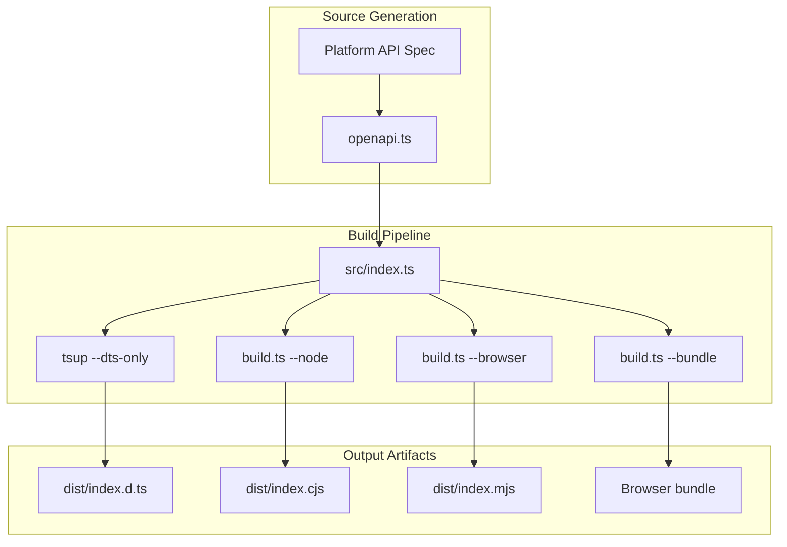
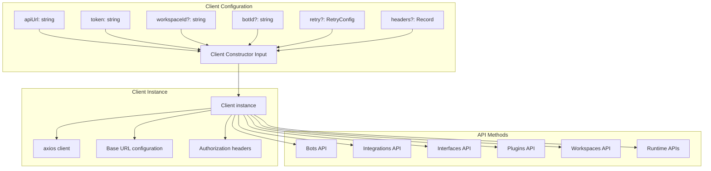
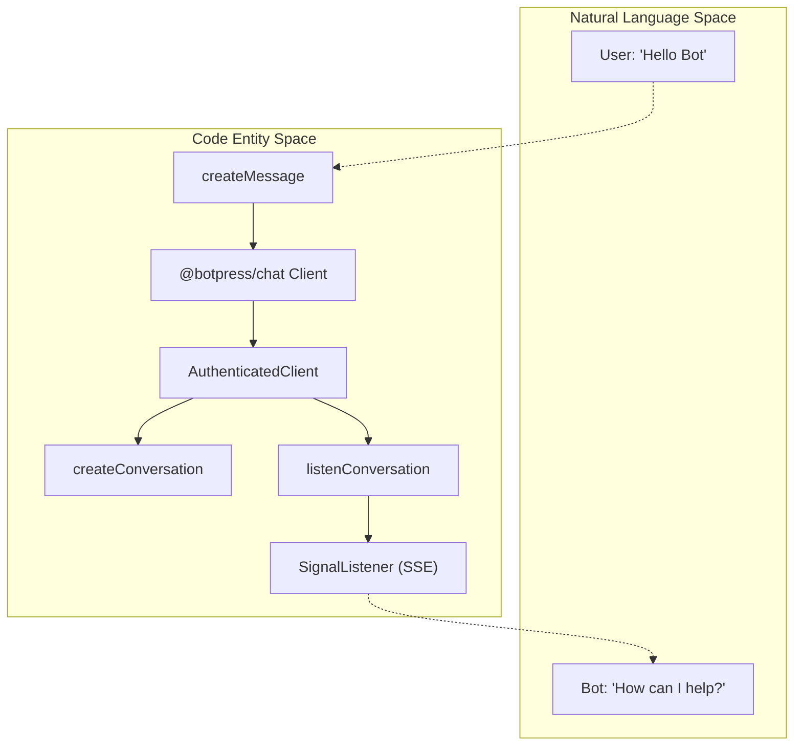
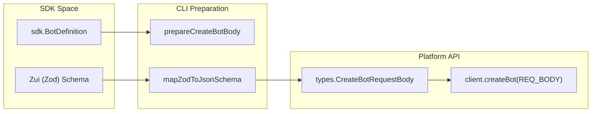

<!-- source: DeepWiki mcp.deepwiki.com · repo botpress/botpress · page 2.3 Client · fetched 2026-10-27 -->

# Client

Relevant source files

The following files were used as context for generating this wiki page:

- [bots/echo/src/index.ts](bots/echo/src/index.ts)
- [echo.Tiltfile](echo.Tiltfile)
- [integrations/chat/definitions/channels/messages.ts](integrations/chat/definitions/channels/messages.ts)
- [integrations/chat/integration.definition.ts](integrations/chat/integration.definition.ts)
- [integrations/chat/openapi.ts](integrations/chat/openapi.ts)
- [integrations/chat/package.json](integrations/chat/package.json)
- [integrations/chat/src/api/message-payload.ts](integrations/chat/src/api/message-payload.ts)
- [integrations/chat/src/api/operations/conversation.ts](integrations/chat/src/api/operations/conversation.ts)
- [integrations/chat/src/api/operations/event.ts](integrations/chat/src/api/operations/event.ts)
- [integrations/chat/src/api/operations/message.ts](integrations/chat/src/api/operations/message.ts)
- [integrations/chat/src/api/operations/model.ts](integrations/chat/src/api/operations/model.ts)
- [integrations/chat/src/api/operations/user.ts](integrations/chat/src/api/operations/user.ts)
- [integrations/chat/src/handler.ts](integrations/chat/src/handler.ts)
- [integrations/chat/src/id-store/dynamo-db-store.ts](integrations/chat/src/id-store/dynamo-db-store.ts)
- [integrations/chat/src/index.ts](integrations/chat/src/index.ts)
- [integrations/chat/src/signal-emitter/pushpin.ts](integrations/chat/src/signal-emitter/pushpin.ts)
- [integrations/chat/src/tracing.ts](integrations/chat/src/tracing.ts)
- [integrations/chat/src/websocket.ts](integrations/chat/src/websocket.ts)
- [packages/chat-api/src/api.ts](packages/chat-api/src/api.ts)
- [packages/chat-api/src/index.ts](packages/chat-api/src/index.ts)
- [packages/chat-api/src/models/message.ts](packages/chat-api/src/models/message.ts)
- [packages/chat-api/src/operations/message.ts](packages/chat-api/src/operations/message.ts)
- [packages/chat-api/src/version.ts](packages/chat-api/src/version.ts)
- [packages/chat-client/e2e/message.test.ts](packages/chat-client/e2e/message.test.ts)
- [packages/chat-client/e2e/participant.test.ts](packages/chat-client/e2e/participant.test.ts)
- [packages/chat-client/openapi.ts](packages/chat-client/openapi.ts)
- [packages/chat-client/package.json](packages/chat-client/package.json)
- [packages/chat-client/readme.md](packages/chat-client/readme.md)
- [packages/chat-client/src/client.ts](packages/chat-client/src/client.ts)
- [packages/chat-client/src/consts.ts](packages/chat-client/src/consts.ts)
- [packages/chat-client/src/eventsource.ts](packages/chat-client/src/eventsource.ts)
- [packages/chat-client/src/index.ts](packages/chat-client/src/index.ts)
- [packages/chat-client/src/signal-listener.ts](packages/chat-client/src/signal-listener.ts)
- [packages/chat-client/src/types.ts](packages/chat-client/src/types.ts)
- [packages/cli/src/api/bot-body.ts](packages/cli/src/api/bot-body.ts)
- [packages/cli/src/api/integration-body.ts](packages/cli/src/api/integration-body.ts)
- [packages/cli/src/api/interface-body.ts](packages/cli/src/api/interface-body.ts)
- [packages/cli/src/api/plugin-body.ts](packages/cli/src/api/plugin-body.ts)
- [packages/cli/src/chat/index.ts](packages/cli/src/chat/index.ts)
- [packages/cli/src/command-implementations/chat-command.ts](packages/cli/src/command-implementations/chat-command.ts)
- [packages/cli/src/command-implementations/read-command.ts](packages/cli/src/command-implementations/read-command.ts)
- [packages/client/src/index.ts](packages/client/src/index.ts)

The `@botpress/client` package provides a TypeScript client for interacting with the Botpress Platform API. It serves as the foundational HTTP client used by both the CLI and SDK to manage workspaces, bots, integrations, interfaces, plugins, and runtime operations. The client is auto-generated from OpenAPI specifications and provides strongly-typed methods for all platform operations.

For information about how the CLI uses the client for deployment operations, see [CLI](#2.2). For SDK-level bot and integration runtime functionality, see [SDK](#2.1).

## Package Structure and Build System

The client package is published to npm as `@botpress/client` and provides dual-format exports for both Node.js and browser environments.

**Package Configuration**

The client generation and build process consists of:
- **Source Export**: [packages/client/src/index.ts:1-12]() exports modules for `admin`, `billing`, `files`, `tables`, and generated `public` models.
- **Dual Support**: The package supports both browser and Node.js through specialized build scripts and dependencies like `browser-or-node` [packages/chat-client/package.json:23]().

Sources: [packages/client/src/index.ts:1-12](), [packages/chat-client/package.json:1-53]()

## Client Class Architecture

The core `Client` class provides direct access to all Botpress Platform API endpoints.

**Client Instantiation Flow**

The client is instantiated with authentication and workspace context, then provides typed methods for all API operations. It uses `axios` and `axios-retry` for resilient network communication [packages/client/src/index.ts:1-2]().

Sources: [packages/client/src/index.ts:1-12](), [packages/chat-client/src/client.ts:42-49]()

## Chat API Client

In addition to the platform client, `@botpress/chat` (found in `packages/chat-client`) provides a specialized client for the Botpress Chat API. This is used by front-end applications or external services to communicate with bots via the Chat Integration.

**Chat Client Interaction**

Key features of the Chat Client:
- **Authentication**: Supports connecting via `userKey` or `encryptionKey` (HS256) [packages/chat-client/src/client.ts:58-88]().
- **Real-time**: Implements `listenConversation` using Server-Sent Events (SSE) via `SignalListener` [packages/chat-client/src/client.ts:129-142]().
- **Operations**: Provides methods for managing `conversations`, `messages`, `users`, and `participants` [packages/chat-client/src/client.ts:90-111]().

Sources: [packages/chat-client/src/client.ts:42-142](), [integrations/chat/integration.definition.ts:6-118]()

## CLI Data Preparation

The CLI uses `@botpress/client` types to prepare request bodies when deploying bots, integrations, or plugins. This process involves converting Zui (Zod-based) schemas into JSON schemas that the Platform API understands.

**Data Flow: SDK Definition to API Body**

Implementation details:
- **Bots**: `prepareCreateBotBody` maps bot configurations, actions, and states [packages/cli/src/api/bot-body.ts:7-94]().
- **Integrations**: `prepareCreateIntegrationBody` converts channel, action, and event schemas [packages/cli/src/api/integration-body.ts:7-105]().
- **Plugins**: `prepareCreatePluginBody` handles plugin-specific metadata and tags [packages/cli/src/api/plugin-body.ts:7-94]().

Sources: [packages/cli/src/api/bot-body.ts:7-130](), [packages/cli/src/api/integration-body.ts:7-160](), [packages/cli/src/api/plugin-body.ts:7-134]()

## CLI Chat Command

The CLI includes a `chat` command that leverages the `@botpress/chat` client to provide an interactive terminal interface for testing bots.

**Chat Command Workflow**
1. **Login**: Ensures the user is logged in and creates a platform client [packages/cli/src/command-implementations/chat-command.ts:24]().
2. **Bot Selection**: Selects the target bot [packages/cli/src/command-implementations/chat-command.ts:25]().
3. **Integration Check**: Verifies if the `chat` integration is installed; if not, it offers to install it [packages/cli/src/command-implementations/chat-command.ts:31-40]().
4. **Connection**: Connects to the chat integration's webhook using the chat client [packages/cli/src/command-implementations/chat-command.ts:47]().
5. **Session**: Creates a new conversation and launches the interactive chat loop [packages/cli/src/command-implementations/chat-command.ts:51-60]().

Sources: [packages/cli/src/command-implementations/chat-command.ts:18-158]()

## Error Handling

The clients provide robust error mapping to translate HTTP errors into actionable TypeScript errors.
- **Platform Client**: Uses `axios-retry` for transient failure recovery [packages/client/src/index.ts:2]().
- **Chat Client**: Implements `_checkPayloadForError` to handle cases where the API returns a 200 OK but the payload contains a functional error [packages/chat-client/src/client.ts:163-172]().

Sources: [packages/client/src/index.ts:1-12](), [packages/chat-client/src/client.ts:144-156]()

---

