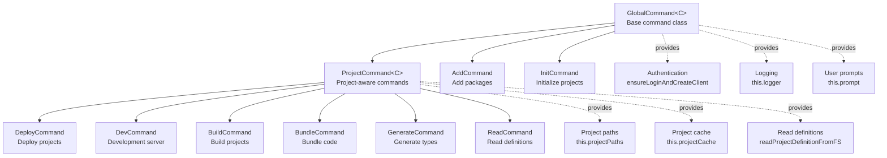
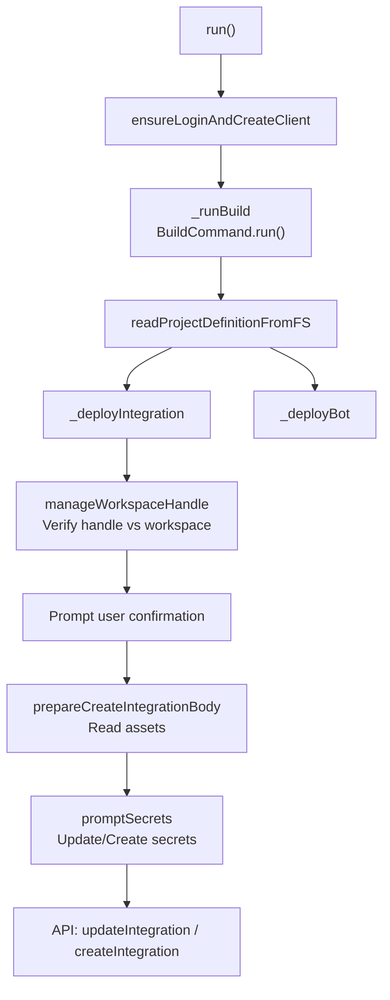
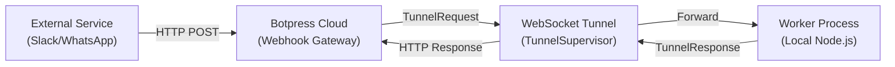
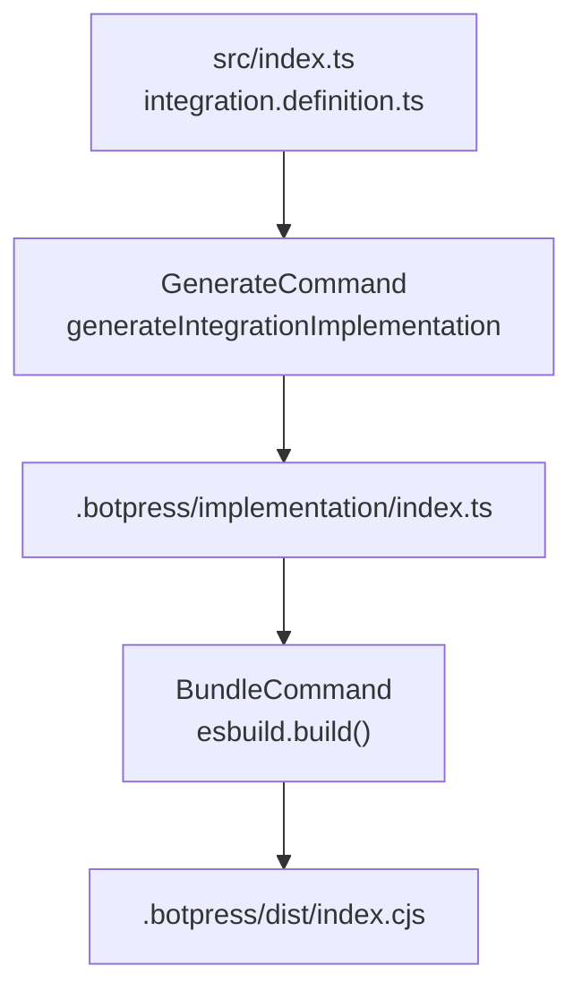

<!-- source: DeepWiki mcp.deepwiki.com · repo botpress/botpress · page 3.1 CLI Commands · fetched 2026-10-27 -->

# CLI Commands

Relevant source files

The following files were used as context for generating this wiki page:

- [packages/cli/e2e/api.ts](packages/cli/e2e/api.ts)
- [packages/cli/e2e/defaults.ts](packages/cli/e2e/defaults.ts)
- [packages/cli/e2e/index.ts](packages/cli/e2e/index.ts)
- [packages/cli/e2e/tests/bot-secrets.ts](packages/cli/e2e/tests/bot-secrets.ts)
- [packages/cli/e2e/tests/create-deploy-bot-with-dependencies.ts](packages/cli/e2e/tests/create-deploy-bot-with-dependencies.ts)
- [packages/cli/e2e/tests/create-deploy-bot.ts](packages/cli/e2e/tests/create-deploy-bot.ts)
- [packages/cli/e2e/tests/create-deploy-integration.ts](packages/cli/e2e/tests/create-deploy-integration.ts)
- [packages/cli/e2e/tests/dev-bot.ts](packages/cli/e2e/tests/dev-bot.ts)
- [packages/cli/e2e/tests/install-interfaces.ts](packages/cli/e2e/tests/install-interfaces.ts)
- [packages/cli/e2e/tests/install-package.ts](packages/cli/e2e/tests/install-package.ts)
- [packages/cli/e2e/tests/install-plugins.ts](packages/cli/e2e/tests/install-plugins.ts)
- [packages/cli/e2e/tests/integration-secrets.ts](packages/cli/e2e/tests/integration-secrets.ts)
- [packages/cli/e2e/tests/manage-workspace-handle.ts](packages/cli/e2e/tests/manage-workspace-handle.ts)
- [packages/cli/e2e/typings.ts](packages/cli/e2e/typings.ts)
- [packages/cli/e2e/utils.ts](packages/cli/e2e/utils.ts)
- [packages/cli/src/api/client.ts](packages/cli/src/api/client.ts)
- [packages/cli/src/api/types.ts](packages/cli/src/api/types.ts)
- [packages/cli/src/code-generation/bot-implementation/index.ts](packages/cli/src/code-generation/bot-implementation/index.ts)
- [packages/cli/src/code-generation/generators.ts](packages/cli/src/code-generation/generators.ts)
- [packages/cli/src/code-generation/integration-implementation/index.ts](packages/cli/src/code-generation/integration-implementation/index.ts)
- [packages/cli/src/code-generation/interface-implementation/integration-typings/index.ts](packages/cli/src/code-generation/interface-implementation/integration-typings/index.ts)
- [packages/cli/src/code-generation/plugin-package/plugin-package-definition/index.ts](packages/cli/src/code-generation/plugin-package/plugin-package-definition/index.ts)
- [packages/cli/src/code-generation/plugin-package/plugin-package-definition/typings.ts](packages/cli/src/code-generation/plugin-package/plugin-package-definition/typings.ts)
- [packages/cli/src/code-generation/secret-module.ts](packages/cli/src/code-generation/secret-module.ts)
- [packages/cli/src/code-generation/typings.ts](packages/cli/src/code-generation/typings.ts)
- [packages/cli/src/command-definitions.ts](packages/cli/src/command-definitions.ts)
- [packages/cli/src/command-implementations/add-command.ts](packages/cli/src/command-implementations/add-command.ts)
- [packages/cli/src/command-implementations/bot-commands.ts](packages/cli/src/command-implementations/bot-commands.ts)
- [packages/cli/src/command-implementations/build-command.ts](packages/cli/src/command-implementations/build-command.ts)
- [packages/cli/src/command-implementations/bundle-command.ts](packages/cli/src/command-implementations/bundle-command.ts)
- [packages/cli/src/command-implementations/deploy-command.ts](packages/cli/src/command-implementations/deploy-command.ts)
- [packages/cli/src/command-implementations/dev-command.ts](packages/cli/src/command-implementations/dev-command.ts)
- [packages/cli/src/command-implementations/global-command.ts](packages/cli/src/command-implementations/global-command.ts)
- [packages/cli/src/command-implementations/index.ts](packages/cli/src/command-implementations/index.ts)
- [packages/cli/src/command-implementations/init-command.ts](packages/cli/src/command-implementations/init-command.ts)
- [packages/cli/src/command-implementations/integration-commands.ts](packages/cli/src/command-implementations/integration-commands.ts)
- [packages/cli/src/command-implementations/interface-commands.ts](packages/cli/src/command-implementations/interface-commands.ts)
- [packages/cli/src/command-implementations/lint-command.ts](packages/cli/src/command-implementations/lint-command.ts)
- [packages/cli/src/command-implementations/plugin-commands.ts](packages/cli/src/command-implementations/plugin-commands.ts)
- [packages/cli/src/command-implementations/profile-commands.ts](packages/cli/src/command-implementations/profile-commands.ts)
- [packages/cli/src/command-implementations/project-command.ts](packages/cli/src/command-implementations/project-command.ts)
- [packages/cli/src/command-implementations/serve-command.ts](packages/cli/src/command-implementations/serve-command.ts)
- [packages/cli/src/config.test.ts](packages/cli/src/config.test.ts)
- [packages/cli/src/config.ts](packages/cli/src/config.ts)
- [packages/cli/src/consts.ts](packages/cli/src/consts.ts)
- [packages/cli/src/index.ts](packages/cli/src/index.ts)
- [packages/cli/src/linter/base-linter.test.ts](packages/cli/src/linter/base-linter.test.ts)
- [packages/cli/src/linter/base-linter.ts](packages/cli/src/linter/base-linter.ts)
- [packages/cli/src/linter/bot-linter.ts](packages/cli/src/linter/bot-linter.ts)
- [packages/cli/src/linter/integration-linter.ts](packages/cli/src/linter/integration-linter.ts)
- [packages/cli/src/linter/interface-linter.ts](packages/cli/src/linter/interface-linter.ts)
- [packages/cli/src/linter/ruleset-functions.ts](packages/cli/src/linter/ruleset-functions.ts)
- [packages/cli/src/linter/ruleset-tests/bot.ruleset.test.ts](packages/cli/src/linter/ruleset-tests/bot.ruleset.test.ts)
- [packages/cli/src/linter/ruleset-tests/common.ts](packages/cli/src/linter/ruleset-tests/common.ts)
- [packages/cli/src/linter/ruleset-tests/integration.ruleset.test.ts](packages/cli/src/linter/ruleset-tests/integration.ruleset.test.ts)
- [packages/cli/src/linter/ruleset-tests/interface.ruleset.test.ts](packages/cli/src/linter/ruleset-tests/interface.ruleset.test.ts)
- [packages/cli/src/linter/rulesets/bot.ruleset.ts](packages/cli/src/linter/rulesets/bot.ruleset.ts)
- [packages/cli/src/linter/rulesets/integration.ruleset.ts](packages/cli/src/linter/rulesets/integration.ruleset.ts)
- [packages/cli/src/linter/rulesets/interface.ruleset.ts](packages/cli/src/linter/rulesets/interface.ruleset.ts)
- [packages/cli/src/linter/spectral-functions.ts](packages/cli/src/linter/spectral-functions.ts)
- [packages/cli/src/package-ref.test.ts](packages/cli/src/package-ref.test.ts)
- [packages/cli/src/package-ref.ts](packages/cli/src/package-ref.ts)
- [packages/cli/src/utils/cache-utils.ts](packages/cli/src/utils/cache-utils.ts)
- [packages/cli/src/utils/esbuild-utils.test.ts](packages/cli/src/utils/esbuild-utils.test.ts)
- [packages/cli/src/utils/esbuild-utils.ts](packages/cli/src/utils/esbuild-utils.ts)
- [packages/cli/src/utils/index.ts](packages/cli/src/utils/index.ts)
- [packages/cli/src/utils/json-utils.ts](packages/cli/src/utils/json-utils.ts)
- [packages/cli/src/utils/pkgjson-utils.ts](packages/cli/src/utils/pkgjson-utils.ts)
- [packages/cli/src/utils/prompt-utils.ts](packages/cli/src/utils/prompt-utils.ts)
- [packages/cli/src/utils/record-utils.test.ts](packages/cli/src/utils/record-utils.test.ts)
- [packages/cli/src/utils/record-utils.ts](packages/cli/src/utils/record-utils.ts)
- [packages/cli/src/utils/schema-utils.ts](packages/cli/src/utils/schema-utils.ts)
- [packages/cli/src/worker/child-entrypoint.ts](packages/cli/src/worker/child-entrypoint.ts)
- [packages/cli/tsconfig.json](packages/cli/tsconfig.json)
- [packages/cognitive/build.ts](packages/cognitive/build.ts)
- [packages/llmz/examples/package.json](packages/llmz/examples/package.json)
- [packages/llmz/src/prompts/dual-modes.ts](packages/llmz/src/prompts/dual-modes.ts)
- [packages/llmz/src/typings.ts](packages/llmz/src/typings.ts)
- [packages/sdk/src/integration/definition/generic.ts](packages/sdk/src/integration/definition/generic.ts)
- [packages/sdk/src/schema.ts](packages/sdk/src/schema.ts)
- [packages/sdk/src/version-utils.ts](packages/sdk/src/version-utils.ts)
- [packages/sdk/src/zui.ts](packages/sdk/src/zui.ts)
- [scripts/upload-sandbox-scripts.ts](scripts/upload-sandbox-scripts.ts)

This page documents the command implementations in the Botpress CLI (`@botpress/cli`). Each command extends from a base class hierarchy and provides specific functionality for building, deploying, and managing Botpress projects (integrations, interfaces, plugins, and bots).

For information about the CLI architecture and usage patterns, see [CLI & Development Tools](#3). For details on the build system tooling, see [Build System](#3.2). For local development workflows, see [Local Development](#6.1).

## Command Class Hierarchy

The CLI commands follow an inheritance hierarchy that provides shared functionality for authentication, logging, prompting, and project management.

### Class Relationship Diagram

**Sources:** [packages/cli/src/command-implementations/global-command.ts:43-174](), [packages/cli/src/command-implementations/project-command.ts:116-279]()

### GlobalCommand Base Class

`GlobalCommand<C>` provides core functionality shared by all commands:

| Property/Method | Description |
|----------------|-------------|
| `this.argv` | Parsed command-line arguments using `@bpinternal/yargs-extra`. |
| `this.logger` | Logger instance for standard and debug output. |
| `this.prompt` | Prompting interface (`CLIPrompt`) for interactive user input. |
| `this.api` | `ApiClientFactory` for creating authenticated Botpress API clients. |
| `ensureLoginAndCreateClient()` | Authenticates using profiles or environment variables and creates an `ApiClient`. |
| `readCLIPkgJson()` | Reads the CLI's own `package.json` for versioning. |

**Sources:** [packages/cli/src/command-implementations/global-command.ts:43-174]()

### ProjectCommand Base Class

`ProjectCommand<C>` extends `GlobalCommand` and adds project-specific filesystem awareness:

| Property/Method | Description |
|----------------|-------------|
| `this.projectPaths` | Instance of `ProjectPaths` providing absolute paths to `integration.definition.ts`, `bot.definition.ts`, etc. |
| `this.projectCache` | `FSKeyValueCache` for project metadata stored in `.botpress/project.cache.json`. |
| `this.projectContext` | `ProjectDefinitionContext` for caching esbuild results and compiled code modules. |
| `readProjectDefinitionFromFS()` | Lazily detects project type and returns a resolver for the definition. |
| `prepareCreateIntegrationBody()` | Prepares the API payload for integration deployment, including icons and READMEs. |
| `promptSecrets()` | Interactively prompts for missing secrets defined in the project. |

**Sources:** [packages/cli/src/command-implementations/project-command.ts:116-279]()

## DeployCommand

`DeployCommand` handles the lifecycle of pushing local project code and metadata to the Botpress Cloud. It supports bots, integrations, plugins, and interfaces.

### Deployment Flow Diagram

**Sources:** [packages/cli/src/command-implementations/deploy-command.ts:16-180]()

### Integration Deployment Details
- **Workspace Handle Validation**: The CLI ensures the handle in the integration name (e.g., `my-handle/my-integration`) matches the authenticated workspace handle. [packages/cli/src/command-implementations/deploy-command.ts:522-631]()
- **Breaking Changes**: If the user is in a Botpress-internal workspace, the CLI performs breaking change detection unless `--bypassBreakingChangeDetection` is used. [packages/cli/src/command-implementations/deploy-command.ts:69-71]()
- **Visibility**: Supports `public`, `private`, and `unlisted`. Unlisted is restricted to integrations and plugins. [packages/cli/src/command-implementations/deploy-command.ts:48-59]()

**Sources:** [packages/cli/src/command-implementations/deploy-command.ts:61-180]()

## DevCommand

`DevCommand` provides a local development environment with hot-reloading and a secure tunnel for webhooks.

### Local Dev Architecture

**Sources:** [packages/cli/src/command-implementations/dev-command.ts:115-152]()

### Key Features
- **Tunnel Management**: Uses `TunnelSupervisor` to maintain a WebSocket connection. It generates a unique `tunnelId` (cached in `project.cache.json`) to provide a stable URL. [packages/cli/src/command-implementations/dev-command.ts:88-112]()
- **File Watcher**: Monitors the `workDir` for changes. On TypeScript changes, it triggers a rebuild and worker restart. [packages/cli/src/command-implementations/dev-command.ts:178-220]()
- **Secret Caching**: Saves prompted secrets locally in `.botpress/project.cache.json` unless `--noSecretCaching` is specified. [packages/cli/src/command-implementations/dev-command.ts:74-79]()

**Sources:** [packages/cli/src/command-implementations/dev-command.ts:25-360]()

## Build & Bundle Commands

`BuildCommand` is a high-level orchestrator that runs `GenerateCommand` followed by `BundleCommand`.

### Data Flow: From Source to Bundle

**Sources:** [packages/cli/src/command-implementations/build-command.ts:8-36](), [packages/cli/src/command-implementations/gen-command.ts:12-101]()

- **GenerateCommand**: Transforms Zui schemas in the definition file into TypeScript types used by the SDK. [packages/cli/src/command-implementations/gen-command.ts:12-101]()
- **BundleCommand**: Uses `esbuild` to package the implementation code. Integrations and bots are bundled as CommonJS (`.cjs`), while plugins generate both CJS and ESM (`.mjs`) bundles. [packages/cli/src/command-implementations/bundle-command.ts:8-73]()

## AddCommand

`AddCommand` manages `bpDependencies` in `package.json`. It installs integrations, interfaces, or plugins into the local project.

### Installation Workflow
1. **Reference Parsing**: Supports `name@version`, `id`, or `path:./local-path`. [packages/cli/src/package-ref.ts:11-40]()
2. **Remote Resolution**: Fetches definitions from the Botpress Hub via `ApiClient.findPublicOrPrivateIntegration`. [packages/cli/src/api/client.ts:141-157]()
3. **Code Generation**: Calls `codegen.generateIntegrationPackage` (or equivalent) to create TypeScript wrappers in `bp_modules/`. [packages/cli/src/command-implementations/add-command.ts:113-130]()
4. **Manifest Update**: Updates the `bpDependencies` field in the local `package.json`. [packages/cli/src/command-implementations/add-command.ts:281-309]()

**Sources:** [packages/cli/src/command-implementations/add-command.ts:37-177]()

## InitCommand

`InitCommand` bootstraps new projects from templates.

- **Project Types**: Supports `bot`, `integration`, and `plugin`. [packages/cli/src/command-implementations/init-command.ts:13-15]()
- **Templates**: Fetches available templates from `ProjectTemplates`. [packages/cli/src/project-templates.ts]()
- **Scaffolding**: Copies template files and performs string replacement in `package.json` for project names. [packages/cli/src/command-implementations/init-command.ts:187-210]()

**Sources:** [packages/cli/src/command-implementations/init-command.ts:19-211]()

## Project Paths and Constants

The CLI relies on a standardized directory structure defined in `consts.ts`.

| Path Key | Default Value | Description |
|----------|---------------|-------------|
| `outDir` | `.botpress` | Metadata and build artifacts. |
| `distDir` | `.botpress/dist` | Bundled executable code. |
| `projectCacheFile` | `.botpress/project.cache.json` | Local project state (IDs, secrets). |
| `integrationDefinition` | `integration.definition.ts` | Integration entry point. |
| `botDefinition` | `bot.definition.ts` | Bot entry point. |

**Sources:** [packages/cli/src/consts.ts:42-56]()

---

