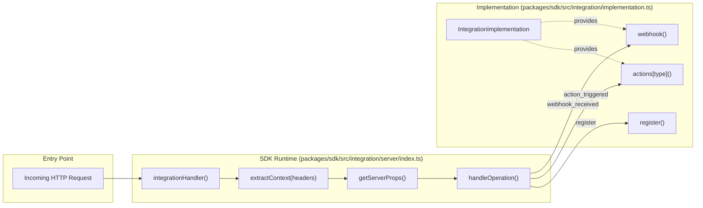

<!-- source: DeepWiki mcp.deepwiki.com · repo botpress/botpress · page 4.1 Integration Definition · fetched 2026-10-27 -->

# Integration Definition

<details>
<summary>Relevant source files</summary>

The following files were used as context for generating this wiki page:

- [integrations/github/src/misc/error-handling.ts](integrations/github/src/misc/error-handling.ts)
- [integrations/whatsapp/src/webhook/handlers/oauth/index.ts](integrations/whatsapp/src/webhook/handlers/oauth/index.ts)
- [interfaces/creatable/interface.definition.ts](interfaces/creatable/interface.definition.ts)
- [interfaces/deletable/interface.definition.ts](interfaces/deletable/interface.definition.ts)
- [interfaces/files-readonly/interface.definition.ts](interfaces/files-readonly/interface.definition.ts)
- [interfaces/listable/interface.definition.ts](interfaces/listable/interface.definition.ts)
- [interfaces/readable/interface.definition.ts](interfaces/readable/interface.definition.ts)
- [interfaces/speech-to-text/interface.definition.ts](interfaces/speech-to-text/interface.definition.ts)
- [interfaces/text-to-image/interface.definition.ts](interfaces/text-to-image/interface.definition.ts)
- [interfaces/typing-indicator/interface.definition.ts](interfaces/typing-indicator/interface.definition.ts)
- [interfaces/typing-indicator/package.json](interfaces/typing-indicator/package.json)
- [interfaces/typing-indicator/tsconfig.json](interfaces/typing-indicator/tsconfig.json)
- [interfaces/updatable/interface.definition.ts](interfaces/updatable/interface.definition.ts)
- [packages/common/src/error-handling/try-catch-wrapper.test.ts](packages/common/src/error-handling/try-catch-wrapper.test.ts)
- [packages/common/src/error-handling/try-catch-wrapper.ts](packages/common/src/error-handling/try-catch-wrapper.ts)
- [packages/common/src/html-dialogs/components/index.ts](packages/common/src/html-dialogs/components/index.ts)
- [packages/common/src/html-dialogs/components/pages/form-dialog.tsx](packages/common/src/html-dialogs/components/pages/form-dialog.tsx)
- [packages/common/src/html-dialogs/components/pages/input-dialog.tsx](packages/common/src/html-dialogs/components/pages/input-dialog.tsx)
- [packages/common/src/html-dialogs/index.ts](packages/common/src/html-dialogs/index.ts)
- [packages/common/src/oauth-wizard/consts.ts](packages/common/src/oauth-wizard/consts.ts)
- [packages/common/src/oauth-wizard/index.ts](packages/common/src/oauth-wizard/index.ts)
- [packages/common/src/oauth-wizard/schema-to-fields.ts](packages/common/src/oauth-wizard/schema-to-fields.ts)
- [packages/common/src/oauth-wizard/types.ts](packages/common/src/oauth-wizard/types.ts)
- [packages/common/src/oauth-wizard/wizard-handler.ts](packages/common/src/oauth-wizard/wizard-handler.ts)
- [packages/common/tsconfig.json](packages/common/tsconfig.json)
- [packages/sdk/src/bot/definition.ts](packages/sdk/src/bot/definition.ts)
- [packages/sdk/src/integration/definition/index.ts](packages/sdk/src/integration/definition/index.ts)
- [packages/sdk/src/integration/implementation.ts](packages/sdk/src/integration/implementation.ts)
- [packages/sdk/src/integration/server/index.ts](packages/sdk/src/integration/server/index.ts)
- [packages/sdk/src/integration/server/types.ts](packages/sdk/src/integration/server/types.ts)
- [packages/sdk/src/interface/definition.ts](packages/sdk/src/interface/definition.ts)
- [packages/sdk/src/plugin/definition.ts](packages/sdk/src/plugin/definition.ts)

</details>


## Purpose and Scope

The Integration Definition is the declarative contract layer that defines an integration's public API, configuration schema, and runtime capabilities. It specifies what secrets are required, what actions can be called, what events can be emitted, what message types are supported, and what data entities exist. This definition serves as the interface between the Botpress platform and external services, providing the schema validation and type safety used by the SDK and CLI.

---

## IntegrationDefinition Structure

An integration definition is created by instantiating `IntegrationDefinition` from `@botpress/sdk`. This class centralizes the schemas for configuration, actions, channels, and events using the Zui (Zod-based) schema system.

### Core Metadata and Schema Map

```mermaid
graph TB
    IntegrationDefinition["IntegrationDefinition<br/>(packages/sdk/src/integration/definition/index.ts)"]
    
    subgraph "Core Metadata"
        Name["name: string"]
        Version["version: string"]
        Title["title: string"]
        Description["description: string"]
        Icon["icon: string"]
        Readme["readme: string"]
    end
    
    subgraph "Schema Definitions"
        Configuration["configuration/configurations<br/>(ConfigurationDefinition)"]
        Secrets["secrets<br/>(Record&lt;string, SecretDefinition&gt;)"]
        Entities["entities<br/>(Record&lt;string, EntityDefinition&gt;)"]
        Actions["actions<br/>(Record&lt;string, ActionDefinition&gt;)"]
        Events["events<br/>(Record&lt;string, EventDefinition&gt;)"]
        Channels["channels<br/>(Record&lt;string, ChannelDefinition&gt;)"]
        States["states<br/>(Record&lt;string, StateDefinition&gt;)"]
        User["user<br/>(UserDefinition)"]
    end
    
    subgraph "Runtime & Advanced"
        Identifier["identifier<br/>(extractScript, fallbackHandlerScript)"]
        Advanced["__advanced<br/>(SchemaTransformOptions, esbuild)"]
    end
    
    IntegrationDefinition --> Name
    IntegrationDefinition --> Version
    IntegrationDefinition --> Configuration
    IntegrationDefinition --> Secrets
    IntegrationDefinition --> Entities
    IntegrationDefinition --> Actions
    IntegrationDefinition --> Events
    IntegrationDefinition --> Channels
    IntegrationDefinition --> States
    IntegrationDefinition --> User
    IntegrationDefinition --> Identifier
    IntegrationDefinition --> Advanced
```



**Sources:** [packages/sdk/src/integration/definition/index.ts:27-86](), [packages/sdk/src/integration/definition/index.ts:178-203]()

---

## Configuration System

Integrations support two configuration approaches defined in `IntegrationDefinitionProps`:
1.  `configuration`: A single `ConfigurationDefinition` for straightforward setups.
2.  `configurations`: A record of `AdditionalConfigurationDefinition` for multi-mode setups (e.g., separating "OAuth" from "Manual API Key" setups).

### Configuration Components

| Property | Type | Description |
| :--- | :--- | :--- |
| `schema` | `z.ZuiObjectSchema` | The Zui schema defining the configuration fields. |
| `title` | `string` | Display name for the configuration mode. |
| `description` | `string` | Help text for the UI. |

**Sources:** [packages/sdk/src/integration/definition/index.ts:53-56](), [packages/sdk/src/integration/definition/types.ts:13-17]()

---

## Actions and Events

### Actions
Actions are remote procedures provided by the integration. The `ActionDefinition` requires an `input` schema and an `output` schema.
*   **Input/Output:** Defined using `SchemaDefinition<T>`, which wraps Zui schemas.
*   **Attributes:** Optional metadata used by the Botpress Studio to categorize or hide actions.

### Events
Events are payloads emitted by the integration (e.g., via webhooks). The `EventDefinition` includes a `schema` and optional `recurrence` settings for scheduled triggers.

```typescript
// Example Action Definition in SDK
export type ActionDefinition<TAction extends BaseActions[string] = BaseActions[string]> = {
  title?: string
  description?: string
  input: SchemaDefinition<TAction>
  output: SchemaDefinition<z.ZuiObjectOrRefSchema>
  attributes?: Record<string, string>
}
```

**Sources:** [packages/sdk/src/integration/definition/types.ts:34-40](), [packages/sdk/src/bot/definition.ts:71-77](), [packages/sdk/src/bot/definition.ts:44-50]()

---

## Channels and Messages

Channels represent the medium of communication (e.g., "dm", "group"). Each `ChannelDefinition` contains:
*   **Messages:** A map of message types (text, image, etc.) to their respective Zui schemas.
*   **Tags:** Metadata definitions for both `conversation` and `message` objects within that channel.

**Sources:** [packages/sdk/src/integration/definition/types.ts:25-32](), [packages/sdk/src/bot/definition.ts:58-64]()

---

## Runtime Lifecycle & Handlers

The `IntegrationImplementation` class manages the runtime logic associated with a definition. It maps the declarative schemas to executable functions.

### Lifecycle Operations

| Operation | Trigger | Purpose |
| :--- | :--- | :--- |
| `register` | Integration enabled | Perform setup (e.g., creating webhooks on the external service). |
| `unregister` | Integration disabled | Perform cleanup (e.g., deleting webhooks). |
| `handler` | Webhook received | Process incoming HTTP requests from external services. |
| `actions` | Bot/User call | Execute logic for a specific defined action. |

### Data Flow: Request to Handler



**Sources:** [packages/sdk/src/integration/server/index.ts:70-92](), [packages/sdk/src/integration/server/index.ts:94-125](), [packages/sdk/src/integration/implementation.ts:36-65]()

---

## OAuth Wizard System

For integrations requiring complex authentication, the `OAuthWizard` provides a structured way to handle multi-step UI flows (choices, inputs, forms) during the registration phase.

*   **WizardStep:** A discrete step in the authentication flow.
*   **Responses:** The wizard can return `displayChoices`, `displayForm`, or `redirectToExternalUrl` to guide the user through OAuth.
*   **Integration Identifier:** The `setIntegrationIdentifier` function allows the wizard to tag the integration instance with a unique ID (like a workspace ID) using the `x-bp-integration-identifier` header.

**Sources:** [packages/common/src/oauth-wizard/wizard-handler.ts:9-23](), [packages/common/src/oauth-wizard/types.ts:30-74]()

---

## Error Handling

The SDK provides a `RuntimeError` class and utility wrappers to ensure errors occurring within integration handlers are properly logged and optionally redacted before being sent to the bot owner.

*   **`wrapAsyncFnWithTryCatch`**: Wraps integration functions to catch unhandled exceptions.
*   **`handlerErrorToHttpResponse`**: Converts caught errors into standard HTTP responses (e.g., 500 for internal errors).

**Sources:** [packages/common/src/error-handling/try-catch-wrapper.ts:138-144](), [packages/sdk/src/integration/server/index.ts:110-124]()

---

