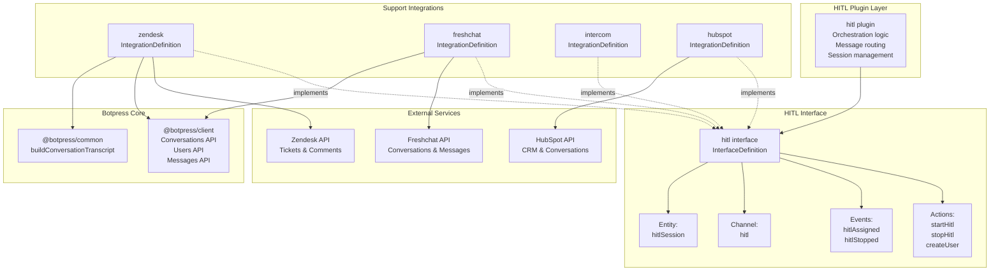
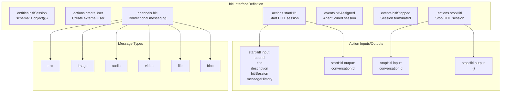
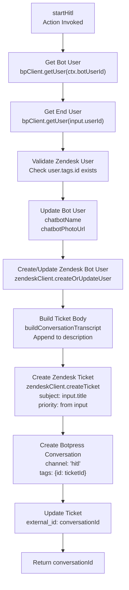
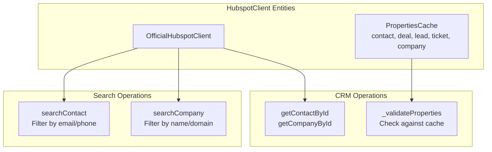

<!-- source: DeepWiki mcp.deepwiki.com · repo botpress/botpress · page 4.4 Support & CRM Integrations · fetched 2026-10-27 -->

# Support & CRM Integrations

Relevant source files

The following files were used as context for generating this wiki page:

- [bots/hit-looper/bot.definition.ts](bots/hit-looper/bot.definition.ts)
- [bots/hit-looper/src/api-utils.ts](bots/hit-looper/src/api-utils.ts)
- [bots/hit-looper/src/index.ts](bots/hit-looper/src/index.ts)
- [integrations/freshchat/integration.definition.ts](integrations/freshchat/integration.definition.ts)
- [integrations/freshchat/package.json](integrations/freshchat/package.json)
- [integrations/freshchat/src/actions/hitl.ts](integrations/freshchat/src/actions/hitl.ts)
- [integrations/freshchat/src/channels.ts](integrations/freshchat/src/channels.ts)
- [integrations/freshchat/src/client.ts](integrations/freshchat/src/client.ts)
- [integrations/freshchat/src/definitions/freshchat-events.ts](integrations/freshchat/src/definitions/freshchat-events.ts)
- [integrations/freshchat/src/definitions/index.ts](integrations/freshchat/src/definitions/index.ts)
- [integrations/freshchat/src/definitions/schemas.ts](integrations/freshchat/src/definitions/schemas.ts)
- [integrations/freshchat/src/events/conversationAssignment.ts](integrations/freshchat/src/events/conversationAssignment.ts)
- [integrations/freshchat/src/events/messageCreate.ts](integrations/freshchat/src/events/messageCreate.ts)
- [integrations/freshchat/src/handler.ts](integrations/freshchat/src/handler.ts)
- [integrations/freshchat/src/util.ts](integrations/freshchat/src/util.ts)
- [integrations/hubspot/definitions/actions/company.ts](integrations/hubspot/definitions/actions/company.ts)
- [integrations/hubspot/definitions/actions/contact.ts](integrations/hubspot/definitions/actions/contact.ts)
- [integrations/hubspot/definitions/actions/deal.ts](integrations/hubspot/definitions/actions/deal.ts)
- [integrations/hubspot/definitions/actions/file.ts](integrations/hubspot/definitions/actions/file.ts)
- [integrations/hubspot/definitions/actions/index.ts](integrations/hubspot/definitions/actions/index.ts)
- [integrations/hubspot/definitions/actions/lead.ts](integrations/hubspot/definitions/actions/lead.ts)
- [integrations/hubspot/definitions/actions/owner.ts](integrations/hubspot/definitions/actions/owner.ts)
- [integrations/hubspot/definitions/actions/ticket.ts](integrations/hubspot/definitions/actions/ticket.ts)
- [integrations/hubspot/definitions/events.ts](integrations/hubspot/definitions/events.ts)
- [integrations/hubspot/definitions/index.ts](integrations/hubspot/definitions/index.ts)
- [integrations/hubspot/definitions/states.ts](integrations/hubspot/definitions/states.ts)
- [integrations/hubspot/hub.md](integrations/hubspot/hub.md)
- [integrations/hubspot/integration.definition.ts](integrations/hubspot/integration.definition.ts)
- [integrations/hubspot/linkTemplate.vrl](integrations/hubspot/linkTemplate.vrl)
- [integrations/hubspot/src/actions/company.ts](integrations/hubspot/src/actions/company.ts)
- [integrations/hubspot/src/actions/contact.ts](integrations/hubspot/src/actions/contact.ts)
- [integrations/hubspot/src/actions/deal.ts](integrations/hubspot/src/actions/deal.ts)
- [integrations/hubspot/src/actions/file.ts](integrations/hubspot/src/actions/file.ts)
- [integrations/hubspot/src/actions/index.ts](integrations/hubspot/src/actions/index.ts)
- [integrations/hubspot/src/actions/lead.ts](integrations/hubspot/src/actions/lead.ts)
- [integrations/hubspot/src/actions/owner.ts](integrations/hubspot/src/actions/owner.ts)
- [integrations/hubspot/src/actions/ticket.ts](integrations/hubspot/src/actions/ticket.ts)
- [integrations/hubspot/src/auth.ts](integrations/hubspot/src/auth.ts)
- [integrations/hubspot/src/hubspot-api/hubspot-client.ts](integrations/hubspot/src/hubspot-api/hubspot-client.ts)
- [integrations/hubspot/src/setup.ts](integrations/hubspot/src/setup.ts)
- [integrations/hubspot/src/utils.ts](integrations/hubspot/src/utils.ts)
- [integrations/hubspot/src/webhook/handler.ts](integrations/hubspot/src/webhook/handler.ts)
- [integrations/hubspot/src/webhook/handlers/index.ts](integrations/hubspot/src/webhook/handlers/index.ts)
- [integrations/hubspot/src/webhook/handlers/oauth-wizard.ts](integrations/hubspot/src/webhook/handlers/oauth-wizard.ts)
- [integrations/instagram/package.json](integrations/instagram/package.json)
- [integrations/intercom/integration.definition.ts](integrations/intercom/integration.definition.ts)
- [integrations/intercom/package.json](integrations/intercom/package.json)
- [integrations/intercom/src/auth.ts](integrations/intercom/src/auth.ts)
- [integrations/intercom/src/index.ts](integrations/intercom/src/index.ts)
- [integrations/line/package.json](integrations/line/package.json)
- [integrations/messenger/package.json](integrations/messenger/package.json)
- [integrations/sunco/definitions/index.ts](integrations/sunco/definitions/index.ts)
- [integrations/sunco/src/events/conversation-created.ts](integrations/sunco/src/events/conversation-created.ts)
- [integrations/sunco/src/events/conversation-message.ts](integrations/sunco/src/events/conversation-message.ts)
- [integrations/sunco/src/handler.ts](integrations/sunco/src/handler.ts)
- [integrations/viber/package.json](integrations/viber/package.json)
- [integrations/vonage/package.json](integrations/vonage/package.json)
- [integrations/webhook/package.json](integrations/webhook/package.json)
- [integrations/zapier/package.json](integrations/zapier/package.json)
- [integrations/zendesk-messaging-hitl/hub.md](integrations/zendesk-messaging-hitl/hub.md)
- [integrations/zendesk-messaging-hitl/integration.definition.ts](integrations/zendesk-messaging-hitl/integration.definition.ts)
- [integrations/zendesk-messaging-hitl/package.json](integrations/zendesk-messaging-hitl/package.json)
- [integrations/zendesk-messaging-hitl/src/actions/hitl.ts](integrations/zendesk-messaging-hitl/src/actions/hitl.ts)
- [integrations/zendesk-messaging-hitl/src/channels.ts](integrations/zendesk-messaging-hitl/src/channels.ts)
- [integrations/zendesk-messaging-hitl/src/client.ts](integrations/zendesk-messaging-hitl/src/client.ts)
- [integrations/zendesk-messaging-hitl/src/handler.ts](integrations/zendesk-messaging-hitl/src/handler.ts)
- [integrations/zendesk-messaging-hitl/src/setup/index.ts](integrations/zendesk-messaging-hitl/src/setup/index.ts)
- [integrations/zendesk-messaging-hitl/src/setup/register.ts](integrations/zendesk-messaging-hitl/src/setup/register.ts)
- [integrations/zendesk-messaging-hitl/src/sunshine-api.ts](integrations/zendesk-messaging-hitl/src/sunshine-api.ts)
- [integrations/zendesk/hub.md](integrations/zendesk/hub.md)
- [integrations/zendesk/integration.definition.ts](integrations/zendesk/integration.definition.ts)
- [integrations/zendesk/src/actions/call-api.ts](integrations/zendesk/src/actions/call-api.ts)
- [integrations/zendesk/src/actions/close-ticket.ts](integrations/zendesk/src/actions/close-ticket.ts)
- [integrations/zendesk/src/actions/create-ticket.ts](integrations/zendesk/src/actions/create-ticket.ts)
- [integrations/zendesk/src/actions/create-user.ts](integrations/zendesk/src/actions/create-user.ts)
- [integrations/zendesk/src/actions/find-customer.ts](integrations/zendesk/src/actions/find-customer.ts)
- [integrations/zendesk/src/actions/get-ticket.ts](integrations/zendesk/src/actions/get-ticket.ts)
- [integrations/zendesk/src/actions/hitl.ts](integrations/zendesk/src/actions/hitl.ts)
- [integrations/zendesk/src/actions/index.ts](integrations/zendesk/src/actions/index.ts)
- [integrations/zendesk/src/actions/list-agents.ts](integrations/zendesk/src/actions/list-agents.ts)
- [integrations/zendesk/src/actions/sync-kb.ts](integrations/zendesk/src/actions/sync-kb.ts)
- [integrations/zendesk/src/channels.ts](integrations/zendesk/src/channels.ts)
- [integrations/zendesk/src/client.ts](integrations/zendesk/src/client.ts)
- [integrations/zendesk/src/definitions/actions.ts](integrations/zendesk/src/definitions/actions.ts)
- [integrations/zendesk/src/definitions/channels.ts](integrations/zendesk/src/definitions/channels.ts)
- [integrations/zendesk/src/definitions/index.ts](integrations/zendesk/src/definitions/index.ts)
- [integrations/zendesk/src/definitions/schemas.ts](integrations/zendesk/src/definitions/schemas.ts)
- [integrations/zendesk/src/events/article-published.ts](integrations/zendesk/src/events/article-published.ts)
- [integrations/zendesk/src/events/hitl-ticket-filter.ts](integrations/zendesk/src/events/hitl-ticket-filter.ts)
- [integrations/zendesk/src/events/message-received.ts](integrations/zendesk/src/events/message-received.ts)
- [integrations/zendesk/src/events/ticket-assigned.ts](integrations/zendesk/src/events/ticket-assigned.ts)
- [integrations/zendesk/src/events/ticket-solved.ts](integrations/zendesk/src/events/ticket-solved.ts)
- [integrations/zendesk/src/handler.ts](integrations/zendesk/src/handler.ts)
- [integrations/zendesk/src/misc/axios-utils.ts](integrations/zendesk/src/misc/axios-utils.ts)
- [integrations/zendesk/src/misc/upload-articles-to-kb.ts](integrations/zendesk/src/misc/upload-articles-to-kb.ts)
- [integrations/zendesk/src/misc/utils.ts](integrations/zendesk/src/misc/utils.ts)
- [integrations/zendesk/src/setup.ts](integrations/zendesk/src/setup.ts)
- [integrations/zendesk/src/triggers.ts](integrations/zendesk/src/triggers.ts)
- [integrations/zendesk/src/webhookEvents.ts](integrations/zendesk/src/webhookEvents.ts)
- [interfaces/hitl/interface.definition.ts](interfaces/hitl/interface.definition.ts)
- [packages/cli/src/code-generation/plugin-implementation/plugin-implementation.ts](packages/cli/src/code-generation/plugin-implementation/plugin-implementation.ts)

This document covers support and CRM integrations within the Botpress platform, focusing on Human-in-the-Loop (HITL) implementations that enable seamless handoff from bots to human agents. Support integrations include Zendesk, Freshchat, Intercom, HubSpot, and Salesforce, which implement the `hitl` interface for ticket/conversation management and agent assignment.

For information about AI/LLM integrations, see [LLM Integrations](#4.2). For messaging platform integrations, see [Messaging Integrations](#4.3). For HITL plugin orchestration, see [HITL Plugin](#5.2).

## Overview

Support and CRM integrations enable bots to escalate conversations to human agents through external ticketing and support systems. These integrations implement the `hitl` interface, providing a standardized contract for HITL operations including session creation, agent assignment, bidirectional message routing, and session termination.

**Architecture: Support Integrations and HITL Interface**

Sources: [interfaces/hitl/interface.definition.ts:43-202](), [integrations/zendesk/integration.definition.ts:5-77](), [integrations/freshchat/integration.definition.ts:6-35](), [integrations/hubspot/integration.definition.ts:5-105]()

## HITL Interface Contract

The `hitl` interface defines a standardized contract that all support integrations must implement. This ensures interoperability between different support platforms and the HITL plugin.

### Interface Definition Structure

**HITL Interface Components**

Sources: [interfaces/hitl/interface.definition.ts:43-202]()

### Entity Schema

The `hitlSession` entity is extensible, allowing integrations to add platform-specific configuration:

| Integration | Entity Name | Custom Fields |
|------------|-------------|---------------|
| Zendesk | `hitlTicket` | `priority`, `chatbotName`, `chatbotPhotoUrl`, `requesterEmail`, `ticketFormId` |
| Freshchat | `hitlConversation` | `priority` |
| HubSpot | `ticket` | `inboxId` |

The base `hitlSession` schema is empty (`z.object({})`), enabling each integration to extend it with platform-specific properties. Integrations map their custom entity to `hitlSession` using the `.extend()` method.

Sources: [interfaces/hitl/interface.definition.ts:47-52](), [integrations/zendesk/integration.definition.ts:31-71](), [integrations/freshchat/integration.definition.ts:19-30](), [integrations/hubspot/integration.definition.ts:59-64]()

### Action Definitions

The `startHitl` action accepts a `messageHistory` array containing all prior conversation messages. Each message includes a `source` (identifying if the sender is a `'user'` or `'bot'`), a `type` (e.g., `'text'`, `'image'`), and the actual `payload`.

Sources: [interfaces/hitl/interface.definition.ts:21-41](), [interfaces/hitl/interface.definition.ts:113-165]()

### Event Definitions

Support integrations emit events to notify the bot of HITL lifecycle changes:

| Event | Payload | Description |
|-------|---------|-------------|
| `hitlAssigned` | `conversationId`, `userId` | Agent joined HITL session |
| `hitlStopped` | `conversationId` | HITL session terminated |

Sources: [interfaces/hitl/interface.definition.ts:53-86]()

## Zendesk Integration

The Zendesk integration implements HITL through Zendesk's ticketing system, creating tickets for HITL sessions and routing messages via ticket comments.

### HITL Action Implementation

**startHitl Action Flow**

Sources: [integrations/zendesk/src/actions/hitl.ts:6-65]()

### Zendesk API Client

The `ZendeskApi` class handles communication with the Zendesk V2 API. It includes specialized methods for ticket management and user synchronization.

| Function | Purpose |
|----------|---------|
| `createTicket` | Creates a new ticket with a subject, comment, and requester. |
| `updateTicket` | Updates ticket fields, including status and `external_id`. |
| `createPlaintextComment` | Adds a comment to a ticket and extracts the `zendeskCommentId`. |
| `createOrUpdateUser` | Syncs Botpress user data to Zendesk users. |

Sources: [integrations/zendesk/src/client.ts:71-91](), [integrations/zendesk/src/client.ts:137-146](), [integrations/zendesk/src/client.ts:158-176](), [integrations/zendesk/src/client.ts:185-192]()

## HubSpot Integration

HubSpot implementation focuses on CRM entities (Contacts, Companies, Deals) and HITL via HubSpot's Conversations/Inbox system.

### HITL Extension

The HubSpot integration extends the `hitl` interface by mapping its `ticket` entity to `hitlSession`. It uses custom tags on the HITL channel to track HubSpot thread IDs and integration thread IDs.

| Tag | Description |
|-----|-------------|
| `id` | The HubSpot conversations thread ID. |
| `integrationThreadId` | UUID used for custom channel messages in HubSpot. |
| `inboxId` | The specific HubSpot inbox used for the session. |

Sources: [integrations/hubspot/integration.definition.ts:106-130]()

### HubSpot API Client

The `HubspotClient` uses the official `@hubspot/api-client` and implements advanced features like property caching and search filters.

Sources: [integrations/hubspot/src/hubspot-api/hubspot-client.ts:60-94](), [integrations/hubspot/src/hubspot-api/hubspot-client.ts:103-151](), [integrations/hubspot/src/hubspot-api/hubspot-client.ts:163-216]()

## Intercom Integration

The Intercom integration enables real-time engagement. It handles user and conversation identification through specific tags and state management.

### Integration Lifecycle

During `register`, the integration retrieves the `adminId` (the bot's ID in Intercom) and stores it in the `credentials` state. It also tags the Botpress bot user with this Intercom ID.

Sources: [integrations/intercom/src/index.ts:9-22]()

### Configuration & State

Intercom requires an `accessToken` and an optional `adminId`. The `credentials` state is used to persist these values for use in handlers and actions.

| State | Fields |
|-------|--------|
| `credentials` | `adminId`, `accessToken` |

Sources: [integrations/intercom/integration.definition.ts:12-22](), [integrations/intercom/integration.definition.ts:94-102]()

## Common Implementation Details

### User Creation (`createUser`)

Support integrations implement `createUser` to ensure the end-user exists in the external system before starting a HITL session. For example, in Zendesk, this involves:
1. Creating/Retrieving a Botpress user via `getOrCreateUser`.
2. Syncing that user to Zendesk via `createOrUpdateUser`.
3. Updating the Botpress user with the Zendesk ID tag.

Sources: [integrations/zendesk/src/actions/create-user.ts:4-54]()

### Message History Formatting

Integrations use `buildConversationTranscript` to provide agents with context. This function converts the `messageHistory` array from the `startHitl` input into a readable text format.

Sources: [integrations/zendesk/src/actions/hitl.ts:88-96]()

---

