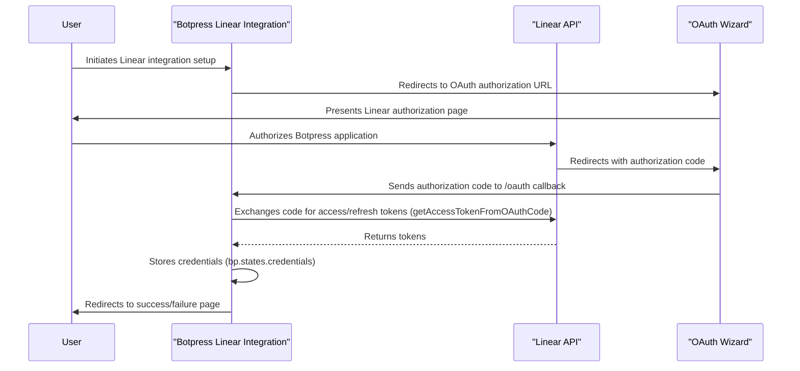

<!-- source: DeepWiki mcp.deepwiki.com · repo botpress/botpress · page 4.5 Productivity & Data Integrations · fetched 2026-10-27 -->

# Productivity & Data Integrations

<details>
<summary>Relevant source files</summary>

The following files were used as context for generating this wiki page:

- [.greptile/config.json](.greptile/config.json)
- [.prettierignore](.prettierignore)
- [bots/sheetzy/src/bot.ts](bots/sheetzy/src/bot.ts)
- [bots/sheetzy/src/commands.ts](bots/sheetzy/src/commands.ts)
- [integrations/airtable/integration.definition.ts](integrations/airtable/integration.definition.ts)
- [integrations/airtable/linkTemplate.vrl](integrations/airtable/linkTemplate.vrl)
- [integrations/airtable/package.json](integrations/airtable/package.json)
- [integrations/airtable/src/actions/record.ts](integrations/airtable/src/actions/record.ts)
- [integrations/airtable/src/actions/table.ts](integrations/airtable/src/actions/table.ts)
- [integrations/airtable/src/airtable-api/airtable-client.ts](integrations/airtable/src/airtable-api/airtable-client.ts)
- [integrations/airtable/src/airtable-api/airtable-oauth-client.ts](integrations/airtable/src/airtable-api/airtable-oauth-client.ts)
- [integrations/airtable/src/api/error-handling.ts](integrations/airtable/src/api/error-handling.ts)
- [integrations/airtable/src/index.ts](integrations/airtable/src/index.ts)
- [integrations/airtable/src/misc/custom-schemas.ts](integrations/airtable/src/misc/custom-schemas.ts)
- [integrations/airtable/src/misc/field-schemas.ts](integrations/airtable/src/misc/field-schemas.ts)
- [integrations/airtable/src/misc/sub-schemas.ts](integrations/airtable/src/misc/sub-schemas.ts)
- [integrations/airtable/src/misc/types.ts](integrations/airtable/src/misc/types.ts)
- [integrations/airtable/src/oauth-wizard/index.ts](integrations/airtable/src/oauth-wizard/index.ts)
- [integrations/airtable/src/oauth-wizard/wizard.ts](integrations/airtable/src/oauth-wizard/wizard.ts)
- [integrations/airtable/tsconfig.json](integrations/airtable/tsconfig.json)
- [integrations/bamboohr/definitions/actions.ts](integrations/bamboohr/definitions/actions.ts)
- [integrations/bamboohr/definitions/bamboohr-schemas.ts](integrations/bamboohr/definitions/bamboohr-schemas.ts)
- [integrations/bamboohr/definitions/common.ts](integrations/bamboohr/definitions/common.ts)
- [integrations/bamboohr/definitions/events.ts](integrations/bamboohr/definitions/events.ts)
- [integrations/bamboohr/definitions/index.ts](integrations/bamboohr/definitions/index.ts)
- [integrations/bamboohr/hub.md](integrations/bamboohr/hub.md)
- [integrations/bamboohr/icon.svg](integrations/bamboohr/icon.svg)
- [integrations/bamboohr/integration.definition.ts](integrations/bamboohr/integration.definition.ts)
- [integrations/bamboohr/linkTemplate.vrl](integrations/bamboohr/linkTemplate.vrl)
- [integrations/bamboohr/src/actions/company.ts](integrations/bamboohr/src/actions/company.ts)
- [integrations/bamboohr/src/actions/employees.ts](integrations/bamboohr/src/actions/employees.ts)
- [integrations/bamboohr/src/actions/index.ts](integrations/bamboohr/src/actions/index.ts)
- [integrations/bamboohr/src/api/auth.ts](integrations/bamboohr/src/api/auth.ts)
- [integrations/bamboohr/src/api/bamboohr-client.ts](integrations/bamboohr/src/api/bamboohr-client.ts)
- [integrations/bamboohr/src/api/signing.ts](integrations/bamboohr/src/api/signing.ts)
- [integrations/bamboohr/src/api/utils.ts](integrations/bamboohr/src/api/utils.ts)
- [integrations/bamboohr/src/events.ts](integrations/bamboohr/src/events.ts)
- [integrations/bamboohr/src/index.ts](integrations/bamboohr/src/index.ts)
- [integrations/bamboohr/src/wizard.ts](integrations/bamboohr/src/wizard.ts)
- [integrations/browser/integration.definition.ts](integrations/browser/integration.definition.ts)
- [integrations/browser/package.json](integrations/browser/package.json)
- [integrations/browser/src/actions/browse-pages.ts](integrations/browser/src/actions/browse-pages.ts)
- [integrations/browser/src/actions/capture-screenshot.ts](integrations/browser/src/actions/capture-screenshot.ts)
- [integrations/browser/src/actions/discover-urls.ts](integrations/browser/src/actions/discover-urls.ts)
- [integrations/browser/src/actions/get-website-logo.ts](integrations/browser/src/actions/get-website-logo.ts)
- [integrations/browser/src/actions/web-search.ts](integrations/browser/src/actions/web-search.ts)
- [integrations/browser/src/definitions/actions.ts](integrations/browser/src/definitions/actions.ts)
- [integrations/browser/src/index.ts](integrations/browser/src/index.ts)
- [integrations/browser/src/tracking.ts](integrations/browser/src/tracking.ts)
- [integrations/browser/src/utils/globs.test.ts](integrations/browser/src/utils/globs.test.ts)
- [integrations/browser/src/utils/globs.ts](integrations/browser/src/utils/globs.ts)
- [integrations/calendly/integration.definition.ts](integrations/calendly/integration.definition.ts)
- [integrations/calendly/src/calendly-api/auth.ts](integrations/calendly/src/calendly-api/auth.ts)
- [integrations/charts/package.json](integrations/charts/package.json)
- [integrations/chat/src/metrics-server.ts](integrations/chat/src/metrics-server.ts)
- [integrations/confluence/integration.definition.ts](integrations/confluence/integration.definition.ts)
- [integrations/confluence/package.json](integrations/confluence/package.json)
- [integrations/confluence/src/actions/implementations/list-items-in-folder.ts](integrations/confluence/src/actions/implementations/list-items-in-folder.ts)
- [integrations/confluence/src/actions/implementations/transfer-file-to-botpress.ts](integrations/confluence/src/actions/implementations/transfer-file-to-botpress.ts)
- [integrations/confluence/src/actions/index.ts](integrations/confluence/src/actions/index.ts)
- [integrations/confluence/src/channels/index.ts](integrations/confluence/src/channels/index.ts)
- [integrations/confluence/src/channels/publishers/page-comment.ts](integrations/confluence/src/channels/publishers/page-comment.ts)
- [integrations/confluence/src/client.ts](integrations/confluence/src/client.ts)
- [integrations/confluence/src/index.ts](integrations/confluence/src/index.ts)
- [integrations/confluence/src/parser/markdownToHtml.ts](integrations/confluence/src/parser/markdownToHtml.ts)
- [integrations/github/integration.definition.ts](integrations/github/integration.definition.ts)
- [integrations/github/linkTemplate.vrl](integrations/github/linkTemplate.vrl)
- [integrations/github/package.json](integrations/github/package.json)
- [integrations/github/src/actions/find-target.ts](integrations/github/src/actions/find-target.ts)
- [integrations/github/src/definitions/actions.ts](integrations/github/src/definitions/actions.ts)
- [integrations/github/src/definitions/index.ts](integrations/github/src/definitions/index.ts)
- [integrations/github/src/handler.ts](integrations/github/src/handler.ts)
- [integrations/github/src/misc/github-client.ts](integrations/github/src/misc/github-client.ts)
- [integrations/github/src/setup.ts](integrations/github/src/setup.ts)
- [integrations/github/tsconfig.json](integrations/github/tsconfig.json)
- [integrations/gmail/definitions/channels.ts](integrations/gmail/definitions/channels.ts)
- [integrations/gmail/definitions/configuration.ts](integrations/gmail/definitions/configuration.ts)
- [integrations/gmail/definitions/events.ts](integrations/gmail/definitions/events.ts)
- [integrations/gmail/definitions/index.ts](integrations/gmail/definitions/index.ts)
- [integrations/gmail/definitions/secrets.ts](integrations/gmail/definitions/secrets.ts)
- [integrations/gmail/definitions/states.ts](integrations/gmail/definitions/states.ts)
- [integrations/gmail/definitions/user-tags.ts](integrations/gmail/definitions/user-tags.ts)
- [integrations/gmail/hub.md](integrations/gmail/hub.md)
- [integrations/gmail/integration.definition.ts](integrations/gmail/integration.definition.ts)
- [integrations/gmail/linkTemplate.vrl](integrations/gmail/linkTemplate.vrl)
- [integrations/gmail/package.json](integrations/gmail/package.json)
- [integrations/gmail/src/channels/channel-wrapper.ts](integrations/gmail/src/channels/channel-wrapper.ts)
- [integrations/gmail/src/channels/channels.ts](integrations/gmail/src/channels/channels.ts)
- [integrations/gmail/src/config/integration-config.ts](integrations/gmail/src/config/integration-config.ts)
- [integrations/gmail/src/google-api/google-client.ts](integrations/gmail/src/google-api/google-client.ts)
- [integrations/gmail/src/google-api/index.ts](integrations/gmail/src/google-api/index.ts)
- [integrations/gmail/src/google-api/jwt-validation.ts](integrations/gmail/src/google-api/jwt-validation.ts)
- [integrations/gmail/src/index.ts](integrations/gmail/src/index.ts)
- [integrations/gmail/src/setup.ts](integrations/gmail/src/setup.ts)
- [integrations/gmail/src/utils/datetime-utils.ts](integrations/gmail/src/utils/datetime-utils.ts)
- [integrations/gmail/src/utils/mail-composing.tsx](integrations/gmail/src/utils/mail-composing.tsx)
- [integrations/gmail/src/webhook-events/handler.ts](integrations/gmail/src/webhook-events/handler.ts)
- [integrations/gmail/src/webhook-events/new-mail.ts](integrations/gmail/src/webhook-events/new-mail.ts)
- [integrations/gmail/src/webhook-events/oauth-callback.ts](integrations/gmail/src/webhook-events/oauth-callback.ts)
- [integrations/gmail/tsconfig.json](integrations/gmail/tsconfig.json)
- [integrations/googlecalendar/definitions/secrets.ts](integrations/googlecalendar/definitions/secrets.ts)
- [integrations/googlecalendar/definitions/states.ts](integrations/googlecalendar/definitions/states.ts)
- [integrations/googlecalendar/hub.md](integrations/googlecalendar/hub.md)
- [integrations/googlecalendar/integration.definition.ts](integrations/googlecalendar/integration.definition.ts)
- [integrations/googlecalendar/src/actions/implementations/check-availability.ts](integrations/googlecalendar/src/actions/implementations/check-availability.ts)
- [integrations/googlecalendar/src/google-api/error-handling.ts](integrations/googlecalendar/src/google-api/error-handling.ts)
- [integrations/googlecalendar/src/index.ts](integrations/googlecalendar/src/index.ts)
- [integrations/googlecalendar/src/webhook-events/handler-dispatcher.ts](integrations/googlecalendar/src/webhook-events/handler-dispatcher.ts)
- [integrations/googlecalendar/src/webhook-events/index.ts](integrations/googlecalendar/src/webhook-events/index.ts)
- [integrations/googledrive/hub.md](integrations/googledrive/hub.md)
- [integrations/googledrive/integration.definition.ts](integrations/googledrive/integration.definition.ts)
- [integrations/googledrive/package.json](integrations/googledrive/package.json)
- [integrations/googledrive/src/actions.ts](integrations/googledrive/src/actions.ts)
- [integrations/googledrive/src/client.ts](integrations/googledrive/src/client.ts)
- [integrations/googledrive/src/error-handling.ts](integrations/googledrive/src/error-handling.ts)
- [integrations/googledrive/src/file-channels-cache.ts](integrations/googledrive/src/file-channels-cache.ts)
- [integrations/googledrive/src/file-event-handler.ts](integrations/googledrive/src/file-event-handler.ts)
- [integrations/googledrive/src/file-notification-token.ts](integrations/googledrive/src/file-notification-token.ts)
- [integrations/googledrive/src/files-cache.ts](integrations/googledrive/src/files-cache.ts)
- [integrations/googledrive/src/handler.ts](integrations/googledrive/src/handler.ts)
- [integrations/googledrive/src/mime-types.ts](integrations/googledrive/src/mime-types.ts)
- [integrations/googledrive/src/notification-handler.ts](integrations/googledrive/src/notification-handler.ts)
- [integrations/googledrive/src/schemas.ts](integrations/googledrive/src/schemas.ts)
- [integrations/googledrive/src/types.ts](integrations/googledrive/src/types.ts)
- [integrations/googledrive/src/utils.ts](integrations/googledrive/src/utils.ts)
- [integrations/googledrive/src/validation.ts](integrations/googledrive/src/validation.ts)
- [integrations/gsheets/definitions/actions.ts](integrations/gsheets/definitions/actions.ts)
- [integrations/gsheets/definitions/configuration.ts](integrations/gsheets/definitions/configuration.ts)
- [integrations/gsheets/definitions/events.ts](integrations/gsheets/definitions/events.ts)
- [integrations/gsheets/definitions/secrets.ts](integrations/gsheets/definitions/secrets.ts)
- [integrations/gsheets/definitions/states.ts](integrations/gsheets/definitions/states.ts)
- [integrations/gsheets/hub.md](integrations/gsheets/hub.md)
- [integrations/gsheets/integration.definition.ts](integrations/gsheets/integration.definition.ts)
- [integrations/gsheets/linkTemplate.vrl](integrations/gsheets/linkTemplate.vrl)
- [integrations/gsheets/package.json](integrations/gsheets/package.json)
- [integrations/gsheets/src/actions/action-wrapper.ts](integrations/gsheets/src/actions/action-wrapper.ts)
- [integrations/gsheets/src/actions/implementations/add-sheet.ts](integrations/gsheets/src/actions/implementations/add-sheet.ts)
- [integrations/gsheets/src/actions/implementations/append-values-utils.ts](integrations/gsheets/src/actions/implementations/append-values-utils.ts)
- [integrations/gsheets/src/actions/implementations/append-values.test.ts](integrations/gsheets/src/actions/implementations/append-values.test.ts)
- [integrations/gsheets/src/actions/implementations/append-values.ts](integrations/gsheets/src/actions/implementations/append-values.ts)
- [integrations/gsheets/src/actions/implementations/clear-values.ts](integrations/gsheets/src/actions/implementations/clear-values.ts)
- [integrations/gsheets/src/actions/implementations/get-info-spread-sheet.ts](integrations/gsheets/src/actions/implementations/get-info-spread-sheet.ts)
- [integrations/gsheets/src/actions/implementations/get-values.ts](integrations/gsheets/src/actions/implementations/get-values.ts)
- [integrations/gsheets/src/actions/implementations/set-values.ts](integrations/gsheets/src/actions/implementations/set-values.ts)
- [integrations/gsheets/src/actions/index.ts](integrations/gsheets/src/actions/index.ts)
- [integrations/gsheets/src/google-api/error-handling.ts](integrations/gsheets/src/google-api/error-handling.ts)
- [integrations/gsheets/src/google-api/google-client.ts](integrations/gsheets/src/google-api/google-client.ts)
- [integrations/gsheets/src/google-api/oauth-client.ts](integrations/gsheets/src/google-api/oauth-client.ts)
- [integrations/gsheets/src/index.ts](integrations/gsheets/src/index.ts)
- [integrations/gsheets/src/setup.ts](integrations/gsheets/src/setup.ts)
- [integrations/gsheets/src/webhook-events/handler-dispatcher.ts](integrations/gsheets/src/webhook-events/handler-dispatcher.ts)
- [integrations/gsheets/src/webhook-events/handlers/oauth-callback.ts](integrations/gsheets/src/webhook-events/handlers/oauth-callback.ts)
- [integrations/gsheets/src/webhook-events/handlers/oauth-wizard.ts](integrations/gsheets/src/webhook-events/handlers/oauth-wizard.ts)
- [integrations/gsheets/tsconfig.json](integrations/gsheets/tsconfig.json)
- [integrations/jira/integration.definition.ts](integrations/jira/integration.definition.ts)
- [integrations/jira/readme.md](integrations/jira/readme.md)
- [integrations/jira/src/actions/add-attachment.ts](integrations/jira/src/actions/add-attachment.ts)
- [integrations/jira/src/actions/index.ts](integrations/jira/src/actions/index.ts)
- [integrations/jira/src/client/index.ts](integrations/jira/src/client/index.ts)
- [integrations/jira/src/definitions/actions.ts](integrations/jira/src/definitions/actions.ts)
- [integrations/jira/src/misc/custom-schemas.ts](integrations/jira/src/misc/custom-schemas.ts)
- [integrations/jira/src/oauth-wizard/index.ts](integrations/jira/src/oauth-wizard/index.ts)
- [integrations/jira/src/oauth-wizard/wizard.ts](integrations/jira/src/oauth-wizard/wizard.ts)
- [integrations/linear/definitions/states.ts](integrations/linear/definitions/states.ts)
- [integrations/linear/integration.definition.ts](integrations/linear/integration.definition.ts)
- [integrations/linear/linkTemplate.vrl](integrations/linear/linkTemplate.vrl)
- [integrations/linear/package.json](integrations/linear/package.json)
- [integrations/linear/src/handler.ts](integrations/linear/src/handler.ts)
- [integrations/linear/src/misc/linear.ts](integrations/linear/src/misc/linear.ts)
- [integrations/linear/src/misc/utils.ts](integrations/linear/src/misc/utils.ts)
- [integrations/linear/src/oauth-wizard.ts](integrations/linear/src/oauth-wizard.ts)
- [integrations/linear/src/setup.ts](integrations/linear/src/setup.ts)
- [integrations/linear/tsconfig.json](integrations/linear/tsconfig.json)
- [integrations/linkedin/integration.definition.ts](integrations/linkedin/integration.definition.ts)
- [integrations/linkedin/src/handler.ts](integrations/linkedin/src/handler.ts)
- [integrations/linkedin/src/setup.ts](integrations/linkedin/src/setup.ts)
- [integrations/mailchimp/integration.definition.ts](integrations/mailchimp/integration.definition.ts)
- [integrations/mailchimp/src/misc/custom-schemas.ts](integrations/mailchimp/src/misc/custom-schemas.ts)
- [integrations/mailchimp/src/misc/sub-schemas.ts](integrations/mailchimp/src/misc/sub-schemas.ts)
- [integrations/mailchimp/src/utils.ts](integrations/mailchimp/src/utils.ts)
- [integrations/monday/hub.md](integrations/monday/hub.md)
- [integrations/monday/integration.definition.ts](integrations/monday/integration.definition.ts)
- [integrations/monday/linkTemplate.vrl](integrations/monday/linkTemplate.vrl)
- [integrations/monday/package.json](integrations/monday/package.json)
- [integrations/monday/src/actions/index.ts](integrations/monday/src/actions/index.ts)
- [integrations/monday/src/index.ts](integrations/monday/src/index.ts)
- [integrations/monday/src/misc/auth.ts](integrations/monday/src/misc/auth.ts)
- [integrations/monday/src/misc/custom-schemas.ts](integrations/monday/src/misc/custom-schemas.ts)
- [integrations/monday/src/misc/graphql-queries.ts](integrations/monday/src/misc/graphql-queries.ts)
- [integrations/monday/src/misc/monday-client.ts](integrations/monday/src/misc/monday-client.ts)
- [integrations/monday/src/oauth-wizard/index.ts](integrations/monday/src/oauth-wizard/index.ts)
- [integrations/monday/src/oauth-wizard/wizard.ts](integrations/monday/src/oauth-wizard/wizard.ts)
- [integrations/monday/tsconfig.json](integrations/monday/tsconfig.json)
- [integrations/notion/integration.definition.ts](integrations/notion/integration.definition.ts)
- [integrations/notion/src/webhook-events/handlers/oauth-callback.ts](integrations/notion/src/webhook-events/handlers/oauth-callback.ts)
- [integrations/resend/definitions/actions.ts](integrations/resend/definitions/actions.ts)
- [integrations/resend/definitions/common.ts](integrations/resend/definitions/common.ts)
- [integrations/resend/definitions/events.ts](integrations/resend/definitions/events.ts)
- [integrations/resend/hub.md](integrations/resend/hub.md)
- [integrations/resend/icon.svg](integrations/resend/icon.svg)
- [integrations/resend/integration.definition.ts](integrations/resend/integration.definition.ts)
- [integrations/resend/package.json](integrations/resend/package.json)
- [integrations/resend/src/actions/index.ts](integrations/resend/src/actions/index.ts)
- [integrations/resend/src/actions/send-mail.ts](integrations/resend/src/actions/send-mail.ts)
- [integrations/resend/src/index.ts](integrations/resend/src/index.ts)
- [integrations/resend/src/misc/ResendError.ts](integrations/resend/src/misc/ResendError.ts)
- [integrations/resend/src/misc/markdown-utils.ts](integrations/resend/src/misc/markdown-utils.ts)
- [integrations/resend/src/misc/types.ts](integrations/resend/src/misc/types.ts)
- [integrations/resend/src/misc/utils.ts](integrations/resend/src/misc/utils.ts)
- [integrations/resend/src/misc/webhook-utils.ts](integrations/resend/src/misc/webhook-utils.ts)
- [integrations/resend/src/webhook-events/event-dispatcher.ts](integrations/resend/src/webhook-events/event-dispatcher.ts)
- [integrations/resend/src/webhook-events/handlers/email.ts](integrations/resend/src/webhook-events/handlers/email.ts)
- [integrations/resend/src/webhook-events/schemas/email.ts](integrations/resend/src/webhook-events/schemas/email.ts)
- [integrations/resend/src/webhook-events/schemas/ignored.ts](integrations/resend/src/webhook-events/schemas/ignored.ts)
- [integrations/resend/src/webhook-events/schemas/index.ts](integrations/resend/src/webhook-events/schemas/index.ts)
- [integrations/sendgrid/definitions/actions.ts](integrations/sendgrid/definitions/actions.ts)
- [integrations/sendgrid/definitions/common.ts](integrations/sendgrid/definitions/common.ts)
- [integrations/sendgrid/definitions/events.ts](integrations/sendgrid/definitions/events.ts)
- [integrations/sendgrid/hub.md](integrations/sendgrid/hub.md)
- [integrations/sendgrid/icon.svg](integrations/sendgrid/icon.svg)
- [integrations/sendgrid/integration.definition.ts](integrations/sendgrid/integration.definition.ts)
- [integrations/sendgrid/package.json](integrations/sendgrid/package.json)
- [integrations/sendgrid/resources.txt](integrations/sendgrid/resources.txt)
- [integrations/sendgrid/src/actions/index.ts](integrations/sendgrid/src/actions/index.ts)
- [integrations/sendgrid/src/actions/send-mail.ts](integrations/sendgrid/src/actions/send-mail.ts)
- [integrations/sendgrid/src/index.ts](integrations/sendgrid/src/index.ts)
- [integrations/sendgrid/src/misc/custom-types.ts](integrations/sendgrid/src/misc/custom-types.ts)
- [integrations/sendgrid/src/misc/markdown-utils.ts](integrations/sendgrid/src/misc/markdown-utils.ts)
- [integrations/sendgrid/src/misc/sendgrid-api.ts](integrations/sendgrid/src/misc/sendgrid-api.ts)
- [integrations/sendgrid/src/misc/utils.ts](integrations/sendgrid/src/misc/utils.ts)
- [integrations/sendgrid/src/misc/webhook-utils.ts](integrations/sendgrid/src/misc/webhook-utils.ts)
- [integrations/sendgrid/src/webhook-events/handlers/index.ts](integrations/sendgrid/src/webhook-events/handlers/index.ts)
- [integrations/stripe/hub.md](integrations/stripe/hub.md)
- [integrations/stripe/integration.definition.ts](integrations/stripe/integration.definition.ts)
- [integrations/stripe/src/events/charge-failed.ts](integrations/stripe/src/events/charge-failed.ts)
- [integrations/stripe/src/events/index.ts](integrations/stripe/src/events/index.ts)
- [integrations/stripe/src/events/invoice-payment-failed.ts](integrations/stripe/src/events/invoice-payment-failed.ts)
- [integrations/stripe/src/events/payment-intent-failed.ts](integrations/stripe/src/events/payment-intent-failed.ts)
- [integrations/stripe/src/events/subscription-created.ts](integrations/stripe/src/events/subscription-created.ts)
- [integrations/stripe/src/events/subscription-deleted.ts](integrations/stripe/src/events/subscription-deleted.ts)
- [integrations/stripe/src/events/subscription-schedule-created.ts](integrations/stripe/src/events/subscription-schedule-created.ts)
- [integrations/stripe/src/events/subscription-schedule-updated.ts](integrations/stripe/src/events/subscription-schedule-updated.ts)
- [integrations/stripe/src/events/subscription-updated.ts](integrations/stripe/src/events/subscription-updated.ts)
- [integrations/stripe/src/events/utils.ts](integrations/stripe/src/events/utils.ts)
- [integrations/stripe/src/misc/custom-schemas.ts](integrations/stripe/src/misc/custom-schemas.ts)
- [integrations/stripe/src/setup/handler.ts](integrations/stripe/src/setup/handler.ts)
- [integrations/stripe/src/setup/register.ts](integrations/stripe/src/setup/register.ts)
- [integrations/webhook/integration.definition.ts](integrations/webhook/integration.definition.ts)
- [integrations/webhook/src/cors.ts](integrations/webhook/src/cors.ts)
- [integrations/webhook/src/index.ts](integrations/webhook/src/index.ts)
- [integrations/whatsapp/.greptile/config.json](integrations/whatsapp/.greptile/config.json)
- [integrations/zapier/integration.definition.ts](integrations/zapier/integration.definition.ts)
- [integrations/zapier/src/helpers.ts](integrations/zapier/src/helpers.ts)
- [integrations/zapier/src/index.ts](integrations/zapier/src/index.ts)
- [integrations/zapier/src/types.ts](integrations/zapier/src/types.ts)

</details>


This page details the Botpress integrations designed to enhance productivity and manage data across various platforms. These integrations cover a wide range of services, from project management tools like Notion and Linear to communication platforms like Gmail and Slack, and data management services such as Google Sheets and Airtable. The documentation focuses on the technical aspects of these integrations, including their OAuth flows, webhook handling, and entity management.

## Integration Definition Structure

Each integration is defined using an `IntegrationDefinition` object, which specifies its name, version, title, description, icon, and various functional components like actions, events, configurations, and secrets. This structure allows the Botpress SDK to understand and interact with the external service.

For example, the Linear integration's definition includes:
- `name`: 'linear' [integrations/linear/integration.definition.ts:15-15]()
- `version`: '2.6.1' [integrations/linear/integration.definition.ts:16-16]()
- `title`: 'Linear' [integrations/linear/integration.definition.ts:17-17]()
- `description`: 'Manage your projects autonomously. Have your bot participate in discussions, manage issues and teams, and track progress.' [integrations/linear/integration.definition.ts:18-19]()
- `secrets`: OAuth client IDs and secrets, and a webhook signing secret [integrations/linear/integration.definition.ts:33-50]()
- `actions`, `events`, `states`, `entities`: Defined in separate files and imported [integrations/linear/integration.definition.ts:9-9]()

The `IntegrationDefinition` also supports extending its capabilities through modules like `listable`, `deletable`, `proactiveConversation`, and `filesReadonly`. These modules add common functionalities such as listing items, deleting items, managing proactive conversations, and handling read-only files.

For instance, the Linear integration extends `listable` for issues, `deletable` for issues, `proactiveConversation` for issue conversations, and `filesReadonly` for file management actions [integrations/linear/integration.definition.ts:56-89]().

Sources:
- [integrations/linear/integration.definition.ts]()
- [integrations/notion/integration.definition.ts]()
- [integrations/gmail/integration.definition.ts]()
- [integrations/googlecalendar/integration.definition.ts]()
- [integrations/gsheets/integration.definition.ts]()
- [integrations/github/integration.definition.ts]()
- [integrations/googledrive/integration.definition.ts]()
- [integrations/browser/integration.definition.ts]()

## OAuth Flows

Many productivity and data integrations require OAuth for secure authentication and authorization. The Botpress SDK provides utilities to streamline this process.

### Linear OAuth Flow

The Linear integration uses an OAuth wizard for authentication. The `handler` function in `integrations/linear/src/handler.ts` manages the OAuth flow:
1.  **OAuth Wizard URL Handling**: If the request path matches an OAuth wizard URL, `buildOAuthWizard(props).handleRequest()` is called to process the request [integrations/linear/src/handler.ts:27-33]().
2.  **OAuth Callback**: For the `/oauth` path, the handler processes the OAuth callback, potentially returning an identifier in the headers [integrations/linear/src/handler.ts:37-54]().

The `LinearOauthClient` class [integrations/linear/src/misc/linear.ts:108-114]() is responsible for handling OAuth-related operations, including:
-   `_handleOAuthRequest`: A private method to send OAuth requests to the Linear API [integrations/linear/src/misc/linear.ts:119-137]().
-   `_parseCredentials`: Parses the OAuth response into a `Credentials` object, including `accessToken`, `refreshToken`, and `expiresAt` [integrations/linear/src/misc/linear.ts:140-153]().
-   `migrateOldToken`: Migrates older Linear OAuth tokens [integrations/linear/src/misc/linear.ts:156-164]().
-   `getAccessTokenFromRefreshToken`: Refreshes an access token using a refresh token [integrations/linear/src/misc/linear.ts:167-175]().
-   `getAccessTokenFromOAuthCode`: Obtains an access token from an authorization code [integrations/linear/src/misc/linear.ts:178-189]().
-   `resolveValidCredentials`: Checks if the current credentials are valid and refreshes them if they are expired [integrations/linear/src/misc/linear.ts:192-201]().
-   `create` and `createAdmin`: Static methods to create a `LinearClient` instance using stored credentials [integrations/linear/src/misc/linear.ts:204-210]().

#### Linear OAuth Flow Diagram


Sources:
- [integrations/linear/src/handler.ts]()
- [integrations/linear/src/misc/linear.ts]()
- [integrations/linear/src/oauth-wizard.ts]()
- [@botpress/common/src/oauth-wizard]()

## Webhook Handling

Webhooks are crucial for real-time updates from external services. Botpress integrations implement a `handler` function to process incoming webhook events.

### Linear Webhook Handling

The Linear integration's `handler` function [integrations/linear/src/handler.ts:19-131]() is responsible for processing incoming Linear webhook events.
1.  **Request Logging**: Logs details about the incoming request [integrations/linear/src/handler.ts:21-25]().
2.  **OAuth Wizard Check**: Prioritizes OAuth wizard requests [integrations/linear/src/handler.ts:27-54]().
3.  **Body Parsing**: Parses the request body into a `LinearEvent` object [integrations/linear/src/handler.ts:60-61]().
4.  **Signature Verification**: Calls `_safeCheckWebhookSignature` to verify the webhook's authenticity using the `WEBHOOK_SIGNING_SECRET` [integrations/linear/src/handler.ts:63-68](). This uses `LinearWebhookClient` from `@linear/sdk/webhooks` [integrations/linear/src/handler.ts:148-148]().
5.  **Bot Event Filtering**: Skips events generated by the bot itself to prevent infinite loops [integrations/linear/src/handler.ts:70-74]().
6.  **Event Handling**:
    -   **Issue Events**: If the event type is 'issue' and the action is 'create', 'restore', 'update', or 'remove', it triggers corresponding Botpress events (`fireIssueCreated`, `fireIssueUpdated`, `fireIssueDeleted`) and emits file change events [integrations/linear/src/handler.ts:77-93]().
    -   **Comment Events**: If the event type is 'comment' and the action is 'create', it extracts the comment content, user ID, and issue ID, then creates a new message in Botpress using `client.createMessage` [integrations/linear/src/handler.src/handler.ts:104-128]().

#### Linear Webhook Processing Diagram

```mermaid
graph TD
    A[Linear Webhook Event] --> B{Request to Botpress Integration Handler};
    B --> C{Is OAuth Wizard URL?};
    C -- Yes --> D[Handle OAuth Wizard Request];
    C -- No --> E{Is /oauth Callback?};
    E -- Yes --> F[Handle OAuth Callback];
    E -- No --> G{Request Body Exists?};
    G -- No --> H[Return (No Body)];
    G -- Yes --> I[Parse Request Body to LinearEvent];
    I --> J{Verify Webhook Signature (_safeCheckWebhookSignature)};
    J -- Failure --> K[Log Error & Throw RuntimeError];
    J -- Success --> L{Is Event from Bot Itself?};
    L -- Yes --> H;
    L -- No --> M{Event Type: 'issue' and Action: 'create'/'restore'};
    M -- Yes --> N[Fire Issue Created Event];
    M -- Yes --> O[Emit File Change Event (created)];
    M -- No --> P{Event Type: 'issue' and Action: 'update'};
    P -- Yes --> Q[Fire Issue Updated Event];
    P -- Yes --> R[Emit File Change Event (updated)];
    P -- No --> S{Event Type: 'issue' and Action: 'remove'};
    S -- Yes --> T[Fire Issue Deleted Event];
    S -- Yes --> U[Emit File Change Event (deleted)];
    S -- No --> V{Event Type: 'comment' and Action: 'create'};
    V -- Yes --> W[Get User and Conversation IDs];
    W --> X[Create Botpress Message (client.createMessage)];
    V -- No --> H;
```
Sources:
- [integrations/linear/src/handler.ts]()
- [integrations/linear/src/misc/linear.ts]()

### Gmail Webhook Handling

The Gmail integration also handles webhooks, specifically for new email notifications. The `newMail` event is triggered when a new email arrives [integrations/gmail/src/webhook-events/new-mail.ts:1-1](). The `handler` function in `integrations/gmail/src/index.ts` processes these events.

Sources:
- [integrations/gmail/src/webhook-events/new-mail.ts]()
- [integrations/gmail/src/index.ts]()

## Entity Management

Integrations often define custom entities to represent data from the external service within Botpress. These entities are used in actions, events, and states.

### Linear Entities

The Linear integration defines several entities, including `issue` and `issueConversation` [integrations/linear/integration.definition.ts:57-74](). These entities are used by the `listable`, `deletable`, and `proactiveConversation` modules to manage Linear issues and their associated conversations.

The `LinearIssueEvent` type [integrations/linear/src/misc/linear.ts:23-58]() defines the structure of an issue event received from Linear, including fields like `id`, `identifier`, `title`, `description`, `team`, and `state`.

### Google Drive Entities

The Google Drive integration defines schemas for various file and folder entities, such as `fileSchema`, `folderSchema`, and `baseDiscriminatedFileSchema` [integrations/googledrive/integration.definition.ts:19-19](). These schemas are used for actions like `listFiles`, `createFile`, `readFile`, `updateFile`, and `deleteFile`, as well as for events like `fileCreated`, `fileDeleted`, `folderCreated`, and `folderDeleted` [integrations/googledrive/integration.definition.ts:46-163]().

The integration also maintains states for `filesCache` and `filesChannelsCache` to keep track of known files and file change subscription channels [integrations/googledrive/integration.definition.ts:175-192]().

Sources:
- [integrations/linear/integration.definition.ts]()
- [integrations/linear/src/misc/linear.ts]()
- [integrations/googledrive/integration.definition.ts]()

## Specific Productivity & Data Integrations

This section provides an overview of various productivity and data integrations, highlighting their key features and how they interact with Botpress.

### Notion

The Notion integration allows bots to interact with Notion pages and databases. It extends the `filesReadonly` module, providing actions like `listItemsInFolder` and `transferFileToBotpress` [integrations/notion/integration.definition.ts:28-39](). This enables bots to manage files and content within Notion.

Sources:
- [integrations/notion/integration.definition.ts]()

### Linear

As detailed above, the Linear integration focuses on project management, allowing bots to manage issues, comments, and teams. It supports OAuth for authentication and handles webhooks for real-time updates on issue creation, updates, and deletions.

Sources:
- [integrations/linear/integration.definition.ts]()
- [integrations/linear/src/handler.ts]()
- [integrations/linear/src/misc/linear.ts]()

### GitHub

The GitHub integration enables bots to manage GitHub issues, pull requests, and repositories. Similar to Linear, it extends the `filesReadonly` module for file-related actions [integrations/github/integration.definition.ts:29-40](). It also defines actions and events specific to GitHub operations.

Sources:
- [integrations/github/integration.definition.ts]()

### Google Drive

The Google Drive integration provides comprehensive file management capabilities. Bots can list, create, read, update, and delete files and folders. It also supports syncing channels for file change subscriptions, allowing bots to react to modifications in Google Drive in real-time [integrations/googledrive/integration.definition.ts:132-141]().

Sources:
- [integrations/googledrive/integration.definition.ts]()

### Gmail

The Gmail integration allows bots to send, receive, and manage emails. It defines actions for email operations and events for new mail notifications [integrations/gmail/integration.definition.ts:29-30]().

Sources:
- [integrations/gmail/integration.definition.ts]()

### Google Sheets

The Google Sheets integration enables bots to access, update, and append data in Google Sheets. It provides actions for interacting with spreadsheet data [integrations/gsheets/integration.definition.ts:25-25]().

Sources:
- [integrations/gsheets/integration.definition.ts]()

### Google Calendar

The Google Calendar integration allows bots to sync with calendars to manage events, appointments, and schedules [integrations/googlecalendar/integration.definition.ts:10-10](). It defines actions for calendar operations and events for calendar updates.

Sources:
- [integrations/googlecalendar/integration.definition.ts]()

### Browser

The Browser integration provides actions for web browsing and data extraction. Key actions include:
-   `captureScreenshot`: Captures a screenshot of a specified page [integrations/browser/src/definitions/actions.ts:5-32]().
-   `getWebsiteLogo`: Retrieves the logo of a website [integrations/browser/src/definitions/actions.ts:45-70]().
-   `browsePages`: Extracts the full content and metadata of specified web pages as markdown, using the Firecrawl API [integrations/browser/src/definitions/actions.ts:73-107](). This action also tracks costs and events [integrations/browser/src/actions/browse-pages.ts:93-94]().
-   `webSearch`: Performs web searches and can optionally browse to the pages to get full content [integrations/browser/src/definitions/actions.ts:116-175]().
-   `discoverUrls`: Discovers URLs of a website using sitemaps, robots.txt, and crawling [integrations/browser/src/definitions/actions.ts:184-220]().

Sources:
- [integrations/browser/integration.definition.ts]()
- [integrations/browser/src/definitions/actions.ts]()
- [integrations/browser/src/actions/browse-pages.ts]()

### Other Integrations

Botpress supports a wide array of other productivity and data integrations, each with its own `IntegrationDefinition` and specific actions, events, and configurations:

-   **Airtable**: For database management.
-   **Slack**: For communication and collaboration.
-   **Confluence**: For knowledge management.
-   **Dropbox**: For file storage and sharing.
-   **Todoist**: For task management.
-   **Asana**: For project and task management.
-   **Monday**: For work management and project tracking. The Monday integration includes an OAuth wizard for authentication [integrations/monday/src/oauth-wizard/wizard.ts:1-1]().
-   **Webflow**: For website building and content management.
-   **Stripe**: For payment processing. The Stripe integration defines custom schemas for its entities [integrations/stripe/src/misc/custom-schemas.ts:1-1]().
-   **Sendgrid**: For email delivery. It includes an action for sending emails [integrations/sendgrid/src/actions/send-mail.ts:1-1]().
-   **Resend**: Another email delivery service.
-   **Jira**: For issue tracking and project management.
-   **Trello**: For project management with boards, lists, and cards.
-   **Mailchimp**: For email marketing and audience management.
-   **Calendly**: For scheduling appointments.
-   **BambooHR**: For human resources management.
-   **Zapier**: For connecting various web applications.
-   **Webhook**: A generic webhook integration for custom event handling.

Each of these integrations follows the `IntegrationDefinition` pattern, specifying their unique attributes, actions, events, and secrets to enable seamless interaction with the Botpress platform.

Sources:
- [integrations/stripe/integration.definition.ts]()
- [integrations/sendgrid/integration.definition.ts]()
- [integrations/monday/integration.definition.ts]()
- [integrations/resend/integration.definition.ts]()
- [integrations/webhook/integration.definition.ts]()
- [integrations/sendgrid/src/actions/send-mail.ts]()
- [integrations/mailchimp/integration.definition.ts]()
- [integrations/monday/src/oauth-wizard/wizard.ts]()
- [integrations/confluence/integration.definition.ts]()
- [integrations/bamboohr/integration.definition.ts]()
- [integrations/airtable/integration.definition.ts]()
- [integrations/zapier/integration.definition.ts]()
- [integrations/stripe/src/misc/custom-schemas.ts]()
- [integrations/calendly/integration.definition.ts]()

---

