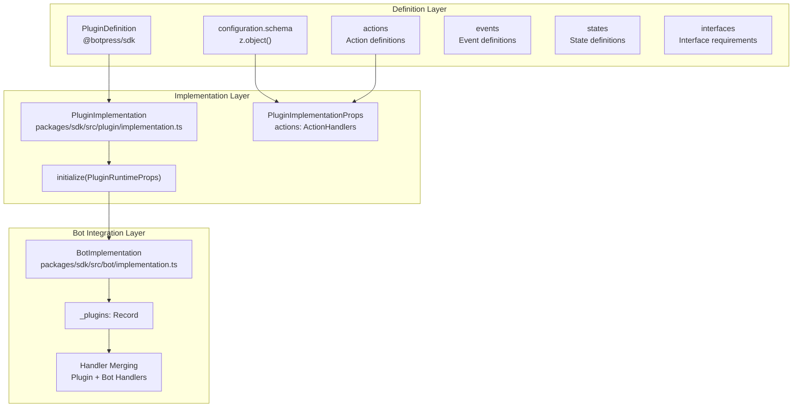
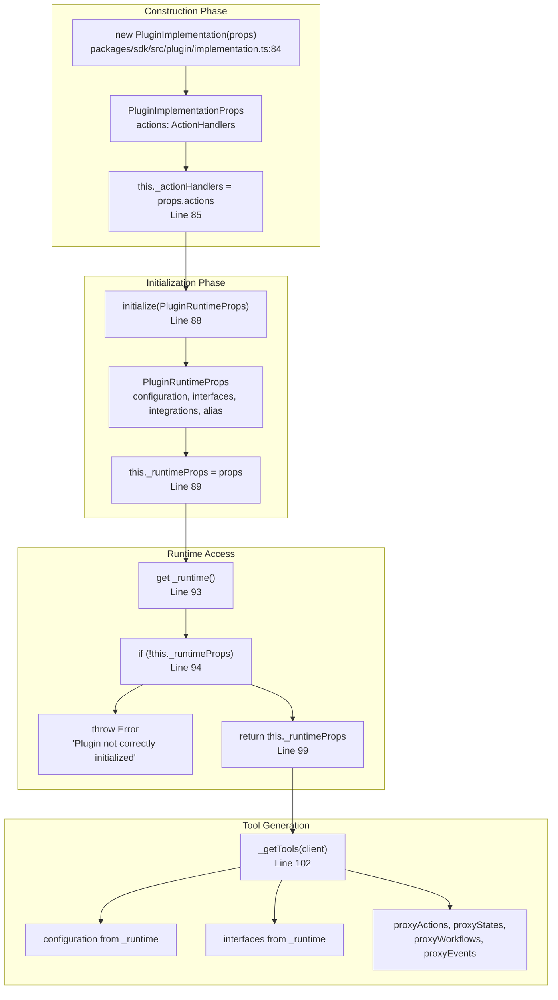
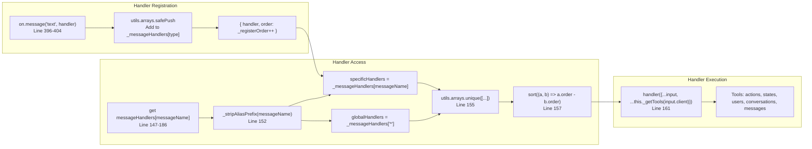
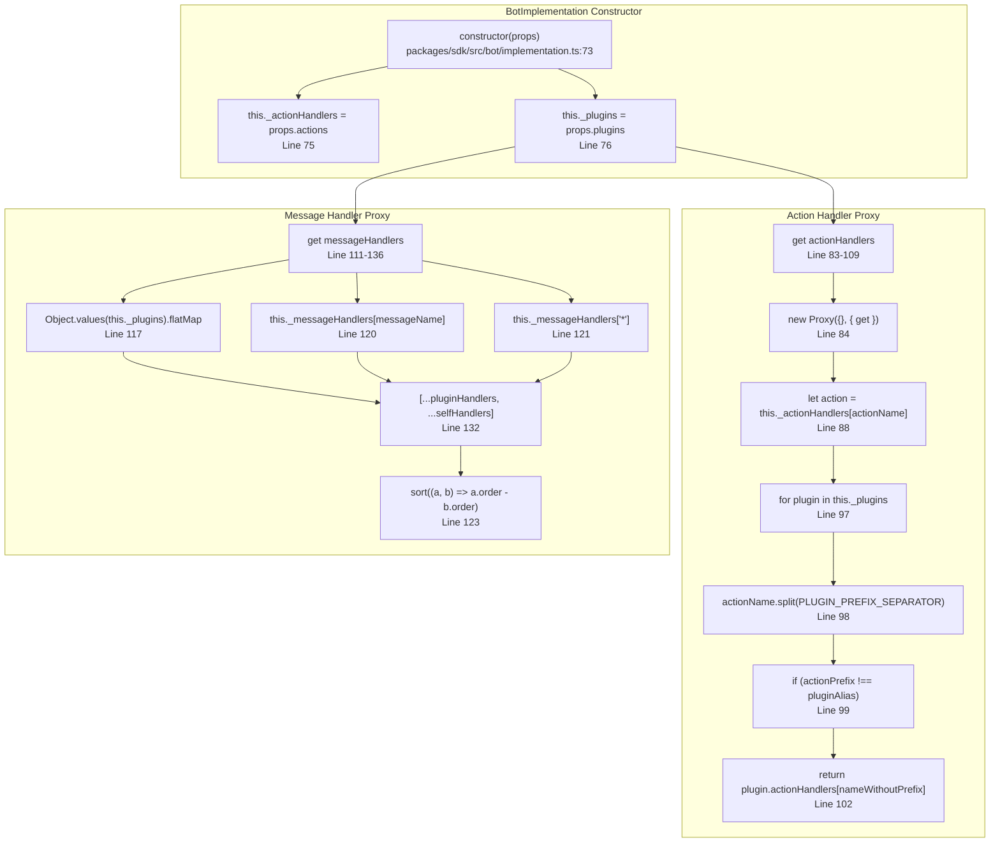
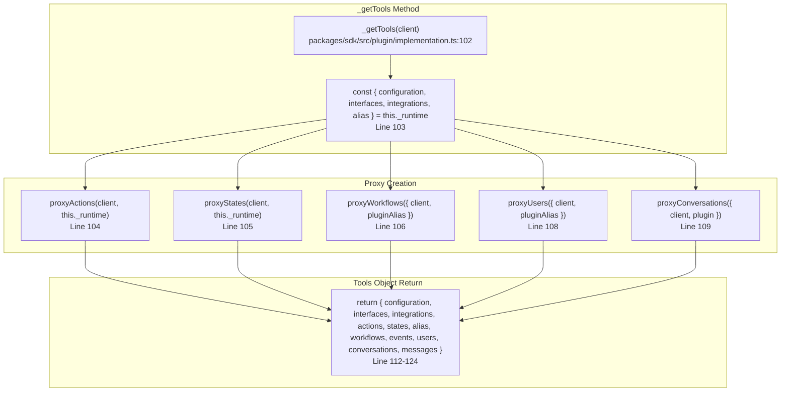
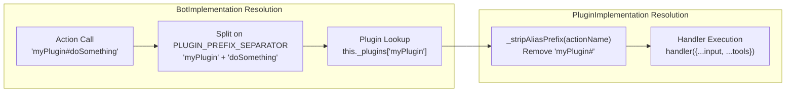

<!-- source: DeepWiki mcp.deepwiki.com · repo botpress/botpress · page 5 Plugin System · fetched 2026-10-27 -->

# Plugin System

Relevant source files

The following files were used as context for generating this wiki page:

- [bots/knowledgiani/package.json](bots/knowledgiani/package.json)
- [bots/synchrotron/package.json](bots/synchrotron/package.json)
- [packages/sdk/src/bot/implementation.ts](packages/sdk/src/bot/implementation.ts)
- [packages/sdk/src/bot/server/index.ts](packages/sdk/src/bot/server/index.ts)
- [packages/sdk/src/bot/server/types.test.ts](packages/sdk/src/bot/server/types.test.ts)
- [packages/sdk/src/bot/server/types.ts](packages/sdk/src/bot/server/types.ts)
- [packages/sdk/src/plugin/implementation.ts](packages/sdk/src/plugin/implementation.ts)
- [packages/sdk/src/plugin/server/types.ts](packages/sdk/src/plugin/server/types.ts)
- [plugins/file-synchronizer/package.json](plugins/file-synchronizer/package.json)
- [plugins/hitl/package.json](plugins/hitl/package.json)
- [plugins/hitl/src/hooks/before-incoming-event/all.ts](plugins/hitl/src/hooks/before-incoming-event/all.ts)
- [plugins/hitl/src/hooks/before-incoming-event/index.ts](plugins/hitl/src/hooks/before-incoming-event/index.ts)
- [plugins/hitl/src/hooks/index.ts](plugins/hitl/src/hooks/index.ts)
- [plugins/hitl/src/index.ts](plugins/hitl/src/index.ts)
- [plugins/knowledge/package.json](plugins/knowledge/package.json)
- [plugins/personality/package.json](plugins/personality/package.json)
- [plugins/synchronizer/package.json](plugins/synchronizer/package.json)
- [plugins/synchronizer/src/index.ts](plugins/synchronizer/src/index.ts)

The plugin system provides a framework for extending bot functionality with reusable modules that encapsulate actions, event handlers, message processors, and lifecycle hooks. Plugins are defined using `PluginDefinition`, implemented via `PluginImplementation`, and integrated into bots through the `BotImplementation` class.

This page covers the core plugin architecture and how plugins integrate with bots. For plugin creation details, see [Plugin Definition & Implementation](#5.1). For the HITL plugin implementation, see [HITL Plugin](#5.2). For details on other specialized plugins, see [Other Plugins](#5.3).

## Plugin Architecture Overview

The plugin system consists of three main layers: definition (contract), implementation (logic), and integration (bot composition).

### Plugin System Layers

**Plugin Definition Layer**

The `PluginDefinition` class defines the plugin contract: configuration schema, actions, events, states, and interface requirements.

Sources: [packages/sdk/src/plugin/implementation.ts:46-57](), [packages/sdk/src/bot/implementation.ts:35-41](), [packages/sdk/src/bot/implementation.ts:43-77]()

### Plugin Component Architecture

```mermaid
graph TB
    subgraph "PluginImplementation Core"
        PIMPL["PluginImplementation<TPlugin><br/>packages/sdk/src/plugin/implementation.ts:57"]
        RUNTIME["_runtimeProps?: PluginRuntimeProps<br/>Line 58"]
        ACTION_H["_actionHandlers: ActionHandlers<br/>Line 60"]
        MSG_H["_messageHandlers: OrderedMessageHandlersMap<br/>Line 61"]
        EVT_H["_eventHandlers: OrderedEventHandlersMap<br/>Line 62"]
        STATE_H["_stateExpiredHandlers: OrderedStateExpiredHandlersMap<br/>Line 63"]
        HOOK_H["_hookHandlers: OrderedHookHandlersMap<br/>Line 64-75"]
        WF_H["_workflowHandlers: OrderedWorkflowHandlersMap<br/>Line 76-80"]
        REG_ORDER["_registerOrder: number<br/>Line 82"]
    end
    
    subgraph "Handler Proxies"
        AH_PROXY["actionHandlers getter<br/>Line 127-145"]
        MH_PROXY["messageHandlers getter<br/>Line 147-186"]
        EH_PROXY["eventHandlers getter<br/>Line 188-228"]
        SH_PROXY["stateExpiredHandlers getter<br/>Line 230-262"]
        HH_PROXY["hookHandlers getter<br/>Line 264-325"]
        WH_PROXY["workflowHandlers getter<br/>Line 327-393"]
    end
    
    subgraph "Registration API"
        ON["on object<br/>Line 395"]
        MSG_REG["on.message(type, handler)<br/>Line 396-404"]
        EVT_REG["on.event(type, handler)<br/>Line 406-414"]
        HOOK_REG["on.beforeIncomingMessage(type, handler)<br/>Line 436-444"]
        WF_REG["on.workflowStart(type, handler)<br/>Line 542-550"]
    end
    
    PIMPL --> ACTION_H
    PIMPL --> MSG_H
    PIMPL --> EVT_H
    PIMPL --> STATE_H
    PIMPL --> HOOK_H
    PIMPL --> WF_H
    
    ACTION_H --> AH_PROXY
    MSG_H --> MH_PROXY
    EVT_H --> EH_PROXY
    STATE_H --> SH_PROXY
    HOOK_H --> HH_PROXY
    WF_H --> WH_PROXY
    
    MSG_REG --> MSG_H
    EVT_REG --> EVT_H
    HOOK_REG --> HOOK_H
    WF_REG --> WF_H
```

Sources: [packages/sdk/src/plugin/implementation.ts:57-580]()

## Plugin Lifecycle

Plugins follow a two-phase lifecycle: construction and initialization. Construction creates the plugin instance with action handlers, while initialization injects runtime context.

### Initialization Flow

Sources: [packages/sdk/src/plugin/implementation.ts:84-125]()

### Handler Registration and Execution

Handlers are registered via the `on` object and stored in ordered maps. When accessed via proxy getters, they are merged with interface handlers, sorted by registration order, and injected with plugin tools (actions, states, users, conversations, etc.).

Sources: [packages/sdk/src/plugin/implementation.ts:147-186](), [packages/sdk/src/plugin/implementation.ts:396-404](), [packages/sdk/src/plugin/implementation.ts:102-125]()

## Plugin Integration into Bots

The `BotImplementation` class integrates plugins by storing them in a `_plugins` map and merging their handlers with bot handlers. Action calls use the `PLUGIN_PREFIX_SEPARATOR` (`#`) to route to the correct plugin.

### Bot-Plugin Handler Composition

Sources: [packages/sdk/src/bot/implementation.ts:73-136](), [packages/sdk/src/consts.ts:3]()

## Handler Types and Registration

Plugins support multiple handler types, each registered via the `on` object. Handlers are stored in ordered maps with registration sequence numbers to preserve execution order.

### Handler Registration Methods

| Handler Type | Registration Method | Storage Type |
|--------------|-------------------|--------------|
| Action | Constructor `props.actions` | `ActionHandlers` |
| Message | `on.message(type, handler)` | `OrderedMessageHandlersMap` |
| Event | `on.event(type, handler)` | `OrderedEventHandlersMap` |
| State Expired | `on.stateExpired(name, handler)` | `OrderedStateExpiredHandlersMap` |
| Hook | `on.beforeIncomingMessage(type, handler)` | `OrderedHookHandlersMap` |
| Workflow | `on.workflowStart(name, handler)` | `OrderedWorkflowHandlersMap` |

Sources: [packages/sdk/src/plugin/implementation.ts:395-580]()

### Hook Handler Types

The plugin system provides hooks for intercepting operations at different lifecycle points. Hooks can be stoppable (returning `{ stop: true }`) or data-transforming.

```mermaid
graph TB
    subgraph "Incoming Hooks (Stoppable)"
        BIE["before_incoming_event<br/>packages/sdk/src/plugin/server/types.ts:245"]
        BIM["before_incoming_message<br/>Line 249"]
        AIE["after_incoming_event<br/>Line 265"]
        AIM["after_incoming_message<br/>Line 269"]
        BICA["before_incoming_call_action<br/>Line 261"]
        AICA["after_incoming_call_action<br/>Line 281"]
    end
    
    subgraph "Outgoing Hooks (Non-stoppable)"
        BOM["before_outgoing_message<br/>Line 253"]
        AOM["after_outgoing_message<br/>Line 273"]
        BOCA["before_outgoing_call_action<br/>Line 257"]
        AOCA["after_outgoing_call_action<br/>Line 277"]
    end
    
    subgraph "Hook Output"
        STOPPABLE["{ data?: T, stop?: boolean }<br/>For stoppable hooks"]
        NON_STOP["{ data?: T }<br/>For non-stoppable hooks"]
    end
    
    BIE --> STOPPABLE
    BIM --> STOPPABLE
    AIE --> STOPPABLE
    AIM --> STOPPABLE
    BICA --> STOPPABLE
    AICA --> STOPPABLE
    
    BOM --> NON_STOP
    AOM --> NON_STOP
    BOCA --> NON_STOP
    AOCA --> NON_STOP
```

Sources: [packages/sdk/src/plugin/server/types.ts:244-285]()

## Plugin Runtime Environment

Plugins receive a runtime environment through `initialize(PluginRuntimeProps)` containing configuration, interface mappings, and an optional alias. The `_getTools` method creates proxy objects for actions, states, events, and workflows.

### Runtime Props Structure

| Property | Description | Source |
|----------|-------------|--------|
| `configuration` | Plugin configuration values defined in schema | [packages/sdk/src/plugin/server/types.ts:139]() |
| `interfaces` | Mapping of interface dependencies to implementations | [packages/sdk/src/plugin/server/types.ts:144]() |
| `integrations` | Mapping of integration dependencies to implementations | [packages/sdk/src/plugin/server/types.ts:149]() |
| `alias` | The unique identifier for the plugin instance in the bot | [packages/sdk/src/plugin/server/types.ts:155]() |

Sources: [packages/sdk/src/plugin/server/types.ts:138-155]()

### Plugin Tool Generation

Sources: [packages/sdk/src/plugin/implementation.ts:102-125]()

## Plugin Prefix System

Actions implemented by plugins use a prefix system to avoid naming conflicts. The prefix format is `{pluginAlias}#{actionName}` using the `PLUGIN_PREFIX_SEPARATOR` constant.

### Action Resolution with Prefixes

Sources: [packages/sdk/src/bot/implementation.ts:97-103](), [packages/sdk/src/plugin/implementation.ts:132-141](), [packages/sdk/src/consts.ts:3]()

---

