<!-- source: DeepWiki mcp.deepwiki.com · repo botpress/botpress · page 5.1 Plugin Definition & Implementation · fetched 2026-10-27 -->

# Plugin Definition & Implementation

<details>
<summary>Relevant source files</summary>

The following files were used as context for generating this wiki page:

- [packages/sdk/src/bot/implementation.ts](packages/sdk/src/bot/implementation.ts)
- [packages/sdk/src/bot/server/index.ts](packages/sdk/src/bot/server/index.ts)
- [packages/sdk/src/bot/server/types.test.ts](packages/sdk/src/bot/server/types.test.ts)
- [packages/sdk/src/bot/server/types.ts](packages/sdk/src/bot/server/types.ts)
- [packages/sdk/src/plugin/implementation.ts](packages/sdk/src/plugin/implementation.ts)
- [packages/sdk/src/plugin/server/types.ts](packages/sdk/src/plugin/server/types.ts)
- [plugins/analytics/package.json](plugins/analytics/package.json)
- [plugins/analytics/plugin.definition.ts](plugins/analytics/plugin.definition.ts)
- [plugins/analytics/src/index.ts](plugins/analytics/src/index.ts)
- [plugins/conversation-insights/plugin.definition.ts](plugins/conversation-insights/plugin.definition.ts)
- [plugins/conversation-insights/src/error-handler.ts](plugins/conversation-insights/src/error-handler.ts)
- [plugins/conversation-insights/src/handlers/after-incoming-message.ts](plugins/conversation-insights/src/handlers/after-incoming-message.ts)
- [plugins/conversation-insights/src/handlers/after-outgoing-message.ts](plugins/conversation-insights/src/handlers/after-outgoing-message.ts)
- [plugins/conversation-insights/src/handlers/index.ts](plugins/conversation-insights/src/handlers/index.ts)
- [plugins/conversation-insights/src/handlers/update-ai-insight.ts](plugins/conversation-insights/src/handlers/update-ai-insight.ts)
- [plugins/conversation-insights/src/handlers/update-all-conversations.ts](plugins/conversation-insights/src/handlers/update-all-conversations.ts)
- [plugins/conversation-insights/src/index.ts](plugins/conversation-insights/src/index.ts)
- [plugins/conversation-insights/src/onNewMessageHandler.ts](plugins/conversation-insights/src/onNewMessageHandler.ts)
- [plugins/conversation-insights/src/prompt/parse-content.ts](plugins/conversation-insights/src/prompt/parse-content.ts)
- [plugins/conversation-insights/src/prompt/prompt.ts](plugins/conversation-insights/src/prompt/prompt.ts)
- [plugins/conversation-insights/src/prompt/sentiment-prompt.ts](plugins/conversation-insights/src/prompt/sentiment-prompt.ts)
- [plugins/conversation-insights/src/prompt/summary-prompt.ts](plugins/conversation-insights/src/prompt/summary-prompt.ts)
- [plugins/conversation-insights/src/tagsUpdater.ts](plugins/conversation-insights/src/tagsUpdater.ts)
- [plugins/conversation-insights/src/types.ts](plugins/conversation-insights/src/types.ts)
- [plugins/conversation-insights/src/updateAllConversations.test.ts](plugins/conversation-insights/src/updateAllConversations.test.ts)
- [plugins/conversation-insights/src/updateAllConversations.ts](plugins/conversation-insights/src/updateAllConversations.ts)
- [plugins/file-synchronizer/plugin.definition.ts](plugins/file-synchronizer/plugin.definition.ts)
- [plugins/file-synchronizer/src/actions/sync-files-to-botpress.ts](plugins/file-synchronizer/src/actions/sync-files-to-botpress.ts)
- [plugins/file-synchronizer/src/consts.ts](plugins/file-synchronizer/src/consts.ts)
- [plugins/file-synchronizer/src/hooks/on-event/file-created.ts](plugins/file-synchronizer/src/hooks/on-event/file-created.ts)
- [plugins/file-synchronizer/src/hooks/on-event/file-deleted.ts](plugins/file-synchronizer/src/hooks/on-event/file-deleted.ts)
- [plugins/file-synchronizer/src/hooks/on-event/file-updated.ts](plugins/file-synchronizer/src/hooks/on-event/file-updated.ts)
- [plugins/file-synchronizer/src/hooks/on-event/folder-deleted-recursive.ts](plugins/file-synchronizer/src/hooks/on-event/folder-deleted-recursive.ts)
- [plugins/file-synchronizer/src/hooks/on-event/index.ts](plugins/file-synchronizer/src/hooks/on-event/index.ts)
- [plugins/file-synchronizer/src/hooks/workflow-continued/index.ts](plugins/file-synchronizer/src/hooks/workflow-continued/index.ts)
- [plugins/file-synchronizer/src/hooks/workflow-started/index.ts](plugins/file-synchronizer/src/hooks/workflow-started/index.ts)
- [plugins/file-synchronizer/src/hooks/workflow-timed-out/index.ts](plugins/file-synchronizer/src/hooks/workflow-timed-out/index.ts)
- [plugins/file-synchronizer/src/index.ts](plugins/file-synchronizer/src/index.ts)
- [plugins/file-synchronizer/src/sync-queue/directory-traversal-with-batching.test.ts](plugins/file-synchronizer/src/sync-queue/directory-traversal-with-batching.test.ts)
- [plugins/file-synchronizer/src/sync-queue/directory-traversal-with-batching.ts](plugins/file-synchronizer/src/sync-queue/directory-traversal-with-batching.ts)
- [plugins/file-synchronizer/src/sync-queue/file-processor.test.ts](plugins/file-synchronizer/src/sync-queue/file-processor.test.ts)
- [plugins/file-synchronizer/src/sync-queue/file-processor.ts](plugins/file-synchronizer/src/sync-queue/file-processor.ts)
- [plugins/file-synchronizer/src/sync-queue/glob-matcher.test.ts](plugins/file-synchronizer/src/sync-queue/glob-matcher.test.ts)
- [plugins/file-synchronizer/src/sync-queue/glob-matcher.ts](plugins/file-synchronizer/src/sync-queue/glob-matcher.ts)
- [plugins/file-synchronizer/src/sync-queue/index.ts](plugins/file-synchronizer/src/sync-queue/index.ts)
- [plugins/file-synchronizer/src/sync-queue/job-file-manager.ts](plugins/file-synchronizer/src/sync-queue/job-file-manager.ts)
- [plugins/file-synchronizer/src/sync-queue/queue-batching.test.ts](plugins/file-synchronizer/src/sync-queue/queue-batching.test.ts)
- [plugins/file-synchronizer/src/sync-queue/queue-batching.ts](plugins/file-synchronizer/src/sync-queue/queue-batching.ts)
- [plugins/file-synchronizer/src/sync-queue/queue-processor.test.ts](plugins/file-synchronizer/src/sync-queue/queue-processor.test.ts)
- [plugins/file-synchronizer/src/sync-queue/queue-processor.ts](plugins/file-synchronizer/src/sync-queue/queue-processor.ts)
- [plugins/knowledge/plugin.definition.ts](plugins/knowledge/plugin.definition.ts)
- [plugins/logger/package.json](plugins/logger/package.json)
- [plugins/logger/plugin.definition.ts](plugins/logger/plugin.definition.ts)
- [plugins/logger/src/index.ts](plugins/logger/src/index.ts)
- [plugins/personality/plugin.definition.ts](plugins/personality/plugin.definition.ts)
- [plugins/synchronizer/plugin.definition.ts](plugins/synchronizer/plugin.definition.ts)

</details>


This document explains how to define and implement plugins in the Botpress platform. Plugins are modular components that extend bot functionality by providing reusable actions, event handlers, and state management capabilities.

## Plugin Architecture Overview

The plugin system consists of two main files:
- `plugin.definition.ts` - Declares the plugin's schema using `PluginDefinition` class
- `src/index.ts` - Implements runtime behavior using `PluginImplementation` class

Plugins integrate with bots through the `BotImplementation` class, which stores plugin instances in its `_plugins` property and resolves their handlers at runtime.

**Plugin Architecture: Definition to Runtime**

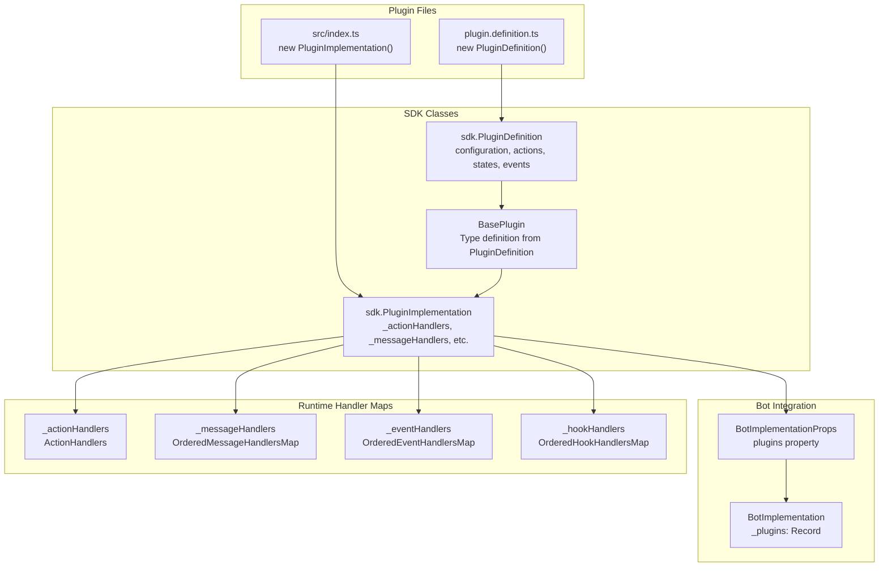

Sources: [packages/sdk/src/bot/implementation.ts:35-40](), [packages/sdk/src/plugin/implementation.ts:46-48](), [packages/sdk/src/plugin/implementation.ts:55-89]()

## Plugin Definition

A plugin is defined in `plugin.definition.ts` using the `PluginDefinition` class from `@botpress/sdk`. The definition declares the plugin's configuration schema, actions, states, events, and interfaces.

### Plugin Definition Components

**File Synchronizer Plugin Definition Structure (plugins/file-synchronizer/plugin.definition.ts)**

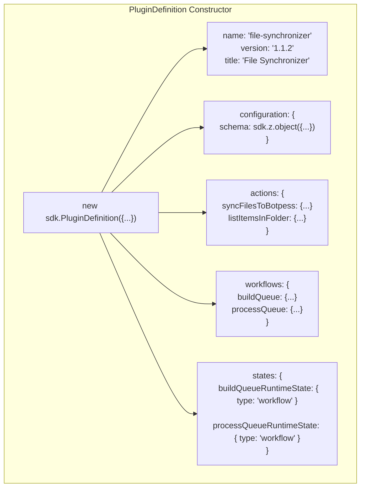

Sources: [plugins/file-synchronizer/plugin.definition.ts:60-67](), [plugins/file-synchronizer/plugin.definition.ts:68-83](), [plugins/file-synchronizer/plugin.definition.ts:85-110](), [plugins/file-synchronizer/plugin.definition.ts:112-170](), [plugins/file-synchronizer/plugin.definition.ts:171-209]()

### Configuration Schema

Plugin configuration is defined using Zod schemas. The File Synchronizer plugin defines rules for including and excluding files:

| Configuration Field | Type | Purpose |
|-------------------|------|---------|
| `enableRealTimeSync` | `boolean` (default: true) | Enable immediate synchronization on file changes. |
| `includeFiles` | `sdk.z.array` | List of rules to include files based on glob patterns, max size, and modified date. |
| `excludeFiles` | `sdk.z.array` | List of rules to exclude files based on glob patterns. Takes precedence over `includeFiles`. |

The `FILE_FILTER_PROPS` object defines reusable Zod schemas for file filtering criteria, including `pathGlobPattern`, `maxSizeInBytes`, `modifiedAfter`, and `applyOptionsToMatchedFiles`.
The `applyOptionsToMatchedFiles` property allows specifying a `addToKbId` to automatically add matched files to a specific Knowledge Base.

Sources: [plugins/file-synchronizer/plugin.definition.ts:4-58](), [plugins/file-synchronizer/plugin.definition.ts:68-83]()

### Action Definitions

Actions define the plugin's callable operations. Each action specifies input/output schemas:

**File Synchronizer Plugin Actions**

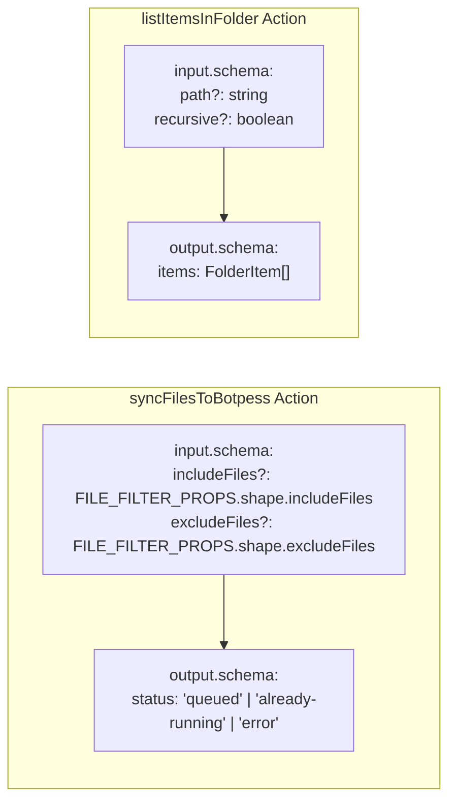

The `syncFilesToBotpess` action allows triggering a file synchronization job, optionally overriding the global include/exclude rules. The `listItemsInFolder` action is re-exported from the `files-readonly` interface, demonstrating how plugins can expose actions from their dependencies.

Sources: [plugins/file-synchronizer/plugin.definition.ts:85-110]()

### Workflow Definitions

Workflows define long-running, multi-step processes within a plugin. They have input/output schemas and can define tags for metadata.

**File Synchronizer Plugin Workflows**

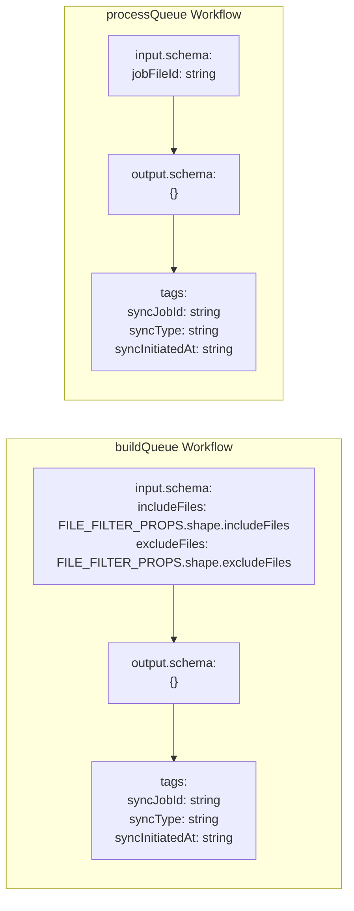

The `buildQueue` workflow is responsible for enumerating files based on the provided rules and creating a queue. The `processQueue` workflow then processes this queue. Both workflows define tags to track job-specific metadata.

Sources: [plugins/file-synchronizer/plugin.definition.ts:112-170]()

### State Definitions

Plugin states store data scoped to different levels (conversation, user, bot, workflow). The File Synchronizer plugin uses workflow-scoped states to manage the progress of its synchronization workflows.

**File Synchronizer Plugin State Definitions**

| State Name | Type | Schema | Purpose |
|-----------|------|--------|---------|
| `buildQueueRuntimeState` | `workflow` | `{ jobFileId: string, enumerationState: object }` | Stores the current state of the `buildQueue` workflow, including pending folders and pagination tokens. |
| `processQueueRuntimeState` | `workflow` | `{ jobFileId: string, fileProcessingState: object }` | Stores the current state of the `processQueue` workflow, including processed files and errors. |

Sources: [plugins/file-synchronizer/plugin.definition.ts:171-209]()

### Tags

Tags attach metadata to users and conversations. The `conversation-insights` plugin uses tags to enrich conversation data with AI-generated insights.

**Conversation Insights Plugin Tags**

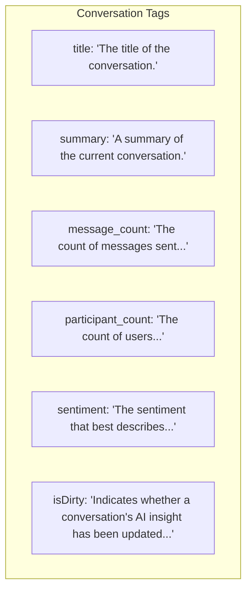

These tags are defined within the `conversation.tags` property of the `PluginDefinition`.

Sources: [plugins/conversation-insights/plugin.definition.ts:17-40]()

### Example Plugin Definition

The `conversation-insights` plugin demonstrates a complete plugin definition with configuration, conversation tags, events, and workflows:

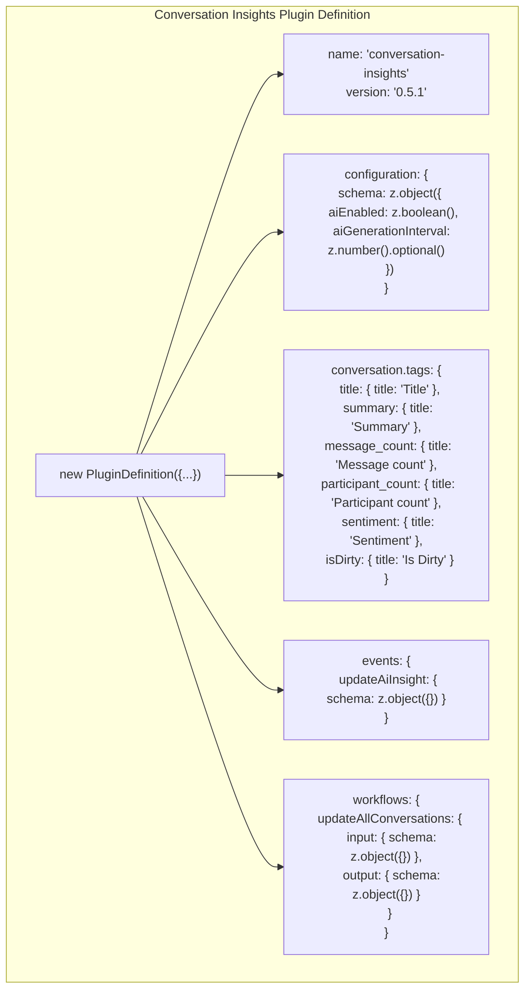

Sources: [plugins/conversation-insights/plugin.definition.ts:3-48]()

## Plugin Implementation

The `PluginImplementation` class in `src/index.ts` provides runtime behavior. It stores handlers in ordered maps and exposes them via proxy objects for dynamic resolution.

### PluginImplementation Internal Structure

**PluginImplementation Class Members**

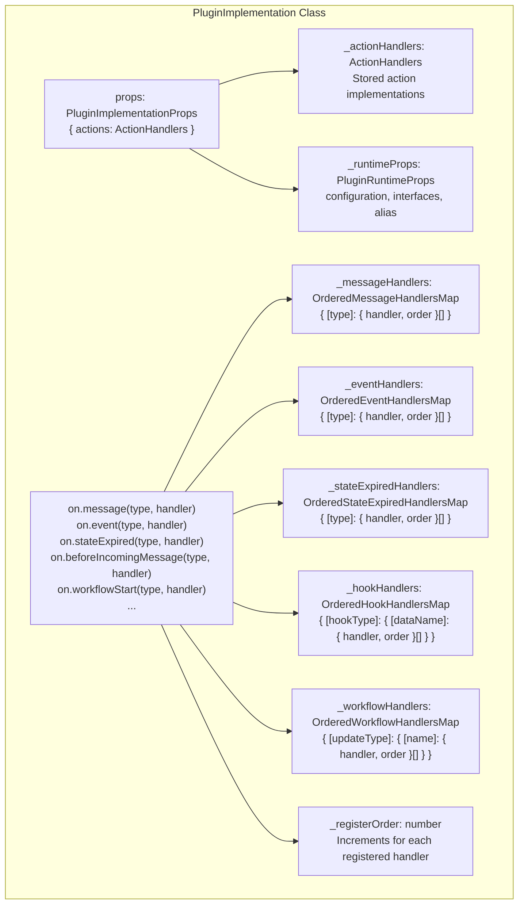

Sources: [packages/sdk/src/plugin/implementation.ts:55-82]()

### Plugin Implementation Example

A typical plugin implementation file (`src/index.ts`) instantiates `PluginImplementation` and registers handlers:

**Plugin Implementation Pattern**

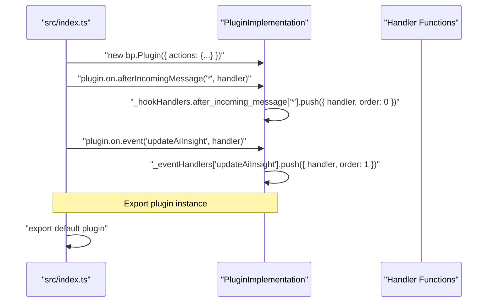

The `conversation-insights` plugin registers `afterIncomingMessage` and `afterOutgoingMessage` hooks, an `updateAiInsight` event handler, and handlers for its `updateAllConversations` workflow.

Sources: [plugins/conversation-insights/src/index.ts:6-8](), [plugins/conversation-insights/src/index.ts:10-17](), [plugins/conversation-insights/src/index.ts:19-26](), [plugins/conversation-insights/src/index.ts:28-35](), [plugins/conversation-insights/src/index.ts:38-42](), [plugins/conversation-insights/src/index.ts:44-48](), [plugins/conversation-insights/src/index.ts:50-57]()

### Handler Registration Methods

The `on` object provides methods to register different handler types:

| Method | Parameters | Purpose |
|--------|-----------|---------|
| `on.message(type, handler)` | type: message type or `'*'`, handler function | Register message handler |
| `on.event(type, handler)` | type: event type or `'*'`, handler function | Register event handler |
| `on.stateExpired(type, handler)` | type: state name or `'*'`, handler function | Register state expiration handler |
| `on.beforeIncomingMessage(type, handler)` | type: message type or `'*'`, handler function | Register pre-processing hook for incoming messages |
| `on.beforeIncomingEvent(type, handler)` | type: event type or `'*'`, handler function | Register pre-processing hook for incoming events |
| `on.afterIncomingMessage(type, handler)` | type: message type or `'*'`, handler function | Register post-processing hook for incoming messages |
| `on.afterOutgoingMessage(type, handler)` | type: message type or `'*'`, handler function | Register post-processing hook for outgoing messages |
| `on.workflowStart(name, handler)` | name: workflow name, handler function | Register handler for workflow start |
| `on.workflowContinue(name, handler)` | name: workflow name, handler function | Register handler for workflow continuation |
| `on.workflowTimeout(name, handler)` | name: workflow name, handler function | Register handler for workflow timeout |

Each registration increments `_registerOrder` to maintain execution order.

Sources: [packages/sdk/src/plugin/implementation.ts:306-489]()

### Plugin Integration with BotImplementation

The `BotImplementation` class integrates plugins through its `plugins` property and provides handler resolution:

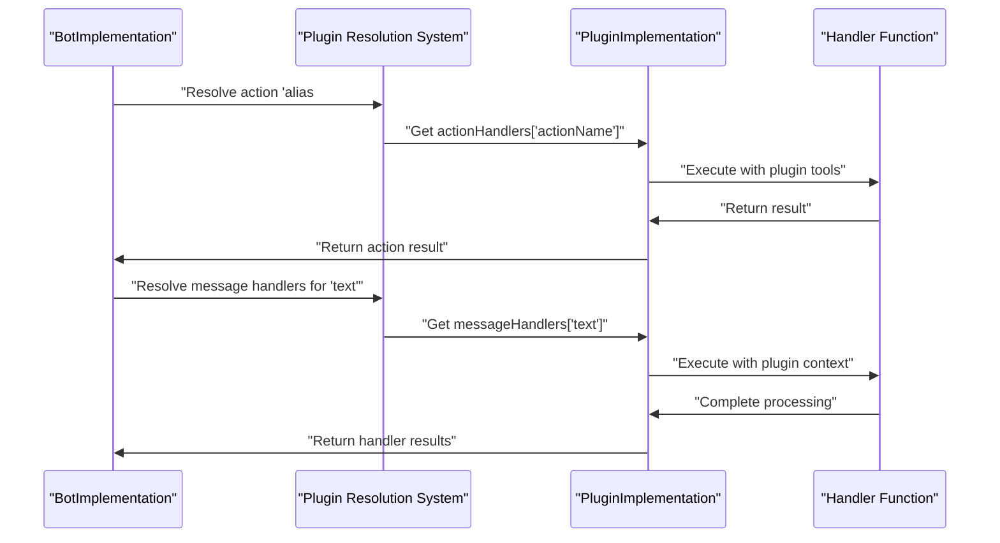

Sources: [packages/sdk/src/bot/implementation.ts:71-96](), [packages/sdk/src/bot/implementation.ts:98-116]()

### Plugin Handler Props (InjectedHandlerProps)

Plugin handlers receive enhanced context through `InjectedHandlerProps`, which are injected by `_getTools()` method:

**Plugin Handler Context Injection**

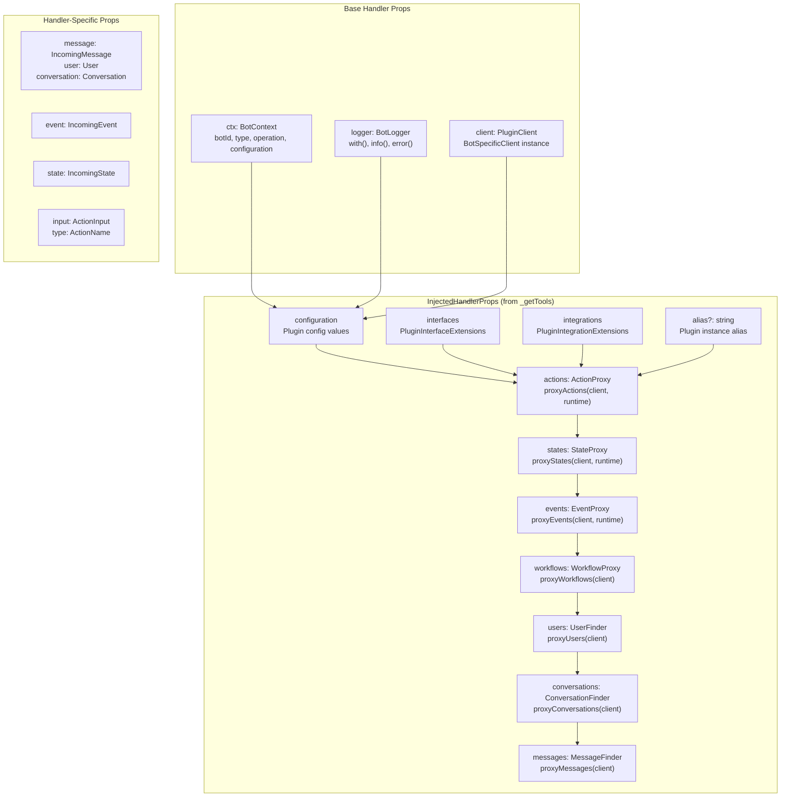

The `_getTools()` method retrieves runtime props and creates proxy objects for actions, states, events, workflows, users, conversations, and messages, enabling plugins to interact with the bot platform.

Sources: [packages/sdk/src/plugin/implementation.ts:102-124](), [packages/sdk/src/plugin/server/types.ts:138-182]()

### Action Handler Implementation

Action handlers implement the operations defined in the plugin definition. They receive typed input and return typed output:

**File Synchronizer Plugin Action Handler Example (syncFilesToBotpess)**

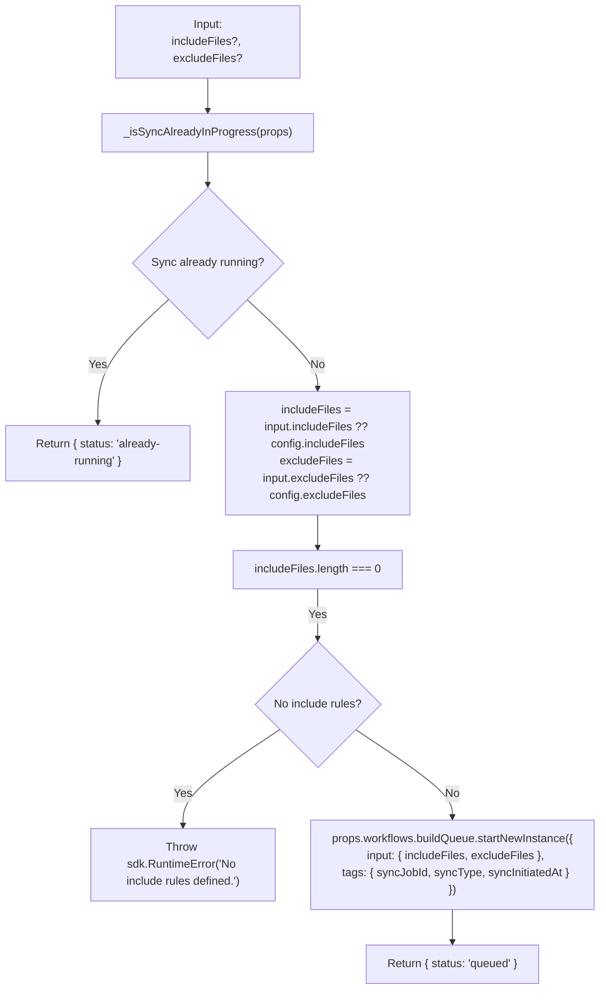

The `syncFilesToBotpess` action checks if a sync is already in progress, validates include rules, and then starts a new instance of the `buildQueue` workflow. It uses `props.workflows.buildQueue.startNewInstance()` to initiate the workflow.

Sources: [plugins/file-synchronizer/src/actions/sync-files-to-botpress.ts:5-36]()

### Hook System

Hooks intercept events and messages at different lifecycle stages. Stoppable hooks can return `{ stop: true }` to prevent further processing.

**Hook Types and Stoppability**

| Hook Type | Stoppable | When Executed |
|-----------|-----------|---------------|
| `before_incoming_event` | Yes | Before event handlers run |
| `before_incoming_message` | Yes | Before message handlers run |
| `before_outgoing_message` | No | Before sending messages |
| `before_outgoing_call_action` | No | Before calling actions |
| `before_incoming_call_action` | No | Before action handlers execute |
| `after_incoming_event` | Yes | After event handlers run |
| `after_incoming_message` | Yes | After message handlers run |
| `after_outgoing_message` | No | After sending messages |
| `after_outgoing_call_action` | No | After calling actions |
| `after_incoming_call_action` | No | After action handlers execute |

Sources: [packages/sdk/src/plugin/server/types.ts:231-272]()

**Hook Execution Flow (Conversation Insights Example)**

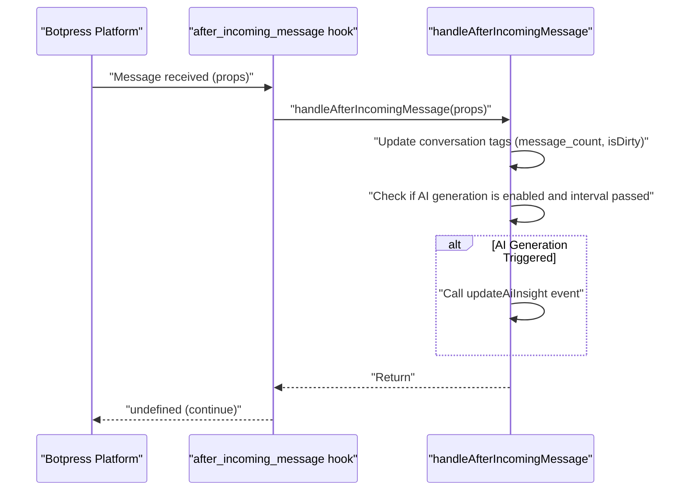

The `conversation-insights` plugin's `after_incoming_message` hook (`'*'` type) updates conversation tags and conditionally triggers AI insight generation.

Sources: [plugins/conversation-insights/src/index.ts:10-17](), [plugins/conversation-insights/src/handlers/after-incoming-message.ts:5-20]()

### Hook Return Values

Hooks return `HookOutputs`, which can include:
- `data`: Modified version of the input data
- `stop`: Boolean flag to halt further processing (only for stoppable hooks)

**Hook Output Examples**

```typescript
// Stop processing (stoppable hooks only)
return { stop: true }

// Modify data and continue
return { data: modifiedMessage }

// Modify data and stop
return { data: modifiedMessage, stop: true }

// Continue without changes
return undefined
```

Sources: [packages/sdk/src/plugin/server/types.ts:290-296]()

### Plugin Handler Resolution

`PluginImplementation` uses Proxy objects to resolve handlers dynamically. When a bot accesses handlers, the proxy intercepts the request and applies transformations.

**Event Handler Resolution Flow**

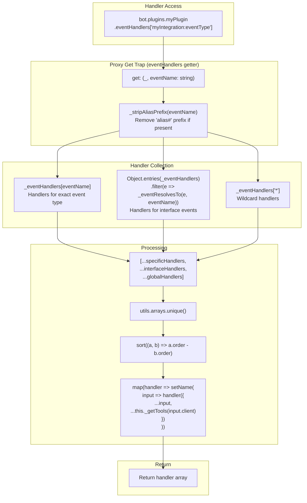

The `_eventResolvesTo()` method checks if an interface event (e.g., `creatable:itemCreated`) resolves to the requested concrete event (e.g., `github:prOpened`).

Sources: [packages/sdk/src/plugin/implementation.ts:188-218](), [packages/sdk/src/plugin/implementation.ts:494-503]()

### Interface Event Resolution

When a plugin registers a handler for an interface event, it automatically receives concrete events from integrations implementing that interface.

**Interface Resolution Example**

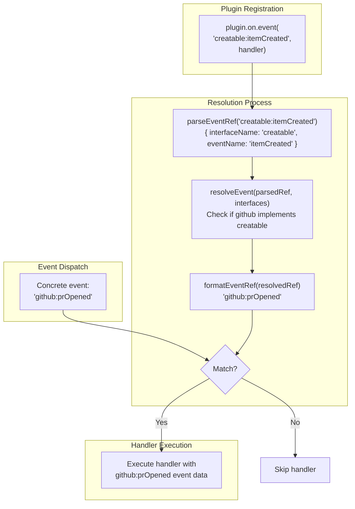

Sources: [packages/sdk/src/plugin/implementation.ts:494-503](), [packages/sdk/src/plugin/interface-resolution.ts]()

### Plugin Tools and Context

When plugin handlers are executed, they receive enhanced context through the `_getTools()` method:

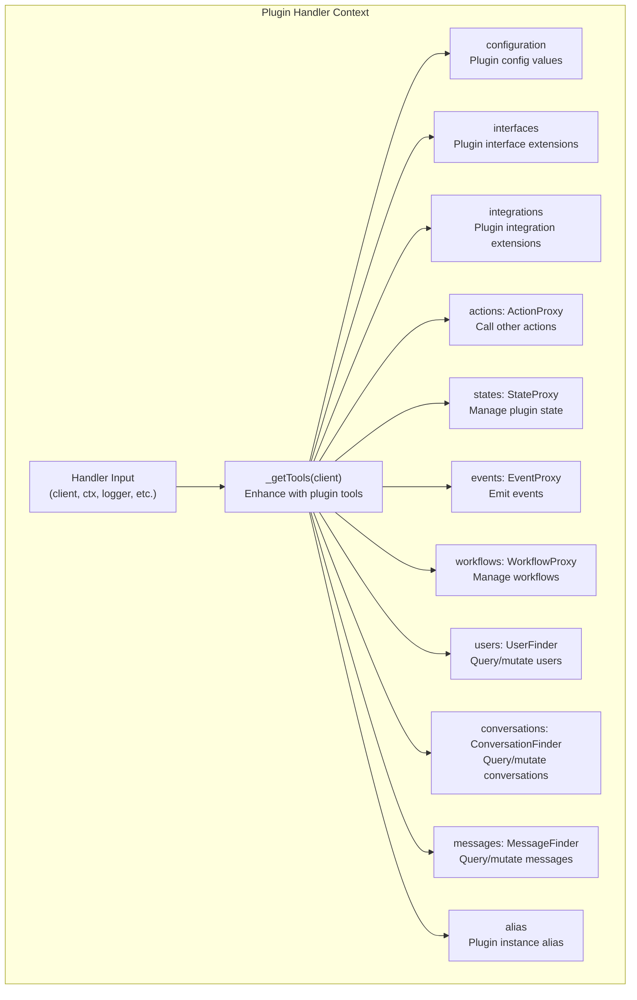

Sources: [packages/sdk/src/plugin/implementation.ts:102-124](), [packages/sdk/src/plugin/server/types.ts:138-182]()

## Plugin Integration with BotImplementation

### Plugin Registration

Bots register plugins in `BotImplementationProps` and `BotImplementation` stores them in `_plugins`:

**Bot-Plugin Integration**

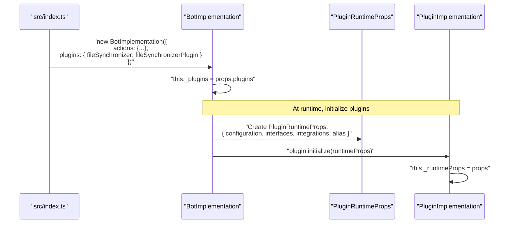

The `initialize()` method injects runtime props (configuration, interfaces, integrations, alias) into the plugin after bot instantiation.

Sources: [packages/sdk/src/bot/implementation.ts:35-40](), [packages/sdk/src/plugin/implementation.ts:86-89]()

### Action Resolution with PLUGIN_PREFIX_SEPARATOR

When a bot action name includes a plugin prefix (e.g., `'fileSynchronizer#syncFilesToBotpess'`), `BotImplementation` resolves it to the plugin's action handler:

**Plugin Action Resolution**

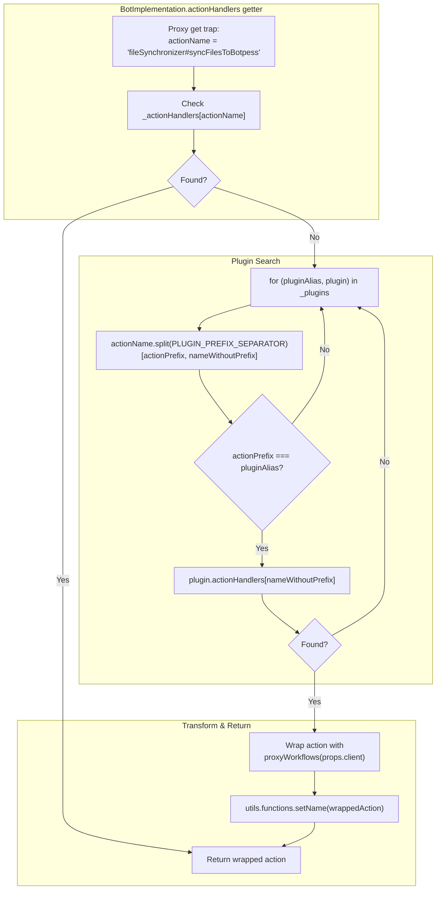

The `PLUGIN_PREFIX_SEPARATOR` constant is `'#'`, enabling namespaced action names.

Sources: [packages/sdk/src/bot/implementation.ts:98-103](), [packages/sdk/src/consts.ts:1]()

## Handler Aggregation and Execution Order

### Message Handler Aggregation

`BotImplementation` aggregates message handlers from plugins and bot, preserving registration order:

**Message Handler Aggregation (BotImplementation.messageHandlers getter)**

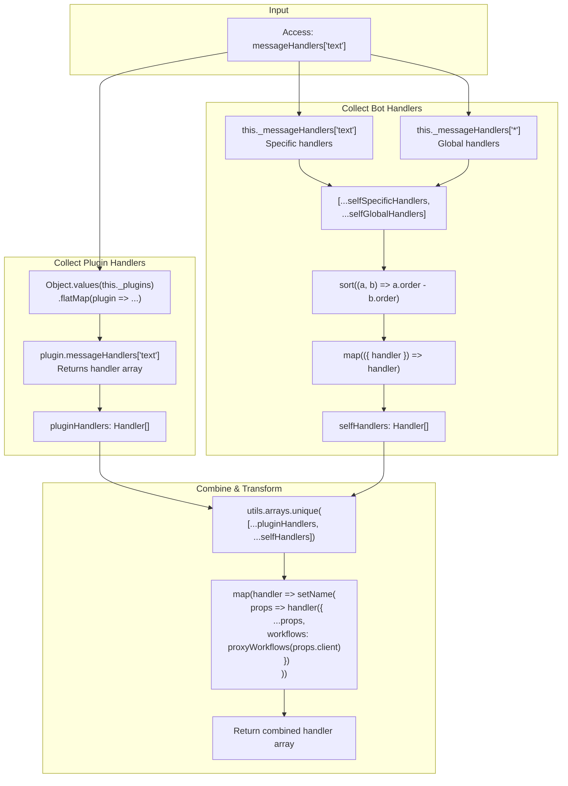

Plugin handlers execute before bot handlers. Within each group, handlers execute in registration order (tracked by `_registerOrder`).

Sources: [packages/sdk/src/bot/implementation.ts:111-131]()

### Event Handler Aggregation

Event handler aggregation follows the same pattern as message handlers, with the addition of supporting wildcard (`'*'`) handlers:

**Handler Execution Order**

1. **Plugin handlers** (from all plugins, in registration order)
2. **Bot-specific handlers** (registered for the exact event type)
3. **Bot global handlers** (registered with `'*'` type)

The `utils.arrays.unique()` function removes duplicate handler references, ensuring each handler executes at most once.

Sources: [packages/sdk/src/bot/implementation.ts:133-157]()

## Best Practices for Plugin Development

1.  **Clear Separation of Concerns**:
    *   Keep plugin definition and implementation separate.
    *   Use a modular approach for actions and hooks.

2.  **Proper State Management**:
    *   Define clear state schemas.
    *   Use the `states` proxy to manage plugin-specific state.

3.  **Error Handling**:
    *   Implement robust error handling in actions and hooks.
    *   Use the `logger` to track issues.

4.  **Interface Design**:
    *   Design interfaces that can be implemented by multiple integrations.
    *   Keep interface definitions focused and cohesive.

5.  **Configuration**:
    *   Provide sensible defaults.
    *   Use descriptive titles and descriptions for configuration options.

## Conclusion

Plugins provide a powerful way to extend Botpress functionality. By understanding the plugin definition and implementation patterns, developers can create custom features that integrate seamlessly with the platform.

For information about specific plugin implementations, see [5.2. HITL Plugin]() for an example of a complete plugin that provides human-in-the-loop capabilities.

---

