<!-- source: DeepWiki mcp.deepwiki.com · repo botpress/botpress · page 6 Development & Deployment · fetched 2026-10-27 -->

# Development & Deployment

<details>
<summary>Relevant source files</summary>

The following files were used as context for generating this wiki page:

- [.github/actions/deploy-integrations/action.yml](.github/actions/deploy-integrations/action.yml)
- [.github/actions/setup/action.yml](.github/actions/setup/action.yml)
- [.github/workflows/check-integration-versions.yml](.github/workflows/check-integration-versions.yml)
- [.github/workflows/deploy-bots.yml](.github/workflows/deploy-bots.yml)
- [.github/workflows/deploy-integrations-production.yml](.github/workflows/deploy-integrations-production.yml)
- [.github/workflows/deploy-integrations-staging.yml](.github/workflows/deploy-integrations-staging.yml)
- [.github/workflows/prod-master-version-verification.yml](.github/workflows/prod-master-version-verification.yml)
- [.github/workflows/publish-packages.yml](.github/workflows/publish-packages.yml)
- [.github/workflows/run-chat-tests.yml](.github/workflows/run-chat-tests.yml)
- [.github/workflows/run-checks.yml](.github/workflows/run-checks.yml)
- [.github/workflows/run-cli-tests.yml](.github/workflows/run-cli-tests.yml)
- [.github/workflows/run-client-tests.yml](.github/workflows/run-client-tests.yml)
- [.tool-versions](.tool-versions)
- [CODEOWNERS](CODEOWNERS)
- [integrations/groq/hub.md](integrations/groq/hub.md)
- [integrations/openai/hub.md](integrations/openai/hub.md)
- [packages/cli/e2e/defaults.ts](packages/cli/e2e/defaults.ts)
- [packages/cli/src/api/client.ts](packages/cli/src/api/client.ts)
- [packages/cli/src/api/types.ts](packages/cli/src/api/types.ts)
- [packages/cli/src/command-implementations/bot-commands.ts](packages/cli/src/command-implementations/bot-commands.ts)
- [packages/cli/src/command-implementations/build-command.ts](packages/cli/src/command-implementations/build-command.ts)
- [packages/cli/src/command-implementations/bundle-command.ts](packages/cli/src/command-implementations/bundle-command.ts)
- [packages/cli/src/command-implementations/deploy-command.ts](packages/cli/src/command-implementations/deploy-command.ts)
- [packages/cli/src/command-implementations/dev-command.ts](packages/cli/src/command-implementations/dev-command.ts)
- [packages/cli/src/command-implementations/gen-command.ts](packages/cli/src/command-implementations/gen-command.ts)
- [packages/cli/src/command-implementations/integration-commands.ts](packages/cli/src/command-implementations/integration-commands.ts)
- [packages/cli/src/command-implementations/interface-commands.ts](packages/cli/src/command-implementations/interface-commands.ts)
- [packages/cli/src/command-implementations/plugin-commands.ts](packages/cli/src/command-implementations/plugin-commands.ts)
- [packages/cli/src/command-implementations/project-command.ts](packages/cli/src/command-implementations/project-command.ts)
- [packages/cli/src/command-implementations/serve-command.ts](packages/cli/src/command-implementations/serve-command.ts)
- [packages/cli/src/config.test.ts](packages/cli/src/config.test.ts)
- [packages/cli/src/config.ts](packages/cli/src/config.ts)
- [packages/cli/src/utils/esbuild-utils.test.ts](packages/cli/src/utils/esbuild-utils.test.ts)
- [packages/cli/src/utils/esbuild-utils.ts](packages/cli/src/utils/esbuild-utils.ts)
- [turbo.json](turbo.json)

</details>


This document covers the development workflows, build system, and deployment infrastructure for the Botpress repository. It includes local development setup, the CI/CD pipeline architecture, automated deployment processes, and testing infrastructure.

For information about the CLI commands used during development, see [CLI & Development Tools](#3). For details about specific integration deployment patterns, see [Integration Framework](#4).

## Overview

The Botpress repository uses a monorepo structure with pnpm workspaces and Turbo for build orchestration. The development and deployment system provides an integrated workflow from local development to production deployment:

- **Local Development**: Hot-reloading dev server with file watching and tunnel support
- **Code Quality**: Pre-commit hooks and automated linting/formatting with multiple tools
- **Build System**: Turbo-based build pipeline with esbuild bundling and dependency management
- **CI/CD Pipeline**: GitHub Actions workflows for automated testing and deployment
- **Deployment**: Staging (`api.botpress.dev`) and production (`api.botpress.cloud`) environments
- **Package Publishing**: Automated NPM package publishing for core libraries

The workflow progresses through several stages: local development → code quality checks → build → automated tests → deployment to staging → manual deployment to production.

## Local Development

The local development workflow focuses on providing a fast and efficient environment for building and testing Botpress projects. It leverages the `bp dev` command for hot-reloading, file watching, and secure tunneling. For details, see [Local Development](#6.1).

### Development Server Architecture

The `bp dev` command provides a local development environment with hot reload capabilities. It consists of several components working together:

**Development Server Components**

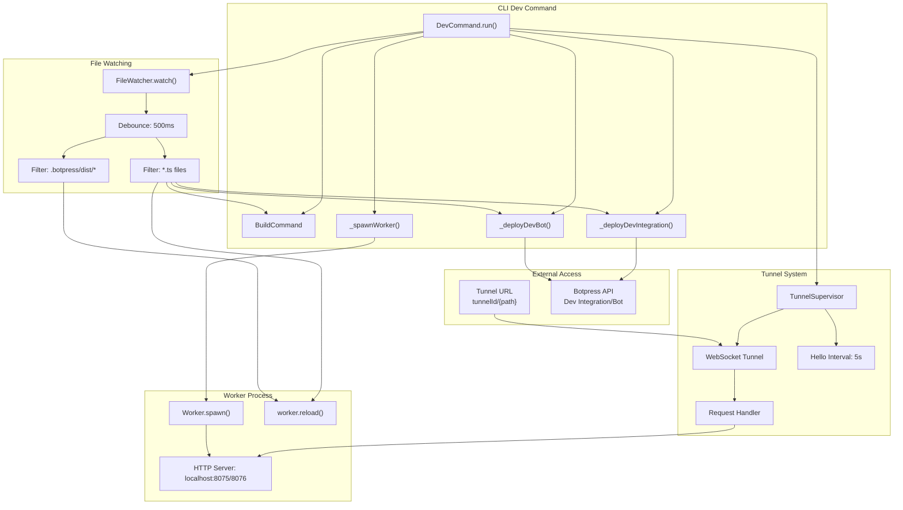

**Sources**: [packages/cli/src/command-implementations/dev-command.ts:1-426]()

### Development Workflow

The development workflow is triggered by the `bp dev` command and follows this sequence:

1.  **Initial Setup** [packages/cli/src/command-implementations/dev-command.ts:34-135]():
    -   Read project definition from filesystem using `readProjectDefinitionFromFS()` [packages/cli/src/command-implementations/dev-command.ts:42]().
    -   Set up environment variables (API URL, token, secrets for integrations).
    -   Determine port (default: 8075 for bots, 8076 for integrations) [packages/cli/src/command-implementations/dev-command.ts:20-21]().
    -   Configure tunnel URL and generate/cache tunnel ID [packages/cli/src/command-implementations/dev-command.ts:81-101]().

2.  **Tunnel Initialization** [packages/cli/src/command-implementations/dev-command.ts:95-134]():
    -   Create `TunnelSupervisor` with WebSocket connection [packages/cli/src/command-implementations/dev-command.ts:115]().
    -   Start hello interval timer (5000ms) to keep tunnel alive [packages/cli/src/command-implementations/dev-command.ts:118]().
    -   Set up request forwarding from tunnel to local server [packages/cli/src/command-implementations/dev-command.ts:127-150]().
    -   Handle tunnel closure and reconnection.

3.  **Build and Deploy** [packages/cli/src/command-implementations/dev-command.ts:136-138]():
    -   Run initial build via `_runBuild()` [packages/cli/src/command-implementations/dev-command.ts:160]().
    -   Deploy dev integration/bot to Botpress platform via `_deploy()` [packages/cli/src/command-implementations/dev-command.ts:161]().
    -   Spawn worker process with compiled code via `_spawnWorker()` [packages/cli/src/command-implementations/dev-command.ts:162]().

4.  **File Watching** [packages/cli/src/command-implementations/dev-command.ts:141-166]():
    -   Watch for file changes with 500ms debounce using `utils.filewatcher.FileWatcher.watch()` [packages/cli/src/command-implementations/dev-command.ts:178]().
    -   Filter TypeScript files (excluding output directory).
    -   Filter distribution directory changes.
    -   Trigger rebuild/reload on changes.

**Sources**: [packages/cli/src/command-implementations/dev-command.ts:34-182]()

### Hot Reload Mechanism

The hot reload system distinguishes between two types of changes:

**TypeScript Source Changes** [packages/cli/src/command-implementations/dev-command.ts:155-157]():
```
Changes detected → Rebuild → Deploy → Reload Worker
```

**Distribution Directory Changes** [packages/cli/src/command-implementations/dev-command.ts:158-160]():
```
Changes detected → Reload Worker (skip rebuild)
```

The restart process is defined in `_restart()`:

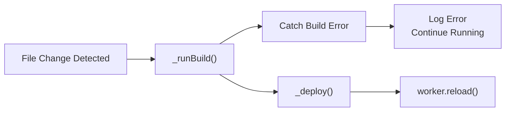

**Sources**: [packages/cli/src/command-implementations/dev-command.ts:184-195]()

### Worker Process Management

The worker process is spawned using Node.js code evaluation:

| Property | Value |
|----------|-------|
| Entry Point | `projectPaths.abs.outFileCJS` |
| Worker Code | `require('{importPath}').default.start({port})` |
| Environment | API URL, token, secrets (for integrations) |
| Reload Strategy | Kill and respawn on code changes |

**Sources**: [packages/cli/src/command-implementations/dev-command.ts:227-243]()

### Development Integration/Bot Deployment

Development deployments create special `dev: true` entities that:
- Use the tunnel URL instead of bundled code
- Maintain a cached `devId` in the project cache
- Skip deployment if definition hasn't changed (for bots)
- Support integration secret prompting

**Dev Integration Deployment** [packages/cli/src/command-implementations/dev-command.ts:251-304]():
- Cache `devId` in `.botpress/cache.json`
- Create or update integration with `dev: true` flag
- Use tunnel URL for external access
- Prompt for secrets on first run

**Dev Bot Deployment** [packages/cli/src/command-implementations/dev-command.ts:306-379]():
- Create bot with `dev: true` flag if not exists
- Update bot definition and dependencies
- Deploy tables via `TablesPublisher`
- Validate integration registration
- Display webhook URLs

**Sources**: [packages/cli/src/command-implementations/dev-command.ts:251-379]()

### Tunnel Request Forwarding

The tunnel forwards incoming requests to the local server:

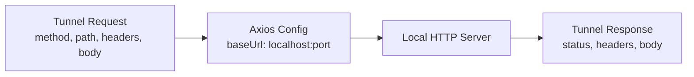

The forwarding logic handles:
- Query string concatenation
- Header extraction and filtering
- Status code pass-through
- Response body forwarding

**Sources**: [packages/cli/src/command-implementations/dev-command.ts:387-424]()

## CI/CD Pipeline

The CI/CD pipeline automates testing, building, and deployment of the Botpress monorepo using GitHub Actions. It includes workflows for staging and production deployments, package publishing, and various quality checks. For details, see [CI/CD Pipeline](#6.2).

### Workflow Overview

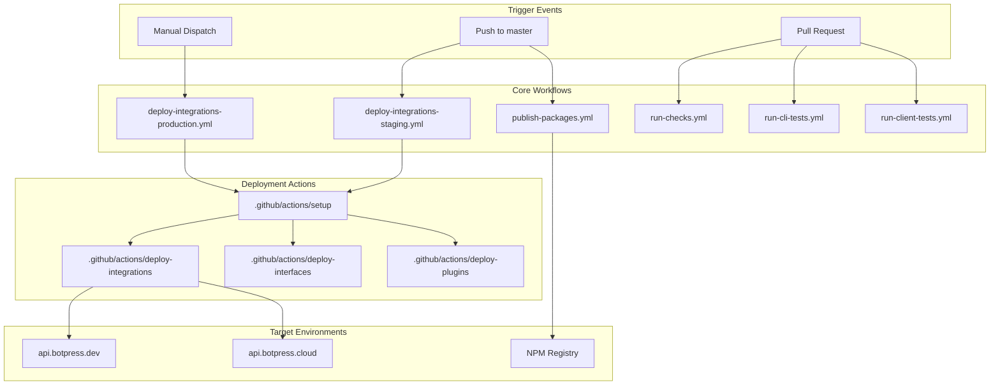

**Sources**: [.github/workflows/deploy-integrations-staging.yml:1-55](), [.github/workflows/deploy-integrations-production.yml:1-47](), [.github/workflows/publish-packages.yml:1-66]()

### Setup Action

The setup action provides a standardized environment for all workflows:

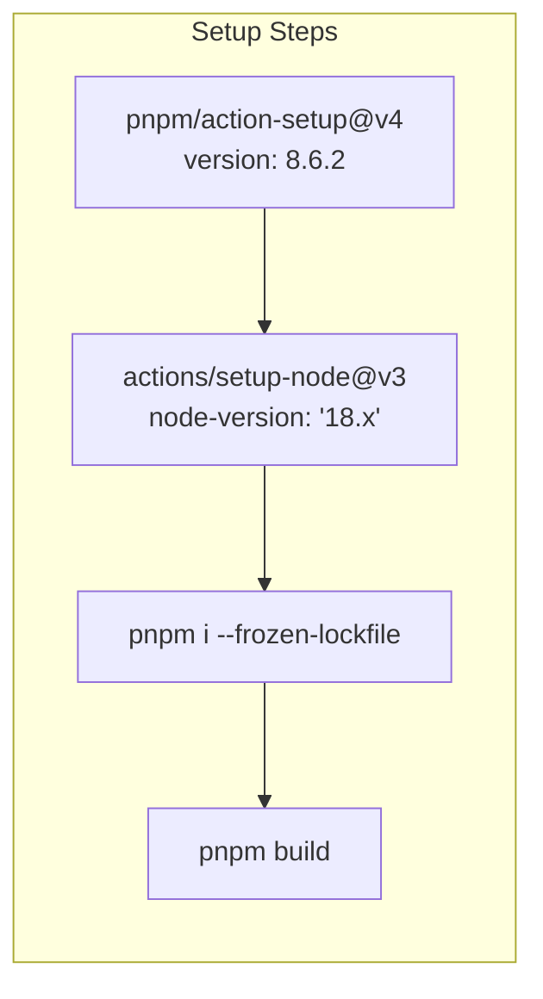

The setup action accepts `extra_filters` to selectively build packages using Turbo filters.

**Sources**: [.github/actions/setup/action.yml:1-28]()

## Deployment Processes

### Integration Deployment Flow

The integration deployment process handles the lifecycle of deploying integrations to staging and production environments.

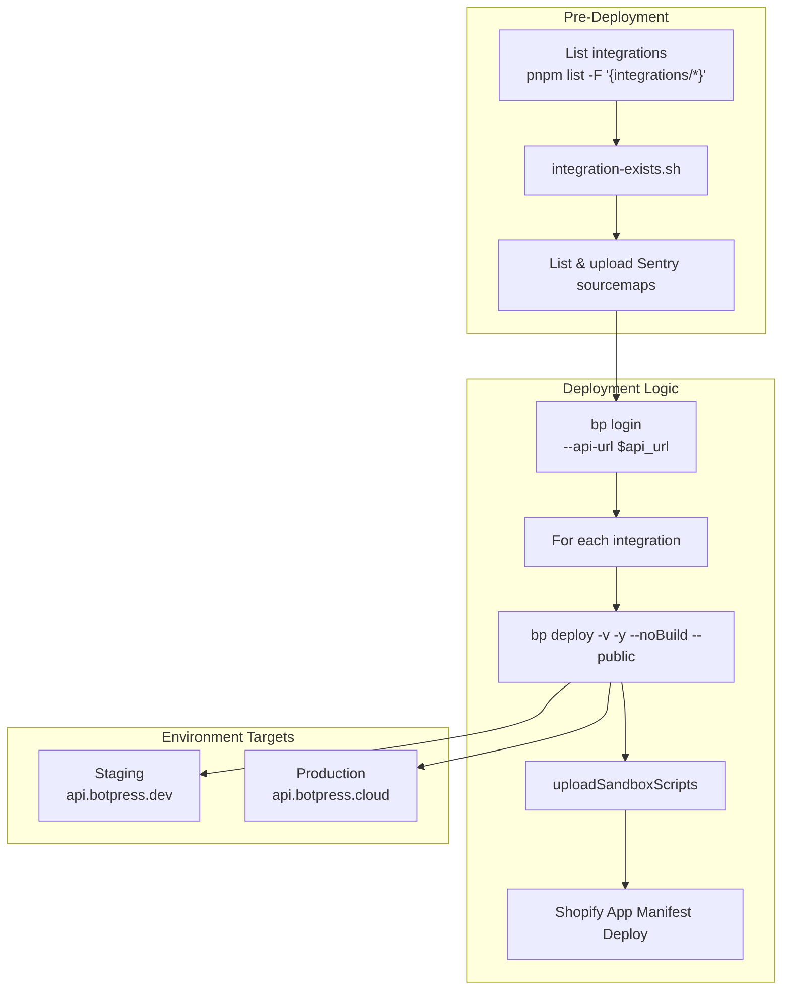

The deployment process includes conditional logic for re-deployment based on the `force` parameter and existence checks. It also handles Shopify app manifest deployment for relevant integrations [github/actions/deploy-integrations/action.yml:118-133]().

**Sources**: [.github/actions/deploy-integrations/action.yml:66-135]()

### Deployment Filtering

The deployment system uses pnpm filters to control which integrations and plugins are deployed:

**Integration Filters**:

| Environment | Excluded Integrations |
|-------------|----------------------|
| Production | `docusign`, `chat`, `grafana` [github/workflows/deploy-integrations-production.yml:34]() |
| Staging | `chat` [github/workflows/deploy-integrations-staging.yml:42]() |

**Plugin Filters**:

| Environment | Excluded Plugins |
|-------------|------------------|
| Production | `analytics`, `logger`, `personality`, `synchronizer`, `knowledge` [github/workflows/deploy-integrations-production.yml:43]() |
| Staging | None (all plugins deployed) |

**Sources**: [.github/workflows/deploy-integrations-production.yml:34-47](), [.github/workflows/deploy-integrations-staging.yml:42-56]()

### Deploy Command Implementation

The `DeployCommand` [packages/cli/src/command-implementations/deploy-command.ts:15]() handles deployment of different project types with specific validation and preparation steps:

**Deployment Flow by Project Type**

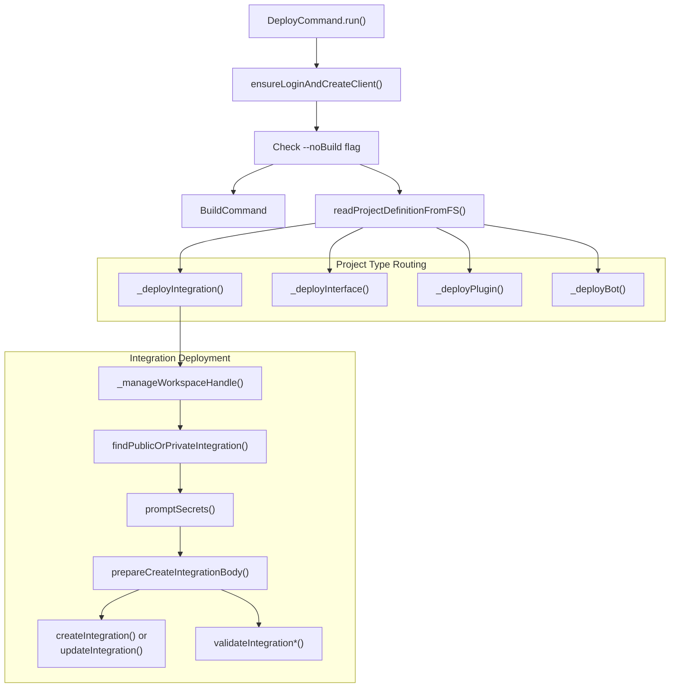

**Sources**: [packages/cli/src/command-implementations/deploy-command.ts:15-42]()

### Integration Deployment Details

The integration deployment process [packages/cli/src/command-implementations/deploy-command.ts:61-180]() includes several validation steps:

**Validation Checks**:
1.  Icon must be SVG format [packages/cli/src/command-implementations/deploy-command.ts:75-77]().
2.  Readme must be Markdown format [packages/cli/src/command-implementations/deploy-command.ts:79-81]().
3.  Version must be unique if deployed publicly by non-Botpress workspace [packages/cli/src/command-implementations/deploy-command.ts:83-94]().
4.  Public integrations cannot be updated without version bump [packages/cli/src/command-implementations/deploy-command.ts:90-94]().

**Workspace Handle Management** [packages/cli/src/command-implementations/project-command.ts:522-631]():
-   Validates workspace handle in integration name.
-   Prompts to claim available handles.
-   Allows deployment to alternate workspaces.
-   Format: `{workspaceHandle}/{integrationName}`.

**Deprecated Feature Detection** [packages/cli/src/command-implementations/deploy-command.ts:381-410]():
-   Warns about deprecated `user.creation` field.
-   Warns about deprecated `channels.{channel}.creation` field.
-   Allows deprecated features in minor/patch version bumps with `--allowDeprecated`.

**Sources**: [packages/cli/src/command-implementations/deploy-command.ts:61-410]()

### Bot Deployment Details

The bot deployment process [packages/cli/src/command-implementations/deploy-command.ts:412-477]() includes:

1.  **Bot Selection**:
    -   Use `--botId` to specify existing bot [packages/cli/src/config.ts:190]().
    -   Use `--createNewBot` to create new bot [packages/cli/src/config.ts:194]().
    -   Prompt user to select from existing bots if neither flag provided.

2.  **Deployment Steps**:
    -   Update bot code and definition.
    -   Prepare bot dependencies (integrations and plugins).
    -   Validate integration registration status.
    -   Deploy tables via `TablesPublisher`.
    -   Display webhook URLs.

**Integration Registration Validation**:
-   Checks if any integrations have `status === 'registration_failed'`.
-   Logs warning with `statusReason` for each failed integration.
-   Continues deployment despite failures (non-blocking).

**Sources**: [packages/cli/src/command-implementations/deploy-command.ts:412-477](), [packages/cli/src/command-implementations/project-command.ts:608-622]()

### Deployment Configuration Options

The `DeployCommand` supports several configuration options, defined in `config.ts` [packages/cli/src/config.ts:186-226]():

| Option | Description | Default |
|--------|-------------|---------|
| `--noBuild` | Skip build step before deployment | `false` |
| `--public` | Deploy as public (deprecated, use `--visibility`) | `false` |
| `--visibility` | Set visibility: `public`, `private`, `unlisted` | `private` |
| `--dryRun` | Validate without deploying | `false` |
| `--allowDeprecated` | Allow deprecated features | `false` |
| `--botId` | Target bot ID for bot deployment | N/A |
| `--createNewBot` | Create new bot for deployment | `false` |
| `--url` | Custom URL for the integration. Only used when deploying an integration | N/A |
| `--bypassBreakingChangeDetection` | Bypass breaking changes detection (hidden) | `false` |

**Sources**: [packages/cli/src/config.ts:186-226]()

### Package Publishing

The package publishing workflow handles NPM releases for core Botpress packages:

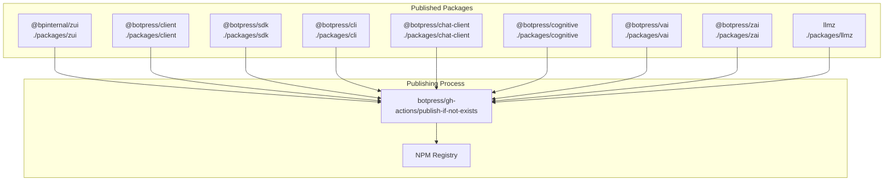

The publishing process uses the `publish-if-not-exists` action to avoid duplicate publications.

**Sources**: [.github/workflows/publish-packages.yml:26-65]()

## Code Quality

The codebase maintains high quality through a combination of pre-commit hooks, linting, formatting, and type-checking tools. For details, see [Code Quality](#6.3).

### Pre-commit Hook System

The repository uses Husky and lint-staged to enforce code quality before commits:

**Pre-commit Workflow**

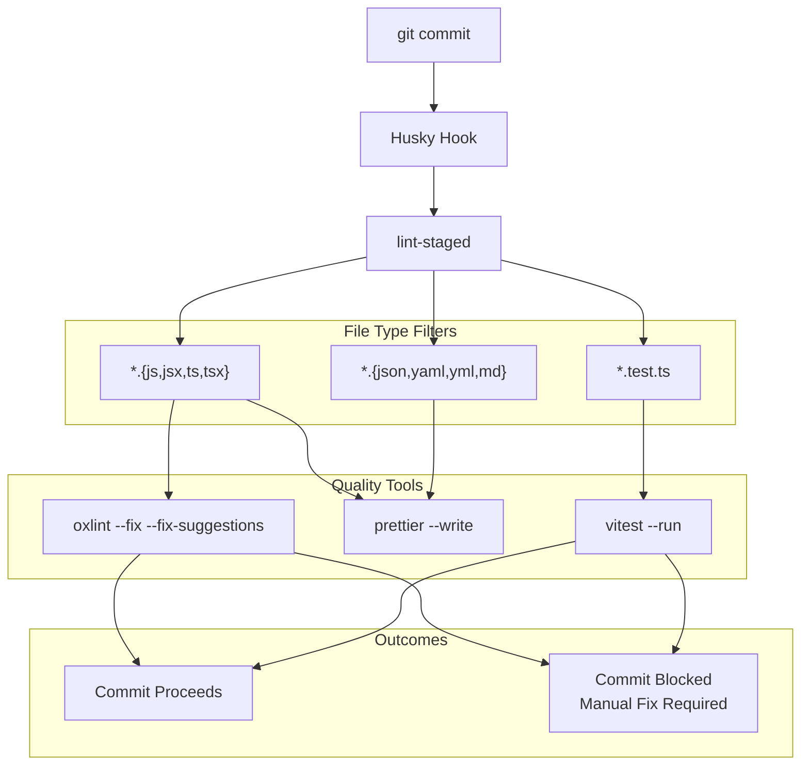

**Sources**: [package.json:25-32]()

### Lint-Staged Configuration

The `lint-staged` section defines file-specific processing:

```json
{
  "lint-staged": {
    "**/*.{js,mjs,cjs,jsx,ts,mts,cts,tsx}": [
      "oxlint -c .oxlintrc.json --fix --fix-suggestions",
      "prettier --write"
    ],
    "**/*.{json,yaml,yml,md}": "prettier --write",
    "**/*.test.ts": "vitest --run"
  }
}
```

**Sources**: [package.json:25-32]()

### Available Quality Scripts

The repository provides multiple scripts for checking and fixing code quality:

**Check Scripts** (lines 8-15):

| Script | Tool | Purpose |
|--------|------|---------|
| `check:bplint` | bplint | Botpress-specific linting rules |
| `check:dep` | depsynky | Dependency version consistency |
| `check:sherif` | sherif | Package.json policy enforcement |
| `check:format` | prettier | Code formatting validation |
| `check:eslint` | eslint | JavaScript/TypeScript linting |
| `check:oxlint` | oxlint | Fast Rust-based linting |
| `check:lint` | Combined | All linting tools |
| `check:type` | tsc | TypeScript type checking |

**Fix Scripts** (lines 16-23):

| Script | Tool | Purpose |
|--------|------|---------|
| `fix:dep` | depsynky | Sync dependency versions |
| `fix:sherif` | sherif | Fix package.json issues |
| `fix:format` | prettier | Auto-format code |
| `fix:oxlint` | oxlint | Auto-fix linting issues |
| `fix:eslint` | eslint | Auto-fix ESLint issues |
| `fix:lint` | Combined | All auto-fixable linting |

**Combined Scripts**:
- `check`: Runs all check scripts sequentially
- `fix`: Runs all fix scripts sequentially

**Sources**: [package.json:4-24]()

### Linting Tool Configuration

**Oxlint** (Fast Rust-based linter):
- Configuration: `.oxlintrc.json`
- Supports auto-fix with `--fix` flag
- Includes suggestion fixes with `--fix-suggestions`

**ESLint**:
- Used for JavaScript/TypeScript files
- Configured with `--max-warnings 0` (fail on any warning)
- Runs across all packages with `pnpm -r --no-bail exec`

**bplint** (Botpress-specific linter):
- Enforces Botpress coding standards
- Runs via Turbo: `turbo check:bplint`

**Sources**: [package.json:8-23]()

### Dependency Management Tools

**Sherif** (lines 10, 17):
- Enforces package.json policies across the monorepo
- Ignores specific packages: `zod`, `axios`, `query-string`, `googleapis`, `@linear/sdk`, `openai`
- Can auto-fix issues with `--fix` flag

**Depsynky** (lines 9, 16):
- Checks and syncs dependency versions across packages
- Ignores dev dependencies with `--ignore-dev`
- Command `bump` updates dependencies to latest versions
- Command `check` validates consistency
- Command `sync` fixes inconsistencies

**Sources**: [package.json:6-17]()

## Build System Architecture

The build system is orchestrated by Turbo using the configuration defined in `turbo.json`. It manages dependencies between packages and provides optimized build caching.

### Turbo Build Pipeline

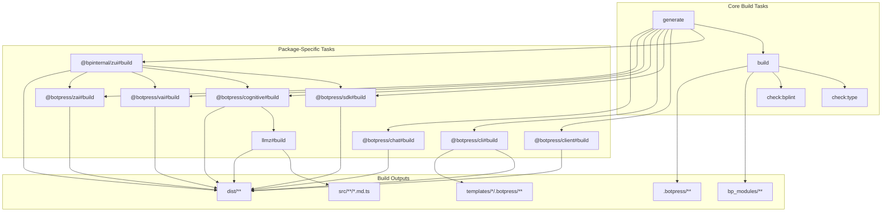

The build system defines specific output directories and dependencies for each package type. The `generate` task creates TypeScript definitions, while `build` compiles the final artifacts.

**Sources**: [turbo.json:1-57]()

### Package Build Dependencies

| Package | Dependencies | Outputs |
|---------|-------------|---------|
| `@bpinternal/zui` | `generate`, `^build` | `dist/**` |
| `@botpress/client` | `generate`, `^build` | `dist/**` |
| `@botpress/sdk` | `generate`, `^build`, `@bpinternal/zui#build` | `dist/**` |
| `@botpress/cli` | `generate`, `^build` | `dist/**`, `templates/*/.botpress/**` |
| `@botpress/cognitive` | `generate`, `^build`, `@bpinternal/zui#build` | `dist/**` |
| `@botpress/vai` | `generate`, `^build`, `@bpinternal/zui#build` | `dist/**` |
| `@botpress/zai` | `generate`, `^build`, `@bpinternal/zui#build` | `dist/**` |
| `llmz` | `generate`, `^build`, `@botpress/cognitive#build` | `dist/**`, `src/**/*.md.ts` |
| `@botpress/chat` | `generate`, `^build` | `dist/**` |

**Sources**: [turbo.json:17-52]()

### Build Command Implementation

The `BuildCommand` [packages/cli/src/command-implementations/build-command.ts:15]() orchestrates the build process through two sub-commands:

**Build Process Flow**

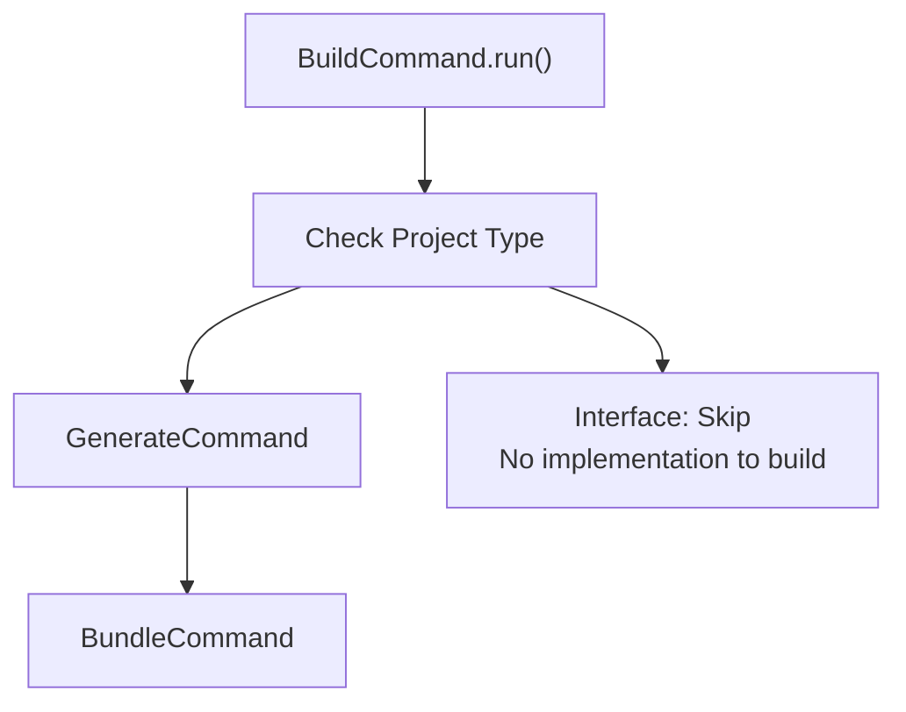

**Sources**: [packages/cli/src/command-implementations/build-command.ts:1-37]()

### Bundle Process

The `BundleCommand` [packages/cli/src/command-implementations/bundle-command.ts:15]() uses esbuild to compile and bundle project code:

**Bundling Strategy by Project Type**

| Project Type | Platform | Format | Output File |
|--------------|----------|--------|-------------|
| Integration | `node` | `cjs` | `.botpress/dist/index.cjs` |
| Bot | `node` | `cjs` | `.botpress/dist/index.cjs` |
| Plugin (node) | `node` | `cjs` | `.botpress/dist/index.cjs` |
| Plugin (browser) | `browser` | `esm` | `.botpress/dist/index.mjs` |
| Interface | N/A | N/A | No bundle needed |

The bundler generates entry point code that imports the project implementation:

```typescript
// Generated entry point
import x from './{importFrom}';
export default x;
export const handler = x.handler;
```

**esbuild Configuration**:
- Bundling: `true`
- Target: `es2020`
- Platform: `node` (default) or `browser` (for plugins)
- Sourcemap: Controlled by `--sourceMap` flag
- Minify: Controlled by `--minify` flag
- Keep Names: `true` (for node-fetch compatibility)

**Sources**: [packages/cli/src/command-implementations/bundle-command.ts:1-74](), [packages/cli/src/utils/esbuild-utils.ts:19-29]()

### Build Context Caching

The build system uses `BuildContext` classes to cache esbuild contexts and avoid unnecessary rebuilds:

**BuildCodeContext** [packages/cli/src/utils/esbuild-utils.ts:31-63]()
- Caches build context based on props and options
- Rebuilds only when props or options change
- Used for code string compilation

**BuildEntrypointContext** [packages/cli/src/utils/esbuild-utils.ts:65-77]()
- Caches build context for entry point files
- Used for definition file compilation
- Returns output files without writing to disk

**Sources**: [packages/cli/src/utils/esbuild-utils.ts:31-78]()

## Testing Infrastructure

### Test Workflows

The repository includes multiple test workflows targeting different components:

| Workflow | Trigger | Target | Environment |
|----------|---------|--------|-------------|
| `run-checks.yml` | Pull Request | All packages | - |
| `run-cli-tests.yml` | Pull Request | `@botpress/cli` | Staging |
| `run-client-tests.yml` | Pull Request | `@botpress/client` | - |
| `run-chat-tests.yml` | Pull Request | Chat components | Staging |

**Sources**: [.github/workflows/run-checks.yml:1-27](), [.github/workflows/run-cli-tests.yml:1-31](), [.github/workflows/run-client-tests.yml:1-24]()

### CLI Testing

The CLI tests run end-to-end tests against the staging environment:

```bash
pnpm run -F cli test:e2e -v \
  --api-url https://api.botpress.dev \
  --workspace-id $STAGING_E2E_TESTS_WORKSPACE_ID \
  --workspace-handle clitests \
  --token $STAGING_TOKEN_CLOUD_OPS_ACCOUNT
```

**Sources**: [.github/workflows/run-cli-tests.yml:24-30]()

### Quality Checks in CI

The check workflow runs comprehensive quality assurance on every pull request:

**Run Checks Workflow** [github/workflows/run-checks.yml:19-26]()

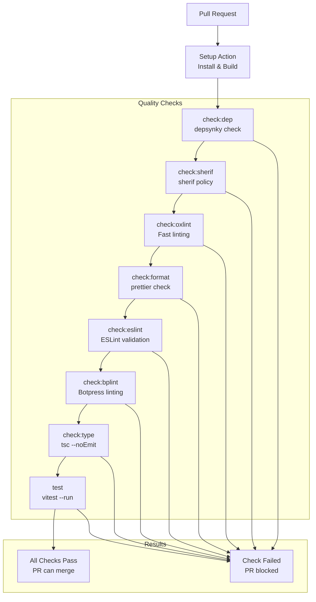

The workflow runs on `depot-ubuntu-22.04-8` runners with a 10-minute timeout and 8192MB Node.js memory allocation.

**Sources**: [.github/workflows/run-checks.yml:1-27](), [package.json:8-15,22]()

### Integration Version Validation

The `check-integration-versions` workflow ensures that modified integrations have updated version numbers:

**Version Check Workflow** [github/workflows/check-integration-versions.yml:26-44]():
1.  Detect changed files in `integrations/**/*.{ts,md,svg}`.
2.  Extract integration names from changed file paths.
3.  For each modified integration:
    -   Check if it exists in production with same version.
    -   Fail if version already deployed publicly.
4.  Require version bump before merging.

This prevents accidental overwrites of published integrations.

**Sources**: [.github/workflows/check-integration-versions.yml:1-45]()

## Environment Configuration

### Node.js and Package Manager Versions

The repository uses specific versions for consistency across environments:

-   **Node.js**: `18.13.0`
-   **pnpm**: `8.6.2`

**Sources**: [.tool-versions:1-2](), [.github/actions/setup/action.yml:14]()

### Environment Variables

The build system supports environment variable injection through the `globalEnv` configuration:

```json
{
  "globalEnv": ["BP_*"]
}
```

This allows all environment variables prefixed with `BP_` to be available during build tasks.

**Sources**: [turbo.json:3]()

---

