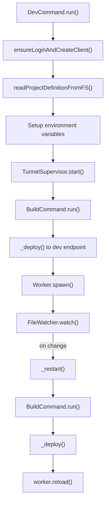
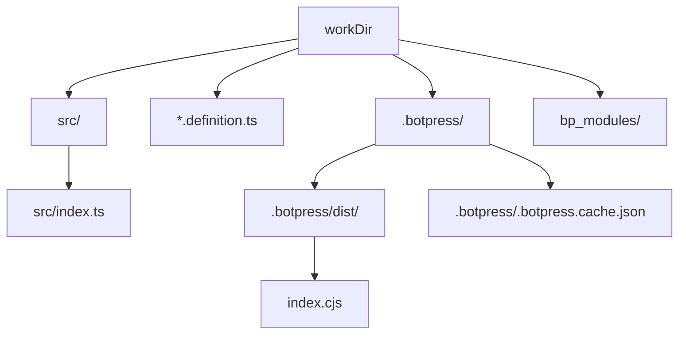
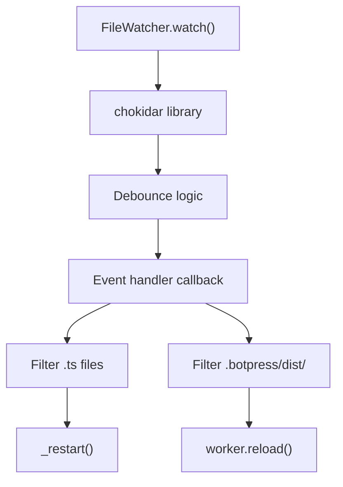
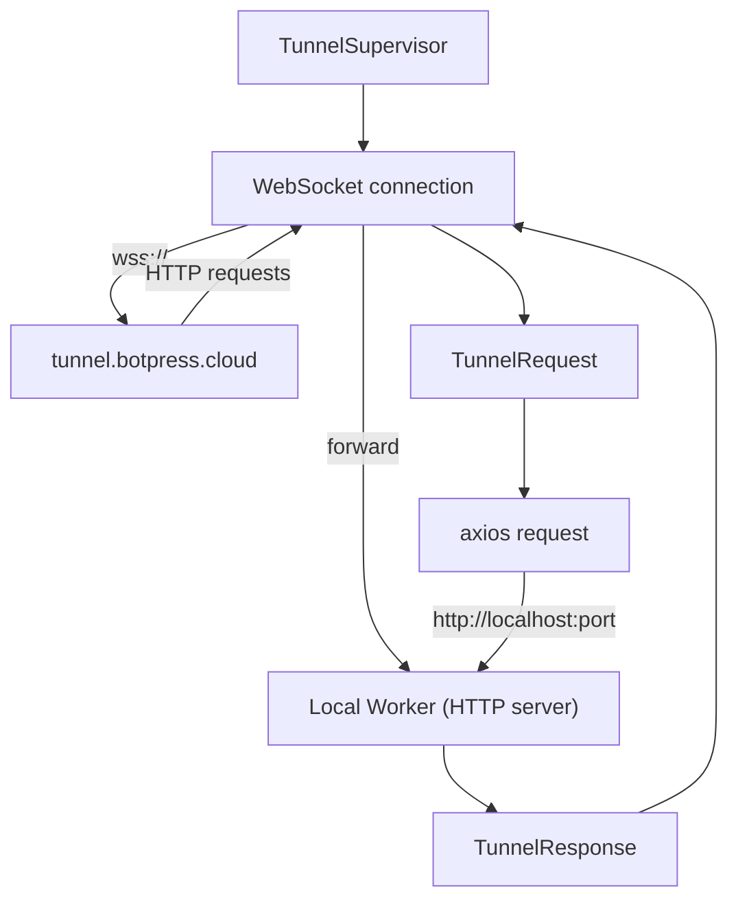
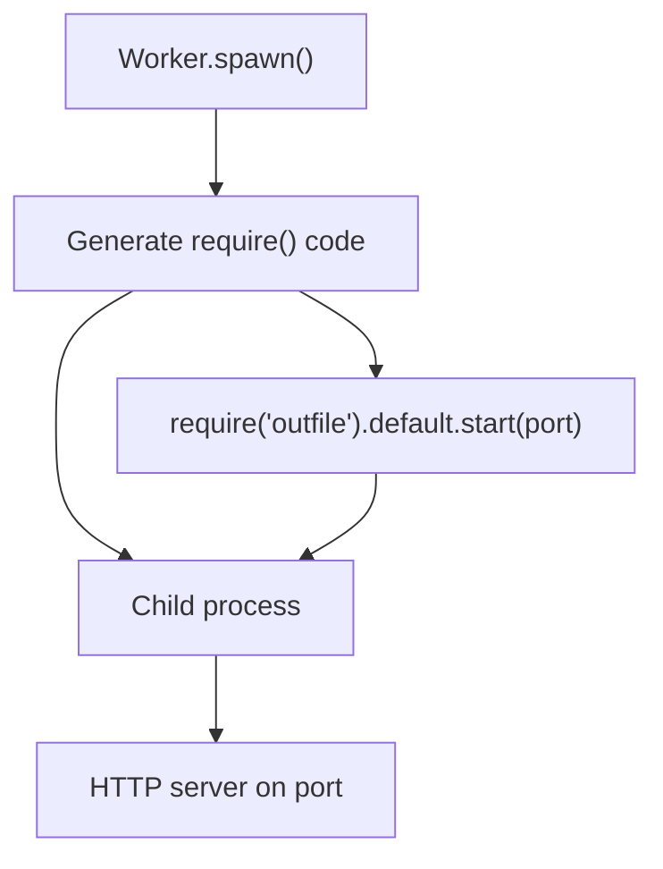
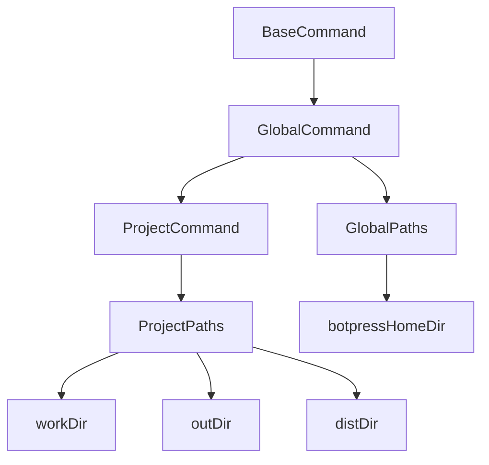

<!-- source: DeepWiki mcp.deepwiki.com · repo botpress/botpress · page 6.1 Local Development · fetched 2026-10-27 -->

# Local Development

<details>
<summary>Relevant source files</summary>

The following files were used as context for generating this wiki page:

- [packages/cli/e2e/api.ts](packages/cli/e2e/api.ts)
- [packages/cli/e2e/defaults.ts](packages/cli/e2e/defaults.ts)
- [packages/cli/e2e/index.ts](packages/cli/e2e/index.ts)
- [packages/cli/e2e/tests/bot-secrets.ts](packages/cli/e2e/tests/bot-secrets.ts)
- [packages/cli/e2e/tests/create-deploy-bot-with-dependencies.ts](packages/cli/e2e/tests/create-deploy-bot-with-dependencies.ts)
- [packages/cli/e2e/tests/create-deploy-bot.ts](packages/cli/e2e/tests/create-deploy-bot.ts)
- [packages/cli/e2e/tests/create-deploy-integration.ts](packages/cli/e2e/tests/create-deploy-integration.ts)
- [packages/cli/e2e/tests/dev-bot.ts](packages/cli/e2e/tests/dev-bot.ts)
- [packages/cli/e2e/tests/install-interfaces.ts](packages/cli/e2e/tests/install-interfaces.ts)
- [packages/cli/e2e/tests/install-package.ts](packages/cli/e2e/tests/install-package.ts)
- [packages/cli/e2e/tests/install-plugins.ts](packages/cli/e2e/tests/install-plugins.ts)
- [packages/cli/e2e/tests/integration-secrets.ts](packages/cli/e2e/tests/integration-secrets.ts)
- [packages/cli/e2e/tests/manage-workspace-handle.ts](packages/cli/e2e/tests/manage-workspace-handle.ts)
- [packages/cli/e2e/typings.ts](packages/cli/e2e/typings.ts)
- [packages/cli/e2e/utils.ts](packages/cli/e2e/utils.ts)
- [packages/cli/src/api/client.ts](packages/cli/src/api/client.ts)
- [packages/cli/src/api/types.ts](packages/cli/src/api/types.ts)
- [packages/cli/src/cli.ts](packages/cli/src/cli.ts)
- [packages/cli/src/code-generation/bot-implementation/index.ts](packages/cli/src/code-generation/bot-implementation/index.ts)
- [packages/cli/src/code-generation/integration-implementation/index.ts](packages/cli/src/code-generation/integration-implementation/index.ts)
- [packages/cli/src/code-generation/secret-module.ts](packages/cli/src/code-generation/secret-module.ts)
- [packages/cli/src/command-implementations/base-command.ts](packages/cli/src/command-implementations/base-command.ts)
- [packages/cli/src/command-implementations/bot-commands.ts](packages/cli/src/command-implementations/bot-commands.ts)
- [packages/cli/src/command-implementations/build-command.ts](packages/cli/src/command-implementations/build-command.ts)
- [packages/cli/src/command-implementations/bundle-command.ts](packages/cli/src/command-implementations/bundle-command.ts)
- [packages/cli/src/command-implementations/deploy-command.ts](packages/cli/src/command-implementations/deploy-command.ts)
- [packages/cli/src/command-implementations/dev-command.ts](packages/cli/src/command-implementations/dev-command.ts)
- [packages/cli/src/command-implementations/init-command.ts](packages/cli/src/command-implementations/init-command.ts)
- [packages/cli/src/command-implementations/integration-commands.ts](packages/cli/src/command-implementations/integration-commands.ts)
- [packages/cli/src/command-implementations/interface-commands.ts](packages/cli/src/command-implementations/interface-commands.ts)
- [packages/cli/src/command-implementations/plugin-commands.ts](packages/cli/src/command-implementations/plugin-commands.ts)
- [packages/cli/src/command-implementations/project-command.ts](packages/cli/src/command-implementations/project-command.ts)
- [packages/cli/src/command-implementations/serve-command.ts](packages/cli/src/command-implementations/serve-command.ts)
- [packages/cli/src/config.test.ts](packages/cli/src/config.test.ts)
- [packages/cli/src/config.ts](packages/cli/src/config.ts)
- [packages/cli/src/errors.test.ts](packages/cli/src/errors.test.ts)
- [packages/cli/src/errors.ts](packages/cli/src/errors.ts)
- [packages/cli/src/init.ts](packages/cli/src/init.ts)
- [packages/cli/src/register-yargs.ts](packages/cli/src/register-yargs.ts)
- [packages/cli/src/root.ts](packages/cli/src/root.ts)
- [packages/cli/src/utils/esbuild-utils.test.ts](packages/cli/src/utils/esbuild-utils.test.ts)
- [packages/cli/src/utils/esbuild-utils.ts](packages/cli/src/utils/esbuild-utils.ts)
- [packages/cli/src/utils/semver-utils.ts](packages/cli/src/utils/semver-utils.ts)
- [packages/cli/src/utils/tunnel-utils.ts](packages/cli/src/utils/tunnel-utils.ts)
- [packages/cli/tsconfig.json](packages/cli/tsconfig.json)
- [packages/sdk/src/version-utils.ts](packages/sdk/src/version-utils.ts)

</details>


This page documents the local development workflow for Botpress projects, focusing on the `bp dev` command, which provides hot-reload development with file watching, tunnel access, and automatic redeployment.

The `bp dev` command is the primary tool for active development of bots, integrations, and plugins. It combines building, serving, and tunnel management into a single command with automatic restart on code changes.

For deployment workflows, see [CI/CD Pipeline](#6.2). For other CLI commands, see [CLI Commands](#3.1).

## Overview of Local Development

The local development workflow centers on the `DevCommand` class, which orchestrates multiple subsystems to provide a live development experience.

### DevCommand Workflow

Title: DevCommand Execution Flow



Sources: [packages/cli/src/command-implementations/dev-command.ts:34-182]()

The `DevCommand` performs these steps:

1.  **Authentication**: Creates an `ApiClient` with workspace credentials [packages/cli/src/command-implementations/dev-command.ts:41]()
2.  **Project Resolution**: Reads project definition from `*.definition.ts` files [packages/cli/src/command-implementations/dev-command.ts:43]()
3.  **Environment Setup**: Configures `BP_API_URL`, `BP_TOKEN`, and integration secrets [packages/cli/src/command-implementations/dev-command.ts:58-78]()
4.  **Tunnel Initialization**: Establishes WebSocket tunnel for external access [packages/cli/src/command-implementations/dev-command.ts:158]()
5.  **Initial Build**: Runs `BuildCommand` to compile TypeScript [packages/cli/src/command-implementations/dev-command.ts:160]()
6.  **Deployment**: Creates or updates dev integration/bot on platform [packages/cli/src/command-implementations/dev-command.ts:164]()
7.  **Worker Spawn**: Starts local HTTP server in child process [packages/cli/src/command-implementations/dev-command.ts:161]()
8.  **File Watching**: Monitors source files for changes [packages/cli/src/command-implementations/dev-command.ts:177-182]()

Sources: [packages/cli/src/command-implementations/dev-command.ts:34-182]()

### Default Port Configuration

The `DevCommand` uses different default ports based on project type:

| Project Type | Default Port | Constant |
|--------------|--------------|----------|
| Bot | 8075 | `DEFAULT_BOT_PORT` |
| Integration | 8076 | `DEFAULT_INTEGRATION_PORT` |

Sources: [packages/cli/src/command-implementations/dev-command.ts:19-20]()

The port can be overridden using the `--port` command-line argument [packages/cli/src/config.ts:235]().

### Project Structure

Botpress projects follow a standardized directory structure:



Sources: [packages/cli/src/consts.ts:17-52](), [packages/cli/src/command-implementations/project-command.ts:61-68]()

Key paths referenced in code:

-   `projectPaths.abs.workDir` - Project root directory [packages/cli/src/command-implementations/project-command.ts:77]()
-   `projectPaths.abs.entryPoint` - `src/index.ts` entry file [packages/cli/src/consts.ts:20]()
-   `projectPaths.abs.outFileCJS` - `.botpress/dist/index.cjs` output [packages/cli/src/consts.ts:22]()
-   `projectPaths.abs.projectCacheFile` - `.botpress/.botpress.cache.json` [packages/cli/src/consts.ts:24]()
-   `projectPaths.abs.integrationDefinition` - `integration.definition.ts` [packages/cli/src/consts.ts:26]()
-   `projectPaths.abs.botDefinition` - `bot.definition.ts` [packages/cli/src/consts.ts:28]()

Sources: [packages/cli/src/consts.ts:17-52]()

## File Watcher and Hot Reload

The `DevCommand` uses a file watcher to detect changes and trigger automatic rebuilds. This system provides rapid feedback during development without manual intervention.

### FileWatcher Architecture

Title: File Watcher System Components



Sources: [packages/cli/src/command-implementations/dev-command.ts:177-195]()

The file watcher monitors the `workDir` and processes two types of changes:

1.  **TypeScript changes**: Files outside `.botpress/` with `.ts` extension trigger full restart [packages/cli/src/command-implementations/dev-command.ts:187-188]()
2.  **Output changes**: Files inside `.botpress/dist/` trigger worker reload only [packages/cli/src/command-implementations/dev-command.ts:189-190]()

Sources: [packages/cli/src/command-implementations/dev-command.ts:187-190]()

### Debouncing Configuration

File change events are debounced to prevent excessive rebuilds:

```typescript
const FILEWATCHER_DEBOUNCE_MS = 500
```

This 500ms delay ensures multiple rapid file saves are batched into a single rebuild operation.

Sources: [packages/cli/src/command-implementations/dev-command.ts:21]()

### Restart vs Reload

The system distinguishes between two types of updates:

**Full Restart** (`_restart`):
-   Triggered by TypeScript source changes [packages/cli/src/command-implementations/dev-command.ts:187-188]()
-   Executes `BuildCommand.run()` to recompile [packages/cli/src/command-implementations/dev-command.ts:185]()
-   Calls `_deploy()` to update dev integration/bot [packages/cli/src/command-implementations/dev-command.ts:191]()
-   Invokes `worker.reload()` to refresh runtime [packages/cli/src/command-implementations/dev-command.ts:194]()

**Worker Reload** (`worker.reload()`):
-   Triggered by output directory changes [packages/cli/src/command-implementations/dev-command.ts:189-190]()
-   Skips build and deploy steps
-   Only reloads the worker process [packages/cli/src/command-implementations/dev-command.ts:194]()

Sources: [packages/cli/src/command-implementations/dev-command.ts:184-195]()

### Error Handling During Restart

Build errors during restart are caught and logged without crashing the dev server:

```typescript
private _restart = async (api: ApiClient, worker: Worker, tunnelUrl: string) => {
  try {
    await this._runBuild()
  } catch (thrown) {
    const error = errors.BotpressCLIError.wrap(thrown, 'Build failed')
    this.logger.error(error.message)
    return // Continue watching despite build failure
  }
  // ...
}
```

This allows developers to fix syntax errors without restarting `bp dev`.

Sources: [packages/cli/src/command-implementations/dev-command.ts:184-195]()

## Tunnel System

The tunnel system provides external HTTP access to the local development server, enabling webhook delivery from external services like Slack or Telegram.

### TunnelSupervisor Architecture

Title: Tunnel System Components



Sources: [packages/cli/src/command-implementations/dev-command.ts:95-128]()

### Tunnel URL Format

The tunnel URL is constructed from configuration and a unique tunnel ID:

```typescript
const tunnelId = uuid.v4() // or from cache/CLI arg
const wsTunnelUrl = `wss://tunnel.botpress.cloud`
const httpTunnelUrl = `https://tunnel.botpress.cloud/${tunnelId}`
```

The `httpTunnelUrl` is registered with the Botpress platform as the webhook endpoint for the dev integration or bot.

Sources: [packages/cli/src/command-implementations/dev-command.ts:88-111]()

### Tunnel Keep-Alive Mechanism

The tunnel connection maintains activity with periodic hello messages:

```typescript
const TUNNEL_HELLO_INTERVAL = 5000 // 5 seconds

tunnel.events.on('connected', ({ tunnel }) => {
  const timer = setInterval(() => {
    if (tunnel.closed) {
      return handleClose()
    }
    tunnel.hello()
  }, TUNNEL_HELLO_INTERVAL)
})
```

This prevents the tunnel from closing due to inactivity.

Sources: [packages/cli/src/command-implementations/dev-command.ts:22](), [packages/cli/src/command-implementations/dev-command.ts:117-126]()

### Request Forwarding

Incoming tunnel requests are forwarded to the local worker:

Title: Tunnel Request Flow

```mermaid
graph LR
    ExternalService["External Service"]
    TunnelServer["tunnel.botpress.cloud"]
    TunnelSupervisor["TunnelSupervisor"]
    ForwardRequest["_forwardTunnelRequest()"]
    AxiosClient["axios HTTP client"]
    LocalWorker["Worker (localhost:port)"]
    
    ExternalService -->|webhook| TunnelServer
    TunnelServer -->|WebSocket| TunnelSupervisor
    TunnelSupervisor --> ForwardRequest
    ForwardRequest --> AxiosClient
    AxiosClient --> LocalWorker
    LocalWorker --> AxiosClient
    AxiosClient --> ForwardRequest
    ForwardRequest --> TunnelSupervisor
    TunnelSupervisor -->|WebSocket| TunnelServer
    TunnelServer --> ExternalService
```



Sources: [packages/cli/src/command-implementations/dev-command.ts:134-151]()

The `_forwardTunnelRequest` method:
1.  Extracts method, path, headers, and body from `TunnelRequest` [packages/cli/src/command-implementations/dev-command.ts:390-393]()
2.  Constructs local URL: `http://localhost:${port}${path}` [packages/cli/src/command-implementations/dev-command.ts:389]()
3.  Forwards via axios with `validateStatus: () => true` (accepts all status codes) [packages/cli/src/command-implementations/dev-command.ts:394-400]()
4.  Returns `TunnelResponse` with status, headers, and body [packages/cli/src/command-implementations/dev-command.ts:401-407]()

Sources: [packages/cli/src/command-implementations/dev-command.ts:387-407]()

### Tunnel ID Caching

The tunnel ID is cached in `projectCache` to maintain consistency across restarts:

```typescript
const cachedTunnelId = await this.projectCache.get('tunnelId')
let tunnelId: string
if (this.argv.tunnelId) {
  tunnelId = this.argv.tunnelId
} else if (cachedTunnelId) {
  tunnelId = cachedTunnelId
} else {
  tunnelId = uuid.v4()
}
if (cachedTunnelId !== tunnelId) {
  await this.projectCache.set('tunnelId', tunnelId)
}
```

This ensures webhook URLs remain stable between development sessions.

Sources: [packages/cli/src/command-implementations/dev-command.ts:88-101]()

## Worker Process Management

The worker process runs the actual bot or integration code in a child process, isolating it from the CLI process and enabling hot reload without restarting the entire development environment.

### Worker Spawning

Title: Worker Process Lifecycle



Sources: [packages/cli/src/command-implementations/dev-command.ts:227-243]()

The worker is spawned with dynamically generated code:

```typescript
private _spawnWorker = async (env: Record<string, string>, port: number) => {
  const outfile = this.projectPaths.abs.outFileCJS
  const importPath = utils.path.toUnix(outfile)
  const code = `require('${importPath}').default.start(${port})`
  const worker = await Worker.spawn(
    {
      type: 'code',
      code,
      env,
    },
    this.logger
  )
  return worker
}
```

This loads the compiled `.botpress/dist/index.cjs` and calls the `.start()` method exported by the SDK's `BotImplementation` or `IntegrationImplementation`.

Sources: [packages/cli/src/command-implementations/dev-command.ts:227-243]()

### Environment Variables

The worker process receives these environment variables:

| Variable | Value | Purpose |
|----------|-------|---------|
| `BP_API_URL` | `api.url` | Botpress API endpoint |
| `BP_TOKEN` | `api.token` | Authentication token |
| `SECRET_*` | Secret values | Integration secrets (for integrations only) |

Sources: [packages/cli/src/command-implementations/dev-command.ts:59-78]()

For integrations, secrets are prompted and formatted as environment variables:

```typescript
const secretEnvVariables = await this.promptSecrets(
  this._initialDef.definition, 
  this.argv, 
  { formatEnv: true }
)
env = { ...env, ...nonNullSecretEnvVariables }
```

The `formatEnv: true` option converts secret names to `SECRET_NAME` format.

Sources: [packages/cli/src/command-implementations/dev-command.ts:66-71]()

### Worker Reload Mechanism

The `Worker` class supports hot reload without process termination:

```typescript
await worker.reload()
```

This reloads the module cache and restarts the HTTP server without killing the child process, providing faster iteration than full process restart.

Sources: [packages/cli/src/command-implementations/dev-command.ts:194]()

### Worker Lifecycle Management

The worker's lifecycle is managed with promises:

```typescript
await Promise.race([
  worker.wait(),    // Resolves on worker exit
  watcher.wait(),   // Resolves on watcher error
  supervisor.wait() // Resolves on tunnel close
])

if (worker.running) {
  await worker.kill()
}
```

This ensures proper cleanup when any subsystem terminates.

Sources: [packages/cli/src/command-implementations/dev-command.ts:176-180]()

## Development File Management

### Path Management System

The CLI uses a sophisticated path management system through the `ProjectPaths` and `GlobalPaths` classes:



Sources: [packages/cli/src/command-implementations/project-command.ts:116-123](), [packages/cli/src/command-implementations/base-command.ts:1-42]()

### File Organization Constants

The CLI defines standard file and directory names:

-   `outDirName`: ".botpress" - Main output directory [packages/cli/src/consts.ts:17]()
-   `distDirName`: "dist" - Compiled output location [packages/cli/src/consts.ts:18]()
-   `installDirName`: "bp_modules" - Package installation directory [packages/cli/src/consts.ts:19]()
-   `defaultWorkDir`: `process.cwd()` - Current working directory [packages/cli/src/consts.ts:20]()
-   `defaultBotpressHome`: `~/.botpress` - Global configuration directory [packages/cli/src/consts.ts:21]()

Sources: [packages/cli/src/consts.ts:17-21]()

## Development Workflow Integration

### Package.json Scripts

Most Botpress projects use standardized npm scripts for development:

```json
{
  "scripts": {
    "build": "bp add -y && bp build",
    "check:type": "tsc --noEmit", 
    "check:bplint": "bp lint"
  }
}
```

These scripts integrate TypeScript checking, linting, and Botpress build processes for consistent development workflows.

Sources: [packages/cli/e2e/tests/create-deploy-integration.ts:42](), [packages/cli/e2e/tests/create-deploy-bot.ts:42](), [packages/cli/e2e/tests/create-deploy-bot-with-dependencies.ts:42]()

---

