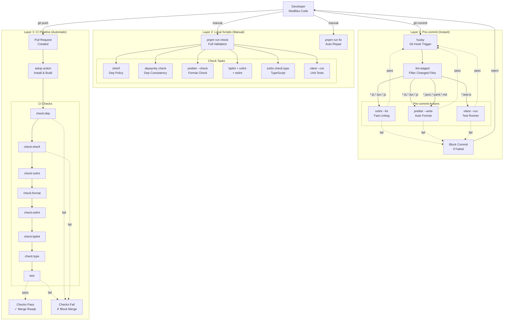
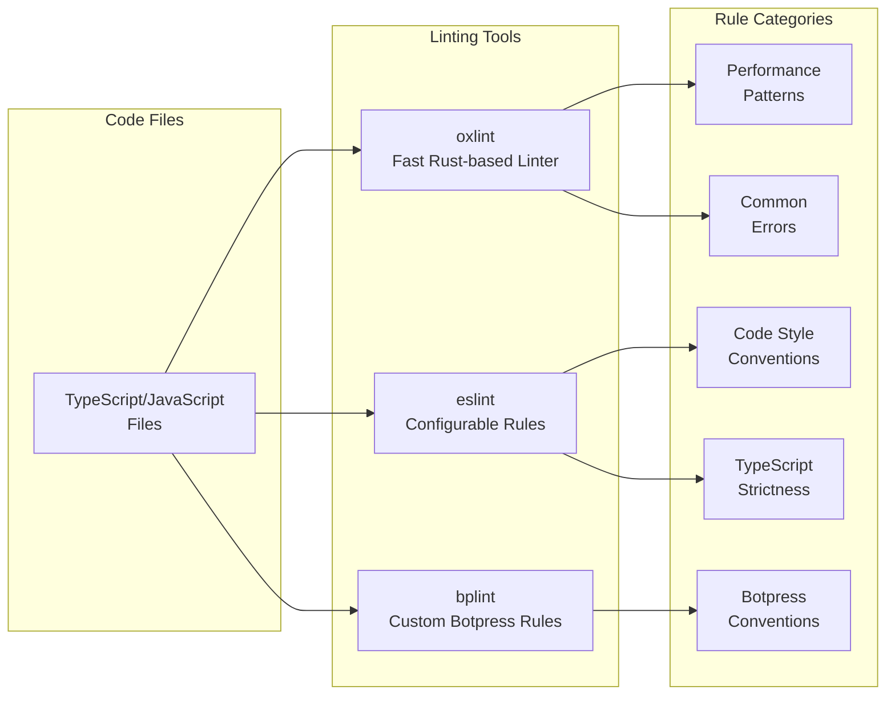
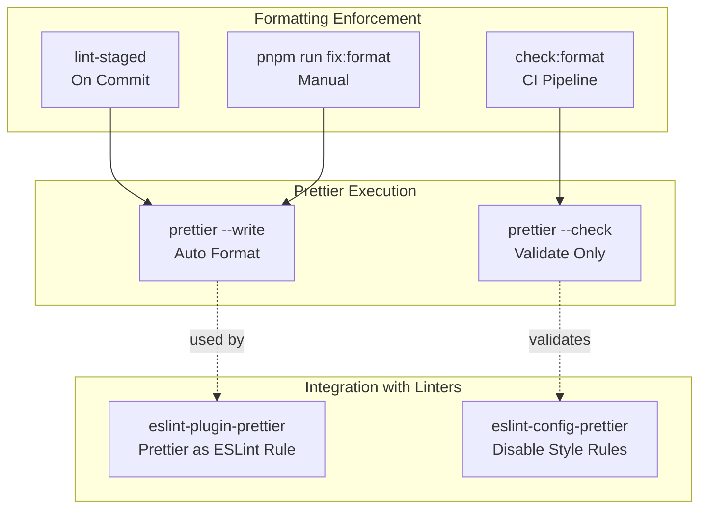
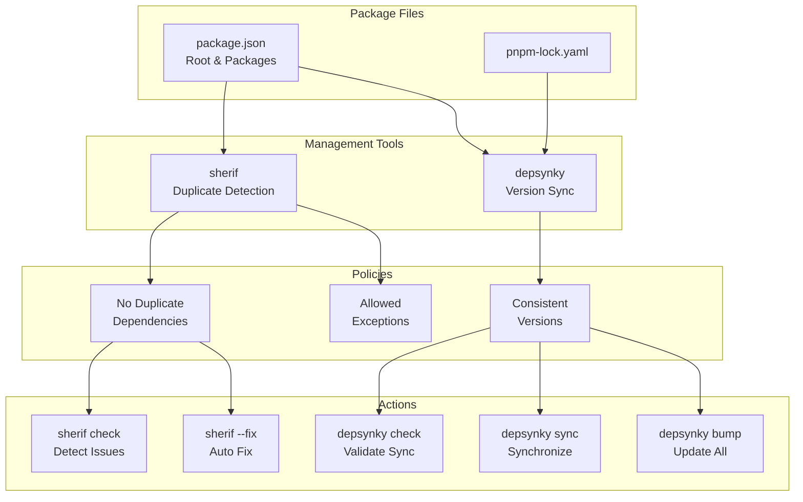
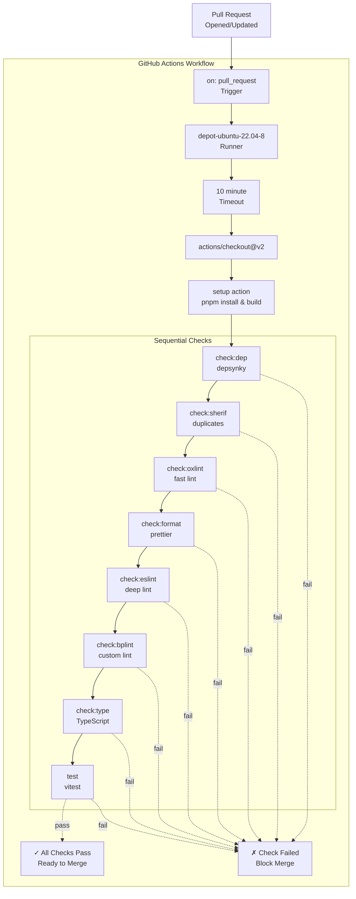

<!-- source: DeepWiki mcp.deepwiki.com · repo botpress/botpress · page 6.3 Code Quality · fetched 2026-10-27 -->

# Code Quality

<details>
<summary>Relevant source files</summary>

The following files were used as context for generating this wiki page:

- [.oxlintrc.json](.oxlintrc.json)
- [eslint.config.mjs](eslint.config.mjs)
- [integrations/calcom/src/actions/bookEvent.ts](integrations/calcom/src/actions/bookEvent.ts)
- [integrations/calcom/src/actions/getEventTypes.ts](integrations/calcom/src/actions/getEventTypes.ts)
- [integrations/linear/definitions/actions.ts](integrations/linear/definitions/actions.ts)
- [integrations/linear/src/actions/find-target.ts](integrations/linear/src/actions/find-target.ts)
- [integrations/linear/src/actions/get-issue.ts](integrations/linear/src/actions/get-issue.ts)
- [integrations/linear/src/actions/get-user.ts](integrations/linear/src/actions/get-user.ts)
- [integrations/linear/src/index.ts](integrations/linear/src/index.ts)
- [package.json](package.json)
- [packages/cli/package.json](packages/cli/package.json)
- [packages/cli/src/code-generation/interface-implementation/integration-typings/index.ts](packages/cli/src/code-generation/interface-implementation/integration-typings/index.ts)
- [packages/cli/src/command-implementations/lint-command.ts](packages/cli/src/command-implementations/lint-command.ts)
- [packages/cli/src/linter/base-linter.test.ts](packages/cli/src/linter/base-linter.test.ts)
- [packages/cli/src/linter/base-linter.ts](packages/cli/src/linter/base-linter.ts)
- [packages/cli/src/linter/bot-linter.ts](packages/cli/src/linter/bot-linter.ts)
- [packages/cli/src/linter/integration-linter.ts](packages/cli/src/linter/integration-linter.ts)
- [packages/cli/src/linter/interface-linter.ts](packages/cli/src/linter/interface-linter.ts)
- [packages/cli/src/linter/ruleset-functions.ts](packages/cli/src/linter/ruleset-functions.ts)
- [packages/cli/src/linter/ruleset-tests/bot.ruleset.test.ts](packages/cli/src/linter/ruleset-tests/bot.ruleset.test.ts)
- [packages/cli/src/linter/ruleset-tests/common.ts](packages/cli/src/linter/ruleset-tests/common.ts)
- [packages/cli/src/linter/ruleset-tests/integration.ruleset.test.ts](packages/cli/src/linter/ruleset-tests/integration.ruleset.test.ts)
- [packages/cli/src/linter/ruleset-tests/interface.ruleset.test.ts](packages/cli/src/linter/ruleset-tests/interface.ruleset.test.ts)
- [packages/cli/src/linter/rulesets/bot.ruleset.ts](packages/cli/src/linter/rulesets/bot.ruleset.ts)
- [packages/cli/src/linter/rulesets/integration.ruleset.ts](packages/cli/src/linter/rulesets/integration.ruleset.ts)
- [packages/cli/src/linter/rulesets/interface.ruleset.ts](packages/cli/src/linter/rulesets/interface.ruleset.ts)
- [packages/cli/src/linter/spectral-functions.ts](packages/cli/src/linter/spectral-functions.ts)
- [packages/cli/src/typings.ts](packages/cli/src/typings.ts)
- [packages/cli/src/utils/schema-utils.ts](packages/cli/src/utils/schema-utils.ts)
- [packages/cli/templates/empty-bot/package.json](packages/cli/templates/empty-bot/package.json)
- [packages/cli/templates/empty-integration/package.json](packages/cli/templates/empty-integration/package.json)
- [packages/cli/templates/empty-plugin/package.json](packages/cli/templates/empty-plugin/package.json)
- [packages/cli/templates/hello-world/package.json](packages/cli/templates/hello-world/package.json)
- [packages/cli/templates/webhook-message/package.json](packages/cli/templates/webhook-message/package.json)
- [packages/client/package.json](packages/client/package.json)
- [packages/cognitive/package.json](packages/cognitive/package.json)
- [packages/llmz/package.json](packages/llmz/package.json)
- [packages/sdk/package.json](packages/sdk/package.json)
- [packages/sdk/src/integration/definition/generic.ts](packages/sdk/src/integration/definition/generic.ts)
- [packages/sdk/src/schema.ts](packages/sdk/src/schema.ts)
- [packages/vai/package.json](packages/vai/package.json)
- [packages/zai/package.json](packages/zai/package.json)
- [pnpm-lock.yaml](pnpm-lock.yaml)

</details>


The Botpress repository implements a comprehensive code quality system that enforces consistency, correctness, and best practices across the monorepo. This system operates at multiple layers: pre-commit hooks for instant feedback, pnpm scripts for local validation, and CI/CD workflows for automated enforcement. The quality checks cover linting, formatting, type safety, dependency consistency, and unit testing.

For information about the build system and compilation, see [Build System](#3.2). For CI/CD deployment workflows, see [CI/CD Pipeline](#6.2).

## Code Quality Layers

The code quality system operates at three enforcement levels, providing progressive validation from development to deployment.

### Quality Enforcement Flow



Sources: [package.json:25-32]()

## Pre-commit Hook System

The repository uses `husky` and `lint-staged` to enforce quality checks before commits reach the remote repository. This provides immediate feedback to developers and prevents common issues from entering the codebase.

### Husky Configuration

The `husky` package manages Git hooks, triggering `lint-staged` on every commit attempt. This is configured through the devDependencies and requires initialization during project setup.

**Package:** `husky@^9.1.7` [pnpm-lock.yaml:81]()

Sources: [pnpm-lock.yaml:81]()

### lint-staged Rules

The `lint-staged` configuration defines file-specific checks that run only on staged files, minimizing execution time. Each file type receives targeted processing.

| File Pattern | Actions | Purpose |
|--------------|---------|---------|
| `**/*.{js,mjs,cjs,jsx,ts,mts,cts,tsx}` | `oxlint -c .oxlintrc.json --fix --fix-suggestions`, `prettier --write` | Fast linting and formatting for TypeScript/JavaScript |
| `**/*.{json,yaml,yml,md}` | `prettier --write` | Format configuration and documentation files |
| `**/*.test.ts` | `vitest --run` | Execute unit tests for modified test files |

The lint-staged configuration ensures that:
1. Code files are linted with `oxlint` before formatting (fixes are automatically applied)
2. All files are formatted consistently with `prettier`
3. Test files are executed to catch regressions immediately

Sources: [package.json:25-32]()

## Linting Tools

The repository employs three complementary linting tools, each serving a specific purpose in the code quality pipeline.

### Tool Responsibilities



Sources: [package.json:8-24]()

### oxlint

`oxlint` is a fast Rust-based linter that provides rapid feedback with minimal configuration. It runs first in both pre-commit hooks and CI pipelines due to its speed.

**Package:** `oxlint@^1.58.0` [pnpm-lock.yaml:86]()

**Configuration:** `.oxlintrc.json`

**Commands:**
- Check: `oxlint -c .oxlintrc.json` [package.json:13]()
- Fix: `oxlint -c .oxlintrc.json --fix --fix-suggestions` [package.json:19]()

The `--fix-suggestions` flag enables automatic application of suggested fixes, which are safe transformations that improve code quality.

Sources: [package.json:13](), [package.json:19](), [pnpm-lock.yaml:86](), [.oxlintrc.json:1-10]()

### eslint

`eslint` provides deep, configurable linting with TypeScript-specific rules and plugin support. It runs across all packages in the monorepo using pnpm's recursive execution.

**Package:** `eslint@^9.34.0` [pnpm-lock.yaml:59]()

**Plugins:**
- `@typescript-eslint/eslint-plugin@^8.42.0` [pnpm-lock.yaml:49]() - TypeScript-specific rules
- `@typescript-eslint/parser@^8.42.0` [pnpm-lock.yaml:53]() - TypeScript parsing
- `@stylistic/eslint-plugin@^5.3.1` [pnpm-lock.yaml:43]() - Code style rules
- `eslint-plugin-import@^2.32.0` [pnpm-lock.yaml:65]() - Import/export validation
- `eslint-plugin-jsdoc@^54.3.1` [pnpm-lock.yaml:68]() - JSDoc comment validation
- `eslint-plugin-oxlint@^1.58.0` [pnpm-lock.yaml:70]() - Integration with oxlint
- `eslint-plugin-prettier@^5.5.4` [pnpm-lock.yaml:73]() - Prettier integration
- `eslint-config-prettier@^10.1.8` [pnpm-lock.yaml:62]() - Disable style rules conflicting with Prettier

**Commands:**
- Check: `pnpm -r --no-bail exec eslint --max-warnings 0` [package.json:12]()
- Fix: `pnpm -r --no-bail exec eslint --fix` [package.json:20]()

The `--max-warnings 0` flag treats all warnings as errors, enforcing strict code quality standards.

Sources: [package.json:12](), [package.json:20](), [pnpm-lock.yaml:43-74]()

### bplint

`bplint` is a custom linting tool specific to Botpress conventions and patterns. It runs through Turbo's task system to leverage caching and parallelization.

**Command:** `turbo check:bplint` [package.json:8]()

The tool enforces Botpress-specific patterns and conventions that are not covered by general-purpose linters. It is configured as a Turbo task for efficient execution across the monorepo. The linter is implemented in `packages/cli/src/linter/` and uses `spectral-core` for defining rulesets.

**Linter Implementation:**
- `BaseLinter` [packages/cli/src/linter/base-linter.ts:10-10]() provides the core logic for linting.
- `IntegrationLinter` [packages/cli/src/linter/integration-linter.ts:10-10]() and `BotLinter` [packages/cli/src/linter/bot-linter.ts:10-10]() extend `BaseLinter` for specific project types.
- Rulesets are defined in `packages/cli/src/linter/rulesets/` for `bot` [packages/cli/src/linter/rulesets/bot.ruleset.ts:1-10]() and `integration` [packages/cli/src/linter/rulesets/integration.ruleset.ts:1-10]() types.
- Custom functions for rules are in `packages/cli/src/linter/ruleset-functions.ts` [packages/cli/src/linter/ruleset-functions.ts:1-10]().

Sources: [package.json:8](), [packages/cli/src/linter/base-linter.ts:10-10](), [packages/cli/src/linter/integration-linter.ts:10-10](), [packages/cli/src/linter/bot-linter.ts:10-10](), [packages/cli/src/linter/rulesets/bot.ruleset.ts:1-10](), [packages/cli/src/linter/rulesets/integration.ruleset.ts:1-10](), [packages/cli/src/linter/ruleset-functions.ts:1-10]()

### Combined Linting

The `check:lint` command executes all three linters in sequence:

```
pnpm check:lint
# Runs: check:bplint && check:oxlint && check:eslint
```

The `fix:lint` command applies automatic fixes from oxlint and eslint:

```
pnpm fix:lint
# Runs: fix:oxlint && fix:eslint
```

Sources: [package.json:14](), [package.json:21]()

## Code Formatting

The repository uses Prettier for consistent code formatting across all file types. Prettier enforces a unified style without manual intervention.

### Prettier Configuration

**Package:** `prettier@^3.4.2` [pnpm-lock.yaml:89]()

**Supported File Types:**
- TypeScript/JavaScript: `.ts`, `.mts`, `.cts`, `.tsx`, `.js`, `.mjs`, `.cjs`, `.jsx`
- Configuration: `.json`, `.yaml`, `.yml`
- Documentation: `.md`

**Commands:**
- Check: `prettier --check .` [package.json:11]()
- Fix: `prettier --write .` [package.json:18]()

The `--write` flag modifies files in place, while `--check` only validates formatting without making changes. In CI, the check command ensures all code is properly formatted before merging.

### Integration Points



Sources: [package.json:11](), [package.json:18](), [package.json:27-30](), [pnpm-lock.yaml:73](), [pnpm-lock.yaml:62]()

## Type Checking

TypeScript type checking is performed across the entire monorepo using Turbo's parallelization capabilities. This ensures type safety without the overhead of transpilation during checks.

### TypeScript Configuration

**Package:** `typescript@^5.6.3` [pnpm-lock.yaml:104]()

**Command:** `turbo check:type` [package.json:15]()

**Turbo Task:** Defined in `turbo.json` as a dependency-aware task.

The `check:type` task runs `tsc --noEmit` in each package, validating types without generating output files. Turbo caches successful type checks and only re-runs when dependencies change. Examples of `check:type` scripts in packages include:
- `@botpress/cli`: `tsc --noEmit` [packages/cli/package.json:9]()
- `@botpress/sdk`: `tsc -p ./tsconfig.json --noEmit` [packages/sdk/package.json:12]()
- `@botpress/client`: `tsc --noEmit` [packages/client/package.json:18]()
- `llmz`: `tsc --noEmit` [packages/llmz/package.json:21]()
- `@botpress/zai`: `tsc --noEmit` [packages/zai/package.json:16]()

### Type Check Execution

The type checking process runs in topological order, respecting package dependencies:

1. Core packages (`@botpress/client`, `@botpress/sdk`) are checked first
2. Dependent packages wait for their dependencies to pass
3. Failures in core packages prevent dependent checks from running
4. Successful checks are cached by Turbo for subsequent runs

Sources: [package.json:15](), [pnpm-lock.yaml:104](), [packages/cli/package.json:9](), [packages/sdk/package.json:12](), [packages/client/package.json:18](), [packages/llmz/package.json:21](), [packages/zai/package.json:16]()

## Dependency Management

The repository uses two tools to maintain dependency consistency and enforce policies across the monorepo.

### Dependency Management Tools



Sources: [package.json:6](), [package.json:9-10](), [package.json:16-17]()

### sherif

`sherif` detects duplicate dependencies across the monorepo, ensuring that each dependency appears only once unless explicitly allowed.

**Package:** `sherif@1.0.1` [pnpm-lock.yaml:95]()

**Commands:**
- Check: `sherif -i zod -i axios -i query-string -i googleapis -i @linear/sdk -i openai` [package.json:10]()
- Fix: `sherif -i zod -i axios -i query-string -i googleapis -i @linear/sdk -i openai --fix` [package.json:17]()

**Ignored Packages:** The `-i` flag allows specific packages to have multiple versions:
- `zod` - Schema validation library
- `axios` - HTTP client
- `query-string` - URL query parsing
- `googleapis` - Google API client
- `@linear/sdk` [pnpm-lock.yaml:40]() - Linear API SDK
- `openai` - OpenAI API client

These packages are allowed to have version conflicts due to transitive dependencies from external SDKs.

Sources: [package.json:10](), [package.json:17](), [pnpm-lock.yaml:95](), [pnpm-lock.yaml:40]()

### depsynky

`depsynky` ensures that dependencies declared across packages remain synchronized to their resolved versions in `pnpm-lock.yaml`.

**Package:** `@bpinternal/depsynky@0.3.2` [pnpm-lock.yaml:33]()

**Commands:**
- Check: `depsynky check --ignore-dev` [package.json:9]()
- Sync: `depsynky sync --ignore-dev` [package.json:16]()
- Bump: `depsynky bump --ignore-dev` [package.json:6]()

**Flag:** `--ignore-dev` excludes devDependencies from synchronization checks, allowing packages to have varying development tooling versions.

**Workflow:**
1. `depsynky check` validates that all non-dev dependencies match their locked versions
2. `depsynky sync` updates package.json files to match the lock file
3. `depsynky bump` updates dependencies and runs `pnpm -w install` to regenerate the lock file

Sources: [package.json:6](), [package.json:9](), [package.json:16](), [pnpm-lock.yaml:33]()

## CI/CD Integration

The code quality system integrates with GitHub Actions to enforce checks on every pull request. This prevents code quality issues from reaching the master branch.

### run-checks Workflow



**Workflow File:** `.github/workflows/run-checks.yml`

**Configuration:**
- Trigger: All pull requests
- Runner: `depot-ubuntu-22.04-8`
- Timeout: 10 minutes
- Node Options: `--max_old_space_size=8192`

**Steps:**
1. Checkout repository
2. Run setup action (install dependencies and build)
3. Execute checks in sequence

The checks run sequentially, with each step blocking on the previous step's success. This ensures rapid failure for fundamental issues like dependency conflicts before running expensive type checks.

Sources: [package.json:8-24]()

## Test Execution

Unit tests are executed using Vitest, both in pre-commit hooks and CI pipelines. Tests run only for modified test files during commits, but run completely in CI.

### Vitest Configuration

**Package:** `vitest@^2.1.4` [pnpm-lock.yaml:109]()

**Commands:**
- Run all tests: `turbo test` [package.json:7]() (which executes `vitest --run` in each package)
- Pre-commit (changed files): `vitest --run` [package.json:31]()

The `--run` flag executes tests once without watch mode, suitable for CI environments and pre-commit hooks.

### Test Integration Points

| Context | Command | Scope |
|---------|---------|-------|
| Pre-commit | `vitest --run` on `**/*.test.ts` | Changed test files only |
| Local | `pnpm run test` | All test files in workspace |
| CI | `pnpm run test` | All test files in workspace |

Sources: [package.json:7](), [package.json:31](), [pnpm-lock.yaml:109]()

## Command Reference

The repository provides two command families: `check` commands for validation and `fix` commands for automatic repair.

### Check Commands

| Command | Script | Purpose |
|---------|--------|---------|
| `check:bplint` | `turbo check:bplint` | Run custom Botpress linter |
| `check:dep` | `depsynky check --ignore-dev` | Validate dependency synchronization |
| `check:sherif` | `sherif -i <packages>` | Detect duplicate dependencies |
| `check:format` | `prettier --check .` | Validate code formatting |
| `check:eslint` | `pnpm -r --no-bail exec eslint --max-warnings 0` | Run ESLint across packages |
| `check:oxlint` | `oxlint -c .oxlintrc.json` | Run fast Rust linter |
| `check:lint` | `check:bplint && check:oxlint && check:eslint` | Run all linters |
| `check:type` | `turbo check:type` | Validate TypeScript types |
| `check` | All check commands in sequence | Run complete validation suite |

Sources: [package.json:8-15](), [package.json:22]()

### Fix Commands

| Command | Script | Purpose |
|---------|--------|---------|
| `fix:dep` | `depsynky sync --ignore-dev` | Synchronize dependencies to lock file |
| `fix:sherif` | `sherif -i <packages> --fix` | Remove duplicate dependencies |
| `fix:format` | `prettier --write .` | Auto-format all files |
| `fix:oxlint` | `oxlint -c .oxlintrc.json --fix --fix-suggestions` | Apply oxlint fixes |
| `fix:eslint` | `pnpm -r --no-bail exec eslint --fix` | Apply ESLint fixes |
| `fix:lint` | `fix:oxlint && fix:eslint` | Apply all lint fixes |
| `fix` | All fix commands in sequence | Apply all automatic fixes |

**Usage Pattern:**
```bash
# Check for issues
pnpm run check

# Automatically fix issues
pnpm run fix

# Re-check after fixes
pnpm run check
```

Sources: [package.json:16-23]()

### Bump Command

The `bump` command updates dependencies and regenerates the lock file:

```bash
pnpm run bump
# Runs: depsynky bump --ignore-dev && pnpm -w install
```

This command:
1. Updates dependency versions in package.json files
2. Runs workspace install to regenerate pnpm-lock.yaml
3. Preserves devDependencies at their current versions

Sources: [package.json:6]()

## Quality Check Matrix

The following matrix shows which checks run in each context:

| Check | Pre-commit | Local Manual | CI Pipeline | Production Deploy |
|-------|-----------|--------------|-------------|-------------------|
| oxlint | ✓ | ✓ | ✓ | - |
| prettier | ✓ | ✓ | ✓ | - |
| vitest (changed) | ✓ | - | - | - |
| vitest (all) | - | ✓ | ✓ | - |
| eslint | - | ✓ | ✓ | - |
| bplint | - | ✓ | ✓ | - |
| TypeScript | - | ✓ | ✓ | - |
| depsynky | - | ✓ | ✓ | - |
| sherif | - | ✓ | ✓ | - |

Pre-commit checks prioritize speed (oxlint + prettier) while CI runs comprehensive validation including the slower tools (eslint, TypeScript). Production deployments bypass checks as they assume code has already passed CI validation.

Sources: [package.json:25-32]()

---

