<!-- source: DeepWiki mcp.deepwiki.com · repo botpress/botpress · page 7.1 Zui Core Types · fetched 2026-10-27 -->

# Zui Core Types

<details>
<summary>Relevant source files</summary>

The following files were used as context for generating this wiki page:

- [packages/zui/package.json](packages/zui/package.json)
- [packages/zui/src/assertions.utils.test.ts](packages/zui/src/assertions.utils.test.ts)
- [packages/zui/src/transforms/common/errors.ts](packages/zui/src/transforms/common/errors.ts)
- [packages/zui/src/transforms/common/eval-zui-string.ts](packages/zui/src/transforms/common/eval-zui-string.ts)
- [packages/zui/src/transforms/zui-from-json-schema-legacy/json-schema-to-zui.test.ts](packages/zui/src/transforms/zui-from-json-schema-legacy/json-schema-to-zui.test.ts)
- [packages/zui/src/transforms/zui-to-json-schema/index.test.ts](packages/zui/src/transforms/zui-to-json-schema/index.test.ts)
- [packages/zui/src/transforms/zui-to-json-schema/index.ts](packages/zui/src/transforms/zui-to-json-schema/index.ts)
- [packages/zui/src/transforms/zui-to-json-schema/type-processors/string.ts](packages/zui/src/transforms/zui-to-json-schema/type-processors/string.ts)
- [packages/zui/src/transforms/zui-to-json-schema/type-processors/tuple.ts](packages/zui/src/transforms/zui-to-json-schema/type-processors/tuple.ts)
- [packages/zui/src/transforms/zui-to-typescript-schema/index.test.ts](packages/zui/src/transforms/zui-to-typescript-schema/index.test.ts)
- [packages/zui/src/transforms/zui-to-typescript-schema/index.ts](packages/zui/src/transforms/zui-to-typescript-schema/index.ts)
- [packages/zui/src/transforms/zui-to-typescript-type/index.test.ts](packages/zui/src/transforms/zui-to-typescript-type/index.test.ts)
- [packages/zui/src/transforms/zui-to-typescript-type/index.ts](packages/zui/src/transforms/zui-to-typescript-type/index.ts)
- [packages/zui/src/transforms/zui-to-typescript-type/primitives.test.ts](packages/zui/src/transforms/zui-to-typescript-type/primitives.test.ts)
- [packages/zui/src/utils/property-path-utils.test.ts](packages/zui/src/utils/property-path-utils.test.ts)
- [packages/zui/src/utils/property-path-utils.ts](packages/zui/src/utils/property-path-utils.ts)
- [packages/zui/src/z/__tests__/crazySchema.ts](packages/zui/src/z/__tests__/crazySchema.ts)
- [packages/zui/src/z/__tests__/deref.test.ts](packages/zui/src/z/__tests__/deref.test.ts)
- [packages/zui/src/z/__tests__/preprocess.test.ts](packages/zui/src/z/__tests__/preprocess.test.ts)
- [packages/zui/src/z/__tests__/transformer.test.ts](packages/zui/src/z/__tests__/transformer.test.ts)
- [packages/zui/src/z/builders.ts](packages/zui/src/z/builders.ts)
- [packages/zui/src/z/guards.ts](packages/zui/src/z/guards.ts)
- [packages/zui/src/z/index.ts](packages/zui/src/z/index.ts)
- [packages/zui/src/z/types/array/index.ts](packages/zui/src/z/types/array/index.ts)
- [packages/zui/src/z/types/basetype/index.ts](packages/zui/src/z/types/basetype/index.ts)
- [packages/zui/src/z/types/basetype/parseUtil.ts](packages/zui/src/z/types/basetype/parseUtil.ts)
- [packages/zui/src/z/types/discriminatedUnion/index.ts](packages/zui/src/z/types/discriminatedUnion/index.ts)
- [packages/zui/src/z/types/effects/index.ts](packages/zui/src/z/types/effects/index.ts)
- [packages/zui/src/z/types/function/index.ts](packages/zui/src/z/types/function/index.ts)
- [packages/zui/src/z/types/index.ts](packages/zui/src/z/types/index.ts)
- [packages/zui/src/z/types/intersection/index.ts](packages/zui/src/z/types/intersection/index.ts)
- [packages/zui/src/z/types/map/index.ts](packages/zui/src/z/types/map/index.ts)
- [packages/zui/src/z/types/object/index.ts](packages/zui/src/z/types/object/index.ts)
- [packages/zui/src/z/types/promise/index.ts](packages/zui/src/z/types/promise/index.ts)
- [packages/zui/src/z/types/readonly/index.ts](packages/zui/src/z/types/readonly/index.ts)
- [packages/zui/src/z/types/record/index.ts](packages/zui/src/z/types/record/index.ts)
- [packages/zui/src/z/types/set/index.ts](packages/zui/src/z/types/set/index.ts)
- [packages/zui/src/z/types/tuple/index.ts](packages/zui/src/z/types/tuple/index.ts)
- [packages/zui/src/z/types/union/index.ts](packages/zui/src/z/types/union/index.ts)
- [packages/zui/src/z/typings.ts](packages/zui/src/z/typings.ts)

</details>


This page details Zui, Botpress's extended Zod-based type system. Zui enhances Zod by incorporating UI-specific metadata, enabling richer schema definitions for integrations, bots, and plugins. It defines a base type hierarchy, handles complex types like objects, unions, and records, and provides a builders API for schema construction.

## Zui's Extension of Zod with UI Metadata

Zui extends the popular Zod library to include metadata specifically for user interface rendering and interaction. This metadata allows developers to attach information such as titles, descriptions, display hints, and other UI-related properties directly to schema definitions. This approach ensures that the UI representation of data types is consistent and automatically derived from the schema.

The core mechanism for this extension is the `ZuiExtensionObject` type, which can be attached to any Zui schema definition.

```typescript
export type ZuiExtensionObject = {
  tooltip?: boolean
  displayAs?: [string, ZuiMetadata]
  title?: string
  disabled?: boolean | string
  hidden?: boolean | string
  placeholder?: string
  secret?: boolean
  coerce?: boolean
  [key: string]: ZuiMetadata
}
```
[packages/zui/src/z/typings.ts:26-36]()

This `ZuiExtensionObject` is stored within the `_def['x-zui']` property of a Zui schema. For example, when converting a Zui schema to a JSON Schema, this `x-zui` property is preserved, allowing UI frameworks to interpret these hints.
[packages/zui/src/transforms/zui-to-json-schema/index.ts:82-82, 99-99, 105-105]()

The `displayAs` property is particularly powerful, allowing developers to specify how a type should be rendered in the UI. It takes a tuple where the first element is a string identifier for a UI component and the second is `ZuiMetadata` containing parameters for that component. The `ZodKindToBaseType` utility helps map Zod's internal type definitions to a `BaseDisplayAsType` (e.g., 'string', 'number', 'object', 'array', 'discriminatedUnion'), which can then be used to look up available UI components.
[packages/zui/src/z/typings.ts:28-29, 38-70]()

### Diagram: Zui UI Metadata Flow

```mermaid
graph TD
    A[Zui Schema Definition] --> B{_def['x-zui'] property}
    B --> C{ZuiExtensionObject}
    C --> D[title: string]
    C --> E[description: string]
    C --> F[displayAs: [string, ZuiMetadata]]
    C --> G[secret: boolean]
    C --> H[hidden: boolean | string]
    C --> I[disabled: boolean | string]
    C --> J[placeholder: string]
    C --> K[tooltip: boolean]
    C --> L[coerce: boolean]
    C --> M[...other ZuiMetadata]

    subgraph Zui Type System
        A
        B
        C
    end

    subgraph UI Rendering
        D
        E
        F
        G
        H
        I
        J
        K
        L
        M
    end

    style A fill:#ace,stroke:#333,stroke-width:2px
    style B fill:#f9f,stroke:#333,stroke-width:2px
    style C fill:#f9f,stroke:#333,stroke-width:2px
```
Sources:
- [packages/zui/src/z/typings.ts:26-36]()
- [packages/zui/src/transforms/zui-to-json-schema/index.ts:82-82, 99-99, 105-105]()

## Base Type Hierarchy

Zui's type system is built upon a base class `ZodBaseTypeImpl`, which provides fundamental parsing, validation, and metadata handling capabilities. All Zui types inherit from this base class.
[packages/zui/src/z/types/basetype/index.ts:54-56]()

Key properties and methods of `ZodBaseTypeImpl` include:
- `_type`, `_output`, `_input`: Type parameters for input and output types.
- `_def`: Stores the type definition, including `typeName` and `errorMap`.
- `description`: Accesses the schema's description.
- `typeName`: Returns the string identifier for the type (e.g., 'ZodString', 'ZodObject').
- `_parse`, `parse`, `safeParse`, `parseAsync`, `safeParseAsync`: Core methods for parsing and validating data, supporting both synchronous and asynchronous operations.
- `refine`, `superRefine`: Methods for adding custom validation logic.
- `optional`, `nullable`, `default`, `readonly`, `describe`: Methods for modifying type behavior and adding metadata.
[packages/zui/src/z/types/basetype/index.ts:57-280]()

The parsing process involves `ParseInput` and `ParseContext` to manage the input data, current path, and accumulated issues. `ParseStatus` tracks the validation state (valid, dirty, aborted).
[packages/zui/src/z/types/basetype/parseUtil.ts:68-75]()

### Diagram: Zui Base Type Hierarchy

```mermaid
graph TD
    ZodBaseTypeImpl["ZodBaseTypeImpl<Output, Def, Input>"]
    ZodBaseTypeImpl -- extends --> IZodType["IZodType<Output, Def, Input>"]

    subgraph Core Zui Types
        ZodStringImpl["ZodStringImpl"]
        ZodNumberImpl["ZodNumberImpl"]
        ZodBooleanImpl["ZodBooleanImpl"]
        ZodObjectImpl["ZodObjectImpl"]
        ZodArrayImpl["ZodArrayImpl"]
        ZodUnionImpl["ZodUnionImpl"]
        ZodDiscriminatedUnionImpl["ZodDiscriminatedUnionImpl"]
        ZodRecordImpl["ZodRecordImpl"]
        ZodLiteralImpl["ZodLiteralImpl"]
        ZodEnumImpl["ZodEnumImpl"]
        ZodAnyImpl["ZodAnyImpl"]
        ZodUnknownImpl["ZodUnknownImpl"]
        ZodNeverImpl["ZodNeverImpl"]
        ZodNullImpl["ZodNullImpl"]
        ZodUndefinedImpl["ZodUndefinedImpl"]
        ZodDateImpl["ZodDateImpl"]
        ZodBigIntImpl["ZodBigIntImpl"]
        ZodSymbolImpl["ZodSymbolImpl"]
        ZodNaNImpl["ZodNaNImpl"]
        ZodVoidImpl["ZodVoidImpl"]
        ZodLazyImpl["ZodLazyImpl"]
        ZodRefImpl["ZodRefImpl"]
        ZodIntersectionImpl["ZodIntersectionImpl"]
        ZodTupleImpl["ZodTupleImpl"]
        ZodMapImpl["ZodMapImpl"]
        ZodSetImpl["ZodSetImpl"]
        ZodFunctionImpl["ZodFunctionImpl"]
        ZodPromiseImpl["ZodPromiseImpl"]
        ZodBrandedImpl["ZodBrandedImpl"]
        ZodCatchImpl["ZodCatchImpl"]
        ZodDefaultImpl["ZodDefaultImpl"]
        ZodOptionalImpl["ZodOptionalImpl"]
        ZodNullableImpl["ZodNullableImpl"]
        ZodPipelineImpl["ZodPipelineImpl"]
        ZodReadonlyImpl["ZodReadonlyImpl"]
        ZodEffectsImpl["ZodEffectsImpl"]
        ZodNativeEnumImpl["ZodNativeEnumImpl"]
    end

    ZodStringImpl -- inherits from --> ZodBaseTypeImpl
    ZodNumberImpl -- inherits from --> ZodBaseTypeImpl
    ZodBooleanImpl -- inherits from --> ZodBaseTypeImpl
    ZodObjectImpl -- inherits from --> ZodBaseTypeImpl
    ZodArrayImpl -- inherits from --> ZodBaseTypeImpl
    ZodUnionImpl -- inherits from --> ZodBaseTypeImpl
    ZodDiscriminatedUnionImpl -- inherits from --> ZodBaseTypeImpl
    ZodRecordImpl -- inherits from --> ZodBaseTypeImpl
    ZodLiteralImpl -- inherits from --> ZodBaseTypeImpl
    ZodEnumImpl -- inherits from --> ZodBaseTypeImpl
    ZodAnyImpl -- inherits from --> ZodBaseTypeImpl
    ZodUnknownImpl -- inherits from --> ZodBaseTypeImpl
    ZodNeverImpl -- inherits from --> ZodBaseTypeImpl
    ZodNullImpl -- inherits from --> ZodBaseTypeImpl
    ZodUndefinedImpl -- inherits from --> ZodBaseTypeImpl
    ZodDateImpl -- inherits from --> ZodBaseTypeImpl
    ZodBigIntImpl -- inherits from --> ZodBaseTypeImpl
    ZodSymbolImpl -- inherits from --> ZodBaseTypeImpl
    ZodNaNImpl -- inherits from --> ZodBaseTypeImpl
    ZodVoidImpl -- inherits from --> ZodBaseTypeImpl
    ZodLazyImpl -- inherits from --> ZodBaseTypeImpl
    ZodRefImpl -- inherits from --> ZodBaseTypeImpl
    ZodIntersectionImpl -- inherits from --> ZodBaseTypeImpl
    ZodTupleImpl -- inherits from --> ZodBaseTypeImpl
    ZodMapImpl -- inherits from --> ZodBaseTypeImpl
    ZodSetImpl -- inherits from --> ZodBaseTypeImpl
    ZodFunctionImpl -- inherits from --> ZodBaseTypeImpl
    ZodPromiseImpl -- inherits from --> ZodBaseTypeImpl
    ZodBrandedImpl -- inherits from --> ZodBaseTypeImpl
    ZodCatchImpl -- inherits from --> ZodBaseTypeImpl
    ZodDefaultImpl -- inherits from --> ZodBaseTypeImpl
    ZodOptionalImpl -- inherits from --> ZodBaseTypeImpl
    ZodNullableImpl -- inherits from --> ZodBaseTypeImpl
    ZodPipelineImpl -- inherits from --> ZodBaseTypeImpl
    ZodReadonlyImpl -- inherits from --> ZodBaseTypeImpl
    ZodEffectsImpl -- inherits from --> ZodBaseTypeImpl
    ZodNativeEnumImpl -- inherits from --> ZodBaseTypeImpl
```


Sources:
- [packages/zui/src/z/types/basetype/index.ts:54-56]()
- [packages/zui/src/z/types/index.ts:1-39]()
- [packages/zui/src/z/builders.ts:5-42]()

## Object, Union, and Record Types

Zui provides robust implementations for complex data structures:

### Object Types (`ZodObjectImpl`)

`ZodObjectImpl` represents object schemas. It manages the shape of the object, including properties and their respective schemas.
[packages/zui/src/z/types/object/index.ts:23-29]()

Key features:
- **Shape Definition**: The `shape()` method returns the object's property schemas.
- **Unknown Keys Handling**: Zui objects can be configured to handle unknown keys in three ways:
    - `'strip'` (default): Unknown keys are removed during parsing.
    - `'strict'`: Unknown keys cause a validation error.
    - `'passthrough'`: Unknown keys are allowed and preserved.
    - Custom `IZodType`: A schema can be provided to validate additional properties.
[packages/zui/src/z/types/object/index.ts:38-40, 95-146, 179-229]()
- **`strict()`, `strip()`, `passthrough()`**: Convenience methods to configure unknown key behavior.
[packages/zui/src/z/types/object/index.ts:179-213]()
- **`additionalProperties()`**: Returns the schema used for validating additional properties, or `undefined` if unknown keys are stripped.
[packages/zui/src/z/types/object/index.ts:219-229]()

When converting to JSON Schema, `ZodObjectImpl` maps to a JSON Schema `object` type, with `properties`, `required`, and `additionalProperties` reflecting the Zui object's configuration.
[packages/zui/src/transforms/zui-to-json-schema/index.ts:123-141]()

### Union Types (`ZodUnionImpl` and `ZodDiscriminatedUnionImpl`)

Zui supports two main types of unions:

- **`ZodUnionImpl`**: Represents a union of multiple schemas. An input is valid if it matches any of the provided schemas.
[packages/zui/src/z/types/union/index.ts:10-10]()
When converting to JSON Schema, `ZodUnionImpl` maps to either `anyOf` or `oneOf` based on the `unionStrategy` option.
[packages/zui/src/transforms/zui-to-json-schema/index.ts:143-156]()

- **`ZodDiscriminatedUnionImpl`**: A more efficient union type where a specific property (the discriminator) determines which sub-schema to use for validation. This is useful for polymorphic data structures.
[packages/zui/src/z/types/discriminatedUnion/index.ts:10-10]()
In JSON Schema conversion, `ZodDiscriminatedUnionImpl` maps to `oneOf` with an optional `discriminator` property, again configurable via `discriminatedUnionStrategy`.
[packages/zui/src/transforms/zui-to-json-schema/index.ts:158-177]()

### Record Types (`ZodRecordImpl`)

`ZodRecordImpl` defines an object type where all keys are of a specific schema (e.g., `string()`) and all values are of another specific schema.
[packages/zui/src/z/types/record/index.ts:10-10]()
This maps to a JSON Schema `object` with `additionalProperties` set to the value schema.
[packages/zui/src/transforms/zui-to-json-schema/index.ts:200-207]()

## Builders API

Zui provides a comprehensive builders API, accessible via the `z` object (e.g., `z.string()`, `z.object()`), for constructing schemas. These builders are implemented in `packages/zui/src/z/builders.ts` and instantiate the corresponding `Zod...Impl` classes.
[packages/zui/src/z/builders.ts:207-249]()

The `_processCreateParams` function handles common parameters like `errorMap`, `description`, and `zuiKey` extensions, ensuring that UI metadata is correctly attached during schema creation.
[packages/zui/src/z/builders.ts:68-105]()

Example builders:
- `z.string()`: Creates a string schema.
- `z.number()`: Creates a number schema.
- `z.boolean()`: Creates a boolean schema.
- `z.object({ ... })`: Creates an object schema.
- `z.array(z.string())`: Creates an array of strings schema.
- `z.union([z.string(), z.number()])`: Creates a union schema.
- `z.discriminatedUnion('type', [...])`: Creates a discriminated union schema.
- `z.record(z.string(), z.number())`: Creates a record schema with string keys and number values.
[packages/zui/src/z/builders.ts:152-230]()

These builders often include options for `coerce` (type coercion) and `supportsExtensions` to control which `ZuiExtensionObject` properties are allowed.
[packages/zui/src/z/builders.ts:70-71, 156-157, 160-161, 164-165, 170-171]()

### Diagram: Zui Builders API

```mermaid
graph TD
    A[User Code] --> B[z.string()]
    A --> C[z.number()]
    A --> D[z.boolean()]
    A --> E[z.object()]
    A --> F[z.array()]
    A --> G[z.union()]
    A --> H[z.discriminatedUnion()]
    A --> I[z.record()]
    A --> J[z.any()]
    A --> K[z.unknown()]
    A --> L[z.never()]
    A --> M[z.null()]
    A --> N[z.undefined()]
    A --> O[z.date()]
    A --> P[z.bigint()]
    A --> Q[z.literal()]
    A --> R[z.enum()]
    A --> S[z.nativeEnum()]
    A --> T[z.ref()]
    A --> U[z.lazy()]
    A --> V[z.intersection()]
    A --> W[z.tuple()]
    A --> X[z.map()]
    A --> Y[z.set()]
    A --> Z[z.function()]
    A --> AA[z.promise()]
    A --> BB[z.branded()]
    A --> CC[z.catch()]
    A --> DD[z.default()]
    A --> EE[z.optional()]
    A --> FF[z.nullable()]
    A --> GG[z.pipeline()]
    A --> HH[z.readonly()]
    A --> II[z.downstream()]
    A --> JJ[z.upstream()]
    A --> KK[z.preprocess()]
    A --> LL[z.custom()]
    A --> MM[z.instanceof()]

    B --> ZodStringImpl["ZodStringImpl"]
    C --> ZodNumberImpl["ZodNumberImpl"]
    D --> ZodBooleanImpl["ZodBooleanImpl"]
    E --> ZodObjectImpl["ZodObjectImpl"]
    F --> ZodArrayImpl["ZodArrayImpl"]
    G --> ZodUnionImpl["ZodUnionImpl"]
    H --> ZodDiscriminatedUnionImpl["ZodDiscriminatedUnionImpl"]
    I --> ZodRecordImpl["ZodRecordImpl"]
    J --> ZodAnyImpl["ZodAnyImpl"]
    K --> ZodUnknownImpl["ZodUnknownImpl"]
    L --> ZodNeverImpl["ZodNeverImpl"]
    M --> ZodNullImpl["ZodNullImpl"]
    N --> ZodUndefinedImpl["ZodUndefinedImpl"]
    O --> ZodDateImpl["ZodDateImpl"]
    P --> ZodBigIntImpl["ZodBigIntImpl"]
    Q --> ZodLiteralImpl["ZodLiteralImpl"]
    R --> ZodEnumImpl["ZodEnumImpl"]
    S --> ZodNativeEnumImpl["ZodNativeEnumImpl"]
    T --> ZodRefImpl["ZodRefImpl"]
    U --> ZodLazyImpl["ZodLazyImpl"]
    V --> ZodIntersectionImpl["ZodIntersectionImpl"]
    W --> ZodTupleImpl["ZodTupleImpl"]
    X --> ZodMapImpl["ZodMapImpl"]
    Y --> ZodSetImpl["ZodSetImpl"]
    Z --> ZodFunctionImpl["ZodFunctionImpl"]
    AA --> ZodPromiseImpl["ZodPromiseImpl"]
    BB --> ZodBrandedImpl["ZodBrandedImpl"]
    CC --> ZodCatchImpl["ZodCatchImpl"]
    DD --> ZodDefaultImpl["ZodDefaultImpl"]
    EE --> ZodOptionalImpl["ZodOptionalImpl"]
    FF --> ZodNullableImpl["ZodNullableImpl"]
    GG --> ZodPipelineImpl["ZodPipelineImpl"]
    HH --> ZodReadonlyImpl["ZodReadonlyImpl"]
    II --> ZodEffectsImpl["ZodEffectsImpl"]
    JJ --> ZodEffectsImpl
    KK --> ZodEffectsImpl
    LL --> ZodEffectsImpl
    MM --> ZodEffectsImpl

    subgraph "Zui Builders (packages/zui/src/z/builders.ts)"
        B
        C
        D
        E
        F
        G
        H
        I
        J
        K
        L
        M
        N
        O
        P
        Q
        R
        S
        T
        U
        V
        W
        X
        Y
        Z
        AA
        BB
        CC
        DD
        EE
        FF
        GG
        HH
        II
        JJ
        KK
        LL
        MM
    end

    subgraph "Zui Type Implementations (packages/zui/src/z/types/)"
        ZodStringImpl
        ZodNumberImpl
        ZodBooleanImpl
        ZodObjectImpl
        ZodArrayImpl
        ZodUnionImpl
        ZodDiscriminatedUnionImpl
        ZodRecordImpl
        ZodAnyImpl
        ZodUnknownImpl
        ZodNeverImpl
        ZodNullImpl
        ZodUndefinedImpl
        ZodDateImpl
        ZodBigIntImpl
        ZodLiteralImpl
        ZodEnumImpl
        ZodNativeEnumImpl
        ZodRefImpl
        ZodLazyImpl
        ZodIntersectionImpl
        ZodTupleImpl
        ZodMapImpl
        ZodSetImpl
        ZodFunctionImpl
        ZodPromiseImpl
        ZodBrandedImpl
        ZodCatchImpl
        ZodDefaultImpl
        ZodOptionalImpl
        ZodNullableImpl
        ZodPipelineImpl
        ZodReadonlyImpl
        ZodEffectsImpl
    end
```
Sources:
- [packages/zui/src/z/builders.ts:207-249]()
- [packages/zui/src/z/builders.ts:68-105]()
- [packages/zui/src/z/builders.ts:152-230]()
- [packages/zui/src/z/builders.ts:70-71, 156-157, 160-161, 164-165, 170-171]()

---

