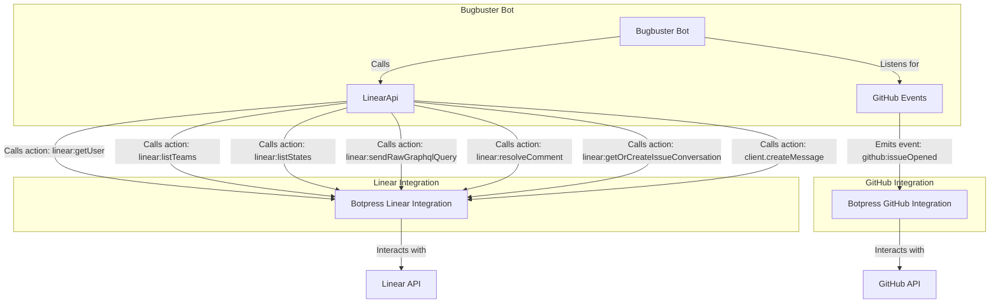

<!-- source: DeepWiki mcp.deepwiki.com · repo botpress/botpress · page 8.1 Bugbuster Bot · fetched 2026-10-27 -->

# Bugbuster Bot

<details>
<summary>Relevant source files</summary>

The following files were used as context for generating this wiki page:

- [bots/bugbuster/bot.definition.ts](bots/bugbuster/bot.definition.ts)
- [bots/bugbuster/src/bootstrap.ts](bots/bugbuster/src/bootstrap.ts)
- [bots/bugbuster/src/handlers/github-issue-opened.ts](bots/bugbuster/src/handlers/github-issue-opened.ts)
- [bots/bugbuster/src/handlers/index.ts](bots/bugbuster/src/handlers/index.ts)
- [bots/bugbuster/src/handlers/linear-issue-created.ts](bots/bugbuster/src/handlers/linear-issue-created.ts)
- [bots/bugbuster/src/handlers/linear-issue-updated.ts](bots/bugbuster/src/handlers/linear-issue-updated.ts)
- [bots/bugbuster/src/handlers/lint-all.ts](bots/bugbuster/src/handlers/lint-all.ts)
- [bots/bugbuster/src/handlers/message-created.ts](bots/bugbuster/src/handlers/message-created.ts)
- [bots/bugbuster/src/handlers/time-to-check-issues-state.ts](bots/bugbuster/src/handlers/time-to-check-issues-state.ts)
- [bots/bugbuster/src/index.ts](bots/bugbuster/src/index.ts)
- [bots/bugbuster/src/services/command-processor.ts](bots/bugbuster/src/services/command-processor.ts)
- [bots/bugbuster/src/services/issue-processor/index.ts](bots/bugbuster/src/services/issue-processor/index.ts)
- [bots/bugbuster/src/services/issue-processor/lint-issue.ts](bots/bugbuster/src/services/issue-processor/lint-issue.ts)
- [bots/bugbuster/src/services/issue-state-checker.ts](bots/bugbuster/src/services/issue-state-checker.ts)
- [bots/bugbuster/src/services/recently-linted-manager.ts](bots/bugbuster/src/services/recently-linted-manager.ts)
- [bots/bugbuster/src/services/teams-manager.ts](bots/bugbuster/src/services/teams-manager.ts)
- [bots/bugbuster/src/types.ts](bots/bugbuster/src/types.ts)
- [bots/bugbuster/src/utils/botpress-utils.ts](bots/bugbuster/src/utils/botpress-utils.ts)
- [bots/bugbuster/src/utils/linear-utils/client.ts](bots/bugbuster/src/utils/linear-utils/client.ts)
- [bots/bugbuster/src/utils/linear-utils/graphql-queries.ts](bots/bugbuster/src/utils/linear-utils/graphql-queries.ts)
- [bots/clog/bot.definition.ts](bots/clog/bot.definition.ts)
- [bots/clog/package.json](bots/clog/package.json)
- [bots/clog/src/index.ts](bots/clog/src/index.ts)
- [bots/slackbox/bot.definition.ts](bots/slackbox/bot.definition.ts)
- [bots/slackbox/eslint.config.mjs](bots/slackbox/eslint.config.mjs)
- [bots/slackbox/package.json](bots/slackbox/package.json)
- [bots/slackbox/src/index.ts](bots/slackbox/src/index.ts)
- [bots/slackbox/tsconfig.json](bots/slackbox/tsconfig.json)

</details>


The Bugbuster Bot is an example Botpress bot designed to automate issue triage and linting for GitHub and Linear. It leverages LLMs for issue analysis, processes commands from chat, manages teams, and integrates with the Linear and GitHub integrations to provide a comprehensive issue management solution. This page provides a deep dive into its implementation, data flow, and key functionalities.

## Purpose and Scope

The primary purpose of the Bugbuster Bot is to enforce best practices and consistency in issue tracking across GitHub and Linear. It automatically lints issues based on predefined rules, notifies relevant teams of issues that violate these rules, and provides a command-line interface within chat platforms to manage its operations. The bot aims to reduce manual overhead in issue triage, improve data quality in issue trackers, and facilitate communication around development tasks.

## Bot Definition and Integrations

The Bugbuster Bot is defined in `bots/bugbuster/bot.definition.ts` [bots/bugbuster/bot.definition.ts:1-101] using the Botpress SDK. This definition outlines the bot's states, workflows, events, and recurring events.

### States

The bot maintains several states to keep track of its operations:
*   `watchedTeams`: Stores a list of team keys for which Bugbuster should lint issues [bots/bugbuster/bot.definition.ts:16-23].
*   `lastLintedId`: Records the ID of the last successfully linted issue within a workflow [bots/bugbuster/bot.definition.ts:24-30].
*   `lintResults`: Stores the results of issue linting, including identifiers, results (succeeded, failed, ignored), and error messages [bots/bugbuster/bot.definition.ts:31-48].
*   `notificationChannels`: Manages a list of Slack channels where notifications will be sent, along with the teams associated with each channel [bots/bugbuster/bot.definition.ts:49-66].

### Workflows

The bot defines one primary workflow:
*   `lintAll`: This workflow is responsible for initiating and managing the comprehensive linting process for all relevant issues [bots/bugbuster/bot.definition.ts:69-72].

### Events and Recurring Events

Bugbuster responds to various events and triggers recurring events:
*   `github:issueOpened`: Triggered when a new issue is opened on GitHub [bots/bugbuster/src/index.ts:6] (handled by `handleGithubIssueOpened`).
*   `linear:issueUpdated`: Triggered when an issue is updated in Linear [bots/bugbuster/src/index.ts:7] (handled by `handleLinearIssueUpdated`).
*   `linear:issueCreated`: Triggered when a new issue is created in Linear [bots/bugbuster/src/index.ts:8] (handled by `handleLinearIssueCreated`).
*   `timeToLintAll`: A recurring event scheduled to run every Monday at 8 AM EST to initiate a full linting cycle [bots/bugbuster/bot.definition.ts:75-77, bots/bugbuster/bot.definition.ts:83-89].
*   `timeToCheckIssuesState`: A recurring event scheduled to run every hour to check the state of issues [bots/bugbuster/bot.definition.ts:78-80, bots/bugbuster/bot.definition.ts:90-96].
*   `message-created`: Handles incoming messages from integrated chat platforms to process commands [bots/bugbuster/src/index.ts:11] (handled by `handleMessageCreated`).

### Integrations

The bot integrates with several external services:
*   **GitHub**: Used to monitor and react to GitHub issue events [bots/bugbuster/bot.definition.ts:102-109].
*   **Telegram**: Enables communication with users via Telegram [bots/bugbuster/bot.definition.ts:110-117].
*   **Linear**: Used for issue management, including fetching, updating, and commenting on Linear issues [bots/bugbuster/bot.definition.ts:118-125].
*   **Slack**: Facilitates communication and notification delivery to Slack channels [bots/bugbuster/bot.definition.ts:126-136].

```mermaid
graph TD
    subgraph "Bot Definition (bot.definition.ts)"
        BD[BotDefinition]
        BD -- "Defines" --> S1(State: watchedTeams)
        BD -- "Defines" --> S2(State: lastLintedId)
        BD -- "Defines" --> S3(State: lintResults)
        BD -- "Defines" --> S4(State: notificationChannels)
        BD -- "Defines" --> W1(Workflow: lintAll)
        BD -- "Defines" --> E1(Event: timeToLintAll)
        BD -- "Defines" --> E2(Event: timeToCheckIssuesState)
        BD -- "Defines" --> E3(Event: github:issueOpened)
        BD -- "Defines" --> E4(Event: linear:issueUpdated)
        BD -- "Defines" --> E5(Event: linear:issueCreated)
        BD -- "Defines" --> E6(Event: message-created)
        BD -- "Adds" --> I1(Integration: GitHub)
        BD -- "Adds" --> I2(Integration: Telegram)
        BD -- "Adds" --> I3(Integration: Linear)
        BD -- "Adds" --> I4(Integration: Slack)
    end

    subgraph "Event Handlers (src/index.ts)"
        H1[handleGithubIssueOpened]
        H2[handleLinearIssueUpdated]
        H3[handleLinearIssueCreated]
        H4[handleTimeToLintAll]
        H5[handleTimeToCheckIssuesState]
        H6[handleMessageCreated]
        H7[handleLintAll]
        H8[handleLintAllTimeout]

        E3 --> H1
        E4 --> H2
        E5 --> H3
        E1 --> H4
        E2 --> H5
        E6 --> H6
        W1 -- "on workflow start/continue" --> H7
        W1 -- "on workflow timeout" --> H8
    end

    subgraph "Services"
        SM[TeamsManager]
        CP[CommandProcessor]
        IP[IssueProcessor]
        RCM[RecentlyLintedManager]
        ISC[IssueStateChecker]
        LA[LinearApi]
    end

    H6 -- "Uses" --> CP
    H4 -- "Uses" --> IP
    H5 -- "Uses" --> ISC
    H7 -- "Uses" --> IP
    H7 -- "Uses" --> RCM

    CP -- "Manages" --> SM
    CP -- "Interacts with" --> LA
    IP -- "Manages" --> SM
    IP -- "Interacts with" --> LA
    ISC -- "Interacts with" --> LA
    ISC -- "Manages" --> SM

    I1 -- "Provides events to" --> E3
    I3 -- "Provides events to" --> E4
    I3 -- "Provides events to" --> E5
    I2 -- "Provides messages to" --> E6
    I4 -- "Provides messages to" --> E6
    CP -- "Sends messages via" --> I2
    CP -- "Sends messages via" --> I4
    IP -- "Sends messages via" --> I2
    IP -- "Sends messages via" --> I4
    ISC -- "Sends messages via" --> I2
    ISC -- "Sends messages via" --> I4
```


**Diagram: Bugbuster Bot Architecture Overview**
Sources:
- [bots/bugbuster/bot.definition.ts:1-101]()
- [bots/bugbuster/src/index.ts:6]()
- [bots/bugbuster/src/index.ts:7]()
- [bots/bugbuster/src/index.ts:8]()
- [bots/bugbuster/src/index.ts:11]()
- [bots/bugbuster/bot.definition.ts:16-23]()
- [bots/bugbuster/bot.definition.ts:24-30]()
- [bots/bugbuster/bot.definition.ts:31-48]()
- [bots/bugbuster/bot.definition.ts:49-66]()
- [bots/bugbuster/bot.definition.ts:69-72]()
- [bots/bugbuster/bot.definition.ts:75-77]()
- [bots/bugbuster/bot.definition.ts:83-89]()
- [bots/bugbuster/bot.definition.ts:78-80]()
- [bots/bugbuster/bot.definition.ts:90-96]()
- [bots/bugbuster/bot.definition.ts:102-109]()
- [bots/bugbuster/bot.definition.ts:110-117]()
- [bots/bugbuster/bot.definition.ts:118-125]()
- [bots/bugbuster/bot.definition.ts:126-136]()

## Command Processing

The Bugbuster Bot allows users to interact with it through chat commands. The `handleMessageCreated` handler [bots/bugbuster/src/handlers/message-created.ts:7-62] is responsible for parsing incoming messages, identifying commands, and executing the corresponding logic.

### Command Structure

Commands are simple text messages starting with a command name, followed by arguments. For example, `addTeam my-team`.

### `CommandProcessor` Service

The `CommandProcessor` class [bots/bugbuster/src/services/command-processor.ts:7-234] is central to handling commands. It is initialized with a Botpress `Client` and a `TeamsManager`.

Key command implementations include:
*   `_listTeams`: Lists all teams currently watched by the bot [bots/bugbuster/src/services/command-processor.ts:14-18].
*   `_addTeam`: Adds a new team to the watched teams list [bots/bugbuster/src/services/command-processor.ts:20-31].
*   `_removeTeam`: Removes a team from the watched teams list [bots/bugbuster/src/services/command-processor.ts:33-42].
*   `_lintAll`: Triggers the `lintAll` workflow, which performs a full linting cycle [bots/bugbuster/src/services/command-processor.ts:46-59].
*   `_addNotifChannel`: Configures a Slack channel to receive notifications for specific teams [bots/bugbuster/src/services/command-processor.ts:61-115].
*   `_removeNotifChannel`: Removes a Slack notification channel [bots/bugbuster/src/services/command-processor.ts:127-161].
*   `_removeNotifChannelTeam`: Removes a specific team from a notification channel's subscription [bots/bugbuster/src/services/command-processor.ts:163-207].
*   `_listNotifChannels`: Lists all configured Slack notification channels and their associated teams [bots/bugbuster/src/services/command-processor.ts:209-230].

```mermaid
graph TD
    A[User Message] --> B{handleMessageCreated}
    B -- "Extracts command and args" --> C{CommandProcessor}
    C -- "Calls specific command implementation" --> D{_listTeams}
    C -- "Calls specific command implementation" --> E{_addTeam}
    C -- "Calls specific command implementation" --> F{_removeTeam}
    C -- "Calls specific command implementation" --> G{_lintAll}
    C -- "Calls specific command implementation" --> H{_addNotifChannel}
    C -- "Calls specific command implementation" --> I{_removeNotifChannel}
    C -- "Calls specific command implementation" --> J{_removeNotifChannelTeam}
    C -- "Calls specific command implementation" --> K{_listNotifChannels}

    D -- "Reads bot state" --> L[TeamsManager.listWatchedTeams]
    E -- "Updates bot state" --> M[TeamsManager.addWatchedTeam]
    F -- "Updates bot state" --> N[TeamsManager.removeWatchedTeam]
    G -- "Starts workflow" --> O[Client.getOrCreateWorkflow("lintAll")]
    H -- "Updates bot state, calls Slack integration" --> P[Client.getOrSetState("notificationChannels")]
    H -- "Updates bot state, calls Slack integration" --> Q[Client.callAction("slack:getOrCreateChannelConversation")]
    I -- "Updates bot state" --> R[Client.setState("notificationChannels")]
    J -- "Updates bot state" --> S[Client.setState("notificationChannels")]
    K -- "Reads bot state" --> T[Client.getOrSetState("notificationChannels")]

    L --> U[Response to User]
    M --> U
    N --> U
    O --> U
    P --> U
    Q --> U
    R --> U
    S --> U
    T --> U
```
**Diagram: Command Processing Flow**
Sources:
- [bots/bugbuster/src/handlers/message-created.ts:7-62]()
- [bots/bugbuster/src/services/command-processor.ts:7-234]()
- [bots/bugbuster/src/services/command-processor.ts:14-18]()
- [bots/bugbuster/src/services/command-processor.ts:20-31]()
- [bots/bugbuster/src/services/command-processor.ts:33-42]()
- [bots/bugbuster/src/services/command-processor.ts:46-59]()
- [bots/bugbuster/src/services/command-processor.ts:61-115]()
- [bots/bugbuster/src/services/command-processor.ts:127-161]()
- [bots/bugbuster/src/services/command-processor.ts:163-207]()
- [bots/bugbuster/src/services/command-processor.ts:209-230]()

## Lint-Issue Pipeline

The core functionality of Bugbuster is its issue linting pipeline. This pipeline is triggered by various events and workflows.

### `IssueProcessor` Service

The `IssueProcessor` class [bots/bugbuster/src/services/issue-processor/index.ts:10-91] orchestrates the linting process. It uses a `LinearApi` client to interact with Linear and a `TeamsManager` to determine which teams' issues to process.

Key methods:
*   `findIssue`: Retrieves a specific Linear issue based on its number and team key [bots/bugbuster/src/services/issue-processor/index.ts:21-40].
*   `listRelevantIssues`: Fetches issues from Linear for all watched teams, excluding those in ignored states [bots/bugbuster/src/services/issue-processor/index.ts:42-54].
*   `lintIssue`: Performs the actual linting of a given Linear issue. It checks for various conditions and returns a `LintResult` [bots/bugbuster/src/services/issue-processor/index.ts:56-91]. If linting fails, it creates a comment on the Linear issue.

### Linting Logic (`lintIssue` function)

The `lintIssue` function [bots/bugbuster/src/services/issue-processor/lint-issue.ts:9-64] contains the specific rules for validating Linear issues. It checks for:
*   Presence of a type label [bots/bugbuster/src/services/issue-processor/lint-issue.ts:11-13].
*   Assignee and blocked status for issues in a "BLOCKED" state [bots/bugbuster/src/services/issue-processor/lint-issue.ts:19-24].
*   Assignee for issues in a "BACKLOG" state [bots/bugbuster/src/services/issue-processor/lint-issue.ts:25-27].
*   Presence of an "area/" label [bots/bugbuster/src/services/issue-processor/lint-issue.ts:29-31].
*   Priority and estimate [bots/bugbuster/src/services/issue-processor/lint-issue.ts:33-42].
*   Estimate exceeding 8 for non-epic issues [bots/bugbuster/src/services/issue-processor/lint-issue.ts:44-49].
*   Issue title format (ensuring it doesn't follow unconventional commit syntax) [bots/bugbuster/src/services/issue-processor/lint-issue.ts:51-54].
*   Association with completed projects [bots/bugbuster/src/services/issue-processor/lint-issue.ts:56-61].

### `lintAll` Workflow Handler

The `handleLintAll` workflow handler [bots/bugbuster/src/handlers/lint-all.ts:7-105] executes the full linting process.
1.  It retrieves the `lastLintedId` and `lintResults` from the workflow's state [bots/bugbuster/src/handlers/lint-all.ts:15-39].
2.  It iteratively calls `issueProcessor.listRelevantIssues` to fetch issues, paginating through them [bots/bugbuster/src/handlers/lint-all.ts:43-45].
3.  For each issue, it calls `issueProcessor.lintIssue` to perform the linting [bots/bugbuster/src/handlers/lint-all.ts:47-49].
4.  It updates the workflow's state with the `lastLintedId` and `lintResults` [bots/bugbuster/src/handlers/lint-all.ts:53-70].
5.  Finally, it sends a summary of the linting results to the conversation that initiated the workflow or to configured notification channels [bots/bugbuster/src/handlers/lint-all.ts:77-102].

```mermaid
graph TD
    A[Trigger: timeToLintAll Event] --> B{handleTimeToLintAll}
    B --> C[IssueProcessor.listRelevantIssues]
    C -- "Iterates through issues" --> D{IssueProcessor.lintIssue}
    D -- "Checks rules (lintIssue function)" --> E{Issue Title Format Valid?}
    D -- "Checks rules (lintIssue function)" --> F{Has Type Label?}
    D -- "Checks rules (lintIssue function)" --> G{Has Area Label?}
    D -- "Checks rules (lintIssue function)" --> H{Has Priority?}
    D -- "Checks rules (lintIssue function)" --> I{Has Estimate?}
    D -- "Checks rules (lintIssue function)" --> J{Estimate > 8 for non-epic?}
    D -- "Checks rules (lintIssue function)" --> K{Blocked state rules?}
    D -- "Checks rules (lintIssue function)" --> L{Associated with completed project?}

    E -- "No" --> M[Add "unconventional commit syntax" lint]
    F -- "No" --> N[Add "missing type label" lint]
    G -- "No" --> O[Add "missing area label" lint]
    H -- "No" --> P[Add "missing priority" lint]
    I -- "No" --> Q[Add "missing estimate" lint]
    J -- "Yes" --> R[Add "estimate too high" lint]
    K -- "No" --> S[Add "blocked state rule violation" lint]
    L -- "Yes" --> T[Add "completed project association" lint]

    M --> U[Lint Results]
    N --> U
    O --> U
    P --> U
    Q --> U
    R --> U
    S --> U
    T --> U

    U -- "If errors" --> V[LinearApi.createComment on Issue]
    U -- "If no errors" --> W[LinearApi.resolveComments on Issue]

    V --> X[Update workflow state: lintResults]
    W --> X
    X --> Y[Send Linting Summary to Chat/Notification Channels]
```
**Diagram: Lint-Issue Pipeline**
Sources:
- [bots/bugbuster/src/services/issue-processor/index.ts:10-91]()
- [bots/bugbuster/src/services/issue-processor/index.ts:21-40]()
- [bots/bugbuster/src/services/issue-processor/index.ts:42-54]()
- [bots/bugbuster/src/services/issue-processor/index.ts:56-91]()
- [bots/bugbuster/src/services/issue-processor/lint-issue.ts:9-64]()
- [bots/bugbuster/src/services/issue-processor/lint-issue.ts:11-13]()
- [bots/bugbuster/src/services/issue-processor/lint-issue.ts:19-24]()
- [bots/bugbuster/src/services/issue-processor/lint-issue.ts:25-27]()
- [bots/bugbuster/src/services/issue-processor/lint-issue.ts:29-31]()
- [bots/bugbuster/src/services/issue-processor/lint-issue.ts:33-42]()
- [bots/bugbuster/src/services/issue-processor/lint-issue.ts:44-49]()
- [bots/bugbuster/src/services/issue-processor/lint-issue.ts:51-54]()
- [bots/bugbuster/src/services/issue-processor/lint-issue.ts:56-61]()
- [bots/bugbuster/src/handlers/lint-all.ts:7-105]()
- [bots/bugbuster/src/handlers/lint-all.ts:15-39]()
- [bots/bugbuster/src/handlers/lint-all.ts:43-45]()
- [bots/bugbuster/src/handlers/lint-all.ts:47-49]()
- [bots/bugbuster/src/handlers/lint-all.ts:53-70]()
- [bots/bugbuster/src/handlers/lint-all.ts:77-102]()

## Teams Management

The bot manages a list of "watched teams" to focus its operations.

### `TeamsManager` Service

The `TeamsManager` class [bots/bugbuster/src/services/teams-manager.ts:7-40]() is responsible for managing the `watchedTeams` bot state.
*   `listWatchedTeams`: Retrieves the list of team keys from the bot's `watchedTeams` state [bots/bugbuster/src/services/teams-manager.ts:12-19]().
*   `addWatchedTeam`: Adds a new team key to the `watchedTeams` state, ensuring it's a valid Linear team [bots/bugbuster/src/services/teams-manager.ts:21-30]().
*   `removeWatchedTeam`: Removes a team key from the `watchedTeams` state [bots/bugbuster/src/services/teams-manager.ts:32-39]().

This service ensures that the bot only processes issues relevant to the configured teams.

## Integration with Linear and GitHub

The Bugbuster Bot heavily relies on the Botpress Linear and GitHub integrations to perform its tasks.

### Linear Integration (`LinearApi` Client)

The `LinearApi` class [bots/bugbuster/src/utils/linear-utils/client.ts:15-21] acts as a wrapper around the Botpress Linear integration's actions. It provides a more convenient interface for interacting with Linear's GraphQL API.

Key functionalities:
*   `getViewerId`: Retrieves the ID of the authenticated Linear user [bots/bugbuster/src/utils/linear-utils/client.ts:21-34].
*   `isTeam`: Checks if a given team key corresponds to an existing Linear team [bots/bugbuster/src/utils/linear-utils/client.ts:36-38].
*   `findIssue`: Searches for a specific Linear issue [bots/bugbuster/src/utils/linear-utils/client.ts:40-53].
*   `listIssues`: Fetches a list of Linear issues based on various filters, including team keys, issue numbers, and states [bots/bugbuster/src/utils/linear-utils/client.ts:55-92]. This method uses the `linear:sendRawGraphqlQuery` action [bots/bugbuster/src/utils/linear-utils/client.ts:215-220] to execute custom GraphQL queries defined in `graphql-queries.ts` [bots/bugbuster/src/utils/linear-utils/graphql-queries.ts:71-141].
*   `issueState`: Determines the state key (e.g., "BACKLOG", "BLOCKED") of a given Linear issue [bots/bugbuster/src/utils/linear-utils/client.ts:94-101].
*   `resolveComments`: Marks comments made by the bot on an issue as resolved [bots/bugbuster/src/utils/linear-utils/client.ts:103-115].
*   `createComment`: Adds a new comment to a Linear issue [bots/bugbuster/src/utils/linear-utils/client.ts:117-132]. This involves creating a conversation for the issue using `linear:getOrCreateIssueConversation` [bots/bugbuster/src/utils/linear-utils/client.ts:118-123] and then sending a message via `client.createMessage` [bots/bugbuster/src/utils/linear-utils/client.ts:125-131].
*   `getTeams`: Retrieves all Linear teams [bots/bugbuster/src/utils/linear-utils/client.ts:148-151].
*   `getStates`: Retrieves all Linear issue states [bots/bugbuster/src/utils/linear-utils/client.ts:153-159].

### GitHub Integration

The bot listens for `github:issueOpened` events [bots/bugbuster/src/index.ts:6]. The `handleGithubIssueOpened` handler is responsible for processing these events, though its specific implementation is not detailed in the provided snippets. It would typically involve fetching issue details from GitHub and potentially creating corresponding Linear issues or triggering linting.


**Diagram: Integration with Linear and GitHub**
Sources:
- [bots/bugbuster/src/utils/linear-utils/client.ts:15-21]()
- [bots/bugbuster/src/utils/linear-utils/client.ts:21-34]()
- [bots/bugbuster/src/utils/linear-utils/client.ts:36-38]()
- [bots/bugbuster/src/utils/linear-utils/client.ts:40-53]()
- [bots/bugbuster/src/utils/linear-utils/client.ts:55-92]()
- [bots/bugbuster/src/utils/linear-utils/client.ts:215-220]()
- [bots/bugbuster/src/utils/linear-utils/graphql-queries.ts:71-141]()
- [bots/bugbuster/src/utils/linear-utils/client.ts:94-101]()
- [bots/bugbuster/src/utils/linear-utils/client.ts:103-115]()
- [bots/bugbuster/src/utils/linear-utils/client.ts:117-132]()
- [bots/bugbuster/src/utils/linear-utils/client.ts:118-123]()
- [bots/bugbuster/src/utils/linear-utils/client.ts:125-131]()
- [bots/bugbuster/src/utils/linear-utils/client.ts:148-151]()
- [bots/bugbuster/src/utils/linear-utils/client.ts:153-159]()
- [bots/bugbuster/src/index.ts:6]()

---

