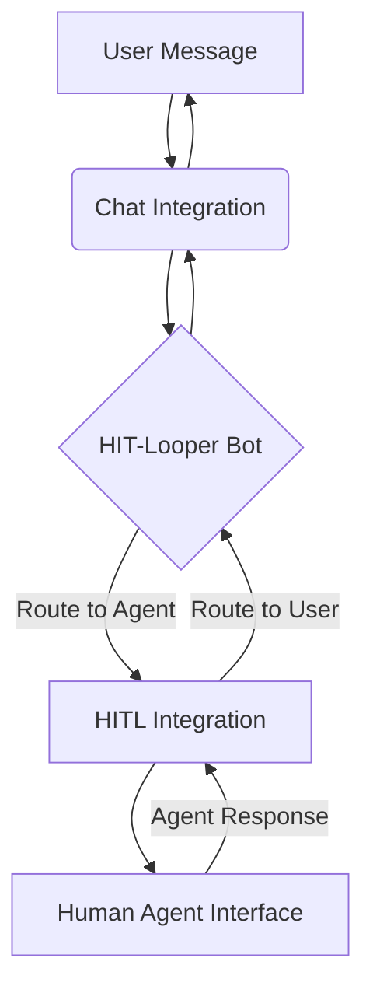
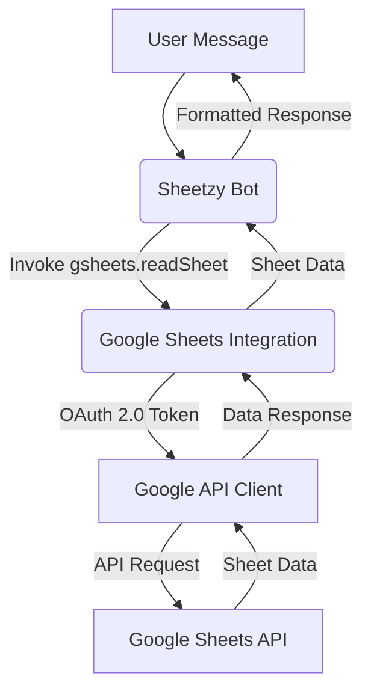

<!-- source: DeepWiki mcp.deepwiki.com · repo botpress/botpress · page 8.2 Other Reference Bots · fetched 2026-10-27 -->

# Other Reference Bots

<details>
<summary>Relevant source files</summary>

The following files were used as context for generating this wiki page:

- [Tiltfile](Tiltfile)
- [bots/bugbuster/package.json](bots/bugbuster/package.json)
- [bots/hello-world/bot.definition.ts](bots/hello-world/bot.definition.ts)
- [bots/hello-world/package.json](bots/hello-world/package.json)
- [bots/hello-world/src/index.ts](bots/hello-world/src/index.ts)
- [bots/hit-looper/package.json](bots/hit-looper/package.json)
- [bots/knowledgiani/bot.definition.ts](bots/knowledgiani/bot.definition.ts)
- [bots/sheetzy/bot.definition.ts](bots/sheetzy/bot.definition.ts)
- [bots/sheetzy/package.json](bots/sheetzy/package.json)
- [bots/sheetzy/src/bot.ts](bots/sheetzy/src/bot.ts)
- [bots/sheetzy/src/index.ts](bots/sheetzy/src/index.ts)
- [bots/sheetzy/src/types.ts](bots/sheetzy/src/types.ts)
- [bots/sinlin/bot.definition.ts](bots/sinlin/bot.definition.ts)
- [bots/sinlin/package.json](bots/sinlin/package.json)
- [bots/sinlin/src/index.ts](bots/sinlin/src/index.ts)
- [integrations/asana/package.json](integrations/asana/package.json)
- [integrations/gsheets/definitions/configuration.ts](integrations/gsheets/definitions/configuration.ts)
- [integrations/gsheets/definitions/events.ts](integrations/gsheets/definitions/events.ts)
- [integrations/gsheets/definitions/secrets.ts](integrations/gsheets/definitions/secrets.ts)
- [integrations/gsheets/definitions/states.ts](integrations/gsheets/definitions/states.ts)
- [integrations/gsheets/integration.definition.ts](integrations/gsheets/integration.definition.ts)
- [integrations/gsheets/linkTemplate.vrl](integrations/gsheets/linkTemplate.vrl)
- [integrations/gsheets/package.json](integrations/gsheets/package.json)
- [integrations/gsheets/src/actions/action-wrapper.ts](integrations/gsheets/src/actions/action-wrapper.ts)
- [integrations/gsheets/src/google-api/error-handling.ts](integrations/gsheets/src/google-api/error-handling.ts)
- [integrations/gsheets/src/google-api/google-client.ts](integrations/gsheets/src/google-api/google-client.ts)
- [integrations/gsheets/src/google-api/oauth-client.ts](integrations/gsheets/src/google-api/oauth-client.ts)
- [integrations/gsheets/src/index.ts](integrations/gsheets/src/index.ts)
- [integrations/gsheets/src/setup.ts](integrations/gsheets/src/setup.ts)
- [integrations/gsheets/src/webhook-events/handler-dispatcher.ts](integrations/gsheets/src/webhook-events/handler-dispatcher.ts)
- [integrations/gsheets/src/webhook-events/handlers/oauth-callback.ts](integrations/gsheets/src/webhook-events/handlers/oauth-callback.ts)
- [integrations/gsheets/src/webhook-events/handlers/oauth-wizard.ts](integrations/gsheets/src/webhook-events/handlers/oauth-wizard.ts)
- [integrations/gsheets/tsconfig.json](integrations/gsheets/tsconfig.json)
- [integrations/mailchimp/package.json](integrations/mailchimp/package.json)
- [integrations/stripe/package.json](integrations/stripe/package.json)
- [integrations/teams/package.json](integrations/teams/package.json)
- [integrations/todoist/package.json](integrations/todoist/package.json)
- [integrations/whatsapp/package.json](integrations/whatsapp/package.json)
- [integrations/whatsapp/src/index.ts](integrations/whatsapp/src/index.ts)
- [integrations/zendesk/package.json](integrations/zendesk/package.json)
- [packages/sdk-addons/package.json](packages/sdk-addons/package.json)

</details>


This page documents the remaining reference bots found in the `bots/` directory of the Botpress monorepo. These examples serve various purposes, from minimal templates to specialized testing harnesses and integration showcases. Each bot demonstrates different aspects of the Botpress SDK and integration capabilities.

## Hello World Bot

The `hello-world` bot is a minimal template designed to showcase the basic structure of a Botpress bot. It demonstrates how to define actions, register integrations, and handle incoming messages.

### Implementation Details

The bot defines a single action, `sayHello`, which takes an optional `name` input and returns a greeting message [bots/hello-world/bot.definition.ts:8-17]().

```typescript
// bots/hello-world/bot.definition.ts
export default new sdk.BotDefinition({
  actions: {
    sayHello: {
      title: 'Say Hello',
      description: 'Says hello to the caller',
      input: {
        schema: sdk.z.object({ name: sdk.z.string().optional() }),
      },
      output: {
        schema: sdk.z.object({ message: sdk.z.string() }),
      },
    },
  },
})
```

The bot is configured to use the `telegram` and `chat` integrations [bots/hello-world/bot.definition.ts:20-30](). The Telegram integration requires a `botToken` which is loaded from environment variables [bots/hello-world/bot.definition.ts:23-24]().

The core logic resides in `src/index.ts`. The bot registers itself and defines the `sayHello` action handler [bots/hello-world/src/index.ts:4-12]().

```typescript
// bots/hello-world/src/index.ts
const bot = new bp.Bot({
  register: async (props) => {
    props.logger.info('Registering Hello World bot!')
  },
  actions: {
    sayHello: async ({ input }) => {
      const name = input?.name || 'World'
      return { message: `Hello, ${name}!` }
    },
  },
})
```

When any message is received (`bot.on.message('*')`), the bot calls its own `sayHello` action and sends the resulting message back to the conversation [bots/hello-world/src/index.ts:15-27]().

### Data Flow

The `hello-world` bot's data flow is straightforward:

1.  An incoming message is received by one of the configured integrations (e.g., Telegram or Chat).
2.  The `bot.on.message('*')` handler is triggered [bots/hello-world/src/index.ts:15]().
3.  The `sayHello` action handler is invoked internally [bots/hello-world/src/index.ts:18]().
4.  The `sayHello` action constructs a greeting message [bots/hello-world/src/index.ts:9-11]().
5.  The bot uses `client.createMessage` to send the greeting back to the user in the same conversation [bots/hello-world/src/index.ts:19-26]().

```mermaid
graph TD
    A[User sends message] --> B(Integration: Telegram/Chat);
    B --> C{Bot.on.message('*') handler};
    C --> D[Call bot.actionHandlers.sayHello];
    D --> E{sayHello Action Logic};
    E --> F[Return "Hello, World!"];
    F --> G[client.createMessage];
    G --> H[Integration sends message to user];
    H --> I[User receives greeting];
```
**Diagram: Hello World Bot Data Flow**

Sources:
- [bots/hello-world/bot.definition.ts:8-17]()
- [bots/hello-world/bot.definition.ts:20-30]()
- [bots/hello-world/bot.definition.ts:23-24]()
- [bots/hello-world/src/index.ts:4-12]()
- [bots/hello-world/src/index.ts:15-27]()
- [bots/hello-world/src/index.ts:15]()
- [bots/hello-world/src/index.ts:18]()
- [bots/hello-world/src/index.ts:9-11]()
- [bots/hello-world/src/index.ts:19-26]()

## HIT-Looper Bot

The `hit-looper` bot is a testing harness designed for Human-in-the-Loop (HITL) scenarios. It's used to simulate and test the interaction between a bot and a human agent.

### Implementation Details

The `hit-looper` bot's `package.json` defines its dependencies, including `@botpress/client` and `@botpress/sdk` [bots/hit-looper/package.json:11-12](). It also specifies `bpDependencies` for the `chat` and `hitl` integrations [bots/hit-looper/package.json:25-28](). The `hitl` integration is crucial for its purpose.

The `postinstall` script uses `genenv` to generate environment variables for `HIT_LOOPER_TELEGRAM_BOT_TOKEN` [bots/hit-looper/package.json:6](), indicating it can also be used with Telegram.

The core logic of the `hit-looper` bot would typically involve:
*   Receiving messages from a user.
*   Potentially routing these messages to a human agent via the HITL integration.
*   Handling responses from the human agent and relaying them back to the user.
*   Managing the conversation state to track the HITL session.

While the full source code for `hit-looper` is not provided, its `package.json` clearly indicates its reliance on the `hitl` integration, which is central to its functionality.


**Diagram: HIT-Looper Bot Interaction Flow**

Sources:
- [bots/hit-looper/package.json:11-12]()
- [bots/hit-looper/package.json:25-28]()
- [bots/hit-looper/package.json:6]()

## Sheetzy Bot

The `sheetzy` bot is an example of integrating with Google Sheets. It demonstrates how to use the `gsheets` integration to read, write, and manage data in Google Sheets.

### Implementation Details

The `sheetzy` bot's `package.json` lists `@botpress/client` and `@botpress/sdk` as dependencies, and crucially, `@botpresshub/gsheets` as a `bpDependency` [bots/sheetzy/package.json:11-12, bots/sheetzy/package.json:25](). This confirms its reliance on the Google Sheets integration.

The `bot.definition.ts` for `sheetzy` would define actions and events related to Google Sheets operations. For instance, it might have actions like `readSheet`, `writeRow`, `appendRow`, etc. It would also configure the `gsheets` integration, likely requiring OAuth credentials for Google API access.

The `gsheets` integration itself defines its capabilities in `integration.definition.ts`. It includes actions, channels, configuration, events, secrets, and states [integrations/gsheets/integration.definition.ts:24-33](). The integration uses `googleapis` for interacting with Google Sheets [integrations/gsheets/package.json:15](). OAuth 2.0 is used for authentication, with handlers for the OAuth callback and wizard [integrations/gsheets/src/webhook-events/handlers/oauth-callback.ts](), [integrations/gsheets/src/webhook-events/handlers/oauth-wizard.ts]().

The `sheetzy` bot's `src/bot.ts` (or `src/index.ts`) would contain the actual bot logic, calling the `gsheets` integration's actions based on user input. For example, a user might say "read sheet X" and the bot would invoke the `gsheets` integration's `readSheet` action.

### Data Flow

1.  User sends a message to the `sheetzy` bot (e.g., "List items in my shopping list sheet").
2.  The bot's message handler processes the intent.
3.  The bot invokes an action from the `gsheets` integration (e.g., `gsheets.readSheet`).
4.  The `gsheets` integration uses the configured Google API credentials (managed via OAuth) to make requests to the Google Sheets API.
5.  The Google Sheets API returns data to the `gsheets` integration.
6.  The `gsheets` integration passes the data back to the `sheetzy` bot.
7.  The `sheetzy` bot formats the data and sends a response message back to the user.


**Diagram: Sheetzy Bot Data Flow**

Sources:
- [bots/sheetzy/package.json:11-12]()
- [bots/sheetzy/package.json:25]()
- [integrations/gsheets/integration.definition.ts:24-33]()
- [integrations/gsheets/package.json:15]()
- [integrations/gsheets/src/webhook-events/handlers/oauth-callback.ts]()
- [integrations/gsheets/src/webhook-events/handlers/oauth-wizard.ts]()

## Slackbox Bot

The `slackbox` bot is an example of a bot designed to interact with Slack. It would typically demonstrate how to send and receive messages, manage channels, and potentially use Slack-specific features like blocks or modals.

### Implementation Details

The `slackbox` bot's `package.json` would list `@botpresshub/slack` as a `bpDependency`, indicating its reliance on the Slack integration. The Slack integration itself handles the complexities of interacting with the Slack API, including webhook processing, message formatting, and authentication (e.g., OAuth for Slack apps).

The bot's `bot.definition.ts` would define actions specific to Slack, such as `sendMessageToChannel`, `postEphemeralMessage`, or `updateMessage`. It would also configure the Slack integration with necessary credentials (e.g., bot token, signing secret).

The bot's `src/index.ts` would contain the logic for responding to Slack events, such as new messages, mentions, or slash commands. It would use the Slack integration's actions to perform operations within Slack.

Sources:
- [bots/bugbuster/package.json:20]() (Example of Slack integration dependency in another bot)
- [integrations/whatsapp/src/index.ts:9-15]() (Example of integration definition structure)

## Sinlin Bot

The `sinlin` bot is an example that integrates with Linear, a project management tool. It demonstrates how to manage Linear issues directly from a chat interface.

### Implementation Details

The `sinlin` bot's `package.json` includes `@botpress/client` and `@botpress/sdk` as dependencies, and `@botpresshub/linear` as a `bpDependency` [bots/sinlin/package.json:11-12, bots/sinlin/package.json:25](). This confirms its integration with Linear. It also uses `genenv` to manage environment variables for the Linear API key and webhook signing secret [bots/sinlin/package.json:6]().

The bot defines several commands: `/sync`, `/list`, and `/clear` [bots/sinlin/src/index.ts:29-74]().

*   `/sync`: Clears existing Linear issues and then presumably re-syncs them (though the provided code only shows `linear#clear` [bots/sinlin/src/index.ts:33]()).
*   `/list`: Retrieves and lists up to 10 Linear issues from a table, if the table exists [bots/sinlin/src/index.ts:38-65](). It uses `props.client._inner` to access the underlying Botpress client and `findTableRows` [bots/sinlin/src/index.ts:49-52]().
*   `/clear`: Clears all Linear issues [bots/sinlin/src/index.ts:68-71]().

The bot uses a `reply` helper function to send text messages back to the user [bots/sinlin/src/index.ts:11-20](). It also has a `summarize` function to truncate long messages [bots/sinlin/src/index.ts:8-9]().

The main message handler `bot.on.message('*')` checks if the incoming message is a text message and if it matches one of the defined commands. If a command is found, its handler is executed. Otherwise, it provides a help message listing available commands [bots/sinlin/src/index.ts:76-98]().

### Data Flow

1.  User sends a command (e.g., `/list`) to the `sinlin` bot.
2.  The `bot.on.message('*')` handler receives the message [bots/sinlin/src/index.ts:76]().
3.  It identifies the command and dispatches to the corresponding handler (e.g., `commands['/list'].handler` [bots/sinlin/src/index.ts:85-89]()).
4.  The command handler interacts with the `linear` integration's actions (e.g., `linear#clear` [bots/sinlin/src/index.ts:33, bots/sinlin/src/index.ts:70]()) or directly with the Botpress client's table API (`getVanillaClient(props).findTableRows` [bots/sinlin/src/index.ts:49-52]()).
5.  The `linear` integration (or Botpress client) communicates with the Linear API.
6.  Results are returned to the `sinlin` bot.
7.  The bot uses the `reply` function to send a formatted response back to the user [bots/sinlin/src/index.ts:11-20]().

```mermaid
graph TD
    A[User sends command (e.g., /list)] --> B(Sinlin Bot);
    B -- Identify Command --> C{commands['/list'].handler};
    C -- Check bot state for 'linear#table' --> D[Botpress Client.getOrSetState];
    D -- Table State --> C;
    C -- Find Table Rows --> E[Botpress Client.findTableRows];
    E -- Linear Issue Data --> C;
    C -- Format Issues --> F[reply function];
    F --> G[Botpress Client.createMessage];
    G --> A;
```
**Diagram: Sinlin Bot Command Flow**

Sources:
- [bots/sinlin/package.json:11-12]()
- [bots/sinlin/package.json:25]()
- [bots/sinlin/package.json:6]()
- [bots/sinlin/src/index.ts:29-74]()
- [bots/sinlin/src/index.ts:33]()
- [bots/sinlin/src/index.ts:38-65]()
- [bots/sinlin/src/index.ts:49-52]()
- [bots/sinlin/src/index.ts:68-71]()
- [bots/sinlin/src/index.ts:11-20]()
- [bots/sinlin/src/index.ts:8-9]()
- [bots/sinlin/src/index.ts:76-98]()
- [bots/sinlin/src/index.ts:76]()
- [bots/sinlin/src/index.ts:85-89]()
- [bots/sinlin/src/index.ts:33]()
- [bots/sinlin/src/index.ts:70]()
- [bots/sinlin/src/index.ts:49-52]()
- [bots/sinlin/src/index.ts:11-20]()

## Knowledgiani Bot

The `knowledgiani` bot is designed to demonstrate knowledge base (KB) capabilities. It would typically integrate with a knowledge base system to answer user queries based on stored information.

### Implementation Details

The `knowledgiani` bot's `bot.definition.ts` would likely include the `knowledge-base` plugin as a dependency. This plugin provides actions and events for interacting with a knowledge base, such as `queryKnowledgeBase`, `addDocument`, or `searchDocuments`.

The bot's logic in `src/index.ts` would involve:
*   Receiving user queries.
*   Invoking the `knowledge-base` plugin's actions to search for relevant information.
*   Processing the search results and formulating a response.
*   Potentially allowing users to add or update knowledge base entries.

This bot serves as an example of how to build a Q&A bot using Botpress's knowledge base features.

Sources:
- [bots/knowledgiani/bot.definition.ts]() (File exists, but content not provided)

## Synchrotron Bot

The `synchrotron` bot's purpose is not explicitly detailed in the provided file contents, but its name suggests a focus on synchronization or data transfer. It might be an example of a bot that synchronizes data between different systems or acts as a central hub for various integrations.

### Implementation Details

A `synchrotron` bot would likely involve multiple integrations, similar to `bugbuster` which integrates with GitHub, Linear, Slack, and Telegram [bots/bugbuster/package.json:25-29](). Its `bot.definition.ts` would declare these integrations and define actions for data manipulation or transfer.

The core logic in `src/index.ts` would orchestrate the flow of data between these integrations, potentially using webhooks, scheduled tasks, or direct API calls through the Botpress SDK. It could involve:
*   Listening for events from one integration.
*   Transforming the data.
*   Invoking actions on another integration to update or create records.

Without specific file content, the exact implementation details remain speculative, but the pattern would follow the general Botpress bot structure of defining integrations, actions, and event handlers.

Sources:
- [bots/bugbuster/package.json:25-29]() (Example of multiple integration dependencies)
- [integrations/whatsapp/src/index.ts:9-15]() (General integration structure)

---

