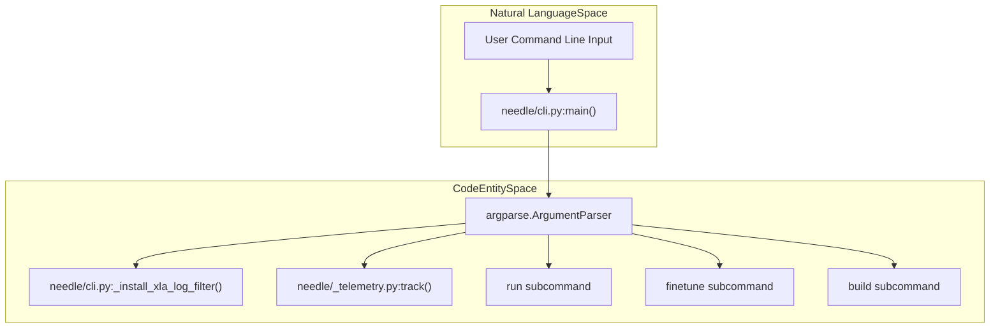
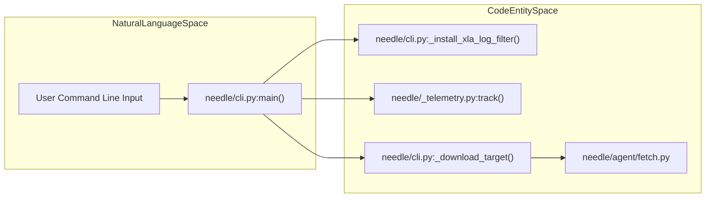

<!-- source: DeepWiki mcp.deepwiki.com · repo cactus-compute/needle · page 1.2 CLI Reference · fetched 2026-10-27 -->

# CLI Reference

Relevant source files

The following files were used as context for generating this wiki page:

- [needle/_telemetry.py](needle/_telemetry.py)
- [needle/cli.py](needle/cli.py)

The purpose of this page is to provide a complete technical reference for all `needle` CLI subcommands (`run`, `finetune`, `generate-data`, `build`, `platform`, `download`, `fetch`, `playground`, and `whistle`), their arguments, default values, log filtering mechanisms, and telemetry integrations.

## Overview of CLI Infrastructure and Log Filtering

The CLI entry point is defined in `needle/cli.py: main()` [needle/cli.py:141](). It processes command-line arguments using `argparse.ArgumentParser` [needle/cli.py:148-149]() and routes execution to the appropriate subcommand module. 

A critical component of the infrastructure is the XLA log filter (`_install_xla_log_filter`), which intercepts file descriptor 2 to drop Triton autotuner noise and compilation errors from `stderr` [needle/cli.py:62-137](). Additionally, anonymous telemetry is managed via `needle/_telemetry.py: track()` to collect lightweight usage statistics without transmitting user prompts or outputs [needle/_telemetry.py:83-86]().

Sources: [needle/cli.py:54-142](), [needle/_telemetry.py:12-86]()

### CLI Infrastructure Data Flow

Sources: [needle/cli.py:54-142](), [needle/_telemetry.py:83-86]()

---

## Command Reference

### `run`
Executes inference on a checkpoint with an optional query and tool definitions [needle/cli.py:9]().

| Argument | Default | Description |
| :--- | :--- | :--- |
| `--checkpoint` | (Required) | Path to the model checkpoint file [needle/cli.py:151]() |
| `--query` | `None` | Query text for tool-call generation [needle/cli.py:152]() |
| `--tools` | `None` | Tools JSON string for tool-call generation [needle/cli.py:153]() |
| `--max-len` | `512` | Maximum generation length [needle/cli.py:154]() |
| `--seed` | `0` | Random seed for generation [needle/cli.py:155]() |
| `--temperature` | `0.0` | Sampling temperature (0 = greedy) [needle/cli.py:156-157]() |

Sources: [needle/cli.py:9](), [needle/cli.py:150-157]()

### `finetune`
Trains a LoRA adapter on JSONL training data [needle/cli.py:10]().

| Argument | Default | Description |
| :--- | :--- | :--- |
| `jsonl_path` | (Required) | Path to JSONL training data [needle/cli.py:160]() |
| `--checkpoint` | `None` | Base model checkpoint (auto-downloads if omitted) [needle/cli.py:161-162]() |
| `--epochs` | `3` | Number of training epochs [needle/cli.py:163]() |
| `--batch-size` | `16` | Training batch size [needle/cli.py:164]() |
| `--lr` | `1e-4` | Learning rate [needle/cli.py:165]() |
| `--lora-rank` | `16` | LoRA adapter rank [needle/cli.py:166]() |
| `--lora-alpha` | `32.0` | LoRA scaling alpha [needle/cli.py:167]() |
| `--max-len` | `1024` | Maximum training sequence length [needle/cli.py:168]() |
| `--val-split` | `0.1` | Fraction of examples held out for validation [needle/cli.py:169-170]() |
| `--seed` | `0` | Random seed for initialization and shuffling [needle/cli.py:171-172]() |
| `--generate` | `0` | Generate N extra examples via OpenRouter before training [needle/cli.py:173]() |

Sources: [needle/cli.py:10](), [needle/cli.py:159-173]()

### Other Subcommands (`generate-data`, `build`, `platform`, `download`, `fetch`, `playground`, `whistle`)
- `generate-data`: Synthesises training data via OpenRouter [needle/cli.py:11]().
- `build`: Exports a checkpoint and adapter into a `.cact` archive [needle/cli.py:12]().
- `platform`: Fine-tunes, generates data, and downloads models hosted on cactuscompute.com [needle/cli.py:13]().
- `download`: Downloads assets such as `needle3`, `needle3.safetensors`, platform binaries, or hub archives (`<org>/<repo>[/<file>.cact]`) [needle/cli.py:14]() [needle/cli.py:30-52]().
- `fetch`: Fetches the compiled engine library for the host platform [needle/cli.py:15]().
- `playground`: Serves the browser playground UI [needle/cli.py:16]().
- `whistle`: Runs speech-to-text playground or comparison sub-utilities (`playground` | `compare`) [needle/cli.py:17]().

Helper functions like `_weights_spec()` and `_download_target()` handle path splitting and asset specification parsing [needle/cli.py:23-52]().

Sources: [needle/cli.py:7-18](), [needle/cli.py:23-52]()

---

## Data Flow and Execution Architecture

Sources: [needle/cli.py:23-137](), [needle/_telemetry.py:83-86]()

---

## Technical Defaults and Constants

| Command | Parameter | Default Value | Source |
| :--- | :--- | :--- | :--- |
| `run` | `max_len` | `512` | [needle/cli.py:154]() |
| `run` | `seed` | `0` | [needle/cli.py:155]() |
| `run` | `temperature` | `0.0` | [needle/cli.py:156-157]() |
| `finetune` | `epochs` | `3` | [needle/cli.py:163]() |
| `finetune` | `batch_size` | `16` | [needle/cli.py:164]() |
| `finetune` | `lr` | `1e-4` | [needle/cli.py:165]() |
| `finetune` | `lora_rank` | `16` | [needle/cli.py:166]() |
| `finetune` | `lora_alpha` | `32.0` | [needle/cli.py:167]() |
| `finetune` | `max_len` | `1024` | [needle/cli.py:168]() |
| `finetune` | `val-split` | `0.1` | [needle/cli.py:169-170]() |
| `finetune` | `seed` | `0` | [needle/cli.py:171-172]() |
| `finetune` | `generate` | `0` | [needle/cli.py:173]() |

Sources: [needle/cli.py:150-173]()

---

