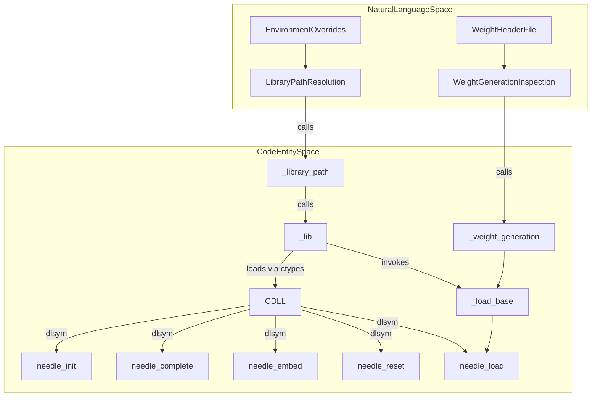
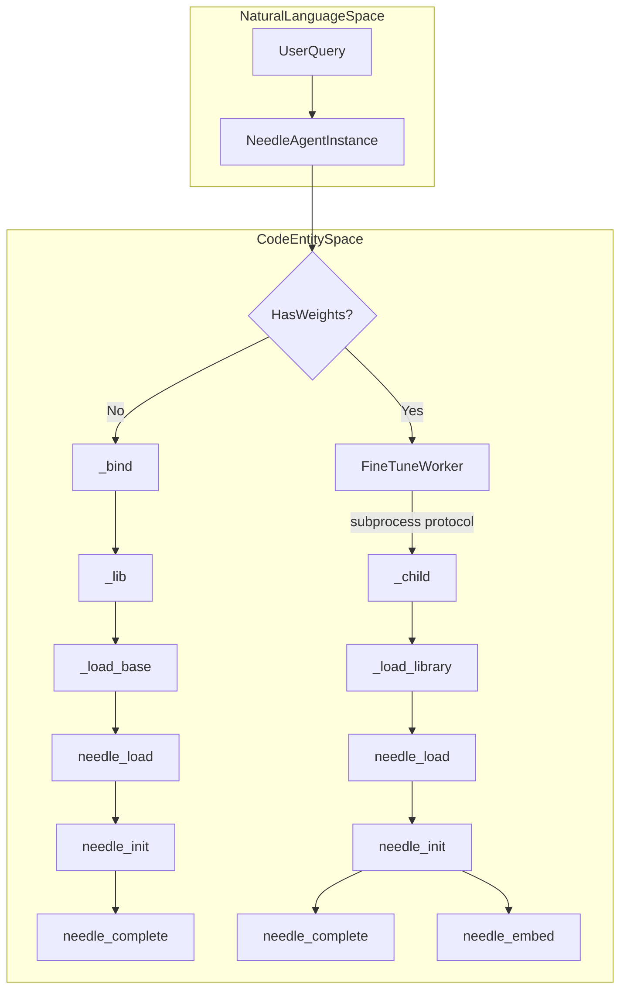

<!-- source: DeepWiki mcp.deepwiki.com · repo cactus-compute/needle · page 2.1 Needle Agent Class · fetched 2026-10-27 -->

# Needle Agent Class

Relevant source files

The following files were used as context for generating this wiki page:

- [needle/__init__.py](needle/__init__.py)
- [needle/_worker.py](needle/_worker.py)
- [tests/test_weights.py](tests/test_weights.py)
- [tests/test_worker.py](tests/test_worker.py)

## Purpose and Scope
This page covers the technical implementation of the `Needle` class defined in `needle/__init__.py`. It details constructor parameters, generation selection (v2 vs v3), stateless mode execution, the agentic loop (`run()`), core execution methods (`complete()`, `embed()`, `reset()`), the `_bind` lifecycle, and the `ctypes` FFI bridge connecting Python to the underlying native engine functions (`needle_init`, `needle_complete`, `needle_embed`, `needle_reset`, `needle_load`).

Sources: [needle/__init__.py:1-191]()

---

## Overview and Constructor Parameters

The `Needle` agent serves as the primary Python interface for the cactus-needle inference engine. Upon instantiation, it resolves tools, configures system prompts, inspects weight headers to determine engine generation via `_weight_generation()`, and defers native engine initialization or worker spawning until interaction via `_bind()` or a tuned weights load.

| Parameter | Type | Description |
| :--- | :--- | :--- |
| `tools` | `list \| str \| None` | A list of `@tool` decorated functions, Pydantic models, or raw JSON schemas. |
| `system` | `str \| None` | System prompt defining environment facts or agent persona. |
| `weights` | `str \| None` | Path to a `.cact` weight file for fine-tuned models. |
| `tool_index_path` | `str \| None` | Path to persist tool embeddings for large-scale tool retrieval. |
| `buffer_size` | `int` | Size of the `ctypes` string buffer for engine responses (default `65536`). |
| `auto_date` | `bool` | Automatically injects date facts into the system prompt (default `True`). |
| `generation` | `int \| None` | Explicit engine generation selection (`2` or `3`, default `3`). |
| `stateless` | `bool` | Whether the agent operates in stateless mode (default `False`). |

Sources: [needle/__init__.py:24-45](), [needle/__init__.py:123-190]()

---

## Generation Dispatch and C-Engine Interface (`ctypes`)

Needle communicates with a high-performance C engine via `ctypes`. The library path is resolved through `_library_path(generation)` [needle/__init__.py:81-110](), handling version overrides (`NEEDLE_LIB_PATH`), local builds, and cached binaries. 

Weight files are inspected using `_weight_generation(path)` to read the 4-byte `.cact` header tag (`0x05E12A83` for Generation 2, `0x05E12A84` for Generation 3) [needle/__init__.py:27-45](). Base weights for Generation 3 models are loaded into memory via `_load_base()` utilizing `needle_load()` [needle/__init__.py:126-136]().

### Engine Management and Dispatch Architecture

Sources: [needle/__init__.py:27-184]()

---

## Stateless Mode and the Agentic Loop (`run()`)

The `Needle` agent supports a `stateless` execution mode (`stateless=True`), which isolates conversation turns or disables persistent context storage across calls depending on configuration. 

The agentic loop is orchestrated via `run()`, which processes user queries, handles intermediate tool calls returned by the engine, executes the corresponding Python functions resolved in `self._functions`, and feeds tool outputs back into the inference loop until a final response is generated or execution bounds are reached.

Sources: [needle/__init__.py:187-191]()

---

## The `_bind` Lifecycle and Worker Subprocess

Needle manages execution via two primary paths: an in-process base engine or an out-of-process subprocess managed by `FineTuneWorker` when custom fine-tuned weights (`weights=...`) are provided.

1.  **In-Process Binding (`_bind()`):** Validates the instance state, fetches the appropriate generation library via `_lib(generation)`, loads base weights if generation $\ge 3$ via `_load_base()`, and invokes `needle_init` with the system prompt, tool schemas, and tool index path.
2.  **Fine-Tuned Worker (`FineTuneWorker`):** If `weights` are specified, Needle instantiates a `FineTuneWorker` subprocess (`needle/_worker.py`) communicating via length-prefixed JSON messages over `stdin`/`stdout` pipes [needle/_worker.py:164-184]().

### Inference and Worker Architecture

Sources: [needle/__init__.py:126-184](), [needle/_worker.py:50-149](), [needle/_worker.py:164-184]()

---

## Core Methods

*   `complete(text, max_new_tokens)`: Executes a single inference turn. For base models, it invokes the C engine via `needle_complete`; for fine-tuned models, it dispatches the request to the `FineTuneWorker` subprocess [needle/_worker.py:98-111]().
*   `embed(text)`: Computes vector embeddings for a given input text (requires Generation 3 models), routing through `needle_embed` or the worker equivalent [needle/_worker.py:112-138]().
*   `reset()`: Resets conversation state and token buffers via `needle_reset` or the worker protocol without clearing loaded tools [needle/_worker.py:139-141]().
*   `run(query, ...)`: Executes the multi-turn agentic loop, invoking tool functions iteratively.

Sources: [needle/__init__.py:187-191](), [needle/_worker.py:93-144]()

---

## C-Engine Interface Reference

The `Needle` class and `FineTuneWorker` wrap five primary native C functions exposed by the shared library via `ctypes`:

| C Function | Python Wrapper / Binding | Purpose |
| :--- | :--- | :--- |
| `needle_init` | `_bind()` / `_child()` | Sets the system prompt, active toolset grammar, and tool index path. |
| `needle_complete` | `complete()` / `FineTuneWorker.complete()` | Generates a response based on the current context and tool schemas. |
| `needle_embed` | `embed()` / `FineTuneWorker.embed()` | Computes vector representations (Generation 3 models only). |
| `needle_reset` | `reset()` / `FineTuneWorker.reset()` | Clears conversation context while preserving loaded model and tool state. |
| `needle_load` | `_load_base()` / `_child()` | Loads a `.cact` binary weight archive into memory. |

Sources: [needle/__init__.py:164-184](), [needle/_worker.py:50-67]()

---

