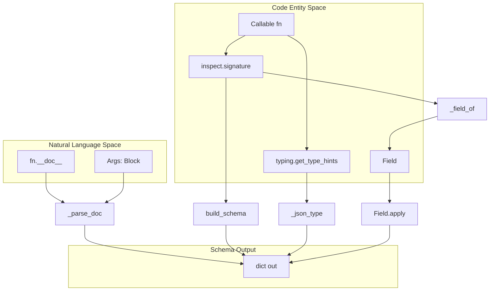
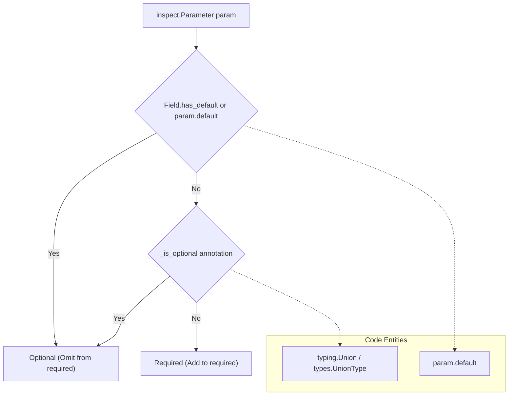

<!-- source: DeepWiki mcp.deepwiki.com · repo cactus-compute/needle · page 2.2 Tool Schema Generation · fetched 2026-10-27 -->

# Tool Schema Generation

Relevant source files

The following files were used as context for generating this wiki page:

- [needle/agent/tools.py](needle/agent/tools.py)
- [tests/test_inference.py](tests/test_inference.py)
- [tests/test_tools.py](tests/test_tools.py)

Tool schema generation in `needle` is implemented in `needle/agent/tools.py` and handles the introspection of Python code entities—functions, classes, and Pydantic models—to produce structured JSON schemas. These schemas are used by the underlying inference engine to constrain model generation grammar and ensure valid tool calls.

## Purpose and Scope

This page documents the internal mechanics of schema compilation in `needle`, covering the `Field` constraint class, type mapping rules, PEP 604 and `typing.Union` handling, docstring parsing, Pydantic model integration, and the `build_schema` introspection pipeline.

Sources: [needle/agent/tools.py:1-171]()

## The `@tool` Decorator and Schema Construction

The schema generation pipeline inspects Python callables to extract metadata, types, and constraints. This process is driven by `build_schema(fn)` [needle/agent/tools.py:120-151]().

### Data Flow: Function to Schema

1. **Signature Introspection**: `inspect.signature` identifies function parameters and default values [needle/agent/tools.py:121]() while `typing.get_type_hints` resolves type annotations [needle/agent/tools.py:123]().
2. **Docstring Parsing**: `_parse_doc` extracts high-level function descriptions and argument descriptions from Google-style `Args:` blocks [needle/agent/tools.py:104-118]().
3. **Type Mapping**: `_json_type` converts Python type annotations into corresponding JSON schema types [needle/agent/tools.py:57-86]().
4. **Constraint Application**: `_field_of` extracts `Field` definitions from `typing.Annotated` or parameter defaults [needle/agent/tools.py:89-101](), and `Field.apply` injects validation keywords into the property schema [needle/agent/tools.py:36-49]().

**Diagram: Tool Introspection Pipeline**

Sources: [needle/agent/tools.py:57-151]()

## Type Mapping and the `Field` Class

`needle` maintains an explicit mapping between Python scalar/container types and JSON Schema types via the `_JSON_TYPES` dictionary [needle/agent/tools.py:8-9]().

| Python Type | JSON Type | Notes |
| :--- | :--- | :--- |
| `str` | `string` | Default fallback [needle/agent/tools.py:8-9](), [needle/agent/tools.py:58-59]() |
| `int` | `integer` | [needle/agent/tools.py:8-9]() |
| `float` | `number` | [needle/agent/tools.py:8-9]() |
| `bool` | `boolean` | [needle/agent/tools.py:8-9]() |
| `list` / `typing.List` | `array` | Recursively resolves nested items [needle/agent/tools.py:77-79]() |
| `dict` / `typing.Dict` | `object` | [needle/agent/tools.py:80-81]() |
| `enum.Enum` | `string` / scalar | Extracts `enum` member values [needle/agent/tools.py:66-69]() |
| `typing.Literal` | `string` / scalar | Extracts literal values as `enum` [needle/agent/tools.py:73-76]() |

### The `Field` Class
The `Field` class enables developers to specify validation constraints (such as numeric ranges, string patterns, or descriptions) either as a parameter default or wrapped inside `typing.Annotated` [needle/agent/tools.py:18-32](). The `Field.apply` method maps these attributes to standard JSON Schema keys (`minimum`, `maximum`, `exclusiveMinimum`, `exclusiveMaximum`, `multipleOf`, `minLength`, `maxLength`, `pattern`, `format`, `minItems`, `maxItems`, `uniqueItems`, `const`) [needle/agent/tools.py:36-49]().

Sources: [needle/agent/tools.py:8-50](), [needle/agent/tools.py:57-86]()

## Optionality and Required Fields

A parameter is added to the `required` list of the generated JSON schema unless it satisfies one of the omission criteria [needle/agent/tools.py:142-143]().

1. **Default Value**: The parameter has a Python default or a `Field` with a default value [needle/agent/tools.py:139-141]().
2. **Optional Annotation**: The parameter type annotation is recognized as optional via `_is_optional`, which checks for `typing.Union` or PEP 604 union origins (`_UNION_ORIGINS`) containing `type(None)` [needle/agent/tools.py:11-13](), [needle/agent/tools.py:52-54]().

**Diagram: Required Argument Logic**

Sources: [needle/agent/tools.py:11-15](), [needle/agent/tools.py:52-55](), [needle/agent/tools.py:139-146]()

## Pydantic Model Integration

`needle` supports complex nested object definitions through Pydantic models via `pydantic_schema(model)` [needle/agent/tools.py:160-170]().

- **Model Detection**: `_is_pydantic_model(obj)` inspects the class Method Resolution Order (MRO) for a base class named `BaseModel` residing in a module starting with `pydantic` [needle/agent/tools.py:154-158]().
- **Schema Generation**: `pydantic_schema` invokes `model_json_schema()` (for Pydantic v2) or falls back to `schema()` (for Pydantic v1) [needle/agent/tools.py:161](). It preserves properties, required fields, and definitions (`$defs` or `definitions`) [needle/agent/tools.py:162-165]().

Sources: [needle/agent/tools.py:154-170]()

## Docstring Parsing

Docstring introspection is implemented in `_parse_doc(doc)`, which parses Google-style docstrings using regular expressions [needle/agent/tools.py:104-118]().

- **Section Headers**: Scans for lines matching case-insensitive argument headings such as `args:`, `arguments:`, `parameters:`, or `params:` [needle/agent/tools.py:108]() to separate the general tool description from argument descriptions.
- **Parameter Extraction**: Uses the regular expression `\s+(\w+)\s*(?:\([^)]*\))?\s*:\s*(.+)` to extract parameter names and their associated documentation while gracefully handling optional type annotations inside parentheses [needle/agent/tools.py:114]().

Sources: [needle/agent/tools.py:104-118]()

---

