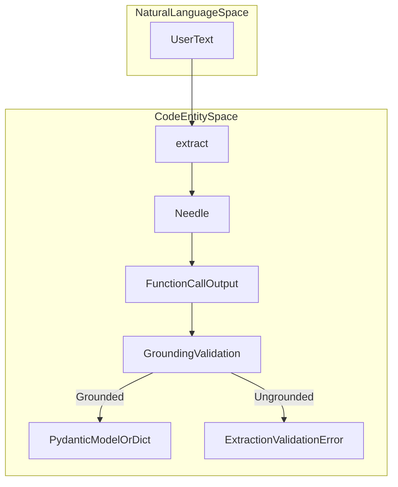
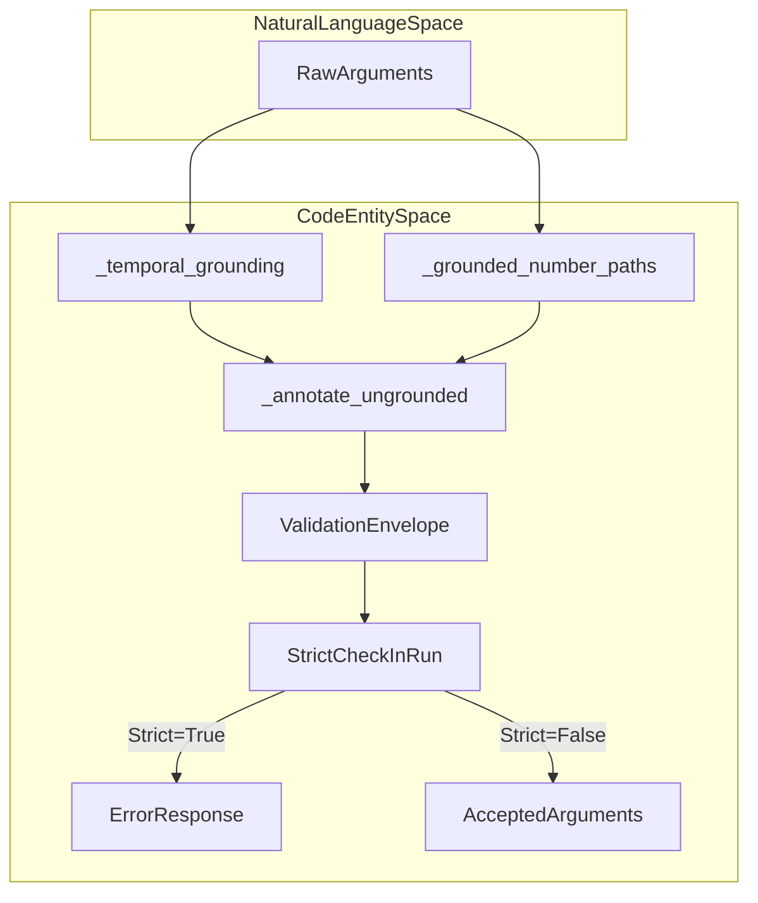

<!-- source: DeepWiki mcp.deepwiki.com · repo cactus-compute/needle · page 2.3 Grounding, Confidence and Extraction · fetched 2026-10-27 -->

# Grounding, Confidence and Extraction

Relevant source files

The following files were used as context for generating this wiki page:

- [.github/workflows/publish-component.yaml](.github/workflows/publish-component.yaml)
- [needle/__init__.py](needle/__init__.py)
- [tests/test_grounding.py](tests/test_grounding.py)

## Purpose and Scope

This page details the grounding validation subsystem, calibrated confidence gating, structured extraction via `extract()`, and the handling of suppressed or ungrounded calls in `cactus-needle`. The grounding subsystem ensures that model outputs (such as dates, numbers, and string arguments) are verifiably derived from the input text or system context, preventing hallucinations. Calibrated confidence gating decides whether a tool call should proceed automatically or be withheld into `suppressed_calls`.

Sources: `needle/__init__.py:21-23` [needle/__init__.py:21-23](), `tests/test_grounding.py:95-207` [tests/test_grounding.py:95-207]()

---

## 1. Structured Extraction via `extract()`

Structured extraction converts unstructured text into a typed Pydantic model or a dictionary using `needle.extract()`. Under the hood, `extract()` registers the target schema as the sole tool, executes inference, and validates grounding against the input text.

### Key Behaviors of `extract()`
- **Schema Translation**: Accepts a Pydantic model class, returning an instantiated model instance, or a raw schema/dict returning a Python dictionary [tests/test_grounding.py:47-60]().
- **Weights Inheritance**: The `weights` parameter selects a tuned `.cact` file, defaulting to whatever model weights the engine currently has loaded [needle/__init__.py:127-136]().
- **Number and Date Parsing**: Handles thousands separators in numbers and parses date fields while enforcing grounding checks [tests/test_grounding.py:137-157]().
- **Validation Errors**: Raises `ExtractionValidationError` if required fields or numbers are fabricated and fail grounding validation [needle/__init__.py:21-23](), [tests/test_grounding.py:159-171]().

Sources: `needle/__init__.py:21-23` [needle/__init__.py:21-23](), `tests/test_grounding.py:47-207` [tests/test_grounding.py:47-207]()

---

## 2. Grounding Validation Subsystem

The grounding validation subsystem inspects generated tool arguments against the input conversation and system facts to detect hallucinations or contradictions.

### Validation Mechanics
- **Temporal Grounding (`_temporal_grounding`)**: Flags dates in tool arguments that contradict or lack support in the input text or system context [tests/test_grounding.py:95-147](). Years lacking any mention in the text or system facts trigger ungrounded annotations [tests/test_grounding.py:95-147]().
- **Number Paths (`_grounded_number_paths`)**: Verifies that numerical values and quantities originate from substrings in the prompt [tests/test_grounding.py:175-207]().
- **Annotation (`_annotate_ungrounded`)**: Populates the `validation.ungrounded` list with dot-notation paths (e.g., `Invoice.due_date`, `set_thermostat.temperature`) [tests/test_grounding.py:75-87]().
- **Execution Policy (`strict` flag)**: During agent execution (`run()`), ungrounded calls are intercepted and returned as error objects (`{"error": "ungrounded ..."}`) unless `strict=False` is explicitly passed [tests/test_grounding.py:159-171]().

Sources: `tests/test_grounding.py:75-207` [tests/test_grounding.py:75-207]()

---

## 3. Calibrated Confidence Gating and `suppressed_calls`

The engine computes a calibrated confidence score for every prediction. When confidence falls below established thresholds or a grounding violation occurs, the execution pipeline handles the output defensively.

- **Confidence Score**: Reported as a float in `[0, 1]` under the `"confidence"` response key [tests/test_grounding.py:75-79](). Tuned weights loaded via `weights=...` emit warnings if scores are uncalibrated [needle/__init__.py:127-136]().
- **`suppressed_calls`**: When confidence drops below thresholds or the grounding gate trips, the engine withholds the function call from `function_calls` and populates `suppressed_calls` instead [tests/test_grounding.py:75-79](). Applications can present suppressed calls to users for explicit confirmation or treat the turn as a refusal.

Sources: `needle/__init__.py:127-136` [needle/__init__.py:127-136](), `tests/test_grounding.py:75-79` [tests/test_grounding.py:75-79]()

---

## 4. Test Suite Coverage (`tests/test_grounding.py`)

The grounding and extraction behaviors are verified extensively in `tests/test_grounding.py`. Key unit tests cover:
- Detecting date contradictions against input strings [tests/test_grounding.py:95-103]().
- Permitting grounded dates and relative dates anchored by system facts [tests/test_grounding.py:105-113](), [tests/test_grounding.py:173-181]().
- Enforcing `strict=True` vs `strict=False` handling during agent runs [tests/test_grounding.py:159-171]().
- Clearing thousands-separated numbers and rejecting fabricated monetary or numeric amounts during extraction [tests/test_grounding.py:137-157]().

Sources: `tests/test_grounding.py:95-207` [tests/test_grounding.py:95-207]()

---

