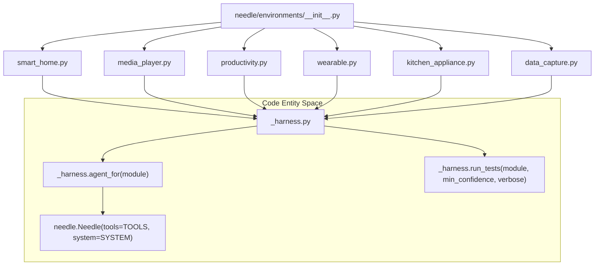
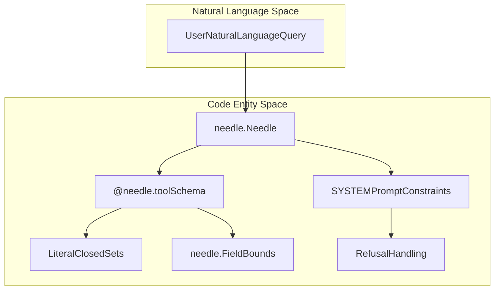
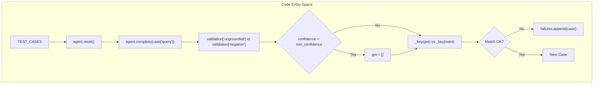

<!-- source: DeepWiki mcp.deepwiki.com · repo cactus-compute/needle · page 2.4 Prebuilt Environments · fetched 2026-10-27 -->

# Prebuilt Environments

<details>
<summary>Relevant source files</summary>

The following files were used as context for generating this wiki page:

- [needle/environments/__init__.py](needle/environments/__init__.py)
- [needle/environments/_harness.py](needle/environments/_harness.py)
- [needle/environments/data_capture.py](needle/environments/data_capture.py)
- [needle/environments/kitchen_appliance.py](needle/environments/kitchen_appliance.py)
- [needle/environments/media_player.py](needle/environments/media_player.py)
- [needle/environments/productivity.py](needle/environments/productivity.py)
- [needle/environments/smart_home.py](needle/environments/smart_home.py)
- [needle/environments/wearable.py](needle/environments/wearable.py)
- [tests/test_environments.py](tests/test_environments.py)

</details>


## Purpose and Scope

The `needle/environments` package provides a set of hand-curated tool surfaces, system prompts, and frozen acceptance test suites designed for constrained decoding on microcontrollers and edge hardware. Each environment models a specific domain—`smart_home`, `media_player`, `productivity`, `wearable`, `kitchen_appliance`, and `data_capture`—enforcing rigorous structural rules: closed sets via `Literal` types, strictly bounded numeric ranges, verbatim text extraction, and a limit of five tools or fewer per environment.

This page details the implementation of `needle/environments`, the conventions governing `TOOLS` and `SYSTEM` definitions, the acceptance test harness (`_harness.py`), and patterns for adapting these environments to custom products.

Sources: `needle/environments/__init__.py:1-14` [needle/environments/__init__.py:1-14]()

---

## Environment Architecture and Subsystems

The `needle.environments` module acts as a dynamic registry for domain-specific agent configurations. It uses lazy module loading via `__getattr__` to avoid unnecessary initialization overhead when importing specific environments.


*Diagram: Architecture bridging environment modules to the shared test harness.*

Sources: `needle/environments/__init__.py:16-45` [needle/environments/__init__.py:16-45](), `needle/environments/_harness.py:8-47` [needle/environments/_harness.py:8-46]()

---

## Design Conventions: TOOLS and SYSTEM

Every prebuilt environment adheres to strict design invariants to ensure deterministic, safe constrained decoding:

1. **Tool Limit**: Environments define no more than five tools (`TOOLS = [...]`) to keep state spaces compact and fit within embedded memory constraints [tests/test_environments.py:26-28]().
2. **Closed Sets (Enums)**: Categorical choices (rooms, categories, actions) are strictly typed using `Literal` or `Enum` equivalents so the engine can restrict token generation paths [needle/environments/smart_home.py:16-16](), [needle/environments/wearable.py:14-14]().
3. **Numeric Bounds**: All numeric arguments (`int`, `float`) are annotated with explicit range constraints using `needle.Field(ge=..., le=...)` or regex patterns [needle/environments/data_capture.py:33-35]().
4. **Verbatim Copying**: System prompts explicitly instruct the model to copy strings word-for-word from user input rather than paraphrasing or resolving them [needle/environments/productivity.py:83-84]().
5. **Refusal & Ambiguity Handling**: The `SYSTEM` prompt mandates that unsupported, incomplete, ambiguous, or negated requests return zero function calls [needle/environments/kitchen_appliance.py:71-71]().


*Diagram: Bridging natural language input to code entity validation rules.*

Sources: `needle/environments/smart_home.py:1-8` [needle/environments/smart_home.py:1-8](), `needle/environments/productivity.py:83-84` [needle/environments/productivity.py:83-84]()

---

## The Acceptance Suite (`_harness.py`)

The acceptance test harness (`needle/environments/_harness.py`) runs frozen test suites against the model to verify regression resistance across six distinct query categories.

### Test Categories
Test cases (`TEST_CASES`) in each environment are categorized into:
* `positive`: Valid requests that should produce exact tool calls.
* `missing`: Requests missing required arguments or parameters (must return no calls).
* `irrelevant`: Out-of-domain requests (must return no calls).
* `negation`: Explicitly negated actions e.g. *"don't turn on the lights"* (must return no calls).
* `invalid`: Requests violating bounds or enum constraints (must return no calls).
* `parallel`: Multi-intent requests requiring multiple tool calls.

### Execution Flow (`run_tests`)


*Diagram: Execution flow and validation mapping inside _harness.py.*

The `run_tests()` function evaluates model responses against expected outputs (`want`), accounting for confidence gating and grounding validation:

```python
def run_tests(module, min_confidence=0.0, verbose=True):
    agent = agent_for(module)
    failures, critical_failures = [], []
    for case in module.TEST_CASES:
        agent.reset()
        response = agent.complete(case["query"])
        got = response.get("function_calls") or []
        validation = response.get("validation") or {}
        if got and (validation.get("ungrounded") or validation.get("negation")):
            got = []
        if got and response.get("confidence", 0.0) < min_confidence:
            got = []
        want = case["calls"]
        # Comparison logic...
```
Sources: `needle/environments/_harness.py:15-47` [needle/environments/_harness.py:15-46](), `tests/test_environments.py:8-10` [tests/test_environments.py:8-10]()

---

## Adapting Environments

To adapt a prebuilt environment (e.g., `smart_home` or `wearable`) to a custom product:
1. **Modify Literal Enums**: Replace stock rooms, sender names, or categories with the exact inventory supported by your device firmware or backend API [needle/environments/smart_home.py:16-16](), [needle/environments/wearable.py:14-14]().
2. **Preserve Structural Shapes**: Maintain the function signatures, argument types, and bounding constraints (`ge`, `le`, `pattern`). Changing parameter types can invalidate constrained decoding masks.
3. **Update Test Cases**: Adjust `TEST_CASES` to match your new domain entities while keeping the categorization (`positive`, `missing`, `negation`, etc.) intact to preserve safety coverage.
4. **Run Validation**: Execute the acceptance suite via `python -m needle.environments` or pytest (`pytest tests/test_environments.py`) to verify regressions [needle/environments/__init__.py:40-45](), [tests/test_environments.py:59-65]().

Sources: `needle/environments/__init__.py:11-14` [needle/environments/__init__.py:11-14](), `tests/test_environments.py:20-65` [tests/test_environments.py:20-65]()

---

